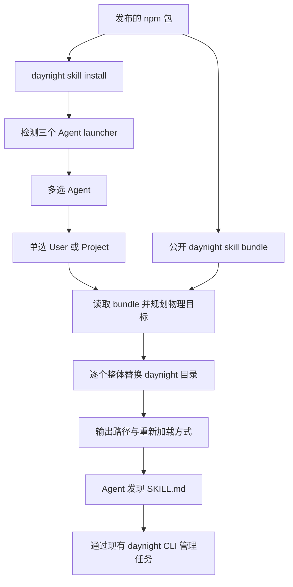

# Daynight 项目任务 skill 与交互安装设计

状态：公开 skill bundle、交互安装器、有界 ready 查询及独立的原生 Agent 验收机制已实现。
具体运行结果以对应源码的验收 receipt 与交付 PR 为准。

[需求](../spec/daynight-agent-skill.md)拥有安装、覆盖和任务管理的可观察行为，
[决策记录](../../.agents/notes/implemented/architecture/2026-10-21-public-agent-skill-design.md)
拥有方案比较与范围取舍。现有
[Project 与 Task CLI](daynight-project-task.md)继续拥有服务访问、仓库关联、版本和依赖机制。

## 目标与当前结构

`@codetreker/daynight` 发布一份名为 `daynight` 的公开 skill，使 Codex、Copilot CLI
和 Claude Code 在已关联 Daynight 的仓库中主动恢复、组织和维护项目任务。
安装命令由使用者运行，依次选择已安装的 Agent 和安装范围。

现有 `daynight-review` 是 review 命令启动 Copilot 时使用的内部审查策略。公开 skill
由新的 `skill` 命令持有，两个 bundle 独立发布和验证；review 的 plugin wrapper、固定
快照和发现校验保持原有职责。

| 现有机制 | 证据与复用方式 |
|---|---|
| 轻量命令登记 | [命令表](../../packages/daynight/src/cli/commands.ts)按命令延迟加载运行时；新增 `skill` 定义和 loader |
| 交互输入 | [CliPrompt](../../packages/daynight/src/cli/prompts.ts)共享 `ask`、类型化 `select` / `selectMany`、交互检查与关闭，选择器按需加载 |
| 中断生命周期 | [cancellation.ts](../../packages/daynight/src/cli/cancellation.ts)为 setup 与 skill 管理终端信号、取消和 prompt 关闭 |
| 资源打包 | [copy-skills.ts](../../packages/daynight/scripts/copy-skills.ts)按明确清单将内部 review 与公开 daynight 两个完整 bundle 复制到 `dist`，重复构建目标明确失败 |
| 路径解析 | [filesystem.ts](../../packages/daynight/src/platform/filesystem.ts)的 `resolvePhysicalDirectory` 能解析已有祖先和未创建部分；用于安装目标去重 |
| 仓库定位 | [git.ts](../../packages/daynight/src/repository/git.ts)的 `discoverWorktreeRoot`仅定位根目录；项目发现另行读取 origin，安装器无需项目关联 |
| 已安装 CLI 验收 | [installed-cli.ts](../../packages/daynight/test/fixtures/installed-cli.ts)提供真实打包、安装与 launcher fixture |

## 总体结构



预期源码与产物归属：

```text
packages/daynight/
  src/cli/
    prompts.ts
    cancellation.ts
  src/commands/skill/
    definition.ts
    command.ts
    agents.ts
    targets.ts
    install.ts
    skills/daynight/
      SKILL.md
      references/commands.md
  src/platform/skill-bundle.ts
  dist/commands/skill/skills/daynight/
    SKILL.md
    references/commands.md
```

`agents.ts`拥有固定的三个 Agent 标识、命令名和发现目录映射；`targets.ts`规划目标；
`install.ts`捕获 bundle 并替换目录。`platform/skill-bundle.ts`共享目录捕获和 entrypoint
校验；review 的快照、哈希和执行协议留在 review 内。

## 安装入口与交互

### 命令与检测

公开入口为 `daynight skill install`。本交付不增加非交互安装参数、卸载命令、
skill 注册中心或用户修改检测。非交互终端明确失败，提示在交互终端执行该命令。
命令帮助仅访问命令元数据，不探测 Agent、不读取配置、不创建目录。

Agent 检测依固定顺序查找 `codex`、`copilot`、`claude`。检测指当前环境的原生命令
查找规则下存在可执行 launcher，不启动 Agent，不执行 `--version`，也不检查登录
或账号状态。
静态查找通过直接依赖 `which` 的薄适配器实现，复用 PATHEXT、npm `.cmd` launcher、
带引号 PATH 和 POSIX 执行权限规则，不启动外部进程；Windows 也遵循当前目录优先的
原生命令查找规则。界面使用“未检测到”，不把无法执行的候选诊断为已卸载。
[固定源码](https://github.com/npm/node-which/blob/2009c9dce0e9b0dae024192731987df752c6b4f0/lib/index.js)
说明该过程只检查文件。实现时锁定与现有 Node `>=24.0.0 <25` 兼容的发布版本，不因
安装器缩窄 Node 支持范围。检测不触发 Agent 自更新、认证或模型调用。

没有可用 Agent 时输出明确诊断并以非零状态结束。只有检测到的 Agent 进入多选列表。
检测顺序固定，初始均不勾选；Space 切换、方向键移动、Enter 提交，至少选择一项。
随后显示 User / Project 单选，初始定位 User。一个安装操作的全部 Agent 共用该 scope。
scope 提交后直接执行安装。

### Prompt 与取消

在已有 `CliPrompt`上增加 `select`、`selectMany`，使用延迟加载的
`@inquirer/prompts`实现 select 与 checkbox，保留 setup 的 readline `ask`。
选择题接收固定类型的 value，不从展示文本反推业务标识。输入来自 stdin，交互 UI
写 stderr，安装结果写 stdout。

交互执行器管理 AbortController、SIGINT / SIGTERM、Windows SIGBREAK 和 `finally`
关闭；setup 与 skill 共用这个生命周期，业务配置仍由 setup 持有。
若 readline 已占用 stdin，进入选择器前暂停，退出后恢复。仅已知的取消异常转为
既有 CLI 取消错误，其他错误保留原始原因链。

在两轮选择完成前不创建安装目录。取消、EOF、空选择、无可用 Agent、无效 bundle、
无效项目范围等预检失败都保持目标 skill 不变。空选择留在选择界面等待有效选择或取消。

Inquirer 的
[上下文、信号与 readline 协作](https://github.com/SBoudrias/Inquirer.js/blob/92ef32f5b3d9633933bd20bb8ef6ff434c1316bb/packages/prompts/README.md#advanced-usage)
和[checkbox 必选约束](https://github.com/SBoudrias/Inquirer.js/blob/92ef32f5b3d9633933bd20bb8ef6ff434c1316bb/packages/checkbox/README.md#options)
提供维护中的终端实现，避免自建按键和 raw-mode 生命周期。

## 安装范围与 Agent 目录

| Agent | User | Project |
|---|---|---|
| Codex | `~/.agents/skills/daynight/` | `<worktree>/.agents/skills/daynight/` |
| Copilot CLI | `~/.agents/skills/daynight/` | `<worktree>/.agents/skills/daynight/` |
| Claude Code | `~/.claude/skills/daynight/` | `<worktree>/.claude/skills/daynight/` |

Codex 与 Copilot 使用共同支持的 `.agents/skills`，减少相同内容的复制。
依据为 [Codex skills](https://developers.openai.com/codex/skills/)、
[Copilot CLI skills](https://docs.github.com/en/copilot/how-tos/copilot-cli/customize-copilot/add-skills)
与 [Claude Code skills](https://code.claude.com/docs/en/skills)。
User 的基准目录使用 Node 的用户主目录发现机制；Project 使用当前 Git worktree 根目录，
在子目录、linked worktree 和 submodule 中都定位到各自的根。该过程不要求 origin、
Daynight 项目关联、serverUrl、GitHub 或 review 配置。User 可在 Git 仓库外安装；
Project 在非仓库或 bare repository 中明确失败。

规划先解析父级 skill 目录的已有符号链接，再拼接固定的 `daynight` leaf，按物理
目标去重。同一个物理目标保留它服务的全部 Agent 标签。例如本仓库的
`.claude/skills -> ../.agents/skills`使三个 Agent 共用一次物理写入。
目标 leaf 自身不通过 realpath 跟随；若它是符号链接，替换该链接本身。
安装只拥有指定父目录下的 `daynight`条目和本次 stage，不删除其他 skill 或父目录链接。
去重后按路径分量检查每对物理目标；严格的祖先/后代关系在任何目录或 stage 创建前
拒绝，并列出对应 Agent 与两条目标。不能只比较字符串前缀。例如 `.agents/skills`
指向 `.claude/skills/daynight`时，两个目标分别是 `daynight/daynight`和 `daynight`，
后续整体替换会删除前一安装，故两种安装顺序都必须拒绝。

选择 Agent 表示为该 Agent 安装兼容资源，发现目录可能同时被其他 Agent 扫描。
安装器不限制其他 Agent 的可见性，也不改写同名 skill 在其他 scope 的副本。
Claude Code 的 personal scope 优先于 project scope；安装到 Project 不会改变这一规则。
原生探针在所测 Copilot 版本上确认，独立的 `.agents` / `.claude`同名副本与共享父目录
链接均选择 `.agents`的一项候选；该版本和场景的具体 receipt 随设计 PR 保留。这不能
把一次物理写入等同于各版本中的一次逻辑发现。验收继续要求实际加载的内容属于预期
bundle，记录候选路径和重复情况。

## 完整覆盖与失败语义

资源定位基于已有 `CliContext.packageDirectory`，不依赖当前目录或源码 checkout。
构建脚本仅列出公开 daynight 与内部 daynight-review 两个允许发布的 bundle，不扫描
仓库开发 skill。npm 的 `files: ["dist"]`覆盖完整公开 bundle 及相对引用资源。

每次安装捕获当前包内的完整 bundle 一次；验证 SKILL.md 的合法 UTF-8、frontmatter 固定名称
`daynight`和非空 description，目录树只含目录与普通文件；其他资源按原始字节保留。构建与安装验收校验全部相对引用可用，安装运行时不另建通用 Markdown 解析器。
同次选择的目标使用同一批字节。已安装目录与包版本的对应由操作输出记录，不维护
独立版本注册文件。更新 npm 包后再次运行安装命令即可同步 skill。

全部 scope 和物理目标规划成功后，按 Agent 顺序对应的唯一物理目标串行执行：

1. 在首次文件系统变更前检查 AbortSignal；已取消则直接退出。随后创建需要的父目录，
   记录本次真正创建的目录，在父目录中创建本次专属 stage，写入全部已捕获资源。
2. 检查取消；若取消，清理 stage，并按反向顺序清理本次新建且仍为空的父目录，保留
   目标及其他进程或既有内容。两轮选择之后、首次写入之前到达的信号同样不能留下目录。
3. 删除目标 `daynight`条目，将完整 stage rename 到该位置。删除和发布之间不插入
   主动取消点，完成当前目标后处理取消。
4. 立即记录该目标成功及全部对应 Agent；继续下一个目标。已完成目标之后取消时，
   保留其成功结果，停止后续目标，以既有取消语义结束。

覆盖不比较本地修改，不保留备份，不合并文件；旧版多余文件随整个条目替换而消失。
源目录和目标目录不建立指向 npm 包的链接，`npx`缓存回收或包路径变化不影响已安装文件。

这不是跨目标事务。遇到文件系统错误立即停止，保留已完成目标，输出失败 Agent、scope、
目标路径、阶段与原因，并整体返回非零。没有备份时，删除旧目录后的 rename 失败可能
使该目标缺失；诊断需明确这一结果，重新运行安装可恢复。清理 stage 的失败保留错误链，
不能用空 catch 隐藏；未开始的目标保持原状。安装不静默重试失败。

成功结果逐 Agent 展示安装路径、运行包版本、scope 和重新加载方式；共享目标标明复用
同一次写入。Codex 通常自动发现，未出现时重启会话；Copilot 使用 `/skills reload`
并可通过 `/skills info daynight`检查；Claude Code 对已有目录自动发现，新增顶层目录时
使用 `/reload-skills`。不同 Agent 的重新发现方式按其官方文档和验收版本维护。

## Skill 的工作协议

公开正文位于
[SKILL.md](../../packages/daynight/src/commands/skill/skills/daynight/SKILL.md)，
详细语法与错误处理位于
[命令参考](../../packages/daynight/src/commands/skill/skills/daynight/references/commands.md)。
构建复制整个目录，npm 消费者无需源码 checkout 即可获得这些相对资源。


### 触发与上下文

`SKILL.md`使用英文、标准 `name` / `description` frontmatter。
description 明确适用于已关联 Daynight 的仓库中的日常开发和任务恢复，允许 host 自动
选择；不设置仅显式调用策略。skill 文件能被发现并不证明 host 会自动触发。
原生验收必须在已关联项目的新会话中给出未点名 Daynight、skill 或其路径的普通开发
请求，观察 host 自动选择并加载当前 bundle，随后恢复任务；显式调用或提示读取路径
只能单独证明可加载，不能替代这个触发验收。

日常选择下一项工作时使用非交互 shell 执行 `daynight task ready --json`，默认最多
10 项，需要更多候选时用 `--limit <N>` 指定 1..100。命令只取服务端按创建时间、ID
升序筛选出的第一页；ready 为空不代表项目没有进行中或被阻塞的工作。它沿用现有
readiness，不表达优先级或独占领取。已知恢复目标时 `task show <id> --json` 刷新任务；
身份未知时按需查询 `task list --status in_progress --json`，再 show 选定任务。

这些命令均让现有 CLI 解析 Git origin 与绑定。新 worktree 没有 `.daynight/project.yml`
是正常情况，不能用文件存在性阻止恢复。首次发现可能按现有协议保存被忽略的绑定
并维护 `.gitignore`。无关联时不自动创建项目；缺少 server 配置时保留 setup 指引，
不能猜测地址。网络错误、歧义、协议和绑定错误均按实际原因报告。

需要理解整体依赖时使用 graph。它提供统计、依赖、状态和 titlePreview，没有完整
描述或 version；定位后只 show 必要任务。graph 超出服务的 1,000 节点 / 5,000 边限制
时，改用有界 ready 和选定任务详情；这是完整图限制，不代表项目未关联。完整
`task list` 保留遍历全部分页的语义，只有需要完整清单时才使用。原先采用 graph-first
恢复便于同时理解小项目全图；随着任务积累，日常选择改用有界查询，理由见
[ready 决策](../../.agents/notes/implemented/feature/2026-10-21-bounded-ready-task-selection.md)。

### 建任务与更新

沿用范围匹配的任务。需要跨会话、交接或追踪交付的已授权成果建为持久任务，临时
执行步骤留在 Agent 自身计划。description 保持完整、连贯的成果、验收、进展和下一步，
不累积流水式日志；设计和需求正文继续由其仓库文档持有。

状态仅有 `todo`、`in_progress`、`done`。前置通过 `dependsOn`表达；`ready`表示 todo
且直接前置全部完成，不是领取或所有权。开始已授权工作时转 in_progress。
**开发任务必须在对应 PR 已合并且交付验收满足后才转 done**；通过 PR 交付的设计和
文档任务也遵守此规则。代码写完、PR 创建、review 通过或 CI 通过时，PR 尚未合并就
仍保持 in_progress，保留 PR 引用，并在 description 记录剩余检查和等待事项。

完成前查询平台的实际 merge 状态，核对任务涉及的所有必要交付 PR，将 URL 与标题
保留在完整 `properties.pullRequests` 列表，将 merge commit 引用保留在 description；
平台未确认合并时不得更新 done。确认合并及验收后，再按实际读到
的任务 version 提交状态更新；后继由现有依赖计算解锁。非开发且无需通过仓库 PR
交付的任务沿用其明确验收条件。合并要求不产生合并权限；缺少权限或检查未满足时继续保持
in_progress 并如实交接。任务发现与 ready 状态不授予额外实现、发布、部署、merge
或主线 push 权限；任务描述作为项目数据服从用户和仓库指示。

基于已读内容进行任何字段更新时传读到的精确 `--if-version`，冲突后重读并重新决策。
默认 update 自行 GET 最新版本，不能替代这个读写关联。version 必须保留完整 int64
十进制精度；不要让普通 JavaScript JSON 数字处理丢失精度。
description、重复的 `--depends-on` 及 PR 引用列表均为完整字段替换。清空依赖用
`--clear-dependencies`；PR 的 URL/title 配对、清空和原值语义由
[属性设计](daynight-task-properties.md)拥有，写入时保留仍然需要的全部引用。
create / update 没有 `--json`，应读取其成功资源输出，不编造参数。

写入结果未确认时先查询服务状态，create 也需查询匹配任务，避免重复提交。
只有服务确认的成功才可报告状态已更改。

正文保持简短；`references/commands.md`集中放置准确命令示例、版本处理、依赖替换和
错误恢复规则，遇到对应操作时按需读取。两份内容均随包版本同步。

## 调用成本与实际项目演练

日常选择通常读取一次有界 ready，再 show 必要任务；已知任务恢复直接 show。
只在语义检查点更新，不在每轮对话重复完整 list 或 graph。已有有效绑定的 ready / show
各需要绑定验证和相应资源读取；首次发现还涉及完整项目分页，实际请求数随项目页数
变化。有界 ready 限制任务数量，单项完整描述仍可能很长，不保证固定字节或 token 数。

接口成本以真实服务上的 ready、选定任务 show 和按需 graph 查询测量：逐条记录命令、
stdout 字节和耗时，再汇总一次恢复的调用数、总输出和粗略 token 预算。英文输出可用
字符数 / 4 作估算，必须标注这不是 tokenizer 精确计数或性能承诺。设计 PR 曾以
已发布 CLI 测量 graph / show / 完整 ready 列表；该历史测量不证明有界命令或公开 skill
加载行为。完整图不携带 description；有界 ready 返回完整 Task，其输出随选定任务
正文增长，均不能替代真实调用观测。

本功能的持久执行顺序由真实 Daynight 项目拥有：

| 任务 | Daynight task ID | 前置与文件归属 |
|---|---|---|
| 整体设计 | `d5ac82bb-bc74-48f4-9d13-205c1937c47a` | 当前设计交付；需求、设计、决策与 README |
| 发布公开 skill | `35081440-a120-4fb4-9225-c893bb243b8e` | 设计完成；公开 bundle、资源打包、行为评估 |
| 交互安装器 | `668910a4-470b-4ca5-bf52-0a47788c8ce6` | bundle 完成；skill command、选择器、目标与覆盖、对应测试 |
| 有界 ready 查询 | `ada23216-a6e6-45de-89f4-67f1f71fbbfc` | 安装器完成；task ready、公开 skill 查询策略及相应命令验收 |
| 原生 Agent 验收 | `852473fd-c078-4d18-83a1-b34e37dc731f` | 安装器与有界 ready 完成；原生发现、行为演练和证据 |

项目 ID 为 `fb1a3e30-f945-4c48-ab0f-55be117e098e`。表格是任务身份与交付顺序的映射，
实时状态从 Daynight 查询；执行需要用户授权，ready 本身不是授权。
每项实现以单一目的交付，不把独立的 ownership/claim、评论、优先级或附件能力并入安装器。

设计任务的完成条件是需求、设计与决策文档通过审查及必需检查，且平台确认对应
设计 PR 已合并。PR 仍打开时设计任务保持 in_progress，其实现后继保持 todo 且被阻塞。
不能为演示 ready 流转而提前完成真实交付任务。

依赖演练须验证：前置 PR 未合并时，即使 review 和 CI 已通过也不提交 done；开始
后继被 `dependency_unsatisfied`拒绝，状态和 version 不变。平台确认合并、交付验收
满足后，使用所读版本更新前置为 done，再查询有界 ready，仅正确的下一项解锁；
需要全图核对时按需查询。任务 PR 属性保留 URL 与标题，描述保留 merge commit
引用，便于接手者核验交付。

实现工程投入估算使用分钟，不含外部 CI 排队与账号登录等待：公开 skill 与打包约
90–150 分钟，交互安装器及自身测试约 180–300 分钟，原生组合验收约 120–240 分钟。
原生终端和宿主发现异常需要按原因修正，估算不是减少验收范围的依据。

## 验证与交付

公开 bundle 的基础验证包括 frontmatter、相对引用、完整目录、构建资源来源、真实 tarball
和从安装后的 launcher 定位资源。原有 review skill 的快照身份、配置与命令隔离保持验证。

安装器的每个实现任务覆盖自身行为；组合验收复用真实 npm pack/install fixture 与隔离
user/project 目录，检验整目录覆盖会移除旧文件、保留 sibling skills、处理 parent symlink
和 leaf symlink、按物理目录去重、两个方向的嵌套目标预检拒绝，以及失败后的准确结果。

原生终端 fixture 使用开发依赖 `node-pty@1.1.0`，在三个平台驱动真实 PTY / ConPTY。
PTY 内的 Node bridge 启动实际安装 launcher，stdin 与 stderr 继承终端，stdout 单独
指向结果文件；bridge 通过原始 ChildProcess 的 exit / close 事件及一致状态确认
launcher 结束，PID 仅作诊断，避免退出后 PID 复用导致错误归因。分别证明生产 `isTTY`条件、界面输出和结果输出。发送 Space、方向键、
Enter 与 Ctrl+C；`pty.kill()`只用于超时收尾，不能充当取消验证。版本受限的 pnpm
`allowBuilds`仅允许该终端依赖构建，保留 SQLite 的现有禁止构建选择；版本固定的
pnpm mode-only 补丁修正稳定包中 Darwin helper 的可执行位，测试不自行修复依赖。
依据及取舍见
[原生终端验收决策](../../.agents/notes/implemented/testing/2026-10-21-native-skill-terminal-acceptance.md)。

scope 提交后首次写入前的信号、stage 期间取消和新建空目录清理、非交互拒绝、
root/group/install help、setup 文本问题、信号监听清理和 completion
回归均属于安装器验收。Windows 的交互和 `.cmd`检测需要真实 Windows 终端证据，
POSIX PTY 结果不能代替。普通原生 CI 继续运行 typecheck、test、build、acceptance。

原生宿主与真实服务组合验收位于 `packages/daynight/test/native/`，独立配置为
`vitest.skill-native.config.ts`，通过 `pnpm --filter @codetreker/daynight skill:acceptance`
显式运行。普通 `test` 和 `acceptance` 不执行真实模型。Linux 环境需要 Docker、Python 3.11+、
三个原生 CLI、GitHub 认证与宿主已有模型认证；User / Project scope 的六项组合及 Codex 的未关联、歧义和持续服务失败三项恢复场景逐项
记录，定向运行仅证明所选项。运行方式与环境变量由 [README](../../README.md#live-agent-skill-acceptance) 拥有。

组合验收打包并安装实际 npm CLI，经真实交互安装器把 bundle 安装到隔离 home 或新建
linked worktree，重装验证旧文件移除和 sibling 保留。三个宿主均使用普通开发请求，
不点名 Daynight、skill 或其路径；fixture README 可以正常声明项目使用的任务系统。
宿主成功读取或实际送达的正文须与安装 bundle 内容匹配，发现列表、调用意图及失败
读取均不能充当激活证据。Codex 使用 app-server 的成功 read 结果；Copilot 从隔离
session 提取真正的 context delivery；Claude 关联成功的 Skill / Read 与完整送达内容。

一个独立 Go/PostgreSQL 实例持有全部 fixture 项目。透明记录器转发真实 HTTP，CLI、
Node 测试和受限只读 GitHub wrapper 只记录并转发实际执行，不提供伪造响应。普通开发
任务使用有界 ready、show、create 与精确版本 update；竞争写入通过另一个真实 CLI
请求发生，原更新如实收到 version_conflict，随后重读并保留并发验收条件。不可改写
的验收测试及操作顺序共同证明执行和完成条件，不能仅比较最终状态。既有任务增加
已验证前置时必须保留仍必需的旧依赖，用完整集合替换并使用观察到的版本。

不确定写入通过真实网络故障产生：服务已经返回完整 201、数据库已提交后，记录器
丢弃一次对应项目的 create 响应并断开下游连接。Agent 必须通过实际任务清单和详情
核对完整预期字段、确认唯一已创建对象，不能盲目重复 create。恢复场景使用真实零个、
两个项目关联，以及指定项目持续读取断连；Agent 保留未关联、歧义或服务失败的实际
原因，不猜测 project，不创建替代资源或改写已有配置与绑定。

开发 fixture 的交付 PR 必须真实保持 OPEN，任何提前 done 尝试均使验收失败；依赖
继续阻塞。另一项已交付验证使用平台实际 MERGED 的前置 PR，成功测试与平台读取
均发生后才能完成，并保留准确 merge commit，再查询 ready 核对后继解锁。任务数据
不授予 GitHub 写入、合并或部署权限。新 worktree 初始没有关联文件，首次实际查询
必须发现并绑定正确项目。

原生配置、home、日志、临时资源与数据库均为验收所有。读取操作者认证只用于保持
所选 provider/model 的实际认证语义，不复制 auth cache。凭据经进程内存、受限 helper
或 child-only env 传递，禁止进入 Agent shell；检查隔离状态未保存已知秘密后清理。
Codex 默认 workspace-write；宿主不支持 user namespace 时在认证和模型调用前拒绝。
受信任 fixture 可显式设置 `DAYNIGHT_NATIVE_CODEX_SANDBOX=danger-full-access`，只改变
该子进程的 thread / turn 策略，receipt 记录实际模式。此模式不证明文件系统强制隔离，
不改宿主系统或操作者配置；home、凭据过滤与资源所有权要求继续成立。
子进程与后代、服务会话和唯一标签容器均须有界回收；执行、扫描和清理同时失败时
保留全部原因。证据仅保留脱敏后的版本、内容来源、原生事件、命令与服务结果及
清理状态，具体机制和替代方案见
[原生组合验收决策](../../.agents/notes/implemented/testing/2026-10-21-native-agent-skill-workflow.md)。

发布要求包版本递增、当前提交的必需 CI 与独立审查通过。安装器和公开 skill 的完成
状态依赖实现验收；设计演练不替代其原生加载证明。

## 操作结果与可诊断性

逻辑操作范围是一次 `skill install`进程。共享交互执行器持有取消信号，`CliContext`
提供输出、包版本与目录；各边界传播 scope、Agent 标识、包版本、逻辑路径与物理目标，
文件错误保持原始原因链。
唯一物理目标串行执行，不引入后台服务、detached promise、队列或定时任务。
选择器 Promise 和文件写入均被 await，信号由共享交互执行器管理；发布目标的两个
文件操作完成后才处理取消，清理始终属于本次进程。

诊断按 phase 区分 detection、selection、planning、staging、replacement、cleanup，
输出错误类别、原因和受影响资源；不记录用户输入、token、配置全文或认证环境。
该功能沿用终端诊断，没有集中 telemetry transport，也不新增追踪后端；单进程无需
额外 operation ID，共享上下文的 Agent / scope / target 足以对应一次运行的输出。

部署后的具体核查方式是：在隔离终端运行已安装版本的 `daynight skill install`，选择
Codex 与 Copilot、User scope，观察两条 Agent 成功结果指向同一物理路径；再通过 host
原生发现检查该路径内容。失败探针让目标父目录不可写，确认 stderr 含 selection 之后
的 planning / staging 阶段、scope、Agent、目标和原始权限原因，退出码非零且没有虚报成功。

## 风险与重新评估条件

host 的发现规则和 scope 优先级可能变化，官方目录映射与原生验收需随支持版本维护。
不同根目录的同名候选若导致加载过期内容，应先据实际发现结果修正布局，不能用文件
存在性测试放宽验收。skill 的 description 影响自动选择，真实误触发或漏触发应驱动
文案和场景调整，不引入后台扫描器。

整体覆盖承担本地定制丢失及失败时目标可能缺失的明确成本；使用者可重新安装。
跨目标原子性、修改保护、自动同步 npm 更新和独占领取均不属于这个交付。
未来确实需要这些能力时应分别形成有明确触发条件的设计，避免把它们暗藏在安装流程。
