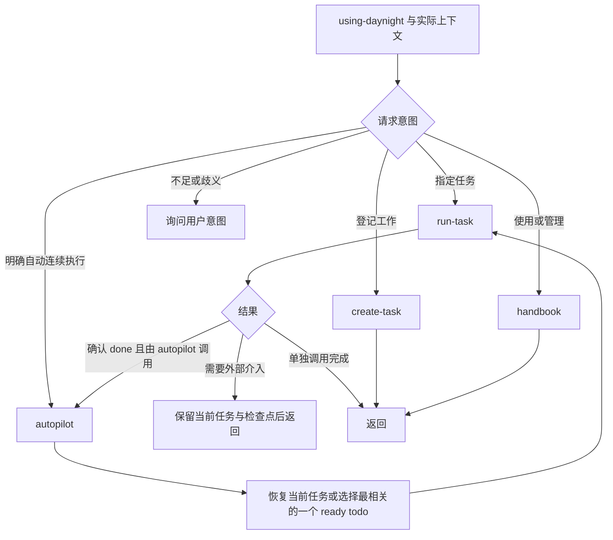

# using-daynight 项目任务 Skill 设计

[需求](../spec/daynight-agent-skill.md)拥有公开行为，
[模式决策](../../.agents/notes/implemented/architecture/2026-10-21-using-daynight-modes.md)
拥有本次职责划分与替代方案；[原分发决策](../../.agents/notes/implemented/architecture/2026-10-21-public-agent-skill-design.md)
保留安装机制的原始理由。[Project/Task CLI](daynight-project-task.md)与
[附件设计](daynight-task-attachments.md)继续拥有服务访问、版本、依赖和文件操作。

## 一个入口与按需加载

npm 包发布一份英文 `using-daynight` skill。`SKILL.md` 只负责发现说明、路由和共同
约束，各模式按需读取自己的引用文档。handbook 提供命令用途索引，以及项目发现、
并发更新等操作背景；参数和调用方法由已安装 CLI 的 `--help` 提供。这样普通查询只需
加载简短背景，连续调度与指定任务执行仍共用完成要求。

```text
packages/daynight/
  src/commands/skill/
    definition.ts
    command.ts
    agents.ts
    targets.ts
    install.ts
    skills/using-daynight/
      SKILL.md
      references/
        handbook.md
        autopilot.md
        run-task.md
        create-task.md
  src/platform/skill-bundle.ts
  dist/commands/skill/skills/using-daynight/
    SKILL.md
    references/
      handbook.md
      autopilot.md
      run-task.md
      create-task.md
```

`using-daynight handbook` 等表达是 Agent 的模式选择协议，不是新增 Daynight CLI。
宿主加载入口后，Agent 使用实际请求与上下文路由。裸调用可能进入任一有充分依据的
模式；上下文不足或歧义时询问意图。autopilot 额外要求用户明确请求自动连续执行，
不能由主题关键词、任务存在或单任务完成推断启动。



skill、任务和附件均不授予额外权限。run-task 的合并完成要求与用户保留 PR 的要求
可以同时成立：完成允许的交付准备，保留 `in_progress` 与等待事项，交回用户审阅。

## 文档职责与任务资料

| 文档 | 所拥有的规则 |
|---|---|
| `SKILL.md` | 触发说明、上下文路由、明确 autopilot、共同授权和单任务约束 |
| `handbook.md` | 命令用途索引与项目定位、查询范围、精确版本、替换和附件独立性等背景 |
| `create-task.md` | 追踪价值、已有任务匹配、资料准备与登记完整性 |
| `run-task.md` | 指定任务恢复、实现验证、交付与完成、阻塞返回 |
| `autopilot.md` | 当前任务恢复、相关性选择、串行循环及停止条件 |

问题放在 task 描述，方案和验收放在一个 Markdown 主附件。描述只保存问题与真实附件
引用；依赖由 `dependsOn` 维护，PR URL/title 由 `properties.pullRequests` 维护。
不在描述中复制方案、验收、依赖或执行日志。主附件使用任务语言的“方案”和“验收标准”
两个必填 section，文件名由任务引用决定。

```text
task.description
  要解决的问题
  已上传附件的实际引用
attachments/
  proposal.md
    方案
    验收标准（含验证方法及完成后的必要证据）
  mockui/index.html       # 前端任务
  mockui/assets/...      # 原型需要的资源
```

前端原型匹配最终视觉、支持纯前端交互，按任务覆盖主要数据与交互状态。方案引用原型，
必要图片、脚本和样式保持相对资源可用。run-task 读取主附件并查看、操作原型，不能仅凭
附件文件名认为已理解方案。完成证据和 merge commit 引用写入主附件对应验收项。
当前执行位置、阻塞、等待和下一步进入会话或项目已有检查点，不引入专用服务字段。

create-task 先判断是否值得持久追踪。单次、trivial 操作和临时命令步骤不建任务；需要
跨会话、交接、依赖或持续追踪的交付成果才登记。已有任务的匹配比较问题、范围、方案
和验收目标。准备所有资料后创建或复用，再用既有附件命令上传、关联、读回核验：

```bash
daynight task attachment put <task-id> ./proposal.md --path proposal.md
daynight task attachment put <task-id> ./mockui/index.html --path mockui/index.html
daynight task attachment list <task-id> --json
daynight task attachment read <task-id> proposal.md
```

实际选项与调用方法查询已安装 CLI 的 help，完整读取与错误契约由附件规范拥有；
handbook 只保留附件独立性与不确定结果核对等背景。这里消费既有附件能力，不扩展 API
或 CLI。成功创建任务但附件失败时，保留同一 ID 补全；写入结果
不确定先查询核对。全部必要资料可读才报告登记完整，未完成登记保持 `todo`。

## 单任务执行与调度

run-task 的输入是明确 task ID。它刷新完整任务、主附件、必要资源，检查授权、依赖和
资料后恢复或开始工作。已完成任务只报告结果；重新打开需要明确意图。开始后保持
`in_progress`，按目标仓库规则实现、验证并完成授权交付。

开发任务和通过 PR 交付的设计、文档任务，必须等全部必要 PR 平台确认合并、验收满足，
保留 PR 属性与验收证据后，才按实际读取版本设置 done。无需 PR 的任务使用自身明确
验收条件。CI、review 和合并等待继续属于当前任务；subagents 协作该任务。阻塞需要
外部介入时保留实际状态与检查点后返回；run-task 完成也返回，不选择后继。

autopilot 只在用户明确要求后运行。当前任务由已有检查点关联并刷新，`in_progress`
清单只是恢复线索，不是所有权。无当前任务时读取有界 `task ready --json`，按问题、
范围、方案、验收和依赖选择与已授权目标最相关的一个 ready todo，再调用 run-task。
只有确认 done 后才开始下一项。外部阻塞保留当前任务；不会为保持忙碌换做无关工作。

ready 默认最多 10 项，必要时使用 1..100 的 `--limit`。服务按创建时间和 ID 升序排序，
顺序不表达相关性。空页和不匹配页不能证明 backlog 完成；按需查询范围相关清单和图，
区分全部交付、依赖阻塞、其他工作进行中及当前候选不足。graph 的 1,000 节点 / 5,000 边
限制不等于项目未关联，详情必须使用 show。普通 task list 仍穷尽匹配分页。

在仓库内可省略 `--project`，由 CLI 按 Git origin URL 匹配服务中的项目；显式指定的
项目优先。handbook 说明项目定位规则，不展开本地绑定文件与忽略规则的内部实现。
无匹配不自动创建项目，配置缺失保留 setup 指引；网络、配置与歧义错误按真实原因处理。

handbook 规定基于已读内容的修改必须携带精确 `--if-version`，包括完整 int64 十进制
精度。默认 update 的临时 GET 不能替代读写关联。description、依赖和 PR 列表是完整字段
替换；冲突后重读并重新决策。未确认写入先核对结果，不自动重复提交；具体选项及
输出格式通过 CLI help 查询。ready、状态及版本机制不提供锁、原子 claim 或额外执行权限。

## 安装命令与既有机制

`daynight-review` 仍是 review runtime 的内部审查资源，其 plugin wrapper、快照、哈希
和发现校验独立。公开 skill 由 `skill` 命令持有，只共享普通 bundle 捕获和校验。

| 机制 | 所在位置与职责 |
|---|---|
| 轻量命令登记 | [命令表](../../packages/daynight/src/cli/commands.ts)延迟加载运行时，帮助只访问元数据 |
| 交互输入 | [CliPrompt](../../packages/daynight/src/cli/prompts.ts)共享 ask/select/selectMany，选择器按需加载 |
| 取消生命周期 | [cancellation.ts](../../packages/daynight/src/cli/cancellation.ts)管理终端信号、取消与关闭 |
| 资源打包 | [copy-skills.ts](../../packages/daynight/scripts/copy-skills.ts)明确列举公开与 review 两个完整 bundle，不扫描仓库 skill |
| 物理路径 | [filesystem.ts](../../packages/daynight/src/platform/filesystem.ts)解析已有祖先和未创建部分 |
| worktree 定位 | [git.ts](../../packages/daynight/src/repository/git.ts)只定位根，安装不依赖 origin 或服务 |
| 打包验收 | [installed-cli.ts](../../packages/daynight/test/fixtures/installed-cli.ts)真实打包安装与 launcher fixture |

入口保持 `daynight skill install`，不增加非交互参数、卸载命令、注册中心或用户修改
检测。`agents.ts` 拥有 Codex/Copilot CLI/Claude Code 的命令、路径、重载说明；
`targets.ts` 规划物理目标；`install.ts` 捕获字节、发布和清理旧名称；
`platform/skill-bundle.ts` 校验资源树与入口。`CliContext.packageDirectory` 定位包内资源，
不依赖 cwd。`files: ["dist"]` 包含完整相对资源。

检测依固定顺序查找 codex、copilot、claude，通过直接依赖 `which` 的薄适配器遵守原生
PATH、POSIX 执行权限、Windows 当前目录/PATHEXT/npm `.cmd`/带引号 PATH；不运行
launcher、`--version`、认证或模型调用。
[固定源码](https://github.com/npm/node-which/blob/2009c9dce0e9b0dae024192731987df752c6b4f0/lib/index.js)
说明它只检查文件。仅展示检测到的选项，初始不勾选，Space 切换、方向键移动、Enter
提交且至少选一项；再单选 User/Project，默认 User。无可用 Agent 或终端不可用明确失败。

`@inquirer/prompts` 延迟加载 checkbox/select，setup 保留 readline ask。类型化 value
不从显示文本反推标识。stdin 提供输入，stderr 负责 UI，stdout 提供结果。共享执行器
管理 AbortController、SIGINT/SIGTERM、Windows SIGBREAK 和 finally 关闭；readline
占用 stdin 时进入选择器前暂停、退出恢复。仅已知取消异常转为既有取消错误，其余保留
原因链。依据为
[信号与 readline 协作](https://github.com/SBoudrias/Inquirer.js/blob/92ef32f5b3d9633933bd20bb8ef6ff434c1316bb/packages/prompts/README.md#advanced-usage)
及[checkbox 必选约束](https://github.com/SBoudrias/Inquirer.js/blob/92ef32f5b3d9633933bd20bb8ef6ff434c1316bb/packages/checkbox/README.md#options)。

## 安装目录、所有权与迁移

| Agent | User | Project |
|---|---|---|
| Codex | `~/.agents/skills/using-daynight/` | `<worktree>/.agents/skills/using-daynight/` |
| Copilot CLI | `~/.agents/skills/using-daynight/` | `<worktree>/.agents/skills/using-daynight/` |
| Claude Code | `~/.claude/skills/using-daynight/` | `<worktree>/.claude/skills/using-daynight/` |

User 使用 Node 用户主目录发现，可在仓库外安装。Project 使用当前 Git worktree 根，
子目录、linked worktree、submodule 各定位自身根；非 Git/bare 明确失败。安装不读取
server/review 配置，不要求 origin 或项目关联。支持目录和重载说明按
[Codex](https://developers.openai.com/codex/skills/)、
[Copilot CLI](https://docs.github.com/en/copilot/how-tos/copilot-cli/customize-copilot/add-skills)、
[Claude Code](https://code.claude.com/docs/en/skills) 维护。

先解析父级 skill 根的物理位置，再拼接 using-daynight 和旧 daynight 叶节点。父级链接
保留，leaf 不 realpath 跟随；替换或清理 leaf 链接保留原指向对象。同一物理根只写一次
并保留逐 Agent 结果；涉及新名称和旧名称的拥有路径出现严格祖先/后代冲突时，在任何
目录或 stage 创建前拒绝，并列出对应目标。路径按分量比较，不能使用字符串前缀。
共享父根链接允许去重；清理不得越过所选物理根或删除另一安装目标。

选择 Agent 表达兼容目标，不承诺发现隔离。Codex 和 Copilot 共用路径；项目中的
`.claude/skills -> ../.agents/skills` 也可使三者共用一次写入。其他 scope 不被修改，
同名副本不合并，Claude personal 优先于 project。原设计的 Copilot 探针曾在特定版本
观察到独立 `.agents`/`.claude` 同名副本与共享父链接均选择 `.agents` 候选，该 receipt
随原设计 PR 保留，仅为历史观察，不是跨宿主版本的保证。

安装先捕获包内完整 bundle 一次，验证 SKILL.md UTF-8、固定 frontmatter 名称
`using-daynight`、非空 description 和仅目录/普通文件的树；其他文件保持原始字节。
构建与验收校验相对引用，运行时不引入 Markdown 解析器。所有目标使用相同捕获字节。

预检后按 Agent 顺序串行处理唯一物理目标：

1. 首次写入前检查取消；创建并记录必要父目录，创建专属 stage，写入全部资源。
2. 再检查取消；取消则删除 stage，逆序清理本次新建且仍为空的父目录。
3. 删除 using-daynight leaf 并 rename stage 发布完整目录；两步之间不主动取消。
4. 发布成功后清理同一物理 skill 根内的旧 daynight leaf，再报告此目标完整成功。
5. 处理取消或继续下一目标。已经完成的目标保留，不跨目标回滚。

发布前不删除旧 daynight，避免重命名迁移先损失原入口。旧名称清理失败时新 bundle
保留，报告部分迁移及实际失败，停止后续目标并非零退出。完整替换不比较修改、不合并、
不备份；覆盖新名称时删除后 rename 失败仍可能使目标缺失。清理 stage 的错误保留
原因链，不能静默吞掉。重跑使用当前包完整恢复，安装不自动重试。

结果逐 Agent 给出 scope、路径、包版本和重载指引，共享目标标明同一次写入。Codex
通常自动发现，必要时重启会话；Copilot 使用 `/skills reload`、
`/skills info using-daynight`；Claude 已有根通常自动发现，新建顶层根时使用
`/reload-skills`。清理旧名称成功不表示其他 scope 的旧入口也被移除。

## 历史任务映射与调用成本

原分发功能在真实 Daynight 项目中使用以下身份，保留其交付顺序；实时状态由服务拥有，
不从表格推断当前执行目标：

| 原任务 | Daynight task ID | 原交付归属 |
|---|---|---|
| 整体设计 | `d5ac82bb-bc74-48f4-9d13-205c1937c47a` | 需求、设计、决策与 README |
| 发布公开 skill | `35081440-a120-4fb4-9225-c893bb243b8e` | bundle、打包、行为评估 |
| 交互安装器 | `668910a4-470b-4ca5-bf52-0a47788c8ce6` | 命令、选择器、目标覆盖与测试 |
| 有界 ready | `ada23216-a6e6-45de-89f4-67f1f71fbbfc` | ready 命令、选择策略与命令验收 |
| 组合安装验收 | `852473fd-c078-4d18-83a1-b34e37dc731f` | 模拟 launcher、六组合与完整资源 |

项目 ID 为 `fb1a3e30-f945-4c48-ab0f-55be117e098e`。这些历史任务不为本次执行授予权限。
原演练要求设计 PR 确认合并前任务保持 in_progress，后继由依赖机制阻塞，不能为了
演示 ready 提前 done。当前同类任务按 run-task 完成规则保存 PR 和附件中的验收证据。

常规选择读取一次有界 ready，再 show 必要任务及读取附件；已知任务直接 show。
只在语义检查点更新，不每轮完整 list/graph。有效绑定的读取仍涉及绑定验证；首次
发现可能读取多页 project。任务数量有界不代表输出字节或 token 固定，附件也会增加
实际读取成本。需要评估时记录真实命令、字节、耗时与总调用数；字符数/4 仅为英文
粗估，不是 tokenizer 计数或性能承诺。原设计对 graph/show/完整 ready 列表的测量不能
证明当前有界命令、附件读取或模型加载成本。

## 验证与诊断

安装验收运行实际 npm pack 和本地安装 CLI，隔离 User、Project、PATH 和全部临时
资源。模拟 codex/copilot/claude launcher 启动即写 sentinel 并失败，场景结束要求
sentinel 不存在。不安装真实 Agent、不读取账号、不调用模型、不启动任务服务或数据库。
[模拟验收决策](../../.agents/notes/implemented/testing/2026-10-21-simulated-agent-installation-acceptance.md)
保留此边界。

开发依赖 `node-pty@1.1.0` 在 Linux/macOS 使用 PTY，Windows 使用 ConPTY。终端内
Node bridge 启动安装 launcher，stdin/stderr 继承终端，stdout 单独落结果文件，证明
真实 isTTY 与流分离。按键包含 Space、方向键、Enter、Ctrl+C；kill 只用于超时清理。
ConPTY 可能将尾随空白编码为光标移动，匹配稳定可见文本并保留原始终端流。pnpm 仅
允许固定 node-pty 的构建 hook，保留 SQLite 既有禁用选择；稳定包 Darwin helper 的
0755 修正使用版本限定 mode-only 补丁，测试不临时修复依赖。
[原生终端决策](../../.agents/notes/implemented/testing/2026-10-21-native-skill-terminal-acceptance.md)
拥有这些平台理由和来源。

六种 Agent/scope 组合验证完整相对路径与每个文件字节、重装清除修改和旧文件、保留
sibling 与另一 scope。迁移增加旧名称存在、leaf 链接、清理失败后新 bundle 仍可读及
准确部分结果。单元测试覆盖预检、scope 后首次写入前信号、stage 取消、新建空目录、
parent/leaf 链接、安装/清理路径嵌套、部分失败、监听清理和 completion 回归。Windows
必须有原生结果；Linux 投影不能替代 `.cmd`、ConPTY 或平台链接证据。

静态检查验证入口 frontmatter、四份引用、全部本地链接、英文、打包 allowlist 和关键
规则；既有 project/task/attachment 套件拥有命令可执行语义。独立情境演练另外核对
裸调用、显式 autopilot、trivial、资料缺失/部分失败、前端原型、禁止 merge、阻塞和
单任务返回。它是指令行为审查，不冒充安装自动测试或对模型执行的保证。review bundle
的快照、原生 Copilot 加载与配置隔离继续独立验证。

普通原生 CI 运行 typecheck、test、build、acceptance，receipt 记录源码、平台、场景
和清理结果。文件证据证明安装结果，不能证明宿主发现或模型遵循。PR 是否合并由用户
授权及平台事实决定，不由 skill 测试通过决定。

逻辑操作范围是一个 skill install 进程；共享上下文传递 Agent、scope、包版本、逻辑
路径和物理根。唯一目标串行 await，无后台队列、服务或 detached promise。诊断区分
检测、选择、规划、stage、替换、旧名称清理及收尾，保留错误链及部分结果，不记录
用户输入、token、配置全文或认证环境。单进程无需额外 operation ID 或 telemetry 后端。

具体人工核查可在隔离终端选择 Codex 与 Copilot/User，确认两条结果共用物理路径并
比较完整 bundle；通过不可写父目录或旧入口探针核对阶段、scope、Agent、目标、原因
和非零退出。重新发现与 scope 优先级随宿主规则维护。自动同步、修改保护、跨目标
原子性、全局任务互斥等独立能力需要各自需求，不隐含在本设计中。
