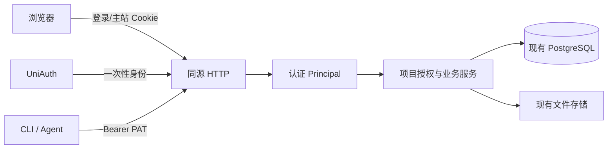

# UniAuth 登录与项目授权架构

状态：已选定方案，等待运行时实现。[需求](../spec/daynight-auth.md)拥有可观察行为，
[任务入口](daynight-auth-tasks.md)连接执行资料，
[鉴权决策](../../.agents/notes/implemented/architecture/2026-10-22-auth-architecture.md)
保存取舍，[交互原型](mockups/auth/index.html)拥有最终视觉和交互。

## 已采纳的架构边界

附件维持现有可信同源执行。HTML 拥有浏览者当前主站权限，资源请求复用主站会话与
项目成员检查。普通 iframe、相对资源、同源文档键盘桥和单 origin 部署继续使用。
[附件架构决策](../../.agents/notes/implemented/architecture/2026-10-21-task-attachment-storage-design.md)
明确独立预览域名/origin、预览凭据、bootstrap 交换及其配套设施不属于本方案；
鉴权实现必须遵守，不能从项目成员权限推导出预览隔离工程。

## 现状与可复用机制

当前同一 mux 注册 project/task/attachment/UI，没有用户或成员，项目列表全局分页，
配置强制 numeric loopback。源码基线 `38b827fe644139f4e20989cd8e7740350566fb56`：

| 机制 | 固定源码 | 使用方式 |
|---|---|---|
| HTTP composition 与 loopback | [server.go](https://github.com/codetreker/daynight/blob/38b827fe644139f4e20989cd8e7740350566fb56/packages/daynight-server/internal/server/server.go#L10-L19)、[config.go](https://github.com/codetreker/daynight/blob/38b827fe644139f4e20989cd8e7740350566fb56/packages/daynight-server/internal/server/config.go#L71-L77) | 一个入口认证，继续原有监听/部署边界。 |
| 项目写锁 | [project_tx.go](https://github.com/codetreker/daynight/blob/38b827fe644139f4e20989cd8e7740350566fb56/packages/daynight-server/internal/core/store/project_tx.go#L29-L39) | 在项目锁内检查权限并执行写入。 |
| 读取快照/列表 | [snapshot.go](https://github.com/codetreker/daynight/blob/38b827fe644139f4e20989cd8e7740350566fb56/packages/daynight-server/internal/core/store/snapshot.go#L14-L38) | 快照内验证成员；列表 SQL 先筛选再分页。 |
| 文件 IO 准入 | [attachment.go](https://github.com/codetreker/daynight/blob/38b827fe644139f4e20989cd8e7740350566fb56/packages/daynight-server/internal/service/attachment.go#L83-L114) | IO 前授权，慢传输不持有事务，保留 K1。 |
| 直接浏览器资源/键盘 | [AttachmentPreview.tsx](https://github.com/codetreker/daynight/blob/38b827fe644139f4e20989cd8e7740350566fb56/packages/daynight-web/src/features/task-detail/attachments/AttachmentPreview.tsx#L35-L72) | iframe/img/下载自然使用主站 Cookie，保留同源键盘桥。 |

UniAuth 基线 `c82c55c7fcd366824d0bc5ac6bdd17528c0300fa` 的
[协议](https://github.com/codetreker/uniauth/blob/c82c55c7fcd366824d0bc5ac6bdd17528c0300fa/docs/reference/api.md)
提供一次性身份，不替产品管理用户或会话。[SDK](https://github.com/codetreker/uniauth/blob/c82c55c7fcd366824d0bc5ac6bdd17528c0300fa/docs/reference/sdks.md)
负责 URL、callback 解析与一次领取。依赖可固定为
`github.com/codetreker/uniauth/sdk/go v0.0.0-20261022051636-c82c55c7fcd3`；
[Go proxy 元数据](https://proxy.golang.org/github.com/codetreker/uniauth/sdk/go/@v/v0.0.0-20261022051636-c82c55c7fcd3.info)
已确认，实施时校验 checksum，不使用工作站 replace。

## 职责与数据流



core 保存用户/成员/凭据结构，现有 core/store 拥有迁移和事务；service 增加身份、
成员与邀请模块，现有业务服务显式接收调用者；server 拥有 HTTP/Cookie/错误映射。
复用一个 store 和既有文件存储，不复制业务实现或增加通用权限引擎。

Principal 形状为 `{UserID, CredentialID, Kind}`，Kind 只有 session/PAT。认证代码
产生可信身份，handler 传给 service；请求 JSON 不能指定调用者或角色。service 在
业务边界授权，不提供可信用户捷径。PAT 不能管理个人令牌，会话可以管理自己的 PAT。

读取在原 repeatable-read 快照中检查成员再读取资源；写入取得现有项目行锁后重查
成员/角色/观察版本与领域约束。列表以 membership JOIN 在原 SQL cursor/LIMIT 前
筛选。任务版本、int64、图容量和现有分页合同保持。

## 登录和凭据

### UniAuth 一次性交接

login_transactions 保存随机 state 摘要、浏览器绑定摘要、provider、主站内返回路径
和十分钟到期时间。每次登录使用独立的绑定 Cookie，支持同时打开多个登录页。
callback 在同一事务验证绑定/state/provider/期限并消费 pending；提交后才通过 SDK
执行一次 Retrieve，继承请求 context 和有界 deadline。

合法 provider error 结束 pending；错误绑定不领取。网络断连、取消、协议错误或
领取响应丢失都重新登录，不能重试可能已消费的 code。用户以完整 UniAuth id 唯一
upsert，本地 UUID 不变；资料保留 null/false，不按邮箱合并。用户与 session 同事务
提交。返回路径拒绝外站、协议相对 URL 和 auth 循环路径，默认项目列表。

### 主站 session 与 PAT

秘密至少 32 随机字节，仅持久化 SHA-256 摘要。生产会话 Cookie 为
__Host-daynight_session、Path=/、Secure、HttpOnly、SameSite=Lax、无 Domain。
会话绝对有效期七天，不后台续期；注销删除当前会话。PAT 由 Web 会话创建，名称
1–100 字符，有效期 1–365 天、默认 30 天；明文只显示一次，列表仅返回 ID、名称和
创建/到期时间。撤销自己的 PAT 幂等，不影响其他凭据。

明确的 Authorization 优先；重复、格式错误或无效 Bearer 返回 401，不回退 Cookie。
Cookie 写请求要求精确主站 Origin，PAT 写请求按其 header 凭据验证。API 401 始终
JSON，Web 发起登录导航。生产配置要求 HTTPS；显式本机开发模式仅接受 literal
localhost/numeric loopback HTTP，使用不带 __Host 前缀和 Secure 的开发 Cookie 名称。
同源预览使用同一 Cookie 和授权规则，没有第二种浏览器凭据。

## 数据与并发

| 表 | 关键字段与约束 |
|---|---|
| users | 本地 UUID；唯一 uniauth_id；可空 email/name/avatar_url；时间。 |
| login_transactions | 事务 ID、state_hash、browser_binding_hash、provider、return_path、expires_at。 |
| sessions | ID、唯一 token_hash、user_id、expires_at；注销删除。 |
| personal_access_tokens | ID、唯一 token_hash、user_id、name、created_at、expires_at；撤销删除。 |
| project_members | `(project_id,user_id)` 唯一；role 为 admin/member；独立 bigint version。 |
| project_invitations | ID、project_id、唯一 token_hash、created_by、expires_at、consumed_by/at、revoked_at。 |

使用既有迁移机制、唯一索引和角色 CHECK，不要求新增 foreign key；关联由业务事务
验证。旧项目内容保持，不自动分配成员，空成员项目自然不可见，后续手工补齐。

创建项目和首位 admin 原子提交。成员管理提交观察版本，锁项目后重查 admin/版本，
变更增加成员版本，过期返回 version_conflict。删除/降级最后 admin 返回 409 last_admin。
两个 admin 并发不能都离任；成员变更不改 task.version。

邀请七天有效、只授予 member、可撤销。邀请属于项目，创建者离任不自动作废。
接受按项目→邀请顺序加锁，验证状态、插入成员后消费。已有成员返回当前成员状态而
不消费，两个非成员并发仅一个成功，另一个 410 invitation_unavailable。inspect 只
返回名称等最小摘要。到期查询即时拒绝，不依赖后台任务；写入时有界清理到期记录，
不新增调度器。过期索引支持每次最多清理 100 条记录。

附件认证和项目/task/路径检查在短快照中完成，随后准入文件 IO，不持锁慢传输。
已准入操作允许完成；不能在文件写入后仅因成员刚移除而拒绝元数据写入。真实存储/
数据库错误按原链传播，保留 K1。撤销后新准入请求拒绝，已发字节不承诺撤回。

## HTTP、Web 与 CLI

新增主站 API 保持 /api/v1，复用现有 Vite /api 代理：

| 路由 | 行为 |
|---|---|
| GET /healthz、GET /readyz | 无业务数据的存活/就绪；就绪保留 store 可用性。 |
| GET /api/v1/auth/login?provider=... | 创建 pending 并跳转 UniAuth。 |
| GET /api/v1/auth/callback | 校验/消费 pending、领取身份、建立 session。 |
| GET /api/v1/me | 当前用户最小资料。 |
| POST /api/v1/auth/logout | 主站会话注销，验证 Origin。 |
| GET/POST /api/v1/me/tokens、DELETE .../{tokenId} | 主站会话管理自己的 PAT。 |
| 现有 project/task/graph/property/attachment API | session 或 PAT；业务 service 检查当前项目成员。 |
| GET .../projects/{id}/members | 任一成员读取最小资料和角色/version。 |
| PATCH/DELETE .../members/{userId} | admin，携带观察到的成员 version。 |
| GET/POST .../projects/{id}/invitations、DELETE .../{inviteId} | admin，创建一次显示链接，删除撤销。 |
| POST /api/v1/invitations/inspect、POST .../accept | 已登录用户，body 携带秘密；明确 accept 才入会。 |

新增 unauthenticated/forbidden/last_admin/invitation_unavailable 错误，保留原 envelope/
requestId。非成员与不存在项目均 not_found；错误类别不能落入 internal_error。

Web 登录壳通过 /me 取得身份，401 显示 UniAuth 入口；资源 404 不退出全局会话。
项目列表增加名称/仓库地址创建表单，复用原 API，成功进入空项目且创建者为 admin。
账户页管理 PAT，项目页管理成员。角色确认后展示管理操作，服务端独立检查；冲突
重取权威数据。401/换账号清除旧项目和附件快照，失败不伪装成空列表。

邀请入口 /invitations#<secret> 读取后立即清除 fragment，以 tab 的临时 sessionStorage
跨登录保存，确认/取消/失效后删除；秘密不进请求路径/Referer/日志。一次性 token/
邀请复制失败可恢复，关闭前清楚提示无法再次读取。桌面/窄屏/长内容/加载/空/错误/
失效/禁用和键盘焦点由原型拥有。

附件 HEAD、GET、图片/PDF/iframe 和相对资源共用主站会话，保留既有同源文档键盘
处理；401 显示明确错误并引导重新登录，不返回登录 HTML。HTML 继续可信执行，
主站 API 始终按当前浏览者实际身份授权，不宣称隔离上传代码。

CLI server 投影增加 serverToken；setup 隐藏输入，明确 --server-token-stdin 从 stdin
读取一行，互斥和输入错误先于 I/O。沿用配置锁/原子替换/受限权限，服务 origin 变更
原子清除旧 token；仓库绑定仍只有 serverUrl/repoIdentity/projectId。HTTP 客户端向原
请求附加 Bearer，保留 manual redirect、不跨 origin 转发、二进制 stdout、完整版本/
分页、预算与不重试写入。review/update/help/version 保留各自依赖边界。

## 配置、现有部署和启用

新增 PUBLIC_ORIGIN、UNIAUTH_URL、UNIAUTH_APP_ID、UNIAUTH_APP_SECRET，使用
DAYNIGHT_ 前缀；callback 固定为 public origin 加 /api/v1/auth/callback。生产 public
origin 显式配置，不从 Host/转发 header/listener 推导。Go 保持 loopback；沿用一个
应用 origin 和现有入口。已有 localhost/dev-ci 卷、网络和清理机制继续，健康检查改
/readyz。缺必需鉴权配置拒绝启动，启用后没有匿名业务访问模式。

本地/CI 使用同源数值回环 HTTP，如 http://127.0.0.1:P，受控 UniAuth fixture 使用
另一回环端口。显式 DAYNIGHT_ALLOW_LOOPBACK_HTTP=1 同时要求相关 HTTP origin 为
literal localhost/numeric loopback，传给 SDK 的 AllowLoopbackHTTP；生产禁止该开关。
现有 SDK 与 callback 注册已支持此规则，不需要修改 UniAuth。

进程验收先临时监听 127.0.0.1:0 选出候选端口，关闭后以固定 ListenAddress 和相同
PUBLIC_ORIGIN 启动真实二进制；只对已证明的 EADDRINUSE 重选，其他失败原样暴露。
受控 App 按候选 origin 登记精确 callback；如发生已确认的端口争用，重选后同步更新
本次 fixture 的 App 注册并重建进程。进程内 fixture 可持有已绑定 listener 再构建
handler；public origin 是 fixture 显式输入，不是生产 fallback。
不增加网关、证书或域名。若实际 UniAuth 有缺口，提供具体限制/复现交由其维护者
处理，不自行扩展架构绕过。

身份/成员模块先以真实 handler/store 验证，尚未挂入入口时维持当前本机行为；CLI
凭据和 Web 新壳完成后，统一接线同时修改 composition、业务 actor 参数、Web 主入口、
部署配置/健康检查、Go 进程/安装 CLI/Web native/container/Docker fixture。测试通过
正常协议取得 session/PAT，没有匿名豁免；既有选中 gate 同次通过。
统一启用本身证明双用户隔离、撤销、管理员/邀请并发、正常浏览器登录和安装 CLI。
最后组合验收补充跨目标回执，不能延后首个安全证明。

## 可观测性与验证

入口保留 requestId；登录增加非秘密 login transaction ID，身份后关联 userId/
credentialId，业务关联 projectId，领取关联 UniAuth 返回的 requestId。SDK HTTP、
数据库和文件准入继承 request context/deadline；重定向后的请求以事务或会话记录
关联。没有新增 detached 执行；监听/资源归属现有运行时，原型请求与监听随组件卸载。

JSON slog 保留 component/phase/cause/error_code/request_id 和已知 user_id/project_id/
login_id。网络、协议、数据库、取消、过期和权限错误分别分类；清洗错误说明，不输出
URL query、body、Cookie、Authorization、code、App Secret 或身份 origin payload。
部署采集保留字段。可按已观察请求 ID 查询：

```bash
docker compose logs --no-log-prefix server | jq -R 'fromjson? | select(.request_id == "REQUEST_ID") | {request_id,user_id,project_id,component,phase,error_code,cause}'
```

验证按 AU-V1–AU-V10 映射，保留真实 PG 并发、实际 SDK/受控 UniAuth、安装 CLI、
生产浏览器、原生/容器和现有资源/容量预算。真实上游人工联调单独留证，缺少时不
宣称全部完成。模型工具预算不适用：不新增 MCP；CLI 不增加认证预检往返，沿用
既有 request/operation/response/累计预算和 stdout 合同。

## 交付边界

已有项目后续手工添加成员，成本是普通成员记录维护，无兼容分支。可信同源 HTML
保持原权限模型，不引入预览安全系统。K1 和已准入传输语义保持。各任务分钟估算
只用于规划，不是已取得的验证证据。
