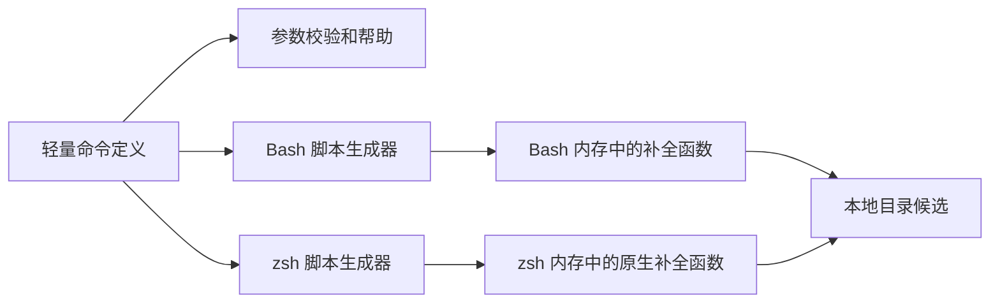

# Daynight Shell 补全设计

状态：已实现，包含 `review`、`update`、`completion` 和 `project` 的共享命令语法。
行为约束由[客户端需求](../spec/daynight.md)拥有，project 行为由
[Project 与 Task 客户端需求](../spec/daynight-project-task.md)拥有。本文负责命令描述、
脚本生成、加载和真实 shell 验证的机制；[客户端架构](daynight.md)负责命令生命周期，
[补全决策](../../.agents/notes/implemented/feature/2026-10-20-shell-completion.md)记录兼容范围和替代方案。

## 目标与范围

客户端为 Bash ≥4.2 和 zsh 提供原生补全，覆盖登记的命令、子命令、别名、选项、
`completion` 的 shell 参数和 `review add-repo --path` 的目录参数。zsh 使用原生描述
展示能力。目录候选不限制运行时合法值；`--path` 继续接受尚未创建的目标目录。

公开脚本生成入口为：

```text
daynight completion
daynight completion --help
daynight completion bash
daynight completion zsh
```

裸 `completion` 和帮助选项显示帮助并退出 0。指定 shell 时，stdout 只包含完整脚本，
不包含状态消息或日志。未知 shell、多余参数、未知选项退出 2，并提示对应帮助入口。
两种生成操作不读取用户主目录、工作目录、配置、SQLite、实例锁或审查状态，不执行
Git、GitHub CLI、Copilot、npm 或网络请求，不修改 shell 启动文件。

`project create --name <name> --repo <repo>`、`project list [--json]` 和
`project show <project-id> [--json]` 已登记在共享命令树中。名称、repo 地址和 project ID
是自由输入，不提供文件或远端候选。Tab 不加载 server 配置，不查询 project 列表；
执行 project 命令时的服务访问仍由其业务模块负责。

## 共享命令描述

[`cli/schema.ts`](../../packages/daynight/src/cli/schema.ts) 拥有不依赖业务实现的
`CommandDefinition`、`CommandOption`、参数校验和帮助生成。每个命令拥有自己的
定义，根 [`cli/commands.ts`](../../packages/daynight/src/cli/commands.ts) 登记异步执行
入口，并从登记项移除加载函数后派生命令树。补全不维护另一份顶层命令清单，定义
不导入配置、文件系统探测、原生数据库模块或业务适配器。

| 描述信息 | 消费者与语义 |
|---|---|
| 名称、说明、子命令、别名 | 分发、帮助、Bash 和 zsh 生成器 |
| 选项名称、说明、动作 | 参数校验、帮助与补全；同组选项名使用同一身份 |
| 选项的 `value.name` 与 `value.kind` | `directory` 枚举本地目录，`text` 接收自由文本并停止候选生成 |
| 选项的 `required` | 解析完参数后检查是否提供；帮助中的必填选项不加方括号 |
| 位置参数名称、说明与固定候选 | 所有声明的位置参数均必填；只有声明的 choices 提供固定候选 |
| 命令补充说明 | 帮助 |

选项只能指定一次，解析结果使用按首个选项名索引的只读 Map。命名值缺失、空字符串
或以 `-` 开始时属于语法错误；合法非空值保持原样，不裁剪空白或 FEFF。名称和 repo
等业务字段的有效性由命令在业务 I/O 前校验，不能用 JavaScript trim 改写服务允许的
文本。project 的 `--name`、`--repo` 都是必填 text 选项，列表与详情的 `--json` 为可选开关。

帮助只能在该层唯一参数为 `-h` 或 `--help` 时触发，并先于必填检查及业务加载。
顶层版本选项不继承到子命令；`--path` 可以位于 remote 前后，只能指定一次；
不接受 `--path=value` 或 `--` 语法。`ls` 分发到 `list` 的同一操作。

解析、帮助和补全共同消费定义中的语法事实。业务模块把已校验参数转换为自身输入，
只在实际执行操作时加载其实现。根帮助、命令帮助、版本和脚本生成的依赖隔离必须由
编译后入口测试验证，不能只由源码类型或模块命名推断。

## 脚本生成与执行



生成器将完整命令树及语法规则写入 shell 函数。每次按 Tab 仅执行 shell 自身的
补全函数和目录枚举，不启动 Node 或其他 daynight 进程。候选使用数组保留边界，
不通过空白分割重建参数，不把输入作为 shell 代码执行。

所有写入脚本的数据都需要正确引用；说明中的引号、冒号、美元符号和反引号不能
成为可执行语法。用户输入的目录、名称、repo 地址和 project ID 也只能作为数据处理。

### Bash

[`completion/bash.ts`](../../packages/daynight/src/commands/completion/bash.ts) 在检查
版本下限后，通过 `complete -F` 注册函数。函数维护 `COMPREPLY` 数组，利用 Bash
≥4.2 的 `compopt` 按当前语义启用文件名处理、目录后缀和引号。命令候选不沿用
目录补全选项，避免同名本地目录改变命令补全的结果。

`COMP_WORDS` 的边界受 `COMP_WORDBREAKS` 影响，与 CLI 最终收到的 argv 不同。
状态机从光标前的有效输入还原参数，处理 repo 地址中的 `:`；光标位于行中时，
后面的参数不改变当前补全位置。值识别不依赖写死的单词下标，不修改用户全局的
`COMP_WORDBREAKS`。

待输入 directory 值时使用目录枚举；待输入 text 值时直接返回空候选，不能继续
提供选项或文件。消耗 text 值后恢复相应命令的选项状态。已指定的选项不再出现，
消耗过的位置参数不重复提供候选。自由输入的 remote 和 project ID 没有固定候选，
也不得回落到无关文件。

目录补全保留空格、中文、引号和特殊字符，支持相对路径、绝对路径及常见的主目录
写法。目录无匹配项返回空候选，不把不存在的目录判为 CLI 输入错误。

### zsh

[`completion/zsh.ts`](../../packages/daynight/src/commands/completion/zsh.ts) 使用原生
`_arguments`、`_describe` 和 `_files -/` 表达语法、候选说明和目录。text 选项使用
明确的 `text_value` 状态；该状态通过 `_message` 显示值说明并成功返回，不产生
候选，不依赖空 action 的默认行为。directory 选项继续使用 `_files -/`。脚本显式
调用 `compdef` 关联 `daynight`；仅输出 `#compdef daynight` 注释不足以支持直接 source。

加载要求 zsh 已初始化 `compinit`。缺少初始化时给出明确诊断并失败，不注册未生效
的定义。脚本不改变调用者的 completion style，不引入 `bashcompinit`，不重复初始化
用户环境。

原生参数助手对无效选项和多余参数较宽松，因此每层函数先用命令定义生成的规则
验证光标前的参数。分派与校验使用相同的去引用形式，使引号包裹的命令名仍指向
同一操作。目录的引号闭合和可自动移除的斜杠保持 zsh 自身的编辑语义。

## 启用与升级

Bash 用户将下列语句加入自己的 `.bashrc`：

```bash
source <(daynight completion bash)
```

zsh 用户在 `.zshrc` 的补全系统初始化后加载：

```zsh
autoload -Uz compinit
compinit
source <(daynight completion zsh)
```

已有环境完成 `compinit` 时只添加最后一行。客户端不自动修改启动文件。每个新
shell 生成当前安装版本的定义；更新包后，已有 shell 重新 source 即可刷新。
保存生成结果后 source 也有效，更新后需要重新生成文件。

脚本是可 source 的定义及注册代码，不承诺将同一输出直接作为 `fpath` 自动加载文件。
该安装方式需要不同的函数装载形态。

## 失败与边界

参数错误保留客户端现有退出码约定。生成器不引入后台任务、调度、远程事件或
遥测管线；不创建审查、请求或会话关联标识。shell 加载错误显示在调用者 stderr，
失败不注册声称已经可用的新定义。运行中的补全状态只属于当前 shell，不写入配置
或持久状态。

独立服务、浏览器应用、project 数据、review 数据格式、全局安装归属和自更新流程
均保持各自的所有者。补全不增加数据库迁移、服务请求或审查配置字段。

## 验证

共享语法测试校验必填命名值、原值保留、重复和缺失值、帮助以及既有命令回归。
生成器测试覆盖 shell 数据引用、目录与 text 类型分派；编译后入口测试验证帮助、
参数错误和生成脚本不进入业务 I/O。

[`shell-completion.py`](../../packages/daynight/test/acceptance/shell-completion.py) 通过
PTY 驱动真实 Tab，检查编辑缓冲区、光标位置和实际解析后的 argv。直接调用函数可
辅助定位，不能代替 Readline 或 zsh 对引号、后缀和候选的处理。zsh 接受目录输入时
可以按原生规则移除自动添加的末尾斜杠；验收同时检查插入时后缀及最终路径语义。
脚本加载后设置执行哨兵，要求每次 Tab 都不调用 Node 或 daynight。

驱动分别确认主提示符切换和编辑器内重置。初始化及实际执行命令后，先等待新一代
主提示符标记，再请求实际 Readline/ZLE widget 回执。丢弃测试输入使用排队执行的
editor reset widget，在同一 generation 内确认空状态。每个场景发送输入前再次
核对当前 generation、空编辑缓冲区和光标 0；输出静默与 capture 标记均不能证明
编辑器已经完成上一项操作。

每个真实 shell 都执行两种管道阻塞证明：首个提示符在编辑器进入前被阻塞，证明
30 ms 输出静默可以与未就绪状态同时存在；capture widget 在输出标记后被阻塞，
证明排队的 reset 请求等待其退出后才执行。两种证明均须取得实际编辑器的空状态
回执，并保留候选、argv、光标、执行哨兵和既有超时要求。同步依据及失败情形见
[就绪验证决策](../../.agents/notes/implemented/testing/2026-10-20-observable-acceptance-readiness.md)。

场景包括根命令、嵌套命令、别名、帮助与版本选项、shell 参数、空前缀、已用选项、
光标位于行中、remote 的 `:`，以及空格、中文、单引号、双引号和美元符号目录。
`--path` 在 remote 前后及目录完成后的下一参数均需覆盖；目录名与 `review` 或
`project` 同名时，命令补全仍插入命令并保留正确分隔符。

project 场景覆盖 create/list/show、必填选项名称、`--json`、已使用选项隐藏，以及
名称、repo 地址和 project ID 的文件回退抑制。名称和 repo 待输入时，包括引号输入
及以选项前缀开始的当前词，都必须保持输入且不生成文件或选项候选。

Bash 4.2 是明确下限，需要真实 4.2 执行验证；现代 Bash 和 zsh 也必须有真实证据。
Linux 准备脚本在仓库 `.tmp/` 中校验固定 SHA-256 的 GNU Bash 4.2 源码并构建所需
程序；zsh 使用现有程序或仅下载、解包发行版软件包。该脚本不做系统安装，输出环境
文件供本地和独立 CI 作业使用同一验收入口。

解包的 zsh 在首次 ZLE 初始化前定位自身原生模块和补全函数。PTY 使用任务专属的
`ZDOTDIR/.zshenv`，通过 `zsh -d -i` 启动；该文件设置解包工具链的准确 `module_path`
和补全函数目录，不拼接宿主 `fpath`。准备完成后关闭 `RCS` 与 `GLOBAL_RCS`，避免
操作者启动配置影响验收。交互设置先执行 `compaudit`，失败立即退出；通过后执行
`compinit -D`。工具链路径和权限必须满足安全审查，不得进入人工信任提示。进程
环境或启动后的交互命令不能替代首次模块定位所需的 zsh 启动文件。

测试不修改开发者启动文件，不依赖其配置、认证或全局安装；临时 shell、终端、探针
和 fixture 均在任务 `.tmp/` 中，由创建者清理。完整验证命令由
[README](../../README.md#cli-development)拥有。托管结果由对应源码版本的 CI 作业与
补全 artifact 记录；本地通过记录不代替该版本的托管验收。

## 依据

- [GNU Bash programmable completion](https://www.gnu.org/software/bash/manual/html_node/Programmable-Completion.html)
  定义函数补全、`COMPREPLY` 和候选处理。
- [GNU Bash variables](https://www.gnu.org/software/bash/manual/html_node/Bash-Variables.html)
  定义补全上下文与分词边界。
- [zsh completion system](https://zsh.sourceforge.io/Doc/Release/Completion-System.html)
  定义 `compinit`、`compdef`、原生参数与目录补全。
