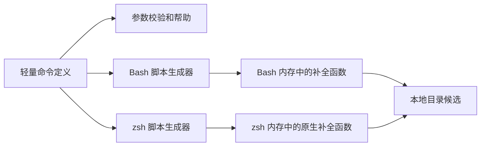

# Daynight Shell 补全设计

状态：已实现。行为约束由[客户端需求](../spec/daynight.md)拥有，本文负责命令描述、
脚本生成、加载和真实 shell 验证的机制。[客户端架构](daynight.md)负责命令生命周期，
[补全决策](../../.agents/notes/implemented/feature/2026-10-20-shell-completion.md)记录兼容范围和替代方案。

## 目标与范围

客户端为 Bash ≥4.2 和 zsh 提供原生补全，覆盖现有命令、子命令、别名、选项、
`completion` 的 shell 参数和 `review add-repo --path` 的目录参数。zsh 使用原生描述
展示能力。目录候选不限制运行时合法值；`--path` 继续接受尚未创建的目标目录。

公开入口为：

```text
daynight completion
daynight completion --help
daynight completion bash
daynight completion zsh
```

裸 `completion` 和帮助选项显示帮助并退出 0。指定 shell 时，stdout 只包含完整脚本，
不包含状态消息或日志。未知 shell、多余参数、未知选项退出 2，并提示对应帮助入口。
两种生成操作不读取用户主目录、工作目录、配置、SQLite、实例锁或审查状态，不执行
Git、GitHub CLI、Copilot、npm 或网络请求，不修改 shell 启动文件。

现有命令没有接收仓库选择器或 PR 编号的参数，因此当前候选不查询配置或数据库。
这类候选属于新增业务参数的后续能力；保持命令描述与业务加载分离，才能在确有参数
接收这些值时扩展候选来源，而不改变当前帮助和补全的启动条件。

## 共享命令描述

命令名称、说明、别名、选项名称、选项值类型和位置参数基数由不导入业务依赖的
TypeScript 数据描述。每个命令保留明确的定义归属，根登记表继续保存异步执行入口。
根命令树从登记表移除加载函数后派生，不单独维护另一份顶层命令清单。
命令定义不能导入配置、文件系统探测、原生数据库模块或业务适配器。

定义表达以下信息：

| 信息 | 消费者 |
|---|---|
| 名称、说明、子命令、别名 | 分发、帮助、Bash 和 zsh 生成器 |
| 选项名称、是否接收值、值名称、目录值类型、是否允许重复 | 参数校验、帮助、补全状态机 |
| 位置参数名称、说明、是否必需、固定候选 | 参数校验、帮助、补全状态机 |
| 命令补充说明及使用方法 | 帮助 |

现有命令的语义保持不变：帮助只能在该层唯一参数为 `-h` 或 `--help` 时触发；
顶层版本选项不继承到子命令；`--path` 可以位于 remote 前后，只能指定一次；
不新增 `--path=value` 或 `--` 语法。`ls` 分发到 `list` 的同一操作。

解析和补全都消费定义中的语法事实。业务模块把已经校验的参数转换为自身输入，
继续只在实际执行操作时加载其实现。根帮助、命令帮助、版本和脚本生成的依赖隔离
必须由编译后入口测试验证，不能只由源码类型或模块命名推断。

## 脚本生成与执行



生成器将完整命令树及语法规则写入 shell 函数。每次按 Tab 仅执行 shell 自身的
补全函数和目录枚举，不启动 Node 或其他 daynight 进程。候选使用数组保留边界，
不通过空白分割重建参数，不把输入作为 shell 代码执行。

生成器必须正确引用所有写入脚本的数据；说明中的引号、冒号、美元符号和反引号
不能成为可执行语法。用户输入的目录或 remote 同样只能作为数据处理。

### Bash

脚本检查 Bash 版本下限，再通过 `complete -F` 注册函数。函数维护 `COMPREPLY`
数组，并利用 Bash ≥4.2 的 `compopt` 按当前语义启用文件名处理、目录后缀和引号。
命令候选不沿用目录补全选项，避免同名本地目录改变命令补全的结果。

`COMP_WORDS` 的边界受 `COMP_WORDBREAKS` 影响，与 CLI 最终收到的 argv 不同。
实现必须处理 remote 中的 `:`，并只分析光标之前的有效参数；光标位于行中时，
后面的参数不能改变当前补全位置。参数值识别不能依赖写死的单词下标，不能修改
用户全局的 `COMP_WORDBREAKS`。

目录补全必须保留空格、中文、引号和特殊字符，支持相对路径、绝对路径及常见的
主目录写法。已指定的非重复选项不再出现，消耗过的位置参数不再重复提供候选。
remote 没有远端候选，输入该参数时不得回落到无关的文件候选。

### zsh

zsh 脚本定义专属补全函数，使用原生 `_arguments`、`_describe` 和 `_files -/`
表达语法、候选说明和目录。脚本显式调用 `compdef` 关联 `daynight`；仅输出
`#compdef daynight` 注释不足以支持直接 source。

加载要求 zsh 已初始化 `compinit`。缺少初始化时必须给出明确诊断并失败，不能
静默提供一份未生效的脚本。脚本不改变调用者的 completion style，不引入
`bashcompinit`，也不负责重复初始化用户环境。

zsh 原生参数助手对无效选项和多余参数较宽松，因此每层函数先用命令定义生成的规则
验证光标前的参数。分派时使用与校验相同的去引用形式，使引号包裹的命令名仍指向
同一个操作。目录的引号闭合和可自动移除的斜杠保持 zsh 自身的编辑语义。

## 启用与升级

Bash 用户将下列语句加入自己的 `.bashrc`：

```bash
source <(daynight completion bash)
```

zsh 用户在 `.zshrc` 的补全系统初始化后加载：

```zsh
autoload -Uz compinit
compinit
source <(daynight completion zsh)
```

已有环境完成 `compinit` 时只添加最后一行。客户端不自动修改启动文件。每个新
shell 生成当前安装版本的定义；更新包后，已有 shell 重新 source 即可刷新。
将生成结果保存为文件再 source 也有效，但更新后需要重新生成该文件。

当前交付的脚本形态是可 source 的定义及注册代码，不承诺将同一输出直接作为
`fpath` 自动加载文件。后者需要不同的函数装载形态，属于可独立增加的安装方式。

## 失败与边界

参数错误保留客户端现有退出码约定。生成器不引入后台任务、调度、远程事件或
遥测管线；不存在需要传播的审查、请求或会话关联标识。shell 加载错误显示在
调用者 stderr，失败不注册一个声称已经可用的新定义。目录无匹配项返回空候选，
不把不存在的目录判为 CLI 输入错误。

独立服务、浏览器应用、review 数据格式、全局安装归属和自更新流程均保持各自的
所有者。本功能不增加数据库迁移或审查配置字段。

## 验证

验证包括共享语法与既有 CLI 回归、编译后入口依赖隔离、脚本语法检查，以及真实
Bash 和 zsh 的补全交互。真实交互通过 PTY 驱动 Tab，检查编辑缓冲区、光标位置和实际解析后的 argv；直接调用
函数可辅助定位，但不能代替 Readline 或 zsh 对引号、后缀和候选的处理。zsh 在用户
结束目录输入时可以按原生规则移除一个自动添加的末尾斜杠；验收同时检查插入时的
目录后缀和最终路径语义。脚本加载后设置执行哨兵，要求 Tab 不调用 Node 或 daynight。

必需场景包括根命令、嵌套命令、别名、帮助与版本选项、shell 参数、空前缀、
remote 已输入、`--path` 位于 remote 前后、已用选项、目录完成后的下一参数、
光标位于行中，以及远程地址中的 `:`、空格/中文/单引号/双引号/美元符号目录。
目录名与 `review` 等命令同名时，命令补全仍插入命令并保留正确分隔符。

Bash 4.2 是明确下限，需要真实 4.2 执行验证；现代 Bash 和 zsh 也必须有真实
执行证据。Linux 准备脚本在仓库 `.tmp/` 中校验固定 SHA-256 的 GNU Bash 4.2 源码
并构建所需可执行文件；zsh 使用现有程序或仅下载、解包发行版软件包。该脚本不做
系统安装，输出的环境文件用于本地和独立 CI 作业的同一验收入口。测试不修改开发者
启动文件，不依赖其配置、认证或全局安装；临时 shell、
终端、探针和 fixture 均在任务 `.tmp/` 中，并由创建者清理。适用的客户端完整
验证命令由[README](../../README.md#cli-development)拥有。

## 依据

- [GNU Bash programmable completion](https://www.gnu.org/software/bash/manual/html_node/Programmable-Completion.html)
  定义函数补全、`COMPREPLY` 和候选处理。
- [GNU Bash variables](https://www.gnu.org/software/bash/manual/html_node/Bash-Variables.html)
  定义补全上下文与分词边界。
- [zsh completion system](https://zsh.sourceforge.io/Doc/Release/Completion-System.html)
  定义 `compinit`、`compdef`、原生参数与目录补全。
