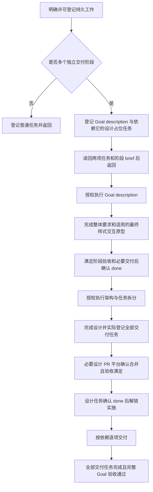

# using-daynight Goal 工作流设计

公开 skill 以共享协议实现分阶段 Goal，保留现有四种模式与安装机制。
[Goal 需求](../spec/daynight-goal-workflow.md)拥有 GW1–GW13，
[任务拆分](daynight-goal-workflow-tasks.md)拥有实际交付任务与文件归属，
[设计决策](../../.agents/notes/implemented/process/2026-10-22-goal-workflow-design.md)
保存阶段划分与范围的理由。当前发布结构和安装机制继续由
[Agent skill 设计](daynight-agent-skill.md)拥有。

## 结构与职责

Goal 是使用既有 task 的工作协议：一个描述任务作为整体要求的来源，后继设计任务负责
架构与交付任务登记，实施任务通过依赖推进。没有独立 Goal 服务资源、类型、状态、CLI
命令或新的 skill 模式。普通单成果任务保留原有流程；临时命令、测试和操作步骤留在
执行计划中。

```text
packages/daynight/src/commands/skill/skills/using-daynight/
  SKILL.md
  references/
    handbook.md
    create-task.md
    run-task.md
    autopilot.md
    goal.md                 # 共享 Goal 协议
```

| 文件 | 设计职责 |
|---|---|
| `SKILL.md` | 保留四模式路由、共同授权和单任务约束；说明多阶段持久工作使用 Goal，并按需链接共享协议。 |
| `references/goal.md` | 统一拥有 Goal 判断、两个起始任务、阶段输入与产出、拆分、依赖、完整 Goal 验收和部分登记恢复。 |
| `references/create-task.md` | 在明确创建许可内判断普通任务或 Goal；为普通任务和各阶段写自足正文，按实际需要准备专属资料并核验登记后返回。 |
| `references/run-task.md` | 先读自足正文，再读取任务专属主附件与真实共享输入；按指定 ID 所属阶段核对输入与验收，完成授权工作后返回，不选择后继。 |
| `references/autopilot.md` | 只有明确启用才串行调度；加载共享 Goal 协议理解阶段和整体验收，仍只调用同一个 run-task 完成规则。 |
| `references/handbook.md` | 保留命令用途、项目发现、精确版本、完整字段替换、附件独立性及不确定写入规则；不重复定义 Goal 阶段。 |

共享协议使创建、执行和连续调度在同一处读取阶段规则，避免三个模式分别形成不同的
完成条件。`goal.md` 只依赖随包资料和已安装 CLI help；不能链接仓库内部文档、未发布
草稿或本机路径。安装器继续捕获和复制完整 bundle，现有 allowlist 已覆盖目录资源，
不需要新的安装分支或运行时 Markdown 解析。

## 调用者可观察的流程



图中的执行边需要相应执行授权。create-task 在登记后返回；run-task 在指定阶段完成或
需要外部介入时返回。只有已明确启动的 autopilot 才能在当前任务确认 done 后继续下一项，
不能从图中的顺序推导自动执行或合并权限。

### 任务身份与资料

起始标题分别为 `[Goal]<outcome>` 与
`Architecture design and task breakdown: <outcome>`。Goal 标题使用 `[Goal]` 标记后直接写目标；
Goal description 是阶段职责，不是标题前缀。标题用于说明职责，不能作为
稳定身份；已确认的 ID、完整任务字段、主附件内容和实际上下文共同识别已有登记。
创建时保留 Goal description ID，随后建立设计任务及其 `dependsOn`。后续任务以真实
任务或附件引用追溯 Goal 与设计，依赖只写入 `dependsOn`，不另写依赖 section。

| 资料 | 唯一职责 |
|---|---|
| task `description` | 自足任务简介：具体问题、范围与动作、交付物、约束、简明可观察完成条件，以及实际输入与附件引用。 |
| 每个任务的专属主 Markdown 附件 | 必填“方案”与“验收标准”；拥有详细做法、完整验收和完成证据，正文可概括但不维护竞争的完整副本。 |
| Goal description 正文与主附件 | 正文本身说明整个 Goal 的目标、行为、范围、UI 适用性、排除项和简明整体验收；主附件从澄清 brief 演进为完整要求及证据。 |
| 设计任务主附件与产出 | 主附件拥有架构与拆分阶段方案及验收；设计和拆分产出由该任务拥有，后继引用实际来源。 |
| mock UI 与资源 | UI Goal 描述阶段的输出；之后供设计和相关实施任务查看、交互与核对。 |
| `properties.pullRequests` | 所有必要交付 PR 的真实 URL 与 title。 |
| 既有执行检查点 | 当前 ID、工作位置、阻塞、PR 等待和下一动作。 |

普通任务和每个 Goal 阶段都使用同样的正文要求：读者不打开附件也能知道当前要解决的
问题、要做什么、交付什么和何时完成，不依赖标题猜测整体目标。正文不是泛化说明加
链接清单；专属主附件承接详细方案、完整验收与证据，两者保持一致而各有深度。

资料按实际需要归属。Goal 要求由描述任务拥有，架构与拆分由设计任务拥有，后继任务
只保留自身主附件，并引用共享输入的真实来源 task ID 与附件路径。仓库规范和决策继续
由仓库拥有，可以引用已核验的不可变 URL，不按任务重复上传整套文件。需要独立快照
时，主附件记录复制目的、原始来源和来源版本；复制不是默认登记步骤。

共享来源通过实际 CLI 读取。例如本 Goal 的要求和架构分别使用：

```bash
daynight task attachment read 03a3ee58-9d3a-4820-b582-8d4eb281a5ae goal.md
daynight task attachment read d2a31f2c-d77a-41ca-8170-3e0f0cc2504b design.md
daynight task attachment read d2a31f2c-d77a-41ca-8170-3e0f0cc2504b tasks.md
```

具体命令参数由已安装 CLI help 拥有。该引用不增加 URL 协议或 API，不假设 `task://`
链接、跨任务相对链接或固定服务主机存在。任务资料引用只在上传或已有来源读回确认后
写入，不能把未来计划路径当作已存在附件。

## 分阶段输入与输出

| 阶段 | 开始所需资料 | 必须交付的结果与完成条件 |
|---|---|---|
| 登记 Goal | 已确认的问题与范围、明确创建许可、两个阶段 brief。 | 两个任务真实存在；设计通过 `dependsOn` 依赖描述；各自 brief 与真实引用可读。登记完成返回。 |
| Goal description | 指定任务、澄清方案和阶段验收；已有背景资料。 | 完整 Goal 要求、适用的最终样式交互原型、已验证的阶段验收及仓库要求的必要交付。只完成描述任务。 |
| 架构与 task breakdown | 描述任务已完成；完整 Goal、适用原型、设计阶段 brief。 | 完整架构与实际持久任务拆分；全部后继资料和依赖核验；必要设计 PR 平台确认合并；设计阶段验收满足。 |
| 实施任务 | 设计依赖已完成；经交付的架构、明确方案与验收、适用原型和资源。 | 自身实现、验证、独立审查、必要 PR 平台确认合并及验收证据；遵守原有 run-task 完成规则。 |
| 整个 Goal | 完整任务范围与原始整体验收。 | 全部交付任务确认完成，所有必要 PR 合并，且整个目标的可观察验收通过。 |

阶段 brief 的“方案”说明当前要开展的工作，“验收标准”说明如何判断它完成。开始澄清
不要求澄清结果已经存在，开始设计不要求架构与拆分已完成。实施入口才要求完整设计，
相关 UI 原型由此前描述阶段提供。这避免把生产资料的工作错误地判为资料缺失。

### 描述阶段

Goal description 聚焦问题定义：为什么需要、要得到什么结果、必须支持的行为与约束、
任务范围、明确排除项、如何观察和验证完成。它不决定模块结构、接口方案或实现路径，
不修改生产实现代码。涉及 UI 时明确最终布局、视觉、交互和代表性数据状态，交付纯
前端可运行、采用最终样式的交互原型及资源；原型代码属于问题表达，不属于生产实现。

执行者核对说明完整且无阻塞性歧义，操作适用原型并记录阶段验收。目标仓库要求此类
文档或原型通过 PR 交付时，沿用原有 PR 完成规则；没有 PR 交付路径时按阶段验收完成。
将此任务设为 done 只解锁设计，不声明整体 Goal 已交付。

### 设计与实际拆分

设计任务完成架构职责、数据和控制流、接口或资料契约、错误与边界行为、关键决策及
验证方案。实际修改规模由目标决定，不能仅为保持任务数量少而留下未定义的交付。
每个后继任务是独立成果，覆盖 Goal 的某部分要求并给出范围、方案、验收、检查方法
和真实引用。设计 PR 交接前必须已登记全部交付任务、上传阶段资料、建立真实依赖，
并读回核验确定的任务身份与内容。拆分总和必须覆盖完整目标，不能只在仓库文档留下
将来登记的清单或一个范围模糊的实施占位任务。

实施任务根节点直接依赖设计任务，其余依赖表达真实交付先后关系；所有实施任务因此
必须经过设计完成这一前提。设计阶段可以创建、上传并核验这些任务，不能提前执行。
任务引用 Goal 和设计的真实来源保持可追溯，不复制整套共有资料。按当前任务需要上传
自身主附件与专属产出；设计评审要求变更时，同步所有者资料及受影响的正文摘要和
来源引用，完成前读回核验一致结果。

需要 PR 时按仓库规则创建设计 PR，并维护完整 PR 属性。PR 创建、review 通过或 CI
成功都不能将设计任务标为 done。所有必要 PR 平台确认合并且阶段验收满足后，才使用
实际版本更新 done。用户要求保留开放 PR 时保存检查点、保持 in_progress 并返回等待；
依赖继续阻塞实施。交付门槛不授予合并或主线 push 权限。

## 写入、恢复与并发

Goal 创建包含多个独立操作，不是事务。执行顺序为查找与核对已有工作、确认许可与
范围、准备两个 brief、创建或复用描述任务、创建或复用依赖它的设计任务、上传资料、
用实际版本更新自足正文与依赖、读取任务及必要附件和共享输入内容核验。注册完毕前保持 todo，
没有额外 draft 状态。

描述任务成功而后续失败时保留其 ID，恢复设计任务或附件的缺失操作；设计成功但返回
不确定时先查完整资源和操作上下文。引用更新或上传失败同样在原 ID 补全。不能凭相似
标题认定写入成功，也不能凭失败响应假定服务未写入。若无法确认唯一身份，保留具体
错误并等待必要的外部信息，不创建第二条链。

更新使用作出判断时读取的精确 int64 版本。description、dependsOn 与 PR 列表按完整
字段替换，保留仍有效的数据；版本冲突后重新读取并决策。附件独立于 task 版本、状态
和更新时间，文件内容与元数据可能部分改变，必须分别核验。设计拆分的部分成功使用
同样规则逐项恢复，交付任务不能因为登记不完整而错误解锁。

状态与 readiness 不提供锁或所有权；in_progress 清单仅是恢复线索，已有检查点确定
当前任务，多个执行者仍按目标仓库机制协调。没有新 ID 格式、原子 claim、租约或全局
Goal 互斥。既有命令与服务错误向调用者暴露，不以空值或自动重复写入隐藏失败。

## 授权、完成与成本

用户明确许可创建目标范围内的 Goal，已覆盖两个起始任务及架构阶段的范围内拆分，
无需逐项重新申请。普通实现请求或 autopilot 启动不自动授予创建许可。已有创建许可
不扩展为无关任务，也不扩展实现、外部通信、部署、发布、合并或主线 push 的权限。

autopilot 沿用已有当前任务和有界 ready 选择机制，一次只推进一个任务。描述或设计
完成后，仅在 autopilot 已明确启动且后继属于授权范围时继续。run-task 的单 ID 返回、
当前任务等待及 no-merge 规则不变。整个 Goal 完成必须核对完整已登记范围与原始
验收；空候选页、部分交付或上游 done 都不能替代该判断。

增加一个共享 Markdown 协议会增加有关模式的读取成本；按需读取避免普通命令查询
加载完整流程。没有新后台组件、存储或运行时生命周期，因此无新增 telemetry 需求。
最大风险是指令重复造成阶段冲突，或仅凭任务 done 判断整个目标；共享阶段表、真实
引用与独立情境审查共同约束这些风险。模型遵循程度仍是指令能力的限制。

## 验证与交付

设计交付检查本文、需求、任务拆分和 note 的链接、语言、状态及结构，实际任务资料与
依赖由 Daynight 读回核验。逐项单独阅读正文，确认不打开附件也能理解具体工作与完成
条件；随后核验专属主附件及共享来源的所有权、可读内容和实际需要，不能只检查统一
附件包的文件是否存在。独立设计审查确认无阻塞的 Critical/Major。设计交付拥有
设计资料和已完成登记、附件核验的后续任务，实施由依赖它的交付任务负责。本 Goal 的完整后继为协议交付 GW-T1 和依赖它的独立整体验收 GW-T2；真实 ID、
范围与验收由任务拆分拥有，不能将后继登记推迟到实施阶段。

实施交付在同一个目的下更新 bundle 和相关 active 文档，按既有 CLI 包版本规则处理；
新增版本须高于实施 PR 当时的目标分支版本，不能使用设计时的版本快照作为门槛。
独立情境审查覆盖普通单任务、多阶段 Goal、UI 产出、双起始任务、复用、缺少许可、
范围内拆分、部分成功与不确定写入、版本冲突、设计 PR 等待、单任务返回和整体验收。
它检验协议的一致含义，不宣称模拟模型运行的确定性，也不创建额外真实任务或启动
autopilot。GW-T1 在自己的交付 PR 合并前完成全部必需检查和独立指令审查；后继验收
不承担替它补齐合并前门禁的职责。

现有 `test/tooling/copy-skills.test.ts` 验证两个 allowlist bundle 的完整字节复制、
frontmatter 与相对链接。`test/cli/e2e.acceptance.ts` 的已安装公开资源必需清单扩展为
包含 `goal.md`；实际 build、npm pack 和隔离本地安装再验证新增协议随完整目录发布。
既有安装验收继续验证路径、覆盖与 scope，无需真实 Agent、账号、模型或新增 Daynight
服务。按实际影响运行 typecheck、test、build 与必要 CI。

GW-T2 在 GW-T1 的必要 PR 实际合并后，对准确的已合并干净源码独立验收。记录源码
commit、包名称和版本、实际打包产物及入口 hash、平台、命令和结果，使用 npm pack
产物在隔离目录安装，比较完整文件的相对路径和字节，确认共享协议及其引用可读。
复用模拟 launcher 的三个 Agent × 两个 scope 真实安装验收，验证覆盖、迁移、资源保留和完整 bundle；安装过程不执行真实
Agent、模型，不依赖登录，也不发布 npm 或部署。

该任务另行审查安装 bundle 的完整行为情境，逐项把 GW1–GW13 映射到已取得证据，区分
指令结论、文件结果和平台合并事实。它不新增任务或修改任务链来演示协议。确认其他
交付任务已 done、必要 PR 已合并且自身验收满足后，完成 GW-T2；服务确认此任务 done
后，再核对完整 Goal 的全部任务和原始整体验收并报告目标完成。GW-T1 只完成协议交付。
若确认存在范围内验收缺陷，保留未通过项，在既有授权内通过修复 PR 交付并验证新的
准确来源；不能绕过门禁、擅自合并或将失败写成完成。文件证据、行为审查和平台合并
事实分别报告，任何一类都不能代替其他类别。
