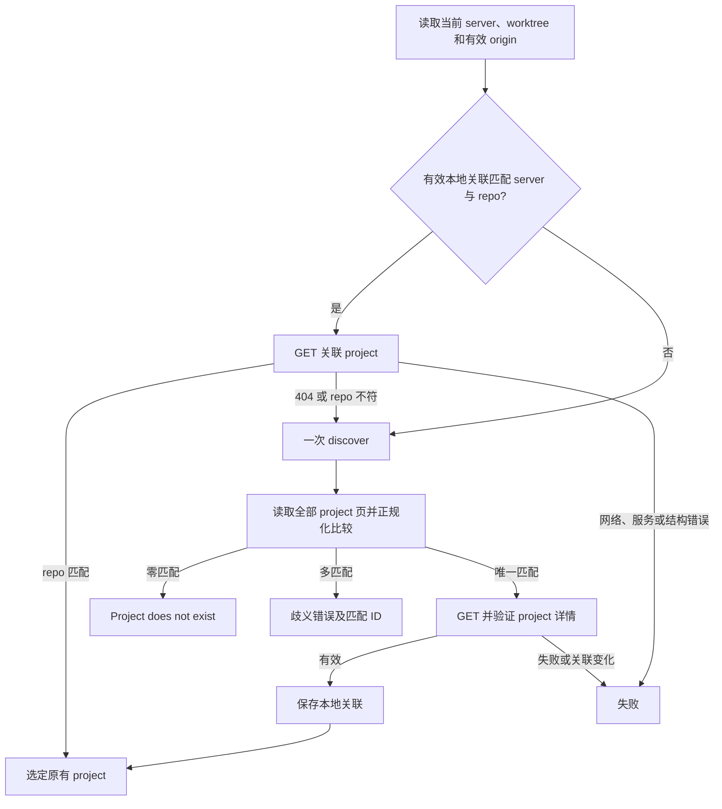

# Project 与 Task 客户端设计

状态：共享配置、HTTP 与仓库关联基础已实现；命令入口与完整联调待完成。
本文描述采用的结构和交付机制，各项状态由任务清单拥有，当前可用命令见
[仓库 README](../../README.md)。必需行为与编号验收由
[客户端需求](../spec/daynight-project-task.md)拥有，服务行为由
[服务需求](../spec/daynight-server.md)拥有。结构决策与真实备选方案见
[决策记录](../../.agents/notes/implemented/architecture/2026-10-20-project-task-cli-design.md)，
实现顺序与依赖见[交付任务](daynight-project-task-tasks.md)。

## 现有基础与交付边界

`project` 和 `task` 复用已有 HTTP API，不改服务或数据库。实现入口及字段可以由
以下现有文件核对：

| 现有归属 | 可复用事实 |
|---|---|
| [`cli/commands.ts`](../../packages/daynight/src/cli/commands.ts) 与 [`cli/application.ts`](../../packages/daynight/src/cli/application.ts) | 命令登记保留异步 `load`，应用统一处理 `0/1/2` 退出结果 |
| [`config/document.ts`](../../packages/daynight/src/config/document.ts)、[`config/files.ts`](../../packages/daynight/src/config/files.ts) | 共享严格 YAML、已知顶层字段、独立锁和原子配置保存 |
| [`commands/review/config.ts`](../../packages/daynight/src/commands/review/config.ts) | review 字段投影与 GitHub 专用 remote 身份规则 |
| [`api/index.ts`](../../packages/daynight/src/api/index.ts) | 命令级操作、服务 DTO、完整分页、精确 JSON 与 HTTP 错误 |
| [`commands/review/paths.ts`](../../packages/daynight/src/commands/review/paths.ts) | 既有配置位置为 `~/.daynight/config.yml` |
| [`api/projects.go`](../../packages/daynight-server/api/projects.go) | project、分页及含 request ID 的结构化错误 |
| [`api/tasks.go`](../../packages/daynight-server/api/tasks.go) | task、派生字段、版本和字段可选的更新请求 |
| [`api/task_graph.go`](../../packages/daynight-server/api/task_graph.go) | 完整图、节点预览及 summary 响应 |
| [`service/repository.go`](../../packages/daynight-server/internal/service/repository.go) | 服务接受通用 HTTPS、SSH、SCP 地址，保存原始地址 |

现有 review 的 `remoteIdentity` 面向 GitHub 且把 owner/name 转小写，不能直接成为
通用 project repo 比较规则。新正规化器单独拥有服务命令的 repo 身份，保持 review
既有行为。共享读取与命令投影已经分离：review 运行解析要求非空 repositories，
server 投影只要求有效 server 地址；review 登记可向 server-only 文档添加首个仓库。

## 模块与依赖方向

`config/`、`api/`、`repository/` 和既有 review/update 已实现；project/task 命令仍
待实现。职责如下，具体文件可以在保持归属的前提下拆分：

```text
src/
  cli/                     # 帮助、分发、通用退出结果
  config/                  # 全局路径、严格 YAML 读取、顶层字段登记
  api/                     # 服务 DTO 验证、请求、分页、结构化错误
  repository/              # Git 定位、repo 正规化、关联解析和原子持久化
  commands/
    project/               # 参数、帮助、project 操作及渲染
    task/                  # 参数、帮助、task 操作及渲染
    review/                # review 配置投影和既有行为
    update/                # 既有 npm 安装生命周期
```

顶层仍只登记名称、描述和惰性加载函数。命令组先解析参数和帮助，再加载业务实现。
project/task 不导入 review runtime、SQLite 或外部审查适配器。`project list/show/create`
只需要配置与 HTTP；task 显式 project 分支也只需要这两者；自动分支才加载 Git 与
仓库状态。共享模块不反向导入命令模块。

配置共享层产出 YAML mapping 和文档上下文，拒绝语法、重复 key、非 mapping 及
未登记顶层字段。review 投影只解析 review 字段；server 投影只要求 `serverUrl`。
共享层保留原有 YAML 字段含义与保存方式，不迁移 review 数据。命令不自动创建或
补齐全局配置。

## 服务地址与 HTTP 客户端

`serverUrl` 解析为 HTTP(S) origin：协议与主机采用 URL 标准形式，默认端口省略，
末尾根斜线省略。拒绝用户信息、非根路径、query 和 fragment。API URL 从该 origin
与固定 `/api/v1/...` 构造，资源 ID 作为单一路径段编码，分页 cursor 通过 query
编码。配置值不得允许请求参数改变服务 origin。

完成参数分派后，每个业务命令执行拥有一个取消控制器及 5 分钟总期限，覆盖 Git
定位、缓存验证、全部分页、本地锁与文件准备及 HTTP。所有步骤共享剩余预算，不能
因翻页或重新发现重置。每个请求期限为 30 秒与命令剩余期限的较小值，覆盖连接和
响应体读取；用户取消沿用同一命令取消源。请求成功、失败或取消后清理单次期限及
监听器。分页请求串行执行，取消及任一失败阻止后续页面、本地保存和写请求。

每个响应最多读取 128 MiB，单命令累计响应体最多读取 256 MiB；MiB 为
1,048,576 字节。按解码 HTTP 内容编码后的响应体字节流计数，包含成功与错误响应，
在 JSON 解析前累计；不能只相信 `Content-Length`。超过任一上限立即取消读取并
报告响应或累计预算超限，不解析已截断 JSON。这些常量与总期限共同限制持续推进
cursor 的扫描及累计 JSON 内存，不新增 CLI 参数或配置字段，也不改变 server 限制。
JSON 对象在完成有界读取后解析；下一步及最终输出前再次检查总期限与取消状态。
失败时取消并释放响应 reader；清理最多额外占用 100 ms，取消失败或清理超时与
原始失败一并保留，不能吞掉清理错误，也不能因底层取消迟迟未完成而无限等待。

读准备阶段超限时不保存绑定、不发 mutation、不输出部分结果。若超限发生于已经
发出的写请求响应，远端结果仍未确认，沿用写入不确定性诊断，不能断言写入未发生。

HTTP 层只接受 API 规定的成功状态和合法 JSON 结构；缺失字段、错误类型、未知
状态值、无效分页 cursor 形态及不完整错误 envelope 作为协议错误暴露。验证可消费
的已知字段，服务将来添加无冲突字段无需猜测其含义。DTO 的时间、版本、UUID 和
数组语义与现有服务契约一致。错误保留 cause，并区分网络、期限、主动取消、HTTP
拒绝和响应结构失败。

所有写请求只发一次，HTTP 层不自动重试、不自动跟随改变写入目标的重定向。写入
后的网络失败或取消意味着结果未确认；诊断明确说明这一点，并提供 project/task
目标供用户查询。读取也不自动重试，避免隐藏服务与分页失败。

## Git 定位与仓库身份

自动选择从调用目录执行 Git，使用 `git rev-parse --show-toplevel` 定位当前 worktree
根目录，并拒绝 bare repository。使用 `git remote get-url origin` 获取默认 fetch
URL，由 Git 处理 `insteadOf`；不读取 push URL、不自行实现 Git 配置优先级，也不
解释 SSH config、DNS 或 provider API。Git 命令受同一剩余总期限约束，stderr 进入保留
原因的错误链。操作不 clone、不 fetch。每个 Git 子进程最多使用 30 秒与共享总期限剩余值的
较小者，stdout、stderr 分别最多捕获 1 MiB；超限或取消时终止任务拥有的执行。
读取索引时以 `-c core.fsmonitor=false` 关闭外部 fsmonitor，避免优化工具继承管道
或启动后台工作。POSIX 使用并等待独占进程组，Windows 使用系统目录下的
`taskkill /T /F` 处理所属进程树。终止与管道收尾最多额外占用 2 秒；无法确认时
保留原始错误并报告进程终止未确认，不能无限等待继承的输出句柄。

repo 正规化对本地 origin、每个列表 repoUrl 和详情 repoUrl 使用同一函数。返回值
是可持久化的 `repoIdentity` 字符串；它不是替换原始 repoUrl 的提交字段。

### 正规化算法

1. 按服务已支持的 HTTPS URL、SSH URL、SCP 风格分类。先验证完整输入，拒绝凭据
   密码、query、fragment、空主机和空仓库路径。SCP 识别需支持括号包围的 IPv6。
   本地文件地址和不支持的协议不能成为自动发现身份。
2. 主机名转小写；IPv6 采用同一规范文本及括号表示。保留 alias 的字面主机名，
   不添加或删除主机末尾点、不把 alias 替换成其他主机。路径大小写及百分号编码
   原样保留，不进行 percent decode、Unicode 规范化、路径分隔折叠或 dot-segment
   消解。实现不能让通用 URL parser 先静默改写路径。
3. 对路径去掉末尾连续 `/`；仅在移除后仍有非空仓库路径时，才移除一个大小写精确
   匹配的 `.git` 后缀。URL 的根 `/` 不是仓库路径，因此 `/.git` 和 SCP 的 `.git`
   均保留字面 `.git`。不删除中间 `/`，不把 `.GIT` 当作 `.git`。正规化必须为每个
   服务有效地址产生身份，不能因后缀处理把有效地址变成解析错误。
4. 普通 hosted 形式要求默认端口：HTTPS 使用根相对仓库路径，SSH URL 使用用户名
   精确为 `git` 的普通仓库路径，SCP 使用默认 `git` 用户和普通仓库路径。路径不含
   空段、`.`、`..`，不以 `~` 开始。普通形式
   去掉 URL 路径的一个根 `/`，输出 `<host>/<path>`。HTTPS 默认端口 443、SSH
   默认端口 22 与各自省略端口相同。SCP 普通 `git@host:owner/repo` 按 hosted
   repo 的常见写法参与该合并；显式 `:./`、`:../`、`:~/`、`:/` 保留路径形式。
5. 非普通形式保留 transport 信息，避免误合并：HTTPS 使用
   `https://<host>[:<port>]/<path>`，其中非默认端口必须保留；SSH URL 使用
   `ssh://[<user>@]<host>[:<port>]<path>`；SCP 使用
   `scp://[<user>@]<host>:<path>`。用户名的有无及大小写、显式根路径与相对路径
   均保留。端口使用十进制规范形式；默认端口可省略，但特殊用户或特殊路径仍保留
   transport 形式。SCP 中的冒号后路径不解释为端口。

用户名编码保持原样，只有字面用户名 `git` 参与普通 SSH 合并；例如 `%67it`
仍保留 transport 身份。普通 hosted 地址是双方约定的等价表达；该规则不证明任意 SSH 服务的路径语义。
需要表达特殊 SSH 用户、根路径或相对路径时，保留形式允许仓库登记与 origin 精确
对应；若两端写法语义是否等价无法由规则证明，用户可显式 `--project`。

### 正规化 fixture

| 输入 | 身份或比较结果 |
|---|---|
| `https://GitHub.com/Org/Repo.git/` | `github.com/Org/Repo` |
| `ssh://git@github.com:22/Org/Repo.git` | `github.com/Org/Repo` |
| `git@github.com:Org/Repo.git` | `github.com/Org/Repo` |
| `https://github.com:443/Org/Repo` | `github.com/Org/Repo` |
| `https://github.com/org/repo` | 保留小写路径，与 `github.com/Org/Repo` 不同 |
| `https://git.example/Group/Sub/Repo.git` | `git.example/Group/Sub/Repo` |
| `https://git.example:8443/Group/Repo.git` | `https://git.example:8443/Group/Repo` |
| `ssh://git@git.example:2222/Group/Repo.git` | `ssh://git@git.example:2222/Group/Repo` |
| `ssh://alice@git.example/Group/Repo.git` | `ssh://alice@git.example/Group/Repo` |
| `alice@git.example:Group/Repo.git` | `scp://alice@git.example:Group/Repo`，与上一行不同 |
| `ssh://git.example/Group/Repo.git` | `ssh://git.example/Group/Repo`，保留缺省用户 |
| `git@work-github:Org/Repo.git` | `work-github/Org/Repo`，不解析为 `github.com` |
| `git@git.example:./Group/Repo.git` | `scp://git@git.example:./Group/Repo` |
| `git@git.example:/Group/Repo.git` | `scp://git@git.example:/Group/Repo` |
| `ssh://git@git.example/~/Repo.git` | `ssh://git@git.example/~/Repo` |
| `https://git.example/Org/Repo%2Egit` | `git.example/Org/Repo%2Egit`，不等于 `git.example/Org/Repo` |
| `https://git.example/Org/%52epo.git` | `git.example/Org/%52epo`，不等于 `git.example/Org/Repo` |
| `https://git.example/Org/Repo.git.git` | `git.example/Org/Repo.git` |
| `https://git.example/Org/Repo.GIT` | `git.example/Org/Repo.GIT` |
| `https://git.example/.git` | `git.example/.git`，保留非空字面仓库路径 |
| `git@git.example:.git` | `git.example/.git`，与上一行相同 |

## 自动发现与关联寿命

关联文件严格包含 `serverUrl`、`repoIdentity`、`projectId`，分别为已正规化服务
origin、repo 身份和合法 UUID。记录是本地目标选择信息，远端详情仍是事实来源；它
没有 TTL，也不保存 task 状态、列表或认证信息。文件格式错误不能等价于文件缺失。

显式 `--project` 分支不依赖 Git 或本地记录，按 ID GET project 后执行操作；错误
直接返回。自动分支执行以下状态流：



列表先全量成功再判定；任何 repoUrl 无法按服务契约解析都作为响应错误，不能跳过
以免制造“唯一匹配”。详情验证发现 404 或 repo 已变化时，不递归重新发现：本次
发现已经用尽，报告目标变化并失败。有效缓存不再扫描完整列表，因此后来添加同 repo
的第二个 project 不会改变目标。跨命令没有本地存在即远端存在的承诺。

每个请求在服务中独立验证资源；CLI 的 GET 与后续请求不构成跨请求事务。GET 成功
后 task 请求可能返回 404 或冲突，按真实结果报告，不通过重新发现切换 project 后
重放写操作。

## 本地文件、锁与写入顺序

`.daynight/project.yml` 位于当前 worktree 的根目录，不放在共享 Git common dir。
该选择让不同 worktree 可以保留各自的关联，并让 submodule 保持自己的边界。
目录预留其他仓库专属文件的空间，本设计只定义 project.yml。

首次持久化或替换关联需取得仓库级元数据锁；锁保护重新读取记录、根 `.gitignore`
的读改写和 project.yml 替换。锁内再次检查当前记录，若其他进程已经保存同一有效
关联则复用；若保存了不同 project，重新验证其适用性，不能仅因锁外 discovery
较早开始就覆盖已确定的有效绑定。锁已由有效持有者占用时立即报告竞争失败，既不
等待也不重试。创建锁前及取得锁后检查取消和剩余总期限。锁文件记录进程 ID 与
随机所有权 token，释放前核对文件身份和内容。已有锁均保留并报告；异常退出后的
残留锁须确认写入者已经停止后人工移除。普通文件的读取与 unlink 不能构成原子
比较删除，因此不按 PID 或锁年龄自动回收，避免误删并发建立的新锁。

写入先检查根 `.gitignore` 中的 `/.daynight/` 及最终 ignore 结果；需要时以保持
既有内容和换行风格的方式写入该规则。后续否定规则可能使该目录重新被包含，必须
在文件末尾确保规则生效并用 Git 分别检查目录本身和 project.yml；仅 project.yml
被忽略不足以保护锁文件及后续仓库信息。已有被跟踪 `.daynight/` 内容不能通过 ignore
隐藏，需报错并提示处理索引。`.gitignore` 不是普通文件、不可写或最终规则仍不
生效时失败。

配置文件、ignore 和元数据共享 `platform/files.ts` 的原子替换原语，各自负责
锁与输入校验。元数据序列化到同目录任务拥有的临时文件，完成写入后原子 rename 替换目标，成功
后释放锁。`.gitignore` 也用同目录临时文件替换，避免截断。两个文件没有跨文件
事务：ignore 成功而 metadata 失败时保留有效 ignore 并报告失败；不回滚期间可能
已有其他进程修改的文件。metadata 从不先于有效 ignore 落地。

自动发现引起的目录、ignore 和 metadata 准备必须在 POST/PATCH task 之前完成。
即使 task 操作随后失败，有效绑定仍可保留。仅查询也可以首次发现并保存关联，这
是自动定位约定的本地副作用。显式 project 分支不发生该副作用。任何路径上的
原始读写错误和清理错误保留因果，不能降格为无缓存。

## API 映射与更新机制

| CLI 操作 | API |
|---|---|
| `project create` | `POST /api/v1/projects`，提交原始 `name`、`repoUrl` |
| `project list` | `GET /api/v1/projects`，读到 `nextCursor: null` |
| `project show <id>` | `GET /api/v1/projects/{id}` |
| `task create` | `POST /api/v1/projects/{projectId}/tasks` |
| `task list` | `GET /api/v1/projects/{projectId}/tasks`，保留相同筛选遍历 cursor |
| `task show <id>` | `GET /api/v1/projects/{projectId}/tasks/{id}` |
| `task update <id>` | 可选先 GET task，再 PATCH 同一路径 |
| `task graph` | `GET /api/v1/projects/{projectId}/task-graph`，不附加 query |

列表使用服务支持的 `limit`，客户端固定选择 100 以减少请求；不新增公开分页选项。
cursor 是不透明字符串，逐页提交，不在 CLI 解码或重建。每页验证后累积结果，末页
才渲染；重复 cursor 或不前进的循环响应作为协议错误终止，不能无限请求。多页读取
继承服务不提供跨请求快照的边界，CLI 不宣称列表是同一时间点的完整快照。

更新参数先转换为字段存在性明确的 patch：未出现标志时不写 key；空描述写 `""`；
重复 `--depends-on` 原样形成替换数组；`--clear-dependencies` 写 `[]`。两种依赖
标志同时出现、无修改字段、无效状态或版本属于参数错误，在任何 I/O 之前拒绝。

默认 GET task 获得 version，再带该 version PATCH；两个请求之间发生并发更新时，
服务返回 `version_conflict`。有 `--if-version` 时直接提交指定版本，不用 GET 的
最新值替代。CLI 不重放 PATCH，不将旧版本冲突改成成功；语义无变化的响应也直接
按服务返回渲染。服务负责事务内的状态、依赖及时间戳不变量。

`Task.version` 与 PATCH 版本覆盖完整正 `int64` 范围，内部使用 `bigint`；JSON 读取
从数字原文保留精度，写入及 `--json` 使用 JSON 数字，不能转换为字符串或不精确的
JavaScript `number`。未知响应字段继续由 DTO 投影忽略，不能因其同名 version
字段触发已知 task 字段的校验。

## 输出与诊断

渲染与 API 数据分离。可读列表展示 ID、名称或标题、状态与 ready/阻塞信息；详情
展示完整资源；图展示 summary、节点及依赖关系，并标明服务给出的标题截短信息。
输出长度不会改变服务数据，完整详情继续使用 show。

查询 `--json` 是脚本和模型调用 CLI 的稳定接口：show 为资源对象，list 为完整数组，
graph 为服务原始完整响应对象。仅序列化 API 字段，不加入渲染专用字符串、进度或
诊断；无额外 model agent tool 或遥测框架。stdout 在读取完成前保持空，确保脚本
不会消费前半段成功结果。写操作输出已确认的资源结果；任何失败均不打印成功文案。

stderr 错误包含操作名、已确定的 project/task ID、失败阶段和可用的服务
`error.code`、`message`、`requestId`。相关 `taskIds` 或图数量与上限应可读地展示。
保留服务 request ID 使 CLI 失败可与现有 server 请求日志关联；无服务响应的网络
失败明确标为本地请求失败。默认不记录完整配置、请求体、环境或凭据。

边界错误保留 cause，顶层统一映射退出码：参数 `2`，操作 `1`，成功 `0`。超时与
用户取消在错误文字中有区别；取消后释放客户端锁、期限及监听器，清理任务拥有的
临时文件，不控制 server 进程。若 task 写请求已发送而无确认，说明结果未确认，
不能声称数据库未写入。

## 验证与交付证据

验证由需求 V1–V12 约束。测试按模块归属组织，避免只镜像实现分支：

| 层次 | 关键观察 |
|---|---|
| 纯数据与参数 | 正规化表和拒绝 fixture、字段存在性、依赖替换/清空、版本参数、JSON 格式 |
| CLI 依赖边界 | 缺失 Git/SQLite/review 工具，或 serverUrl 缺失、业务值无效时，实际编译入口的帮助、版本、update 与 review 仍各自独立 |
| Git 与本地状态 | 真实仓库的 insteadOf、子目录、worktree、submodule、ignore 生效、被跟踪目录、并发锁及原子替换 |
| 受控 HTTP | 多页零/一/多匹配、后页失败、server 或 origin 独立变化、缓存 404/不符、500/无效响应、循环或持续推进 cursor、单次/总期限、字节超限、取消及写响应丢失 |
| 真实服务 | 隔离 PostgreSQL 与 Go server 的 project/task 全流程、依赖拒绝、版本并发冲突、图快照和图超限 |
| 安装后跨平台 | Linux、macOS、Windows 的已构建 CLI 调用真实 Git、文件锁、rename、退出码、stdout/stderr 和信号清理 |

断言本地准备失败时服务器未收到 mutation，显式 project 从未读取本地关联，有效
缓存后增加重复 project 仍使用原绑定，以及完整页失败时 stdout 为空。真实服务
验收保留服务 request ID 与目标 ID，便于将错误对应到 API 及数据库事实。

预算验证使用可控制时钟和流式响应，覆盖每页均在单次期限内且 cursor 唯一推进、
最终仍耗尽总期限的服务；分别跨越 128 MiB 单响应及 256 MiB 累计边界，并验证按
解码后字节计数。锁验证使用真实并发进程观察即时竞争失败，覆盖取消发生于获取前
或持有后的清理。不能用缩短线上常量、截断数据或跳过真实 Git/服务语义替代验收。

源码、包元数据或构建输入交付时按既有版本策略提升 CLI 包版本，运行
`pnpm typecheck`、`pnpm test`、`pnpm build` 及相关安装验收。仅固定本文档的交付
校验链接、文档归属、状态说明和 diff；不能将文档检查当作以上运行时验收证据。
