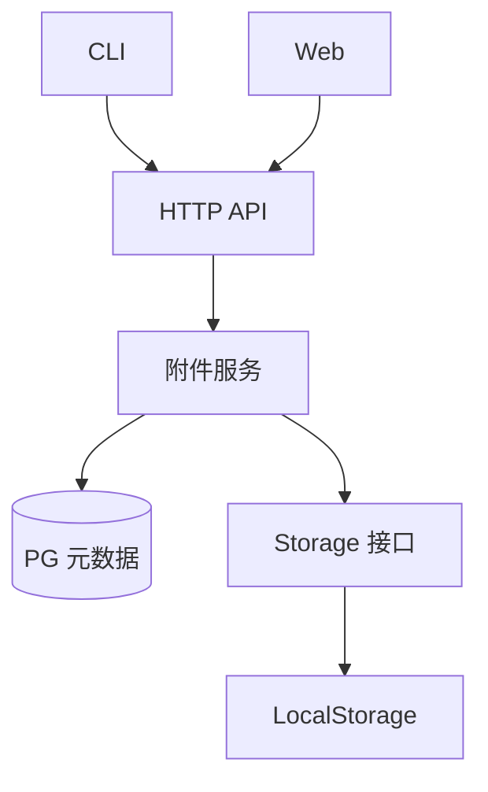

# Task 附件与通用文件存储设计

状态：通用存储、附件元数据与文件 HTTP/预览入口已实现；CLI、Web 管理界面和
持久卷仍待完成。各任务交付进度在 Daynight 中维护。

行为要求由[附件需求](../spec/daynight-task-attachments.md)拥有；本文解释通用存储接口、
附件元数据及各端集成机制。
[任务拆分](daynight-task-attachments-tasks.md)拥有实现顺序、依赖、文件归属和完成条件；
[决策记录](../../.agents/notes/implemented/architecture/2026-10-21-task-attachment-storage-design.md)
保存选择依据、已接受的限制及重新评估条件。决策采用不表示功能已经交付。

## 目标与操作单位

Task 可以保存设计文档、架构文档、图片、HTML mockup 等文件。内容由独立存储模块
管理，元数据保存在 PostgreSQL。Web 浏览和预览文件，CLI 直接读取原始内容。

每次上传、覆盖或删除一个普通文件。目录由相对路径形成：

```text
docs/
  design.md
  architecture.md
  images/
    topology.png
mockup/
  index.html
  assets/
    style.css
    app.js
```

以 `(taskId, attachmentRelativePath)` 标识附件。相同 task、相同完整路径上传时直接
覆盖；不同目录的同名文件可以共存。覆盖更新文件内容和元数据，不保留历史版本。
每个文件独立生效，多文件依次上传时页面可能同时读取尚未全部更新的资源。

目录没有独立记录。存在 `docs/design.md` 时显示 `docs/`，最后一个文件删除后该目录
不再出现在树中。操作入口接受单文件；没有目录上传、目录整体替换或空目录操作。

附件操作不改变 task 的 `version`、`updatedAt`、状态、依赖和任务图。已完成的 task
仍然可以添加、覆盖、读取和删除附件。

## 现有结构与集成位置

以下是当前源码事实，用来确定实现位置；附件行为仍是本文定义的待实现设计。

| 当前结构 | 集成方式 |
|---|---|
| [Task 模型](../../packages/daynight-server/internal/core/task.go)保存正文、状态、版本及依赖 | 新增独立附件模型与服务，不向 task PATCH 加入文件传输 |
| [HTTP 组装](../../packages/daynight-server/internal/server/server.go)在同一 mux 注册 API 和内嵌页面 | 附件 API 与预览复用同一服务及 origin |
| [JSON 解码](../../packages/daynight-server/internal/server/http.go)读取并校验受 1 MiB 限制的 JSON | 二进制上传使用独立的流式处理，既有 JSON 限制保持原义 |
| [附件迁移](../../packages/daynight-server/internal/core/store/migrations/004_task_attachments.sql)定义独立附件表 | 既有迁移机制维护该表，归属由服务校验 |
| [CLI API 客户端](../../packages/daynight/src/api/client.ts)解码并汇总 UTF-8 JSON | 增加共享取消与错误机制下的二进制传输通道 |
| [CLI 上下文](../../packages/daynight/src/cli/context.ts)的 stdout 接受字符串 | 增加可等待写入、保留背压的字节输出能力 |
| [任务详情](../../packages/daynight-web/src/features/task-detail/TaskDrawer.tsx)独立加载 task | 在详情中增加附件区域，保持图和详情既有读取行为 |
| [localhost Compose](../../deployment/localhost/compose.yaml)经 gateway 同源交付，服务使用 [UID 10001](../../deployment/localhost/Dockerfile) | 增加一个附件持久卷及写权限，不新增 Web 服务或预览监听端口 |

## 模块职责与依赖



服务内通用文件存储包位于 `internal/filestorage/`，本地实现在其
`local/` 子包。该包不依赖 task、project、HTTP 或 PG。附件服务选择 bucket、组成
逻辑路径，调用 Storage 并读写附件元数据；其他业务可以用自己的 bucket 复用它。

HTTP 层负责流传输、响应头、错误映射和 URL 路径解析。附件服务负责 task 归属、
业务路径及元数据。PG store 沿用具体实现；文件内容的 Storage 是本设计明确的
后端扩展接口。

## Bucket 与路径

Storage 用 `(bucket, path)` 定位文件。Bucket 是一个合法的单层目录名，按用途由
调用方选择。逻辑路径是保留大小写的非空相对路径，以 `/` 分隔。Bucket 不接受
路径分隔符，bucket 与 path 都拒绝控制字符及越出根目录的写法。

Task 附件使用固定 bucket：

```text
bucket = task-attachments
path   = <canonicalTaskId>/<attachmentRelativePath>
```

例如：

```text
task-attachments /
  8cb70697-87ec-4bfb-a9cb-bf9e065b51e8/docs/design.md
  8cb70697-87ec-4bfb-a9cb-bf9e065b51e8/mockup/index.html
```

Task ID 使用服务已有的规范 UUID 写法。用户文件名与路径保留原貌，不转小写、
不静默改名、不作 Unicode 归一化。拒绝绝对路径、空路径段、`.`、`..`、反斜杠及
控制字符；路径校验后才进行物理路径解析。

已有文件 `docs` 时不能创建 `docs/design.md`；已有 `docs/design.md` 时不能创建
文件 `docs`。附件服务检查该业务冲突，LocalStorage 也明确暴露实际文件系统冲突。
路径处理必须限制在配置的存储根目录内，符号链接不能使访问越过根目录。
LocalStorage 要求实际根目录支持区分大小写；准备目录时验证该能力，不支持时以配置
错误拒绝启动，不能把两个逻辑路径静默映射到同一文件。当前部署在 Linux 容器中
验证该契约，不增加大小写编码或兼容层。

本地物理布局直接采用：

```text
<storage-root>/
  task-attachments/
    <canonicalTaskId>/
      docs/
        design.md
      mockup/
        index.html
        assets/
          style.css
```

Task ID 前缀分片可以由本地实现在有目录规模依据时采用；它不进入逻辑路径、PG 或
API。当前布局没有分片配置或迁移工具。新增其他用途只需使用其他 bucket，bucket
按首次写入创建，不增加 bucket 管理 API。

## Storage 接口与本地实现

接口形状如下，最终声明遵循 Go 包的导出规则：

```go
type FileInfo struct {
    Size int64
}

type Object struct {
    Body io.ReadCloser
    Info FileInfo
}

type Storage interface {
    Put(ctx context.Context, bucket, path string, content io.Reader) (FileInfo, error)
    Open(ctx context.Context, bucket, path string) (Object, error)
    Delete(ctx context.Context, bucket, path string) error
}
```

契约如下：

- `Put` 流式消费内容，创建或覆盖准确的 bucket/path。成功返回实际保存的字节数。
  `Put` 不关闭调用方提供的 reader；HTTP 请求体和本地输入流由各自调用方管理。
- `Open` 打开当前文件，返回内容流与该次已打开文件的实际大小。调用方负责关闭
  `Body`。响应长度不能仅使用 PG 保存的大小，文件与元数据可能处于已知的不一致
  状态。
- `Delete` 删除准确的文件。文件不存在时删除已经完成；权限、I/O 等其他错误明确
  返回。删除不递归移除业务目录下的其他文件。
- Context 取消通过写入、读取和关闭流程向上传递；实现检查流复制过程中的取消，
  调用方负责通过取消 HTTP 请求或关闭自己拥有的输入流解除阻塞。不承诺中断任意
  调用方 reader 内部无法取消的阻塞。
- 缺失、非法路径和 I/O 错误保留可识别原因及错误链。接口不要求 `io.Seeker`，也不
  提供通用 Stat、Scan 或版本操作。

LocalStorage 在目标文件所在目录创建内部临时文件，流式写完并关闭后再替换目标。
内部短锁只保护当前实例的目录准备、发布和删除，不覆盖内容流传输或 PG 操作。
空内部目录可以在发布时让位于文件，非空目录和仍有上传临时文件的目录保持冲突；
不提供共享根目录多进程写入的协调。
替换前的普通写入失败或取消，清理本次调用拥有的临时文件并报告错误。用户可访问
的路径不会指向正在写入的半个文件；内部临时名不属于附件路径或历史版本。

替换实现需要满足目标平台的完整文件发布语义。存储模块仅保证一次文件写入的结果，
不扩展为文件系统与 PG 的事务，也不增加进程异常后的扫描清理服务。

后续存储后端实现同一个 bucket/path 契约；task 逻辑路径、API 和 CLI 用法保持稳定。

## PostgreSQL 元数据

新增 `task_attachments` 表：

| 字段 | 用途 |
|---|---|
| `project_id` | 所属 project |
| `task_id` | 所属 task |
| `path` | task 内完整相对路径 |
| `content_type` | 上传时确定的 MIME type |
| `size_bytes` | `Put` 返回的实际大小 |
| `created_at`、`updated_at` | PG 生成的创建与更新时间 |

以 `(task_id, path)` 作为主键，path 使用 `COLLATE "C"` 保持排序与唯一性区分大小写。业务服务在读写前检查 project/task
归属，不新增 foreign key。Bucket 是附件服务中的固定值，存储路径由 taskId 与 path
推导，表中不保存 `storage_key` 或物理根目录。

覆盖保留 `created_at`，更新 MIME、大小和 `updated_at`。删除后重新上传同一路径
创建新的附件记录。分页按相对路径的确定顺序进行 keyset 读取，cursor 包含上次路径，
并绑定 project、task 与附件列表类型；沿用既有 opaque cursor 和 `items/nextCursor`
形式。附件游标单独保存 version/kind/projectId/taskId/path，严格拒绝未知字段、
尾随 JSON 和跨作用域重用；不伪造既有 task 列表所需的 UUID/time 游标。每页使用
当前数据，不提供跨页快照。

## 上传、覆盖、读取与删除

上传依次校验业务输入和归属、调用 `Storage.Put`、创建或更新 PG 元数据，全部成功
后才返回成功。Storage 直接写入固定逻辑路径，不分配持久化唯一 key。

删除先检查附件记录与归属，再调用 `Storage.Delete`，随后删除 PG 元数据。读取先检查
归属及附件记录，再按推导路径调用 `Open`；缺失附件返回 404。记录存在而实际内容
缺失、权限不足或读取失败，按存储故障明确报告，不能返回伪造空文件。

读取响应的实际长度取自已打开文件；MIME 来自附件元数据。流开始前的失败使用既有
结构化错误响应，流开始后的失败记录并中断传输，不追加 JSON 或成功标记污染内容。

### 已知问题：文件与 PG 不具备原子性

文件操作与 PG 更新不属于同一事务。文件已经替换或删除后，PG 更新可能失败；进程
也可能在两者之间退出。因此可能出现文件与元数据不匹配、文件有内容但无附件记录，
或附件记录仍存在而文件已经缺失。并发覆盖或删除也可能导致最终内容与元数据来自
不同操作，不承诺跨介质的全局提交顺序。

该问题是已接受的限制。错误必须明确返回，并说明文件操作可能已经生效；客户端不
隐式重试写操作。实现不增加跨存储锁、补偿、回滚、状态机、对账、后台回收或自动
恢复机制，也不将一致性修复作为本方案的交付条件。

## HTTP API

公共 task 前缀为：

```text
T = /api/v1/projects/{projectId}/tasks/{taskId}
```

| 方法与路径 | 行为 |
|---|---|
| `GET T/attachments` | 分页读取附件元数据 |
| `PUT T/attachments/files/{path...}` | 上传一个文件，相同完整路径覆盖 |
| `GET T/attachments/files/{path...}` | 返回原始文件内容，用于 CLI 读取和下载 |
| `DELETE T/attachments/files/{path...}` | 删除指定文件 |
| `GET T/preview/{path...}` | 以浏览器 inline 方式提供文件及相对资源 |

上传请求体直接携带文件字节，`Content-Type` 表达文件 MIME。上传端按文件类型选择
合法 MIME，无法识别时使用 `application/octet-stream`；服务拒绝非法 header 值。
缺失 Content-Type 时使用 application/octet-stream。服务不使用 JSON 解码器接收文件，
也不将完整文件载入内存。

```http
PUT T/attachments/files/mockup/assets/style.css
Content-Type: text/css

body { background: white; }
```

新建成功返回 `201`，覆盖成功返回 `200`，响应是附件元数据；删除成功返回 `204`。
元数据示例：

```json
{
  "path": "mockup/assets/style.css",
  "contentType": "text/css",
  "sizeBytes": 1842,
  "createdAt": "2026-10-21T10:00:00Z",
  "updatedAt": "2026-10-21T10:00:00Z"
}
```

列表返回 `items` 与 `nextCursor`，复用既有 limit/cursor 约定。路径各段单独 URL 编码，
服务在路由重写或自动清理前检查非法路径，避免上传、删除被静默重定向至其他文件。
文件 URL 的 query 不作为文件路径，允许相对资源使用普通缓存参数。路径守卫只对
附件请求检测原始命名空间意图，不能因后续 parent 段或冗余前缀将修改重定向到旧
JSON 路由；正常既有路由行为保持原义。
所有入口均检查 project/task 归属。无效输入、缺失资源及内部失败使用既有 HTTP 错误
信封、requestId 和日志规则，保留原始错误链。

原始读取使用下载响应头，预览使用 inline 响应头，并以实际打开文件的大小发送内容。
列表与可覆盖的文件使用 `Cache-Control: no-store`，刷新后读取当前内容。
`path_conflict` 映射 409；存储记录存在而磁盘内容缺失仍为 500，不能被 not_found
错误链误判。流式中止只记录附件操作错误，现有日志包装器直接重抛 ErrAbortHandler，
保留真正 panic 的原有脱敏处理。

## 请求生命周期与诊断

复用服务现有 requestId、Context 和结构化日志。HTTP 请求建立关联，附件服务向
Storage 与 PG 传入同一个 Context；日志携带 request_id、project_id、task_id、
合法相对路径、操作和阶段。错误复用现有 LogFailure 的 type/component/phase/cause/
error_code/diagnostic 字段，保留错误链并经过现有脱敏规则，不记录文件正文、凭据或
物理根目录。流已经开始时的失败同样关联该请求，并终止传输。

文件操作在当前请求内完成；不引入后台任务或脱离请求的执行边界。CLI 复用已有
操作上下文和信号，Web 切换资源时取消本次拥有的请求。流的所有者在完成、失败或
取消时关闭它，不能把客户端取消伪装成成功。

部署后可对一次已知的附件请求按 requestId 核对现有日志，例如：

```bash
docker compose -f deployment/localhost/compose.yaml logs server | rg '"request_id":"attachment-check"'
```

对应请求使用 `X-Request-ID: attachment-check`，核对响应关联及失败时的组件、阶段和
脱敏诊断即可，不另建观测系统。

## Web 文件树与预览

Task 详情增加附件区域，分页加载元数据并按路径构建目录树。用户选择一个本地文件、
填写目标相对路径后上传；点击文件预览，单文件操作提供下载与删除。相同路径直接
覆盖，成功后刷新附件区域。加载、上传或删除失败在该区域显示错误，保留其他已加载
内容；不触发任务图更新。

| 类型 | 预览方式 |
|---|---|
| Markdown | 前端安全渲染，将相对图片及链接按该文件所在目录解析到预览路径 |
| 图片 | 图片查看 |
| PDF | 浏览器原生 PDF 查看 |
| 文本、JSON、源码 | 文本查看，保留内容与换行 |
| HTML | 普通 iframe 中加载并执行 |
| 其他格式 | 文件信息及下载 |

HTML 入口为固定 URL，例如：

```text
/api/v1/projects/{projectId}/tasks/{taskId}/preview/mockup/index.html
```

入口中的 `./assets/style.css`、`./assets/app.js` 和相对 fetch URL 按正常 URL 规则
读取同目录结构的文件。不改写 HTML、CSS 或 JavaScript 内容；以 `/` 开头的根相对
地址仍指向主站根目录，不自动改成 task 内路径。

HTML 附件属于可信项目代码，普通 iframe 与主应用同源，可以运行脚本、ES modules、
fetch 和浏览器存储，也拥有主应用的同源权限。本设计不提供执行隔离。预览复用既有
服务 origin，无预览 session/token、独立域名或端口、Service Worker、离线文件系统。

本设计确定交互和内容约定，不定义新的视觉样式；页面实现沿用现有看板组件和可访问
交互。具体文件切换应取消过期加载，避免前一文件内容覆盖当前选择。

## CLI

命令位于既有 `task` 下：

```bash
daynight task attachment put <task-id> ./design.md --path docs/design.md
daynight task attachment put <task-id> ./index.html --path mockup/index.html
daynight task attachment list <task-id> --tree
daynight task attachment list <task-id> --json
daynight task attachment read <task-id> docs/design.md
daynight task attachment read <task-id> mockup/assets/logo.png > ./logo.png
daynight task attachment remove <task-id> docs/design.md
```

全部命令支持现有 `--project` 选择规则；省略时复用仓库关联发现。`put` 省略 `--path`
使用来源文件 basename，只接受普通文件。默认 list 输出文件列表，`--tree` 展示目录
结构，`--json` 输出完整元数据，两种格式选项互斥。

`read` 向 stdout 输出原始字节，不解码、不增加标签、转义或额外换行。诊断写 stderr；
失败非零退出，已输出的部分内容可能不完整。上传及读取都采用保留背压的字节流，
不能复用现有汇总 UTF-8 JSON 的响应路径，也不能通过 string stdout 输出二进制。

元数据继续沿用 JSON DTO 校验和分页。字节通道复用
[操作生命周期](../../packages/daynight/src/api/operation.ts)中的取消、请求期限、整次
操作期限。元数据继续受现有 JSON 单响应及累计字节上限约束；原始文件上传和读取
使用有界缓冲流，不套用 JSON 字节上限，内存占用不随文件总大小增长。共享取消和
期限不因此放宽。文件传输失败、stdout
关闭或操作取消时，关闭本次拥有的流并解除网络请求。写请求不自动重试或经重定向
重发，结果未确认时明确提示操作可能已经生效。

命令登记、帮助及静态补全继续通过既有声明式命令树生成，帮助不加载配置、Git 或
网络依赖。

## 配置、部署与备份

服务使用必填 `DAYNIGHT_STORAGE_ROOT`，为 LocalStorage 指定明确的根目录。
当前启动以 `local.New` 准备根目录，向工厂提供 `server.Dependencies{Store, Files}`，
在监听前完成验证；后续启动失败与 HTTP 排空后均关闭已取得的文件根句柄。
启动时校验配置并以服务用户准备所需目录；无法访问或创建时启动失败。引入该必填
配置的同次交付必须更新所有现有服务启动调用方，包括 Compose、镜像目录权限、
Web 验收启动器、Go 子进程测试及 CLI 真实服务验收，不能等待后续持久卷任务。
物理目录不进入 API、PG 或 CLI 配置，所有客户端继续使用既有 `serverUrl`。

当前两套 Compose 已设置该变量，生产镜像已为 UID/GID `10001:10001` 准备可写
目录；Go 启动与重启 fixture、Web native runner 使用其所属独立目录。
A-T5 将为 localhost Compose 增加一个附件持久卷，挂载到该根目录。镜像内挂载点与卷初始化
匹配服务 UID/GID `10001:10001`，由真实容器写入及重建验收证明可用。dev-ci 使用
本次隔离 Compose 项目的附件卷，并在现有清理流程中删除；不使用开发环境持久卷。

上传、下载和预览继续经过同一个 gateway；对应代理规则必须支持二进制请求与流式
响应，并沿用既有生命周期策略。本设计不另设一套任意文件大小或时限参数。

数据库与附件目录构成一组备份材料。停止服务写入后备份 PG 与附件根目录；恢复使用
匹配的一组数据。此流程不承诺修复备份前已经存在的文件与元数据不一致。

## 实现验证

通用存储、元数据、HTTP 与 fixture 已有组件和实际二进制检查；源绑定结果归属
对应 PR 与 CI。CLI、Web 管理界面及持久卷仍按各自后续任务验证，不能由后端通过
结果代替。各层验证职责如下：

- Storage：bucket 隔离、真实相对路径、同路径完整覆盖、原始字节一致、实际大小、
  缺失与权限错误、取消、普通失败的临时文件清理及路径不能越出根目录。
- 附件服务与 PG：task 归属、大小写及同名路径、文件/目录冲突、覆盖保留元数据身份、
  删除、分页和 task 版本/状态/图不受附件操作影响。
- HTTP：二进制单文件上传、原样读取、下载与 inline 响应、相对资源、URL 编码、
  非法路径拒绝，以及失败明确暴露；不以跨介质原子性作为验收条件。
- CLI：实际构建入口的上传、完整列表、文本和二进制 stdout、背压、取消、管道中断、
  既有 project 选择、帮助及补全。
- Web：目录树与单文件操作、Markdown 相对图片、HTML 相对 CSS/JS/modules/fetch、
  图片/PDF/文本展示、失败反馈与切换文件时的过期请求取消。
- 部署：真实非 root 容器写入、同源 gateway 传输、正常重建保留附件、dev-ci 卷隔离
  及清理、配套备份恢复。

本方案没有新增 MCP 或模型工具定义，模型工具 schema 与 token 预算不适用。

各实现任务运行所影响模块的既有检查；CLI 使用 `pnpm typecheck`、`pnpm test`、
`pnpm build` 及相关安装验收，Web 使用 README 拥有的 `web:*` 验证，Go 服务使用
隔离 PostgreSQL 下的 `bash scripts/check.sh`。服务既有 build、vet、race、go-cov
及未取整总语句覆盖率严格大于 90% 的门槛保持不变。
