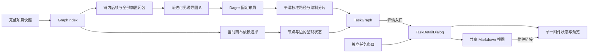

# 任务依赖追踪与详情阅读设计

状态：UX-T1、UX-T3 与 [PR #134](https://github.com/codetreker/daynight/pull/134) 渐进概览已交付，TaskDetailDialog 及概览/附件页签、左右分屏由当前主线拥有。依赖检查由进行中的[替代 PR #143](https://github.com/codetreker/daynight/pull/143)交付；旧 [#121](https://github.com/codetreker/daynight/pull/121) 已关闭弃用。当前主线仍保留卡片打开详情、既有 Dagre 折线与虚线 renderer。UX-T4 的 Markdown 与 bundled skill 验收和交付进行中。[要求](../spec/daynight-task-inspection.md)、[拆分](daynight-task-inspection-tasks.md)和[目标原型](mockups/task-inspection/index.html)分别拥有最终行为、交付边界与最终视觉。

## 问题与当前结构

当前任务节点是整张可点击按钮，点击后同时设置图的选中任务和打开详情。选择与阅读耦合，无法在画布上持续追踪依赖。投影已补齐链内任务的全部上游前置，并排除外部前置的无关后续；其机制由[完整上下文决策](../../.agents/notes/implemented/feature/2026-10-22-complete-prerequisite-context.md)拥有。当前主线依赖线仍按 Dagre 点列绘制为折线；描述使用共享 CommonMark/GFM 视图。详情已使用居中对话框，机制由[居中详情决策](../../.agents/notes/implemented/feature/2026-10-22-centered-task-detail-dialog.md)拥有；下文的选择与曲线属于替代 PR #143 的目标结构，不是当前主线交付事实；Markdown 描述的验收和交付状态独立。

这些事实分别由 [TaskNode](../../packages/daynight-web/src/features/task-graph/TaskNode.tsx)、[ProjectPage](../../packages/daynight-web/src/features/projects/ProjectPage.tsx)、[投影模型](../../packages/daynight-web/src/features/task-graph/model.ts)、[TaskGraph](../../packages/daynight-web/src/features/task-graph/TaskGraph.tsx) 和 [TaskDetailDialog](../../packages/daynight-web/src/features/task-detail/TaskDetailDialog.tsx) 实现。图索引已包含完整项目的 `dependsOn` 和 `successors`，无需新增服务端读取接口。附件预览已使用 `react-markdown`、`remark-gfm` 及任务内相对 URL 解析。

## 目标与边界

交付完整上游上下文、可持续依赖选择、平滑且同步高亮的连线、独立详情入口、居中详情阅读和 Markdown 描述。API 与存储继续使用现有任务字符串和依赖字段，图快照与详情读取保持独立。任务字段编辑、Markdown 编辑器、图布局替换、自动执行任务及新的附件协议不属于本设计。

已实现的独立任务/任务链标签能力负责分类和浏览偏好。本设计只定义图内卡片的新交互，以及所有现有详情入口共用的阅读窗口。独立条目仍直接打开详情；图内新交互接入现有页签、完成项过滤与浏览偏好。文件重叠本身不构成功能前置。

## 最终目标架构

后续检查 PR 的目标结构中，`ProjectPage` 拥有详情资源选择、打开入口和焦点恢复，每个挂载的 `TaskGraph` 拥有局部依赖选择。使用不同的回调表达 `onInspectTask(id)` 与 `onOpenTask(id, trigger)`，关系导航只更新详情 ID。卡片外壳为非交互容器，主选择按钮与“详情”按钮互为兄弟；详情按钮采用链接视觉，继续使用按钮语义，因为它打开本页对话框。

`model.ts` 拥有集合语义；`layout.ts` 只布局既定投影；路径模块把布局点列转换为标准曲线路径及绘制元数据；`TaskGraph` 组合这些结果和状态。标题、状态、共享与阻塞值继续来自完整索引，不能从淡化或过滤后的元素推导。

## 当前交付：完整数据与渐进概览

根 r 的主集合 `M = {r} ∪ descendants(r)`，完整 `P = M ∪ ancestors(M)`，外部 `C = P−M`。`projectRoot` 不变，C 无关后续仍排除。完整 M 拥有进度/状态，项目七项统计与未完成页签数来自完整快照，proposed/todo/in_progress/done 保持原读取语义。可见 `S ⊆ P` 独立，绘制两端在 S 的全部真实诱导边，无聚合或捷径。

`visibility.ts` 的 `createGraphOverview(index, P)` 在 P≤50任务且≤100边时全显；其他情况从根做快照稳定顺序的无向 BFS，先后续再前置。候选加入后实际节点/诱导边仍满足 50/100 才接纳，仅从接纳任务继续。`projectVisibleTasks(P, S)` 只缩小布局输入，不能重算完整计数。

`getTaskExpansion(index, P, S, taskId, direction)` 返回该方向前 20 个隐藏直接邻居、剩余数及准确 `addedEdges`，包括批内真实边；不递归，无手动边上限。卡片宽 220px；两方向都无可展开邻居时高 96px（94px 主体、2px 边框），不渲染 footer 或分隔线；至少一方向有控件时高 136px，包含 40px 双列 footer，另一空方向保留列位置。主体保持原详情触发，方向控件为兄弟按钮。每个可见快照只派生一次展开数据，布局、React Flow 尺寸、初始视口、锚点居中和键盘揭示共用每卡片的实际宽高。展开重排 S，当前缩放居中锚点并聚焦主体；全局“收起到概览”重算/定位并保留 reset 焦点。

`reconcileVisibleTasks(P, oldVisible)` 在成功刷新保留有效实际 ID，加根后仅取诱导无向图的根连通分量，不自动合入新 baseline。刷新保持视口，失败保持旧 S/数据/视口；重置/remount 才计算新概览，项目/根/页签/卸载清除局部状态。详情打开时不抢焦点，丢失入口由既有关闭回退处理。主线 TaskDetailPanels、附件双 pane/单一右滚动、locale 及请求生命周期保持。

当前布局和边绘制继续使用原有 Dagre points、M/L canonical 路径和局部轴向虚线分解。概览 PR 不引入独立 inspection/H、Details sibling、Q 编译器或新的 marker 所有权。[渐进图决策](../../.agents/notes/implemented/feature/2026-10-22-progressive-task-graph.md)记录部分替代 UX1 全量同时展示的理由和范围切分。

## 后续依赖检查目标

替代 PR #143 将主体切换为局部依赖选择，新增独立详情入口。完整 H 从索引计算，可见 H 与真实边/箭头高亮并显示去重隐藏祖先数；选择不改 S、布局或视口。成功刷新保留仍可见的选择，否则清除，失败保留。替代实现及其路由设计必须由该 PR 自身验证；下节保留原设计的路由记录。

## 原始依赖检查路由方案

本节保留原设计采用 Dagre 点列局部圆角的机制与理由。旧 #121 已关闭弃用；替代 PR #143 拥有其路由实现、设计同步和当前源码验收，本节不声明替代源码已采用或验证下列机制。当前主线的折线与虚线绘制保持原有交付事实。

### 路由选择

| 方案 | 路由与绘制代价 | 结论 |
|---|---|---|
| 端点 cubic Bézier | 整条曲线平滑，但丢失 Dagre 的避让点，长虚线绘制策略需要重新建立 | 不采用 |
| 端点 smoothstep | 提供直角圆角路由，但自行计算中间点，不能直接使用斜向 Dagre 点列 | 不采用 |
| Dagre 点列局部圆角 | 保留布局路由、端点和长直线，新增短曲线弧长与独立几何验收 | 采用 |

保留 Dagre 返回的路由点。对非共线转角 p，将入边和出边各裁切 `d = min(12, 入段长度 / 2, 出段长度 / 2)` 个画布单位；裁切点之间使用以 p 为控制点的二次 Bézier `Q`。相邻直线连接到曲线切线，保留首尾坐标和首尾方向。共线点合并，连续重复点只作为冗余点移除；非有限坐标等无效几何仍显式失败。曲线必须满足节点避让验收，不能以静默省略曲线或退回折角掩盖冲突。

不采用仅由端点计算的整条 cubic Bézier，也不采用端点式 smoothstep 自动路由，因为它们没有消费 Dagre 的中间路由点。官方固定版本 [Bezier 实现](https://github.com/xyflow/xyflow/blob/3d35b57317576b0916c0bfeaaedd573aaacc2839/packages/system/src/utils/edges/bezier-edge.ts#L121-L158) 与 [smoothstep 实现](https://github.com/xyflow/xyflow/blob/3d35b57317576b0916c0bfeaaedd573aaacc2839/packages/system/src/utils/edges/smoothstep-edge.ts#L214-L295)说明各自输入；后者的直角转弯算法也不能直接处理 Dagre 的斜向点列。保留路由再圆角化可持续复用现有节点排列及长直线绘制优化。

### 标准路径与外部虚线

一个路径模型同时生成整条可访问标准 `M/L/Q` 路径、箭头的最终切线，以及外部虚线的局部绘制片段。内部边直接绘制标准路径。外部边继续将长直线段画成局部坐标水平 `<line>`，短曲线画成局部路径；整条标准路径只承担语义和 marker。不得重新绘制带长斜线包围盒的整条虚线路径。

分片沿同一标准曲线累积实际弧长，保持现有 5/4 虚线周期和相位；曲线弧长使用可证明误差界的计算，单条路径累计误差在最大支持缩放下不超过 0.1 CSS px。箭头、实线和所有虚线分片共享呈现状态。使用有限的普通/高亮/淡化 marker 变体或等效稳定机制，避免每次选择重新生成几何和每条边独立复制 marker。

路径转换与弧长分片在布局结果变化时预计算。选择只更新节点、边和 marker 的样式引用。无关元素的透明度不得降低到无法阅读状态的程度，选中和前置样式使用边框、底色及可访问说明区分，原有状态色保留。

### 验收判断的升级

既有生产验收对折线路径及分片有独立几何判断。曲线交付必须同步升级判断器，支持 `M/L/Q`、端点、最终切线、节点矩形避让、全部边覆盖、曲线与虚线分片一致性。判断器使用独立解析与采样或独立数学计算，不导入生产路径生成器作为期望值；加入缺边、错误箭头、曲线穿过节点、相位偏差等负例。只放宽现有 `M/L` 断言不构成曲线验收。

## 居中详情

`TaskDetailDialog` 组合已有详情 hook、关系跳转、PR 和附件组件，样式由 `task-detail.css` 的 `task-detail-*` 命名空间拥有。外壳相对可用视口居中，宽度 `min(960px, 100% − 2 × gutter)`，桌面 `gutter = 24px`，600px 及以下为 12px；最大高度为 `min(880px, 100dvh − 2 × gutter)`。标题栏、详情页签、关闭按钮和底部说明处于滚动内容之外。默认“概览”正文独立滚动，包含描述、PR 与元数据/关系；桌面为阅读主栏与 265px 侧栏，850px 及以下侧栏收为 225px，600px 及以下堆叠。附件页签占用全部正文宽度，在所有宽度下保持左列表、右预览；尺寸链及唯一右侧滚动所有者由[附件设计](daynight-task-attachments.md#web-文件树与预览)拥有。长文本换行，代码和表格只在所属区域横向滚动。描述使用共享 Markdown 视图和现有附件导航，详情加载与错误继续由详情资源拥有。

继续复用 body portal、共享滚动锁、背景 inert、焦点循环、遮罩关闭和分层 Esc。清理 inert、滚动锁和监听器的同步阶段与 DOM 移除后恢复焦点的阶段保持既有职责。原入口消失时优先选择仍可用的全屏退出控件，否则使用当前页签内可见的任务或页签控件；整个项目为空时恢复项目标题。任务关系切换不卸载外壳，不中途恢复到旧入口。外壳不引入图重挂载。`dialogFocusables` 与实际对话框中的同源附件 frame 共用可见控件枚举，frame 监听仍按原有 load/替换/卸载生命周期释放。附件独立阅读页复用内容渲染，但保留普通浏览器键盘行为；其路由、完整清单与满视口阅读机制由[附件设计](daynight-task-attachments.md#独立附件阅读页)拥有。

## Markdown 与附件链接

`MarkdownContent` 复用 `react-markdown` 与 `remark-gfm`，只拥有 CommonMark/GFM
渲染及共享样式，覆盖标题、段落、列表、引用、代码、表格、链接和图片。原始 HTML
作为文本，URL 协议沿用已有规则。空描述使用双语目录中的空态消息；用户 Markdown
字节不随语言切换变化。概览继续拥有纵向阅读滚动，代码和表格只在局部横向滚动，
宽内容不能撑破 320px 的尺寸链。

`MarkdownAttachmentBase` 显式区分任务 `root` 与实际文件 `document`。描述从当前
任务附件根解析相对链接和图片；附件 Markdown 从实际文件目录解析。既有路径解析
逐段解码、处理 parent 段并拒绝越过任务根，继续使用真实预览 URL 构造器；不为描述
虚构文件名。API 保存和 CLI/Agent 读取保持原始字符串，不增加格式标记、迁移或
旧数据特判，描述更新保留完整字段替换及观察到的版本语义。

`TaskDetailReading` 在当前 project/task 身份内持有单个 `useAttachments`，将同一
控制器交给描述导航、`TaskDetailPanels` 和 `TaskAttachmentsPanel`。普通主键点击
无 query/hash 的有效相对文件链接时，选择解码后的路径、激活附件页签并将焦点带入
已有 `.attachment-preview-pane`。清单完整前保留加载，只有完整分页清单才判定
缺失；非法路径、清单失败、确认缺失与预览失败分别可见，适用时提供重试。附件区
和描述没有第二份清单或预览请求所有者。独立使用的 `TaskAttachments` wrapper 保留
自身 hook，独立阅读页继续沿用原有文件身份与普通浏览器键盘行为。

链接保留真实 preview `href`。修饰键、非主键、上下文菜单、绝对 URL、协议 URL、
以 `/` 开头的 URL、`#fragment` 及 query/hash 链接使用经过现有 URL 策略处理的
原生导航，不生成 Markdown 标题 ID。预览、原生 frame 键盘桥及 focus cleanup 保留
原所有者；选择、关闭、任务/鉴权/资源失效通过原有取消和 generation 规则排除旧
结果，同路径更新仍使用既有 revision 与 `updatedAt` 重读规则。

公开 skill 源为 `packages/daynight/src/commands/skill/skills/using-daynight/`。
入口、create-task、run-task、handbook 和适用 Goal 指引要求 Markdown 自足简介，
包含具体问题、行动、范围、交付物、约束、简明完成条件和真实引用。任务专属主
Markdown 仍拥有详细 Solution、完整 Acceptance criteria 与证据；共享要求、设计和
原型引用实际来源，不复制整套资料。`[方案与验收](plan.md)` 或
`[交互原型](mockui/index.html)` 只用于实际归属且确认上传的文件。依赖、PR 属性、
Goal 阶段和创建/实现/合并权限不变。交付验证检查实际 npm bundle 及隔离安装夹具，
安装目录通过正常重新安装更新。机制取舍见
[Markdown 描述决策](../../.agents/notes/implemented/architecture/2026-10-22-task-description-markdown.md)。

## 可交互原型

[独立原型](mockups/task-inspection/index.html)沿用生产工作空间、卡片、状态和附件样式，以本地 fixture 展示完整祖先图和最终交互。无需后端或 CDN，可作为任务附件独立打开。它覆盖普通和跨链依赖、共享前置、完成状态、无关分支、选择清除、平滑高亮连线、详情及关系切换、长 Markdown、附件预览、全屏、缩放和平移，以及加载、失败、空态和窄屏。

原型固定 fixture 几何供视觉评估，生产仍由 Dagre 布局。实现任务必须把确认的控件和样式落到生产组件，并更新现有 production-component mockup；独立原型不替代生产组件验收，也不证明大图性能。

## 验证、失败与观测

已交付 PR #134 测试完整 P 与 S 分离、50/100 边界、快照稳定 accepted-only BFS、20 个直接邻居、精确诱导边及剩余数量、共享去重、四状态、无关后续、全局 reset 和实际集合的刷新根连通修剪。浏览器覆盖桌面/320px 的展开、reset framing/focus、既有详情/附件/全屏/locale 和刷新不抢焦点。

四个固定 1,000 任务输入及 999/5,000 边保留，每图五次。完整 API 逐 ID 校验，DOM 判断改为有界概览和全部可见诱导边，并验证显式展开/reset；打开≤3,000ms，详情/缩放/平移≤300ms，保持详情关闭后立即缩放且无额外等待。31 项场景、零重试、timeout、超限/覆盖率/清理保持。当前原有 polyline 与 dash 判断覆盖全部可见线；不声明 H、selectMs 或曲线容量结论。

替代 PR #143 独立验证完整祖先/隐藏数、高亮同步、独立详情控件、选择稳定和曲线/paint/marker，并测量选择反馈；其几何判断独立于生产路径生成器。真实源码绑定生产回执仍是每个 PR 的门槛，原型与历史 full-render 结果不能代替。图/详情请求取消、资源身份、完整快照、脱敏错误和 requestId 保持现有所有权，无新遥测或服务接口。

## 交付与演进

[任务拆分](daynight-task-inspection-tasks.md)定义四个交付目的，UX-T2 保留已交付 PR #134 概览，由替代 PR #143 独立验收和合并后完成任务。UX-T4 的验收和交付状态独立于图检查。API 不引入格式标记或旧数据特判，现有字符串直接按 Markdown 展示；不批量改写已有任务描述。任务拆分拥有每项交付的文档同步和完成条件，Daynight 记录实际进度。

后续如需任务字段编辑或 Markdown 标题锚点，可沿现有原始字符串和链接回调增加能力；它们是可独立追加的功能。不得为未来编辑器加入新的数据格式，也不得把依赖选择与详情打开重新绑定。新增布局引擎、worker 或新的容量上限需要独立证据和授权，当前实现先满足既有真实预算。
