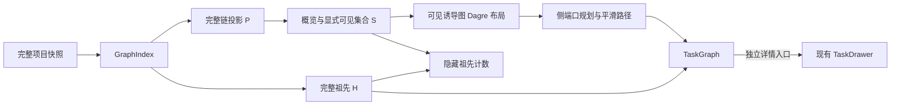

# 任务依赖追踪与详情阅读设计

状态：UX-T1 的完整上下文数据已交付。UX-T2 采用渐进可见图、独立依赖选择和平滑连线，真实运行与交付证据待完成；UX-T3 居中详情与 UX-T4 Markdown 描述待实现。[要求](../spec/daynight-task-inspection.md)拥有行为，[任务拆分](daynight-task-inspection-tasks.md)拥有范围，[原型](mockups/task-inspection/index.html)拥有最终视觉交互。[渐进图决策](../../.agents/notes/implemented/feature/2026-10-22-progressive-task-graph.md)替代全部数据同时可见的展示要求，保留[完整上下文决策](../../.agents/notes/implemented/feature/2026-10-22-complete-prerequisite-context.md)的原始理由和数据保证。

## 目标与当前结构

任务链保留完整依赖数据，画布从可读概览开始，读者通过明确控件逐步加入任务。卡片主体只追踪依赖，“详情”打开独立阅读界面。选择高亮可见路径并准确说明隐藏祖先，选择本身不展开或移动图。独立任务条目继续直接打开详情；页签分类、未完成任务计数、筛选和持久化偏好保留现有语义。

完整项目快照与索引已有 `dependsOn` 和 successors，不增加服务端接口、数据格式或新的 task 状态。`projectRoot` 保留 UX-T1 的完整链上下文；新的可见投影只改变布局和渲染输入。详情仍是 `TaskDrawer` 和纯文本描述，居中与 Markdown 由各自任务交付。

## 数据与职责

`ProjectPage` 拥有详情 ID、入口及关闭后焦点恢复。当前挂载画布拥有实际可见 ID 集合和依赖选择；项目、根、页签变化或卸载时释放。`TaskInspectionContext` 提供选择状态，受控 React Flow node/data 保持 task、几何、分类和稳定回调，memoized `TaskNodeContent` 保留标题、状态及共享/外部标记。方向展开、主体选择和详情是兄弟原生控件；两个原有控件及新增展开入口均保留键盘访问。

`model.ts` 拥有完整图和祖先集合；`visibility.ts` 拥有概览、直接邻居批次、诱导可见投影及刷新连通协调；`layout.ts` 与 `routing.ts` 只处理当前可见图。`DependencyEdges` 采用声明式 React 和三个恒定 direct-RGB 原生 marker 表达 normal/highlighted/unrelated，marker 位于 canonical 路径；`.task-dependency-body` 的 stroke 拥有 body 颜色，paint primitives 局部继承。选择不改变路线、虚线分片或节点几何。

## 完整数据与渐进可见集合

给定根 r，`M = {r} ∪ descendants(r)`，`P = M ∪ ancestors(M)`，外部集合为 `C = P − M`。P 包含全部所需前置和依赖，不引入 C 的无关后续。链内进度和状态只计算 M，项目统计仍按完整快照去重。可见集合 `S ⊆ P` 始终包含根；可见边是 P 中两端都属于 S 的全部真实边，无捷径、聚合节点或合成依赖。

`createGraphOverview(index, P)` 在 P 不超过 50 个任务且 100 条依赖时返回全部 P。其余情况从根开始，按稳定无向 BFS 接纳任务：每个已接纳节点先看后续、再看前置，各方向按 `index.nodes` 的快照顺序。候选只有在加入后 S 仍不超过 50 个节点、实际诱导边仍不超过 100 条时才接纳；只从接纳节点继续，拒绝者不继续遍历，也不反复尝试。判断针对当前 P，小链不会因项目很大而被折叠。

`getTaskExpansion(index, P, S, taskId, direction)` 返回 P 内指定方向前 20 个隐藏直接邻居、全部隐藏直接邻居数及本批 `addedEdges`。只加入本批 ID，不递归。新增边数为 `E(S ∪ batch) − E(S)`，包含新增任务之间及其与原可见集合之间的全部真实边；手动展开不设边数上限，可超过初始 50/100。相同任务从不同入口展开仍只出现一次。`projectVisibleTasks(P, S)` 将完整 main/external 归属带入可见投影，布局不能用可见任务重算完整链进度。

工具栏区分可见任务/边和完整上下文数量，卡片方向控件准确预告本批新增任务与依赖。外部卡片仍标记“外部前置”，完成、阻塞和共享数据仍来自完整快照。一个“收起到概览”按钮重新计算概览并定位视口，无分支归属或逐分支折叠状态。

## 选择、刷新与视口

选择 s 时从完整索引计算 `H = {s} ∪ ancestors(s)`。仅 S∩H 的卡片和终点在 H 的可见真实边高亮；隐藏祖先数量为 `|H − S|`，按 ID 去重。选中任务与前置有不同样式，无关项淡化但文字与状态可辨。再次点击同一卡片或空白清除。主体选择、详情打开/关闭和关系导航均不改变 S、位置、路线或视口。

显式方向展开允许重新布局，并可在当前缩放居中操作卡片并聚焦其主体；全局重置重新计算概览并 framing，焦点保持在稳定的重置按钮。重置后选中 ID 仍可见则保留，否则清除。

`reconcileVisibleTasks(P, oldVisible)` 在成功刷新时保留仍属于新 P 的实际可见 ID，加上根，随后只保留可见诱导无向图的根连通分量。断开任务永久退出 S，不自动并入新 baseline 或新到任务；重置或 remount 才计算新概览。成功刷新保留视口，仍可见的选择从新完整数据重算，不可见则清除。失败保持旧快照、S、选择与视口。

详情打开时刷新不能把焦点抢回图；原详情入口消失后，在关闭时使用既有工具栏/根条目/标题回退。可见控件的离屏聚焦仍通过布局中心、固定尺寸和 viewport 计算，不使用原生 focus 临时滚动后的任务 DOM 边界，保持可读缩放；鼠标及已可见控件聚焦不移动图。

## 可见路线与绘制

Dagre 拥有当前 S 的坐标、rank、排序及中间 lane 意图。`routing.ts` 的 `planDependencyRoutes(nodes, edges)` 接收固定尺寸的 `RoutingNode` 矩形及可见真实边，将前置右侧中心连接到后续左侧中心。列/间隔索引保留畅通直段和中间卡片列 anchor；受阻路段使用列内自由行及 rank 间中点通道，12 单位扩张矩形保护圆角，自由行距卡片至少 16 单位，x 向前，失败显式暴露。库边界及原始 raw-Dagre 圆角选择的理由见[路线决策](../../.agents/notes/implemented/architecture/2026-10-22-task-dependency-routing.md)。

`compileDependencyRoute(points, dashed)` 将规划点列转为 canonical `M/L/Q` 和可选虚线 pieces。非共线转角两侧各裁切 `min(12, 入段/2, 出段/2)`，以原角为 Q 控制点；重复和同向共线冗余点移除，端口与水平首尾方向保留。实线原生描边；外部 body 仍采用局部水平旋转长线与短曲线路径，canonical 路径保留 marker 与语义。

虚线保持 5/4、周期 9。自适应 de Casteljau chord/control-polygon 上下界计算实际曲线长度，各 Q 平分单路线预算，最大缩放 1.8 时累计误差不超过 0.025 CSS px。分片 `startDistance` 沿真实弧长累计，长线切缝在相位 7 的 gap 中点。选择只换呈现，显式可见结构变化或成功快照才重新布局/编译。原[长虚线绘制决策](../../.agents/notes/implemented/bug-fix/2026-10-20-long-dashed-dependency-paint.md)保留原始全图 raster 证据；它不证明当前渐进图的生产性能。

## 居中详情

详情外壳更名为 `TaskDetailDialog`，保留已有详情 hook、关系跳转、PR 和附件组件。内容区位于视口居中容器，宽度 `min(960px, 100% − 2 × gutter)`，桌面 `gutter = 24px`，600px 以下为 12px；高度不超过 `100dvh − 2 × gutter`。内部内容滚动，标题栏、关闭按钮及既有底部说明保持可访问。长代码和表格局部横向滚动。

继续复用 body portal、共享滚动锁、背景 inert、焦点循环、遮罩关闭和分层 Esc。清理 inert、滚动锁和监听器的同步阶段与 DOM 移除后恢复焦点的阶段保持既有职责。原入口消失时仍依次选择可用的全屏退出控件、当前根和项目标题；独立任务标签集成后，保留其当前可用条目或标签回退。任务关系切换不卸载外壳，不中途恢复到旧入口。原型的窗口动画仅作用于外壳，不引入图重挂载。

## Markdown 与附件链接

从 `AttachmentPreview` 提取只负责 CommonMark/GFM 渲染和样式的 Markdown 视图；URL 转换及链接激活由调用方提供。描述调用方使用附件根为基准，Markdown 附件调用方使用实际文档目录，不能给描述虚构一个文件名或目录。原始 HTML、协议处理和图片规则沿用现有附件规则。

详情组合层共享单个附件控制器给描述导航与附件区域。普通主键点击无 query/hash 的相对附件链接时，读取完整附件清单，选中路径并聚焦、滚动到已有预览区域；Markdown、图片、HTML、PDF、文本和未知类型继续使用既有预览或下载行为。路径无效、清单失败、附件不存在与内容失败有各自可见状态，不能以空清单兜底。

保留真实 preview `href`；修饰键、上下文菜单、绝对 URL、协议 URL、以 `/` 开头的 URL、`#fragment` 及带 query/hash 的链接使用经过现有 URL 策略处理的原生导航。本设计不生成 Markdown 标题 ID。相对图片以任务附件根解析，附件内部资源仍按文件目录解析。附件更新独立于 task version；描述变更继续使用完整字段替换和观察到的版本。

公开 skill 源为 `packages/daynight/src/commands/skill/skills/using-daynight/`。同步入口、create-task、run-task 和适用的 handbook 指引、skill 需求/设计及 README。示例使用 `[方案与验收](plan.md)` 和 `[交互原型](mockui/index.html)`，上传并确认真实内容后才加入引用。安装目录通过正常重新安装获得更新，交付验证检查实际 npm 包中的完整 bundle。

## 原型、验证与交付

[可交互原型](mockups/task-inspection/index.html)展示小图全显、大图渐进概览、链内与外部任务方向展开、准确批次计数、隐藏祖先提示、全局重置、选择不移动图，以及后续居中详情和 Markdown 的最终视觉。生产组件原型复用真实 CSS 与组件；两者均不能替代真实服务或容量证据。

独立模型测试复算 P、S、完整诱导边、50/100 接纳、稳定后续优先 BFS、20 个直接邻居批次及无手动边上限、共享去重、隐藏祖先、刷新实际集合的根连通修剪和失败保留。浏览器检查桌面/320px 展开、重置 framing、选择/详情稳定、打开详情时刷新不抢焦点及全部可见控件。

几何预期只包含从 API 独立派生的当前可见节点 ID、真实边及 external 归属。可选 `compilerInputs` 单独检查编译忠实度；实际 DOM 固定端口、正向水平首尾、每条 Q 的 12 单位对称裁切及相切、全部可见卡片避让、完整可见 body coverage、真实弧长、虚线相位和原生 marker 始终独立验证，不复制生产规划器。

四个固定输入仍各含 1,000 个任务及原有 999/5,000 条依赖，每图五次。每次检查完整 API 数据、受限初始 S 及全部诱导边，验证显式展开/重置与隐藏上游数量；不再以完整输入全部同时进入 DOM 为要求。打开概览最慢不超过 3,000ms，选择、详情、缩放和平移不超过 300ms。保留普通态详情→关闭→立即缩放/平移、当前可见任务可信选择、高亮态同序列，详情/缩放/平移取两态较慢值，网络独立记录。关闭到缩放之间不插入重置或等待。

原生、容器、覆盖率与固定 CI 浏览器回执仍是交付门槛。UX1 的已交付投影与历史证据保持原义，UX2 的渐进呈现通过本任务验证。逐分支折叠和聚合节点延后；后续加入需要共享归属/组边语义，当前保留真实 ID、完整 P 与独立 S 使其代价明确。Daynight 主附件记录执行与待完成证据；运行结果随对应 PR 与 CI 保存。
