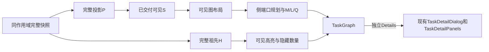

# 任务依赖追踪与详情阅读设计

状态：[PR #134](https://github.com/codetreker/daynight/pull/134) 的渐进概览已合并为 `53e3a0c0ff4ec821f74a2401a3bfa7de24a3f4ea`。当前 #121 只在该基线上交付独立依赖检查、Details 与平滑连线，完整当前 head 验收待完成；#121 合并才完成 UX-T2。UX1、UX3、TaskDetailPanels/附件分屏、四状态/七项统计、双语与 opt-in AuthenticatedApp 由主线拥有，Markdown 属于 UX4。[要求](../spec/daynight-task-inspection.md)、[拆分](daynight-task-inspection-tasks.md)和[原型](mockups/task-inspection/index.html)拥有行为、交付边界与最终视觉。

## 已交付基线与当前责任

完整 P 保持 M（根及全部后续）和所有祖先，排除外部无关后续。PR134 的50任务/100诱导边概览、快照稳定后续优先accepted-only BFS、20直接邻居显式批次、精确增量、无手动边上限、全局reset和实际S刷新根连通修剪保持；完整M进度/状态、七项统计与未完成页签计数不按S重算。[渐进决策](../../.agents/notes/implemented/feature/2026-10-22-progressive-task-graph.md)拥有该已交付渲染工作负载政策，本PR不重新定义它。

当前 ProjectPage 只拥有详情资源/入口及关闭恢复；挂载画布拥有独立依赖选择。主体切换检查，Details 打开现有 TaskDetailDialog，方向按钮沿用 PR134；均为兄弟原生控件。`tracePrerequisites(index, taskId)` 从完整数据返回H，未知ID失败。只高亮S∩H及其真实可见依赖，隐藏祖先为|H−S|按ID去重。同卡片/空白清除，另一卡片替换；四状态、共享、阻塞和外部虚线保持。

## 呈现、选择与生命周期

`inspection.tsx` 的 TaskInspectionContext 提供局部selectedTaskId/highlighted；受控React Flow node/data保存task、几何、分类及稳定回调，不因检查角色更换。TaskNode shell读取状态，memoized TaskNodeContent保留标题/状态/共享/外部内容。选择不改S、布局、路径/分片或视口，详情打开/关闭及关系导航不写检查状态。

PR134展开/reset可改变可见结构。reset后选择仍可见则保留，否则清除。成功同身份/项目/鉴权作用域刷新保留有效实际S加根并修剪连通分量，重算仍可见选择，保持视口；普通失败只在该作用域保留旧数据。current-generation401、身份/会话或项目作用域变化继续执行[鉴权工作空间](../../.agents/notes/implemented/feature/2026-10-22-web-auth-workspace.md)的失效、取消与私有内容卸载，不能跨作用域保留快照或检查。生产App和opt-in AuthenticatedApp的启用关系保持主线原义。

刷新不抢对话框焦点，消失入口使用关闭回退。若仅移除已聚焦footer而卡片仍在，TaskNode最终DOM commit恢复到主体并抑制reveal，避免React Flow较晚controlled-node commit删除焦点；整卡片消失仍用图/全屏回退。普通键盘reveal由布局中心、136固定高度和viewport判断，排除原生focus临时overflow滚动；鼠标与已可见聚焦保持视口。语言切换重译新消息，不更换S、几何或资源，不重发请求。

## 可见路线与绘制

`routing.ts` 的 RoutingNode/planDependencyRoutes接收当前可见卡片矩形及真实边，保留Dagre节点位置、顺序与中间lane意图。源右中心到目标左中心，畅通直段保留，受阻路段经列内free row与rank-gap通道；共享列/区间索引、16单位通道间距和12单位扩张矩形保护Q，x向前，失败显式暴露。[路线决策](../../.agents/notes/implemented/architecture/2026-10-22-task-dependency-routing.md)保留原Dagre端点为何不足的理由。

`compileDependencyRoute(points,dashed)` 生成canonical M/L/Q和DashPiece，Q对称裁切min(12,in/2,out/2)，移除重复/同向共线冗余点，保持固定端口和水平首尾。外部paint继续局部水平旋转长线与短Q；5/4相位由真实累计弧长确定，自适应deCasteljau chord/control-polygon界将最大1.8缩放累计误差限于0.025 CSS px。选择复用几何。

DependencyEdges声明式渲染三种恒定direct-RGB原生marker，canonical路径引用对应marker；task-dependency-body的stroke拥有body颜色，primitive继承。每条可见真实边、身份/role、body piece和原生箭头都保留；编译只随可见布局改变。[检查决策](../../.agents/notes/implemented/feature/2026-10-22-task-dependency-inspection.md)拥有状态与绘制边界，[长虚线证据](../../.agents/notes/implemented/bug-fix/2026-10-20-long-dashed-dependency-paint.md)仍作为历史机制依据。

## 居中详情

`TaskDetailDialog` 组合已有详情 hook、关系跳转、PR 和附件组件，样式由 `task-detail.css` 的 `task-detail-*` 命名空间拥有。外壳相对可用视口居中，宽度 `min(960px, 100% − 2 × gutter)`，桌面 `gutter = 24px`，600px 及以下为 12px；最大高度为 `min(880px, 100dvh − 2 × gutter)`。标题栏、详情页签、关闭按钮和底部说明处于滚动内容之外。默认“概览”正文独立滚动，包含描述、PR 与元数据/关系；桌面为阅读主栏与 265px 侧栏，850px 及以下侧栏收为 225px，600px 及以下堆叠。附件页签占用全部正文宽度，在所有宽度下保持左列表、右预览；尺寸链及唯一右侧滚动所有者由[附件设计](daynight-task-attachments.md#web-文件树与预览)拥有。长文本换行，代码和表格只在所属区域横向滚动。描述仍为纯文本，Markdown 与描述附件导航由 UX-T4 交付。

继续复用 body portal、共享滚动锁、背景 inert、焦点循环、遮罩关闭和分层 Esc。清理 inert、滚动锁和监听器的同步阶段与 DOM 移除后恢复焦点的阶段保持既有职责。原入口消失时优先选择仍可用的全屏退出控件，否则使用当前页签内可见的任务或页签控件；整个项目为空时恢复项目标题。任务关系切换不卸载外壳，不中途恢复到旧入口。外壳不引入图重挂载。`dialogFocusables` 与同源附件 frame 共用可见控件枚举，frame 监听仍按原有 load/替换/卸载生命周期释放。

## Markdown 与附件链接

从 `AttachmentPreview` 提取只负责 CommonMark/GFM 渲染和样式的 Markdown 视图；URL 转换及链接激活由调用方提供。描述调用方使用附件根为基准，Markdown 附件调用方使用实际文档目录，不能给描述虚构一个文件名或目录。原始 HTML、协议处理和图片规则沿用现有附件规则。

详情组合层共享单个附件控制器给描述导航与附件区域。普通主键点击无 query/hash 的相对附件链接时，读取完整附件清单，激活附件页签，选中路径并聚焦已有预览区域；Markdown、图片、HTML、PDF、文本和未知类型继续使用既有预览或下载行为。路径无效、清单失败、附件不存在与内容失败有各自可见状态，不能以空清单兜底。

保留真实 preview `href`；修饰键、上下文菜单、绝对 URL、协议 URL、以 `/` 开头的 URL、`#fragment` 及带 query/hash 的链接使用经过现有 URL 策略处理的原生导航。本设计不生成 Markdown 标题 ID。相对图片以任务附件根解析，附件内部资源仍按文件目录解析。附件更新独立于 task version；描述变更继续使用完整字段替换和观察到的版本。

公开 skill 源为 `packages/daynight/src/commands/skill/skills/using-daynight/`。同步入口、create-task、run-task 和适用的 handbook 指引、skill 需求/设计及 README。示例使用 `[方案与验收](plan.md)` 和 `[交互原型](mockui/index.html)`，上传并确认真实内容后才加入引用。安装目录通过正常重新安装获得更新，交付验证检查实际 npm 包中的完整 bundle。

## 当前验证与交付

继承PR134的完整输入、50/100/20、mandatory visibility[5]与计数/焦点验收。当前增加完整H、可见role与隐藏祖先，选择/Details/关系前后S/节点/标准d/paint pieces/视口稳定，以及同作用域普通失败保留和鉴权失效清理。

GeometryExpectation是visible-topology独立DependencyTopology，只含API身份/dependsOn及预期S的真实诱导边/external，不使用生产planner/curve生成预期。可选compilerInputs单独检验编译忠实度。实际DOM固定左右中心、正向水平端、全部Q≤12对称/相切、所有可见卡片避让、真实CTM、全部bodycoverage、独立解析弧长/虚线phase和原生RGBmarker无条件验证；负例覆盖缺/多边、错误箭头、穿卡片及相位/覆盖错误。

四个完整1000任务、999/5000边输入各五次。保留PR134全部visibility行，增加非空selectedId和精确hiddenUpstream；selectMs≤300、open≤3000、detail/zoom/pan≤300。普通Details→close→立即zoom/pan后做deep-visible可信选择，再高亮态重复；每项取较慢state，network独立记录，不在close与zoom间增加等待/reset/fit。31场景、双语、现有详情/附件面板、超限/coverage/timeout/零retry与清理保持。

PR134的31项真实运行及CI/approval不替当前head建立结论。当前build/typecheck/unit/coverage/component/native/container/capacity和exact-head review必须有独立证据；受保护合并#121后才完成UX-T2。原型不替生产验收，UX4继续拥有Markdown和skill。
