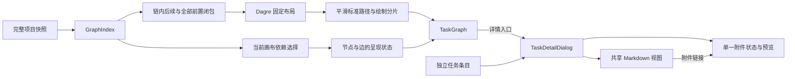

# 任务依赖追踪与详情阅读设计

状态：完整上游上下文、依赖选择、平滑高亮连线和独立详情入口（UX-T1–UX-T2）已实现；居中详情和 Markdown 描述（UX-T3–UX-T4）待实现。适用模块为 `daynight-web` 与 CLI 发布的 `using-daynight` skill。行为以[要求](../spec/daynight-task-inspection.md)为准，交付边界见[任务拆分](daynight-task-inspection-tasks.md)，视觉见[交互原型](mockups/task-inspection/index.html)。[决策记录](../../.agents/notes/implemented/architecture/2026-10-22-task-inspection-design.md)保留实际比较与范围选择。

## 问题与当前结构

任务卡片主体选择该任务及其完整上游路径，独立“详情”入口打开详情。依赖选择属于当前画布，与详情资源选择分离；平滑路径、箭头和虚线分片同步高亮。投影已补齐链内任务的全部上游前置，并排除外部前置的无关后续；其机制由[完整上下文决策](../../.agents/notes/implemented/feature/2026-10-22-complete-prerequisite-context.md)拥有。[依赖追踪决策](../../.agents/notes/implemented/feature/2026-10-22-task-dependency-inspection.md)拥有选择与平滑绘制。描述仍以纯文本显示在右侧详情抽屉中；居中详情和 Markdown 章节定义其余任务的目标结构。

这些事实分别由 [TaskNode](../../packages/daynight-web/src/features/task-graph/TaskNode.tsx)、[ProjectPage](../../packages/daynight-web/src/features/projects/ProjectPage.tsx)、[投影模型](../../packages/daynight-web/src/features/task-graph/model.ts)、[TaskGraph](../../packages/daynight-web/src/features/task-graph/TaskGraph.tsx) 和 [TaskDrawer](../../packages/daynight-web/src/features/task-detail/TaskDrawer.tsx) 实现。图索引已包含完整项目的 `dependsOn` 和 `successors`，无需新增服务端读取接口。附件预览已使用 `react-markdown`、`remark-gfm` 及任务内相对 URL 解析。

## 目标与边界

交付完整上游上下文、可持续依赖选择、平滑且同步高亮的连线、独立详情入口、居中详情阅读和 Markdown 描述。API 与存储继续使用现有任务字符串和依赖字段，图快照与详情读取保持独立。任务字段编辑、Markdown 编辑器、图布局替换、自动执行任务及新的附件协议不属于本设计。

已实现的独立任务/任务链标签能力负责分类和浏览偏好。本设计只定义图内卡片的新交互，以及所有现有详情入口共用的阅读窗口。独立条目仍直接打开详情；图内新交互接入现有页签、完成项过滤与浏览偏好。文件重叠本身不构成功能前置。

## 架构与职责

`ProjectPage` 拥有详情资源选择、打开入口和焦点恢复；每个挂载的 `TaskGraph` 拥有局部依赖选择。使用不同的回调表达 `onInspectTask(id, trigger)` 与 `onOpenTask(id, trigger)`，关系导航只更新详情 ID。卡片外壳为非交互容器，主选择按钮与“详情”按钮互为兄弟；详情按钮采用链接视觉，继续使用按钮语义，因为它打开本页对话框。

`model.ts` 拥有集合语义；`layout.ts` 只布局既定投影；路径模块把布局点列转换为标准曲线路径及绘制元数据；`TaskGraph` 组合这些结果和状态。标题、状态、共享与阻塞值继续来自完整索引，不能从淡化或过滤后的元素推导。

## 完整依赖上下文

给定根 `r`，定义 `M = {r} ∪ descendants(r)`，`V = M ∪ ancestors(M)`，`C = V − M`。画布显示 `V` 中全部节点及终点位于 `V` 的每条依赖。祖先闭包保证这些边的起点也在 `V` 中。链内计数、完成数和聚合状态只基于 `M`；`C` 是外部前置上下文。

例如 `A → D`、`B → C → D`、`C → X`，展开 A 显示链内 A、D，以及外部前置 B、C；不补入 X。实现使用带访问集合的迭代遍历，单个投影为 `O(V + E)`，保持稳定的节点和边排序，不建立所有节点两两可达的全局缓存。

投影和布局只在根或成功快照改变时计算。选择任务 `s` 时，遍历完整索引的 `dependsOn` 得到 `H = {s} ∪ ancestors(s)`。高亮边是终点在 `H` 的依赖边，闭包保证源也在 `H` 中；不高亮仅仅连接两个无关分支的边。状态为 `selected`、`prerequisite`、`unrelated` 或无选择时的 `normal`。去重集合保留共享前置和已完成任务。

成功刷新时从新投影重算；所选节点不再可见则清除。失败不替换旧快照。局部状态随画布卸载释放，打开详情不会更新它。初始视口必须允许访问根左侧新增前置：能以 0.8–1 倍容纳时整体适应，否则以 0.8 倍锚定最左 rank，根已在该 rank 时保持垂直居中，外部上游位于根左侧时将该 rank 的最上方节点置于画布 32px 内边距，并提供“适应画布”；不得继续把根固定在最左侧而将全部外部前置放在初始视口外。完整前置已在画布中，选择时不进行自动重新适应。

## 平滑路由与绘制

### 路由选择

| 方案 | 路由与绘制代价 | 结论 |
|---|---|---|
| 端点 cubic Bézier | 整条曲线平滑，但丢失 Dagre 的避让点，长虚线绘制策略需要重新建立 | 不采用 |
| 端点 smoothstep | 提供直角圆角路由，但自行计算中间点，不能直接使用斜向 Dagre 点列 | 不采用 |
| Dagre 点列局部圆角 | 保留布局路由、端点和长直线，新增短曲线弧长与独立几何验收 | 采用 |

保留 Dagre 返回的路由点。对非共线转角 p，将入边和出边各裁切 `d = min(12, 入段长度 / 2, 出段长度 / 2)` 个画布单位；裁切点之间使用以 p 为控制点的二次 Bézier `Q`。相邻直线连接到曲线切线，保留首尾坐标和首尾方向。共线点合并，连续重复点只作为冗余点移除；非有限坐标等无效几何仍显式失败。曲线必须满足节点避让验收，不能以静默省略曲线或退回折角掩盖冲突。

不采用仅由端点计算的整条 cubic Bézier，也不采用端点式 smoothstep 自动路由，因为它们没有消费 Dagre 的中间路由点。官方固定版本 [Bezier 实现](https://github.com/xyflow/xyflow/blob/3d35b57317576b0916c0bfeaaedd573aaacc2839/packages/system/src/utils/edges/bezier-edge.ts#L121-L158) 与 [smoothstep 实现](https://github.com/xyflow/xyflow/blob/3d35b57317576b0916c0bfeaaedd573aaacc2839/packages/system/src/utils/edges/smoothstep-edge.ts#L214-L295)说明各自输入；后者的直角转弯算法也不能直接处理 Dagre 的斜向点列。保留路由再圆角化可持续复用现有节点排列及长直线绘制优化。

### 标准路径与外部虚线

一个路径模型同时生成整条可访问标准 `M/L/Q` 路径、箭头的最终切线，以及外部虚线的局部绘制片段。内部边直接绘制标准路径。外部边继续将长直线段画成局部坐标水平 `<line>`，短曲线画成局部路径；整条标准路径只承担语义和 marker。不得重新绘制带长斜线包围盒的整条虚线路径。

分片沿同一标准曲线累积实际弧长，保持现有 5/4 虚线周期和相位。`routes.ts` 的 `compileDependencyRoute(points, dashed)` 同时返回标准 `d` 与虚线 `pieces`；弧长采用自适应 de Casteljau 的 chord/control-polygon 上下界，各曲线平分单路线预算，在最大缩放 1.8 下累计误差不超过 0.025 CSS px，严于 0.1 CSS px 要求。箭头、实线和所有虚线分片共享呈现状态。使用有限的普通/高亮/淡化 marker 变体或等效稳定机制，避免每次选择重新生成几何和每条边独立复制 marker。

路径转换与弧长分片在布局结果变化时预计算。选择只更新节点、边和 marker 的样式引用。无关元素的透明度不得降低到无法阅读状态的程度，选中和前置样式使用边框、底色及可访问说明区分，原有状态色保留。

### 验收判断的升级

生产验收的独立几何判断器解析 `M/L/Q`，检查端点、最终切线、节点矩形避让、全部边覆盖及曲线与虚线分片一致性。判断器使用精确二次曲线/矩形交点、独立速度解析积分及近直线几何界，不导入生产路径生成器或图模型作为期望值；缺边、错误箭头、曲线穿过节点、相位偏差和 paint coverage 负例必须失败。标准路径、节点位置和视口在选择前后逐项比较。

## 居中详情

详情外壳更名为 `TaskDetailDialog`，保留已有详情 hook、关系跳转、PR 和附件组件。内容区位于视口居中容器，宽度 `min(960px, 100% − 2 × gutter)`，桌面 `gutter = 24px`，600px 以下为 12px；高度不超过 `100dvh − 2 × gutter`。内部内容滚动，标题栏、关闭按钮及既有底部说明保持可访问。长代码和表格局部横向滚动。

继续复用 body portal、共享滚动锁、背景 inert、焦点循环、遮罩关闭和分层 Esc。清理 inert、滚动锁和监听器的同步阶段与 DOM 移除后恢复焦点的阶段保持既有职责。原入口消失时仍依次选择可用的全屏退出控件、当前根和项目标题；独立任务标签集成后，保留其当前可用条目或标签回退。任务关系切换不卸载外壳，不中途恢复到旧入口。原型的窗口动画仅作用于外壳，不引入图重挂载。

## Markdown 与附件链接

从 `AttachmentPreview` 提取只负责 CommonMark/GFM 渲染和样式的 Markdown 视图；URL 转换及链接激活由调用方提供。描述调用方使用附件根为基准，Markdown 附件调用方使用实际文档目录，不能给描述虚构一个文件名或目录。原始 HTML、协议处理和图片规则沿用现有附件规则。

详情组合层共享单个附件控制器给描述导航与附件区域。普通主键点击无 query/hash 的相对附件链接时，读取完整附件清单，选中路径并聚焦、滚动到已有预览区域；Markdown、图片、HTML、PDF、文本和未知类型继续使用既有预览或下载行为。路径无效、清单失败、附件不存在与内容失败有各自可见状态，不能以空清单兜底。

保留真实 preview `href`；修饰键、上下文菜单、绝对 URL、协议 URL、以 `/` 开头的 URL、`#fragment` 及带 query/hash 的链接使用经过现有 URL 策略处理的原生导航。本设计不生成 Markdown 标题 ID。相对图片以任务附件根解析，附件内部资源仍按文件目录解析。附件更新独立于 task version；描述变更继续使用完整字段替换和观察到的版本。

公开 skill 源为 `packages/daynight/src/commands/skill/skills/using-daynight/`。同步入口、create-task、run-task 和适用的 handbook 指引、skill 需求/设计及 README。示例使用 `[方案与验收](plan.md)` 和 `[交互原型](mockui/index.html)`，上传并确认真实内容后才加入引用。安装目录通过正常重新安装获得更新，交付验证检查实际 npm 包中的完整 bundle。

## 可交互原型

[独立原型](mockups/task-inspection/index.html)沿用生产工作空间、卡片、状态和附件样式，以本地 fixture 展示完整祖先图和最终交互。无需后端或 CDN，可作为任务附件独立打开。它覆盖普通和跨链依赖、共享前置、完成状态、无关分支、选择清除、平滑高亮连线、详情及关系切换、长 Markdown、附件预览、全屏、缩放和平移，以及加载、失败、空态和窄屏。

原型固定 fixture 几何供视觉评估，生产仍由 Dagre 布局。实现任务必须把确认的控件和样式落到生产组件，并更新现有 production-component mockup；独立原型不替代生产组件验收，也不证明大图性能。

## 验证、失败与观测

模型测试分别验证后续主体集合、祖先闭包、无关分支排除、去重计数、成功刷新与选择生命周期。路径测试覆盖直线、斜向转角、短段、共线、重复点、长边及 marker 切线；浏览器中检查全部真实节点和边，并比较选择前后的几何及视口。

组件与浏览器测试覆盖 sibling 控件、键盘选择/详情、根无依赖、跨链祖先、关系导航不改变依赖选择、详情关闭的焦点、全屏两层 Esc、刷新移除入口、附件 frame Tab/Esc、320px 无页面溢出、Markdown 表格/代码/HTML文本、相对链接和错误恢复。保留既有原生、容器与容量验收；每项任务完成自己的受影响检查，不把基本可用性留给单独的最终集成任务。

上限仍是完整项目 1,000 节点/5,000 边。完整闭包可使一条链显示接近整个项目，因此保留含外部祖先密集图的四个容量场景，每图五次记录 `selectMs`，验证选择时完整重绘成本。每个样本先保留普通态初始视口的详情→关闭→立即缩放/平移，再测量深层终点的可信选择，最后在高亮态重复详情→关闭→立即缩放/平移；详情、缩放和平移各取两态较慢值，网络时间取实测较大值。关闭到缩放之间不插入适应画布、视口重置或额外等待。展开五次最慢不超过 3,000ms；布局后交互本地反馈不超过 300ms；网络等待单独统计。

本设计不引入服务端入口、后台调度或新的并发执行边界。图与详情继续通过 `projectId`、`taskId`、请求序号和既有 `requestId` 关联，保留 abort、资源身份检查和局部重试。附件控制器归属当前详情资源，切换 task 或关闭时取消待处理读取，晚到响应不能改写新资源。错误继续使用现有脱敏呈现，不记录描述或附件正文。生产核查可按具体项目/任务复现：打开浏览器网络面板，过滤该 project/task API 路径，确认只有一个附件清单读取所有者，切换任务后旧请求取消；遇到错误按显示的 requestId 对照现有服务日志。性能使用现有 `daynight:task-layout` 与验收报告，不新增遥测系统。

模型工具成本不适用：没有新增或重塑模型工具、CLI 命令、参数或响应形状。Skill 只同步 Markdown 内容约定，保持现有 task/attachment 操作和读取边界，不声称节省 token 或往返次数。

## 交付与演进

[任务拆分](daynight-task-inspection-tasks.md)定义四个独立验收的交付目的。实现时同步当前看板及 skill 的事实陈述、已有图投影/绘制/详情决策和生产验收文档；将本文件与要求的状态改为与实际交付一致。API 不引入格式标记或旧数据特判，现有字符串直接按 Markdown 展示；不批量改写已有任务描述。

后续如需任务字段编辑或 Markdown 标题锚点，可沿现有原始字符串和链接回调增加能力；它们是可独立追加的功能。不得为未来编辑器加入新的数据格式，也不得把依赖选择与详情打开重新绑定。新增布局引擎、worker 或新的容量上限需要独立证据和授权，当前实现先满足既有真实预算。
