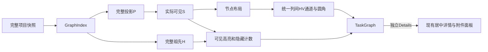

# 任务依赖追踪与详情阅读设计

完整前置上下文、渐进概览、局部依赖检查、独立 Details 与平滑路线已实现。Markdown 描述与 skill 属于待实现的 UX-T4。[要求](../spec/daynight-task-inspection.md)、[拆分](daynight-task-inspection-tasks.md)和[原型](mockups/task-inspection/index.html)分别拥有行为、范围与视觉；任务状态与源码绑定验收记录归 Daynight 和任务专属主附件。

## 实现范围

完整 P、渐进 S、50/100 概览、显式 20 直接邻居批次、真实诱导边、reset 和实际 S 刷新保留共同构成图浏览机制。完整数据、进度和七项统计不因展示缩小。TaskDetailPanels、附件分屏/独立预览、四态读取、locale、鉴权/资源失效及手动/定时刷新策略保持；检查不新增业务请求或刷新触发。

主体切换图局部检查，独立 Details 入口阅读详情。完整 H 从完整索引计算，可见 H 和它们的全部真实可见路线/箭头同步高亮，隐藏 H−S 按 ID 去重计数。选择不展开、不布局、不编译几何、不适应或移动视口。Details 与方向控件均为主体的兄弟原生按钮，键盘动作明确。

## 责任与数据流

ProjectPage保持详情资源和入口/关闭恢复所有权。当前画布拥有局部检查状态，不与详情ID绑定。图局部Context为节点/边提供呈现状态，受控节点几何和布局输入保持稳定。完整索引拥有H，渐进可见规则拥有S；不能从已淡化或已显示元素反推完整依赖和统计。

## 完整依赖与可见交互

`M = {root} ∪ descendants(root)`，`P = M ∪ ancestors(M)`，`S ⊆ P`。绘制P中两端都在S的全部真实边，不生成捷径/聚合。proposed、todo、in_progress和done按相同拓扑参与展开和H，保留状态/共享/阻塞与外部虚线语义。

选中s得到`H = {s} ∪ ancestors(s)`。选中和前置样式不同，无关项淡化但可辨；只改变S∩H以及终点在H的可见真实边，隐藏数为|H−S|。同卡片/空白清除，另一卡片替换。reset或同作用域快照更新后选择仍可见则保留/重算，否则清除。项目、根、页签或画布卸载清除局部检查。

显式方向展开和reset仍可改变结构及其既有锚点/视口/焦点；检查本身不能触发这些动作。普通失败保留旧图仅限同一身份/项目/鉴权作用域，401、会话/身份和资源转换沿用主线失效/取消/私有内容卸载。对话框打开时不抢焦点；消失入口使用既有关闭回退。locale重译新文案和可访问说明，不替换S、几何、视口或资源。

`getTaskExpansion(index, P, S, taskId, direction)` 返回该方向前 20 个隐藏直接邻居、剩余数及准确 `addedEdges`，包括批内真实边；不递归，无手动边上限。卡片宽 220px；两方向都无可展开邻居时高 96px（94px 主体、2px 边框），不渲染 footer 或分隔线；至少一方向有控件时高 136px，包含 40px 双列 footer，另一空方向保留列位置。主体切换检查，Details 与方向控件为兄弟原生按钮。每个可见快照只派生一次展开数据，布局、React Flow 尺寸、初始视口、锚点居中和键盘揭示共用每卡片的实际宽高。展开重排 S，当前缩放居中锚点并聚焦主体；全局“收起到概览”重算/定位并保留 reset 焦点。

## 平滑路线

路由采用统一列间水平/垂直通道。保留可见节点布局和顺序，全部边从源右中心到目标左中心，规划器统一拥有边几何和节点避让。`planDependencyRoutes(nodes, edges)`按每个 CanvasNode 的实际 width/height（220×96 或 220×136）一次建立列和16单位扩张的占用行区间，各中间列按Dagre意图插值选择最近自由行，仅在gap中点作HV转接并合并等高段，无条件碰撞修补/旧端口兼容分支；净空为≤12单位Q圆角留出空间。[统一路线决策](../../.agents/notes/implemented/architecture/2026-10-22-uniform-task-dependency-routing.md)保留原始raw-Dagre圆角选择的理由与替代方案。

编译器消费规划路线，产生canonical平滑路径与外部paint pieces。所有可见依赖、方向、实际body和箭头完整；外部高亮仍为5/4虚线。曲线弧长/分片在几何变化时计算，最大支持缩放的累计相位误差满足既有≤0.1CSSpx要求。选中/前置/无关呈现引用同一份几何，不能以删边、降为实线或临时返回折角掩盖失败。

## 居中详情

`TaskDetailDialog` 组合已有详情 hook、关系跳转、PR 和附件组件，样式由 `task-detail.css` 的 `task-detail-*` 命名空间拥有。外壳相对可用视口居中，宽度 `min(960px, 100% − 2 × gutter)`，桌面 `gutter = 24px`，600px 及以下为 12px；最大高度为 `min(880px, 100dvh − 2 × gutter)`。标题栏、详情页签、关闭按钮和底部说明处于滚动内容之外。默认“概览”正文独立滚动，包含描述、PR 与元数据/关系；桌面为阅读主栏与 265px 侧栏，850px 及以下侧栏收为 225px，600px 及以下堆叠。附件页签占用全部正文宽度，在所有宽度下保持左列表、右预览；尺寸链及唯一右侧滚动所有者由[附件设计](daynight-task-attachments.md#web-文件树与预览)拥有。长文本换行，代码和表格只在所属区域横向滚动。描述仍为纯文本，Markdown 与描述附件导航由 UX-T4 交付。

继续复用 body portal、共享滚动锁、背景 inert、焦点循环、遮罩关闭和分层 Esc。清理 inert、滚动锁和监听器的同步阶段与 DOM 移除后恢复焦点的阶段保持既有职责。原入口消失时优先选择仍可用的全屏退出控件，否则使用当前页签内可见的任务或页签控件；整个项目为空时恢复项目标题。任务关系切换不卸载外壳，不中途恢复到旧入口。外壳不引入图重挂载。`dialogFocusables` 与实际对话框中的同源附件 frame 共用可见控件枚举，frame 监听仍按原有 load/替换/卸载生命周期释放。附件独立阅读页复用内容渲染，但保留普通浏览器键盘行为；其路由、完整清单与满视口阅读机制由[附件设计](daynight-task-attachments.md#独立附件阅读页)拥有。

## 待实现：Markdown 与附件链接

从 `AttachmentPreview` 提取只负责 CommonMark/GFM 渲染和样式的 Markdown 视图；URL 转换及链接激活由调用方提供。描述调用方使用附件根为基准，Markdown 附件调用方使用实际文档目录，不能给描述虚构一个文件名或目录。原始 HTML、协议处理和图片规则沿用现有附件规则。

详情组合层共享单个附件控制器给描述导航与附件区域。普通主键点击无 query/hash 的相对附件链接时，读取完整附件清单，激活附件页签，选中路径并聚焦已有预览区域；Markdown、图片、HTML、PDF、文本和未知类型继续使用既有预览或下载行为。路径无效、清单失败、附件不存在与内容失败有各自可见状态，不能以空清单兜底。

保留真实 preview `href`；修饰键、上下文菜单、绝对 URL、协议 URL、以 `/` 开头的 URL、`#fragment` 及带 query/hash 的链接使用经过现有 URL 策略处理的原生导航。本设计不生成 Markdown 标题 ID。相对图片以任务附件根解析，附件内部资源仍按文件目录解析。附件更新独立于 task version；描述变更继续使用完整字段替换和观察到的版本。

公开 skill 源为 `packages/daynight/src/commands/skill/skills/using-daynight/`。同步入口、create-task、run-task 和适用的 handbook 指引、skill 需求/设计及 README。描述保持当前self-contained行动/范围/交付物/约束/简明完成条件与真实引用；专属主附件保留Solution/Acceptance criteria，不能恢复problem-only或强制复制整包规则。示例使用 `[方案与验收](plan.md)` 和 `[交互原型](mockui/index.html)`，仅在真实归属并确认上传后引用。安装目录通过正常重新安装获得更新，交付验证检查实际 npm 包中的完整 bundle。

## 验证与交付

完整输入、50/100/20、mandatory visibility行和渐进渲染政策保持。验收独立验证完整P/S/H、可见role/真实边、隐藏祖先去重、同卡片/空白清除、兄弟控件与键盘/焦点，以及选择/Details/关系前后的S、节点位置、canonical路径、actual pieces和viewport完全稳定。覆盖共享、外部、完成/proposed、根无依赖、刷新消失、普通失败和鉴权失效。

独立地从完整 API 投影 P 和实际 S 推导每个卡片是否存在隐藏直接邻居，验证 96/136px 高度；P 外无关后续不产生 footer。实际DOM路线的端点/方向、平滑相切、全部可见卡片避让、真实CTM、完整body coverage、参考弧长/phase及原生箭头独立判断，不能由生产规划器输出充当有效预期。可选输入只做编译忠实度，负例覆盖缺/多边、错误箭头、穿卡片和相位/覆盖失败。稳定性比较使用图坐标/相对变换，页面滚动诊断单独保留，不能把一致的文档平移误判为图变化。

31场景（18原生/13容器）、四个完整1000任务输入及999/5000边、每图五次、mandatory visibility、超限、coverage、零retry、timeout和cleanup保持。验收验证selected/hidden上游及selectMs≤300，保留open≤3000及detail/zoom/pan≤300。普通Details→close→立即zoom/pan、可信可见任务选择、高亮态同序列，每项取较慢state、网络单独计量；close与zoom间不加等待/reset/fit。

原型不替代生产验收。生产验证覆盖 typecheck、测试/coverage、build、真实 component/native/container/capacity 和独立审查。结果必须绑定确切源码，任务状态、PR、审批、required checks 与合并证据归 Daynight 和任务专属主附件。任务说明保持自足，专属主附件拥有 Solution/Acceptance criteria。
