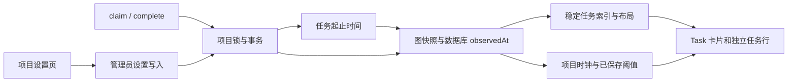

# 任务执行耗时与卡住提醒架构

本设计落实[需求 TT1–TT6](../spec/daynight-task-timing.md)，
[任务拆分](daynight-task-timing-tasks.md)定义独立交付成果，
[决策记录](../../.agents/notes/implemented/architecture/2026-10-23-task-timing-design.md)保存采用理由。
这些是实施所遵循的目标机制；设计 PR 本身不宣称运行时功能已交付。

## 现有结构与职责

[生命周期服务](../../packages/daynight-server/internal/service/task_lifecycle.go)只提供 approve、claim、complete，普通任务更新没有状态字段。
[项目写事务](../../packages/daynight-server/internal/core/store/project_tx.go)通过项目行锁串行化写入，再在同一事务修改任务、版本和依赖；
`updated_at` 随普通编辑变化，不能作为执行起点。
[图读取服务](../../packages/daynight-server/internal/service/task_graph.go)在只读快照中读取项目、任务与统计，现有资源没有独立服务端时钟。

Web 的 [useTaskGraph](../../packages/daynight-web/src/features/projects/useTaskGraph.ts) 每五秒读取图，并通过内容相等判断复用图索引。
[TaskNode](../../packages/daynight-web/src/features/task-graph/TaskNode.tsx) 已将检查任务的主体按钮和打开详情的 Details 按钮分开。
`GraphIndex` 拥有任务与统计，布局来自投影和展开状态；项目设置与每秒计时不应成为这些计算的输入。
现有项目成员页已有管理员判断、请求取消和面板样式，但还没有通用项目设置路由。



## 存储与生命周期

ET-T1 的 `009_task_timing.sql` 迁移给 `tasks` 增加可空 `started_at`、`completed_at timestamptz`，已有记录保持 `NULL`。
core 与 API 使用可空时间字段，JSON 明确输出 `startedAt`、`completedAt`，不省略未知值。

任务写入根据数据库旧状态与目标状态维护计时，而非依赖调用者传入时间：

| 写入 | 起点 | 终点 |
|---|---|---|
| 真正进入 `in_progress` | `statement_timestamp()` | 清空 |
| 真正进入 `done` | 保留 | `statement_timestamp()` |
| 普通编辑或同状态低层写入 | 保留 | 保留 |
| 未来合法离开已完成状态 | 清空旧尝试 | 清空 |

最后一项定义存储数据规则，不新增公开转换。当前 approve、claim、complete 继续拒绝不符合前驱状态的请求。
旧 `in_progress` 记录没有可恢复起点；之后 complete 可记录真实终点，耗时仍未知。

状态、时间、版本与依赖写入共用既有事务。时间表达式使用项目锁获取后的 SQL statement 时间，
不能使用事务开始时间：事务可能等待项目锁，过早时间会把等待阶段错误计入执行。
完整任务、列表、ready、图投影与 CLI/Web 类型、读取器和夹具随同资源变化一起交付，避免发布不能构建或丢失字段的中间状态。ET-T1 同步让现有图缓存等价判断排除 `observedAt`，防止仅时钟变化破坏已建立的图/索引身份；ET-T2 在引入设置版本时交付完整设置元数据与任务索引分离，ET-T3 再接入页面时钟消费者。

## 项目设置资源

ET-T2 的 `010_project_settings.sql` 迁移给 `projects` 增加 `execution_warning_minutes integer NOT NULL DEFAULT 60` 和
`settings_version bigint NOT NULL DEFAULT 1`，约束分别为正值。
直接使用项目行承载这组有界设置，复用项目锁，不引入独立设置表或外键。
所有项目查询与创建路径输出同一嵌套结构：

```json
{
  "settings": {
    "version": 1,
    "executionWarningMinutes": 60
  }
}
```

`GET /api/v1/projects/{projectId}`、项目列表与图中的 Project 均包含 settings。
设置写入使用 `PATCH /api/v1/projects/{projectId}/settings`：

```json
{"version":1,"executionWarningMinutes":90}
```

响应返回已保存的完整 Project，沿用既有响应包装和错误模型。
版本在 Go 中为 `int64`，CLI/Web 使用现有无损 JSON 读取方式保留精确十进制数值，不能先经不安全的 JavaScript number 转换。
分钟数范围为 `1..2147483647`；HTTP 严格对象解析拒绝缺失、重复、未知、`null`、小数、越界及非正值。
ET-T2 同步扩展 CLI/Web 的原始 JSON 版本读取，覆盖 Project、项目列表及图内 `project.settings.version`，以超过 `2^53` 的值验证无精度损失。
图内容比较须支持 bigint，不能直接对含设置版本的对象调用原生 `JSON.stringify`；设置元数据与 `{tasks, summary}` 索引身份在本任务内分离，确保设置 PR 单独合并后图仍正常加载。

写入顺序是项目行锁、锁后成员身份与管理员权限复核、精确版本检查、同值判定、更新。
同值且版本正确时返回原项目，不增加版本；过期同值请求仍返回 `version_conflict`。
成员降权或被移除后不能在等待锁结束时提交旧权限写入。
非成员沿用 `not_found` 隐藏资源，普通成员修改返回 `forbidden`。
数据库、取消或响应错误沿既有错误链传递，不用本地默认值掩盖未知设置。

## 时钟与图快照

ET-T1 给图资源增加顶层 `observedAt`，由同一只读事务中的数据库时钟采样，采样安排在图数据读取之后。
它与任务起止时间共享时钟来源；不使用 Go HTTP Date 的秒精度时间或客户端墙钟推算执行耗时。

Web 接收响应时保存独立锚点：

```ts
type ClockAnchor = {
  readonly serverMilliseconds: number;
  readonly receivedMonotonic: number;
};

const currentServerTime = (anchor: ClockAnchor) =>
  anchor.serverMilliseconds + performance.now() - anchor.receivedMonotonic;
```

这是接收时基于服务端样本推进的显示时钟，不保证消除网络传输延迟；每次既有图轮询会重新对齐。
`GraphSnapshot.receivedAt` 仍用于“最近刷新”墙钟标签，不复用为计时锚点。
缓存分开维护资源内容、任务索引和时钟：`observedAt` 变化不改变图内容身份，
仅项目设置变化时不重建由 `{tasks, summary}` 决定的 `GraphIndex`。
时钟与阈值不得进入投影、节点位置或边路由的 memo 依赖。

ET-T3 提供每个项目页面一个稳定时钟 store/context，以一个一秒定时器发布时间。
仅挂载且需要进行中计时的展示订阅；完成和未知起点任务不需要时钟订阅。
隐藏页面暂停定时器，恢复可见时读取新图时间锚点并发布当前显示；项目切换、登出和卸载清理订阅、定时器及请求。
沿用现有 AbortController 与 generation 保护，旧项目响应不能更新新项目时钟或阈值。

## 项目设置与卡片

ET-T2 增加 `/projects/:id/settings`，与成员页为同级路由，复用项目导航、面板、表单、错误和权限展示模式。
成员可以查看权威值，管理员可编辑分钟、保存或取消。保存期间禁用相应写操作。
草稿与已保存 Project 分开，成功响应才更新权威值；403/404/409 等反馈保留现有错误含义并重新核验资源或权限，
冲突后展示读取的当前设置，不把旧草稿自动重发。

ET-T3 在图卡片与独立任务行复用同一耗时格式和判断。
进行中为当前服务端显示时间减起点，完成为终点减起点，未知起点不显示耗时。
严格比较原始毫秒值 `elapsed > executionWarningMinutes * 60_000`，格式化仅影响文字。
使用琥珀色强调、图标和双语文本表示“可能卡住了”，保留进行中蓝色状态、耗时、共享标记及既有选择强调。
提醒放在现有元数据区域，不覆盖 Details、检查主体或展开控件，不改变 `220×96` / `220×136` 几何。
底部为较宽的英文 Details 标签与耗时留出 42px 预留区，避免沿用原有 28px 后两者重叠；以真实浏览器边界验证长耗时和两种语言。
链汇总没有单任务耗时；显示组件不逐秒使用 live region，以免持续打断辅助技术。

设计任务的纯前端交互 mock 拥有最终视觉和状态示例；共享要求与原型从设计任务实际附件读取。
实施者更新旧原型时保留当前独立 Details 交互，而非恢复已经移除的整卡详情按钮语义。

## 验证与交付

ET-T1 验证迁移、锁等待后的时间、生命周期冲突与回滚、普通编辑保持起止、旧数据未知、快照字段和实际 CLI 读取。
ET-T2 验证默认值、项目隔离、管理员写入与成员只读、锁后降权、并发单胜者、过期同值冲突、严格输入及设置页面状态。
ET-T3 用确定性时钟验证 59:59、60:00、60:01 的精确边界，验证自动推进、后台恢复、错误墙钟、设置重新判断、完成冻结、未知值、图身份与焦点不变，
并以真实服务、隔离 PostgreSQL、生产 Web 和实际 CLI 验证真实阈值跨越与完整数据链路；不要求在持续前进的数据库时钟中命中精确相等瞬间。

各实施任务独立通过涉及模块的现有检查，不把本 PR 必需验证推迟给后继。
服务端使用文档规定的 `scripts/check.sh` 与 Go 覆盖率门槛；CLI 与 Web 运行各自 README 规定的类型、测试、构建和适用接受性检查。
版本变更与文档同步跟随对应运行时代码；实际 run receipt、PR、merge commit 与状态保存在所属任务和 CI，不作为本页滚动记录。

## 运行诊断与接口成本

新增设置请求沿用既有认证、请求上下文和结构化诊断，关联 `request_id`、`user_id`、`project_id`，
并保留 `component`、操作 `phase`、错误类别与原始错误链。任务写入另有关联 `task_id`。
未来调查者可在服务端 JSON 日志中按 `project_id` 和设置请求的 `request_id` 过滤，确认保存阶段及错误类别；不记录令牌、描述内容或表单原始正文。

服务端不增加后台作业或告警扫描器。网页时钟仅属于当前项目页面，错误与取消归现有页面请求所有者；
浏览器定时器只推进本地显示，不产生逐卡网络请求或遥测。每个任务增加两个可空时间字段，
每个图增加一个时钟字段，每个项目增加固定大小 settings。图原有节点/边上限、五秒轮询及列表分页保持不变；
设置读取复用 Project，修改仅增加一次显式 PATCH，不新增模型工具或无界历史输出。
