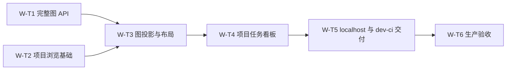

# 项目与任务看板实现任务

状态：W-T1–W-T6 全部完成。实现与验收已交付，对应运行结果由交付 PR 与 CI 保存。

本文拥有任务编号、状态、依赖、文件归属和完成条件。
[需求](../spec/daynight-web.md)拥有 W1–W12 的行为与验收要求，
[架构设计](daynight-web.md)拥有 API、快照、图投影、请求和部署机制。
任务完成时记录实际验证结果并同步状态；行为或机制变化先更新对应文档。下列任务与验收条件
保留其交付时的范围；后续的项目内独立任务/任务链页签由[当前设计](daynight-web.md#项目详情-projectsprojectid)
和[任务视图决策](../../.agents/notes/implemented/feature/2026-10-22-project-task-views.md)拥有，
使用[任务视图预览](mockups/task-views.html)展示交互，不改写下列历史验收结果；当前 PR 按[仓库 CI 路由](../../README.md#ci-selection)选择模块，
main push 执行全量检查。

## 任务顺序与要求归属

| 任务 | 状态 | 前置 | 主要交付 | 对应要求 |
|---|---|---|---|---|
| [W-T1](#w-t1) 完整项目图 API | 已完成 | 无 | 同一快照的完整节点、依赖、统计、规模拒绝 | W3、W6、W7、W9、W11 |
| [W-T2](#w-t2) 项目浏览基础 | 已完成 | 无 | web 工作区、客户端、原生路由、完整项目分页、单元门禁 | W1、W2、W9、W11、W12 |
| [W-T3](#w-t3) 图投影与横向布局 | 已完成 | W-T1、W-T2 | 纯数据校验、根投影、共享与外部前置、LR 布局 | W3、W4、W5、W6、W7、W11 |
| [W-T4](#w-t4) 项目任务看板 | 已完成 | W-T1、W-T2、W-T3 | 快照刷新、统计、根条目、只读画布、详情侧栏 | W2–W9、W12 |
| [W-T5](#w-t5) localhost 与 dev-ci 交付 | 已完成 | W-T4 | 现有 localhost 完整启动、静态资源内嵌、隔离 dev-ci deployment | W2、W9、W10、W11 |
| [W-T6](#w-t6) 生产浏览器与 CI 验收 | 已完成 | W-T5 | 实际二进制及网关、性能、覆盖率证据和汇总门禁 | W1–W12 |

W-T1 与 W-T2 可独立推进，客户端以架构中的 DTO 为共同契约。
每项任务都交付自身的行为测试；W-T6 验证组合后的生产路径。
文档和公共入口在修改前确定唯一编辑者。根 package、锁文件、共享构建脚本和 CI 的交接固定为：

| 阶段 | 唯一编辑归属 | 必须保留和交接的内容 |
|---|---|---|
| W-T2 | W-T2 执行者 | web 命令、锁文件、严格检查器及必选 `verify-web`，保留原 Go/CLI 门槛 |
| W-T5 | W-T5 执行者 | 核对 W-T2 验收结果后接管，加入资源内嵌和 Go 干净构建前置，保留既有 job |
| W-T6 | W-T6 执行者 | 核对 W-T5 构建契约后接管，加入生产浏览器/容器验收，负责最终 `checks.needs` 完整性 |

其他任务以所需命令、依赖和验收输入提出变更，由当前归属任务编辑这些共享文件。
交接发生在前一阶段完成验收之后，不并发修改。交付时的汇总依赖 CLI `verify`、Go
`verify-server`、web `verify-web` 与独立 `verify-completion`，失败或取消都不能汇总
成功。当前工作流按[仓库 CI 路由](../../README.md#ci-selection)选择模块，最终 `checks`
只接受所有前置 job 的 `success` 或 `skipped`，失败、取消及其他结果使汇总失败；
[CI 简化决策](../../.agents/notes/implemented/simplification/2026-10-21-ci-gate-simplification.md)
记录汇总规则。

## 共同完成条件

各任务交付范围内的实现、测试和受影响文档；测试断言用户可见结果、数据不变量及
失败后的行为。数据库测试位于对应 Go package，不能用跨包浏览器调用代替覆盖率。
Go 与 web 的总语句覆盖率分别严格大于 90%，保留已有 Go package、function、
critical-block 及所有原生 CLI 门槛；新增检查不能替换现有检查。

只读看板沿用现有 project/task 写接口、schema、状态和依赖规则，不引入新的写入路径。
本机监听、同源读取、纯文本展示和完整快照保证贯穿全部任务。
任务状态只按实际交付及验证证据更新；预览、模拟响应和单元覆盖率各自具有明确用途，
不能作为生产 UI 或真实 PostgreSQL 集成完成的证据。

## W-T1：完整项目图 API

状态：已完成。前置：无。

验证：`bash scripts/check.sh` 通过 build、vet、race、289 项 Go 测试及 9 项覆盖率
检查；原始覆盖率为 1085/1087 条语句（约 99.82%），store/service/server 均为
100%，无产品排除项。原有 12 组实际进程场景通过，19 个进程全部回收、12 个 schema
删除且无所属会话残留。本地回执记录 dirty 工作树；CI 需以交付 PR 对应源码的干净
产物确认，不能用本地回执代替。独立代码审查未发现 Critical/Major。
[PR #35](https://github.com/codetreker/daynight/pull/35) 已合并，
[合并后 CI](https://github.com/codetreker/daynight/actions/runs/39374025719) 的 Go、
三个原生 CLI 平台及汇总检查全部通过；PR 原始 profile 已验证 1085/1087 严格大于 90%。

### 文件归属与范围

负责 `packages/daynight-server/api/` 的图 DTO、`internal/core/` 的图读取模型、
`internal/core/store/` 的具体快照查询、`internal/service/` 的图用例及
`internal/server/` 的路由和错误映射。共同维护 `fault.go`、错误 DTO、日志白名单
和服务端需求说明；不改变数据库结构、现有写接口或 CLI 状态存储。

### 实现与验收

- 实现 `GET /api/v1/projects/{projectId}/task-graph`，返回 project、完整 tasks
  及六项 summary；无分页、无状态筛选，边由 `dependsOn` 表示。
  非空 query（含未知字段、分页/筛选及无效编码）一律 `400`，HTTP 测试证明不忽略这些输入。
- 使用具体 store 和同一次只读 `REPEATABLE READ` 快照，读取 project、精确节点及
  边数量、节点和依赖，并从该状态计算统计。事务收尾错误保持原有优先级和错误链。
- 快照内先检查数量：最多 1,000 节点、5,000 边；超过任一上限返回
  `409 graph_limit_exceeded`，details 含精确的
  `nodeCount/edgeCount/maxNodes/maxEdges`，不返回部分图或部分统计。
- 查询直接生成最多 160 Unicode code points 的 `titlePreview` 和
  `titleTruncated`，不先读取全部完整标题，不返回 description；节点及依赖保持稳定排序。
- 新错误沿用 requestId、脱敏响应和单次错误记录；API 及日志不得包含 SQL、驱动
  错误、任务正文或仓库凭据。project 不存在为 `404`，非法 ID 为 `400`，数据库失败为 `500`。
- 本任务真实 PostgreSQL 测试覆盖空项目、精确上限与两个独立超限、长标题与中文、
  共享依赖和全部统计。用交错提交证明数量、任务、依赖和统计来自同一快照。
- 测试真实查询取消、数据库失败、事务清理失败及错误优先级；HTTP 测试验证 DTO、
  状态、details、requestId、缓存策略及脱敏。现有 Go 检查和严格覆盖率门槛通过。

## W-T2：项目浏览基础

状态：已完成。前置：无。

验证：web 类型检查、生产构建、141 项功能测试及 13 项覆盖率检查通过；8 个产品文件
的原始语句计数为 245/246（约 99.59%），包括真实浏览器入口。Chromium 对生产
bundle 与受控 API 响应完成分页、续页重试、刷新、空状态、键盘及 320/390/768px
布局检查，无页面错误。原 CLI 类型检查、755 项测试、构建和两组安装验收通过。
两个独立审查分别核对客户端/UI 与覆盖率/CI，均无 Critical/Major。
[PR #36](https://github.com/codetreker/daynight/pull/36) 的六项 CI 与当前 head approval
通过后合并。合并后主线发现既有 cooldown 测试时序问题，由
[PR #38](https://github.com/codetreker/daynight/pull/38) 单独修复并通过六项 CI 与新 head
approval 后合并；原失败运行未重跑。项目详情与图
渲染仍属于后续任务；本任务的受控网络验证不替代 W-T6 的真实服务验收。

### 文件归属与范围

负责私有 workspace 包 `packages/daynight-web/` 的 package、TypeScript、Vite、
测试配置，`src/app/` 路由基础、`src/api/` 类型化客户端、项目列表及基础样式。
负责根 workspace 脚本、锁文件、web 单元测试覆盖率检查器和必选 `verify-web` CI job。
公共 API 类型按既定 DTO 建立，图模型、画布、详情和内嵌交付分别归后续任务。

### 实现与验收

- 使用 React、TypeScript、Vite，沿用 Node 24、pnpm 11.28.6；锁定依赖，提供可复现
  的本地 typecheck、build、dev、test 命令和 Vite 到本机 Go 的 `/api` 代理。
- 实现 fetch 客户端、稳定错误与 requestId 解析、AbortSignal 传递和严格响应边界。
  响应中的 project/task 身份必须匹配规范化后的请求 ID，错误身份按协议错误拒绝显示。
  使用原生 history/popstate 管理 `/` 与 `/projects/{projectId}` 的导航状态。
- 完成交付视觉中的项目列表，显示名称、仓库地址、创建时间；按已有 API 每页 50 项
  加载更多并按 ID 去重。首屏、续页、空列表、失败、重试和刷新都有真实可操作界面。
- 续页失败保留已加载项目；刷新重置分页；末页隐藏加载更多。列表不显示未经完整读取
  的总数。长文本换行，所有标题和地址按纯文本显示，320px 页面无整体横向溢出。
- 客户端和页面测试覆盖超过 50 个项目、续页游标、重复项、末页、续页失败重试、
  刷新与旧请求晚到，以及路由解析、前进后退和取消；不使用静态占位页面代替列表。
- 建立 Vitest V8 语句覆盖率门禁，include 为 `src/**/*.{ts,tsx}`。独立枚举源码并
  逐文件核对 `coverage-final.json`，按整数 `covered * 10 > total * 9` 判定。
- 检查器测试拒绝空或畸形报告、缺失文件、未导入产品文件遗漏、恰好 90% 及舍入误判；
  纯类型文件只有确无运行语句时允许零语句。API、算法和入口无排除项，第三方及产物不计入。
- CI 必须执行 web typecheck、生产 build、单元测试和严格语句门禁，并纳入 `checks`；
  原有 Go 与原生 CLI 检查仍必需，不能以模拟列表测试替代最终生产浏览器验收。

## W-T3：图投影与横向布局

状态：已完成。前置：W-T1、W-T2。

验证：232 项 web 功能测试、13 项覆盖率检查、类型检查及生产构建通过；原始覆盖率
为 380/385 条语句（约 98.70%），10 个产品文件全部进入清单。79 项图模型测试
覆盖容量、依赖、共享/边界与统计，12 项布局测试使用真实 Dagre。独立审查无
Critical/Major，并验证 1,000 节点链的布局几何；这不替代 W-T6 的浏览器性能门槛。
[PR #39](https://github.com/codetreker/daynight/pull/39) 在六项 CI 与当前 head approval
通过后合并，原始 web profile 已独立复算为 380/385。

### 文件归属与范围

负责 `src/features/task-graph/` 中的数据解析、索引、统计验证、根投影和 Dagre
LR 布局模块及其测试。模型与布局不依赖 React、DOM 或网络，不创建画布组件。
复用 W-T2 的 DTO；公共类型需要调整时由其归属者统一修改。

### 实现与验收

- 校验任务 ID 唯一、引用闭包、合法状态、无环、前置与阻塞集合及 ready 一致性，
  并验证服务端 summary 与全体去重任务及统计恒等式相符；非法数据整体拒绝。
- 建立前置/后续索引，以 `dependsOn` 为空识别根，保留后端精确 `(createdAt,id)` 的响应顺序；
  不用 blockedBy 判断根，保留所有已完成前置。
- 根 r 的主集合 M 为 r 及沿后续可达任务；显示集合 V 为 M 加全部传递前置，
  外部前置 C 为 V−M，保留所有终点在 V 的依赖，方向为前置→后续。原 W-T3
  采用直接边界，完整祖先由[UX-T1](daynight-task-inspection-tasks.md#ux-t1完整上游上下文)扩展；其余主集合计数规则保持有效。
- 根进度只统计 M，外部前置不计入；同图节点按 ID 去重，多根 M 的交集成员标为共享。
  项目总数仍来自完整快照，根条目进度不能求和充当全局统计。
- 以固定节点尺寸、按 ID 稳定输入和 `rankdir: "LR"` 生成布局；布局输出保留业务
  状态、外部前置及共享标记。缩放、平移不调用布局算法。
- 纯函数测试覆盖三个根共享、菱形、多外部前置、独立任务、根完成但后续未完成、
  全完成、空图、中文长标题与不同输入顺序；验证主集合、外部前置、边和进度的准确集合。
- 测试重复 ID、缺失引用、环、非法状态、错误统计和派生字段时得到可展示的数据错误，
  不生成部分图。布局测试断言节点/边完整、方向与稳定性，不绑定第三方内部坐标。
- 本任务的模型与布局进入 web 产品源码覆盖率清单，严格总语句门槛通过。

## W-T4：项目任务看板

状态：已完成。前置：W-T1、W-T2、W-T3。

验证：类型检查、生产构建、293 项 web 功能测试及 13 项覆盖率检查通过，原始语句
覆盖率为 648/654（约 99.08%），18 个产品文件全部纳入。两个独立审查及初始视口
变更复核均无 Critical/Major。生产 bundle 通过真实 Go API 与 PostgreSQL 的六组
浏览器流程，覆盖依赖过期、全图刷新、焦点、图几何及窄屏；1,000 节点链本地单次
探针约 1.24s 且根节点初始可见。该单次本地探针不替代 W-T6 的固定 CI 五次性能门槛；
验证工具与回执解释见[web 验证说明](../../packages/daynight-web/README.md#production-browser-acceptance)。
[PR #42](https://github.com/codetreker/daynight/pull/42) 在 CI 与当前 head approval
通过后合并；[合并后 CI](https://github.com/codetreker/daynight/actions/runs/39391455671)
的六项检查全部通过。

### 文件归属与范围

负责项目详情页面及快照 hook、统计与根条目、React Flow 画布/节点、详情侧栏和
相关样式及组件测试。接入 W-T2 路由与 API 客户端、W-T3 投影；共享 app 入口协调编辑。
数据读取、图显示与选择保持各自职责，页面只提供读取和导航操作。

### 实现与验收

- `/projects/{projectId}` 请求完整图快照并一次应用统计、索引和根条目。根条目按精确
  `(createdAt,id)` 倒序展示；默认隐藏整条已完成链，复选框可恢复并按项目记住选择，
  标题显示可见/全部链数。首次访问或保存根消失/隐藏时选择最新可见根，
  仍可见的保存根继续保留，没有可见根时保留原偏好，之后同时最多一条展开；按项目保存当前展开根及明确的全部折叠，整页刷新与离开后返回恢复。加载、首次失败与空图不把自动选择保存为全部折叠；存储失败有提示并保留页面内操作。折叠时卸载画布。条目状态按根及全部可达后续聚合：全部完成为已完成，已有任务开始或完成但整链未结束为进行中，全部待处理为待处理；状态标签、完成链数量与隐藏过滤共用模型派生值。图节点与详情仍显示任务自身状态。
- 根条目采用紧凑留白和行间距，长标题自然增高；桌面和 320px 下验证标题、状态、
  进度与原生按钮焦点不被裁切。图节点和画布尺寸保持既有几何。
- 按确认视觉显示六项统计及完成比例；灰/蓝/绿同时配文字，blocked 是独立标记。
  外部前置带“外部前置”标记，并由图例说明已补齐全部上游；共享成员带共享标记。
- React Flow 提供键盘选择、节点打开、缩放、平移和适应画布；图工具栏的全屏查看铺满浏览器视口，退出保留缩放和平移，全屏图继续支持详情、分层 Esc 和焦点恢复。当前机制见[看板设计](daynight-web.md)与[全屏查看决策](../../.agents/notes/implemented/feature/2026-10-22-task-graph-fullscreen.md)。保留 attribution，
  禁止拖动、连线、重连及删除。大图初始缩放有下限，画布内部可以滚动。
- 图、列表及详情请求分别取消并检查请求序号和资源 ID；导航、刷新、切换选择及
  卸载后的晚到响应不能覆盖新数据，取消不显示失败通知。已加载数据必须绑定当前
  projectId/taskId；切换身份立即进入新资源加载态，不闪现旧内容，仅同资源刷新保留旧数据。
- 首次加载、空项目、404、数据无效、规模超限和其他失败各有明确状态。刷新保留
  上次成功快照和时间，失败明确标识旧数据；成功整体替换，不能拼接局部结果。
- 刷新后仍可见的展开根保留，否则选择最新可见根；没有可见根时保留原偏好，
  明确的全部折叠继续保留。全部完成空态有显示入口，焦点转移到持续存在的复选框。仍存在的详情重读，已消失则关闭并
  提示。页面显示成功快照的本机接收时间，不使用 project.updatedAt 代替。
- 节点及引用打开已有详情 API，展示完整文本、状态、ID、时间、全部前置、未完成
  前置及快照中的直接后续；未知快照引用显示 ID 并允许继续读取，不伪造名称。
- 详情失败局部重试。其状态、ready、依赖、阻塞或更新时间与快照不符时提示刷新，
  不局部修改画布统计。标题、描述和仓库地址始终作为纯文本渲染。
- 侧栏焦点进入关闭按钮，Tab 被约束，Esc/关闭按钮可关闭；关闭恢复原节点焦点，
  节点消失时回到根条目。320px 布局可访问主要内容且无页面整体横向溢出。
- 组件测试覆盖统计、共享/外部前置、单展开、节点与引用导航、刷新/重试、旧数据
  标识、晚到响应、详情差异、焦点进入/循环/恢复及窄屏结构；严格 web 覆盖率通过。

## W-T5：localhost 与 dev-ci 交付

状态：已完成。前置：W-T4。

[PR #46](https://github.com/codetreker/daynight/pull/46) 已合并为 `8d173d5`。

验证：内嵌页面、资源、路由和构建发布均已实现；Go 完整检查通过 307 项测试
（108 项顶层）及 9 项覆盖率检查，原始语句为 1153/1155（约 99.83%）；web
通过 293 项功能测试及 24 项工具测试（13 项覆盖率、11 项发布），原始语句为
648/654（约 99.08%），18 个产品文件全部计入。12 项 Bash 生命周期 fixture
通过；两个独立代码审查均无 Critical/Major。现有 CLI 类型检查、构建、965 项
测试（另 10 项平台跳过）、两组安装验收及实际 Bash 4.2/现代 Bash/zsh completion
验收通过。

真实 Docker 的 HTTP smoke 验证 HTML、资源与缓存/HEAD、深链接、API 和完整图、
镜像身份及三服务整体重建后的数据持久化，当前集成源码复验通过且清理成功。两次
并发 dev-ci 运行证明端口、卷和数据独立，清理一组后另一组继续可用，最终均清理。
两套有效 Compose 的构建、转发、网络和存储配置完成核对；未启动或修改日常栈。
这些本地工作树结果不替代对应 PR 的干净 CI 回执，也不替代 W-T6 的真实浏览器、
固定 1,000/5,000 图集五次性能和实际故障清理验收。对应 PR 与 CI 保存运行结果；
回执与清理解释见[web 验证说明](../../packages/daynight-web/README.md#production-browser-acceptance)。

### 文件归属与范围

负责 `packages/daynight-server/internal/webui/`、Go 静态资源路由、共享 web 构建
脚本及 `packages/daynight-server/scripts/check.sh` 的构建衔接。协调根 package
脚本、Go/web CI 工具配置、README 和服务端构建说明。
部署文件归属为 `deployment/localhost/Dockerfile`、
`deployment/localhost/Dockerfile.dockerignore`、`deployment/localhost/compose.yaml`
及 `deployment/localhost/README.md`；保持现有 nginx stream 转发拓扑，
`deployment/localhost/nginx.conf` 的网络转发与 `deployment/localhost/up.sh` 的完整启动入口保持。
本任务同时负责新增 `deployment/dev-ci/{compose.yaml,run.sh,README.md}`，直接复用
localhost 的生产 Dockerfile 和 nginx 配置，完成独立资源与生命周期管理。

### 实现与验收

- 共享 `pnpm web:build` 只构建前端并复制真实产物至 `internal/webui/dist/`，Go
  `go:embed` 内嵌产物；生成目录不提交，缺少产物明确构建失败，不生成占位页面。
- Go 检查先从仓库根目录调用共享构建，再执行既有 build/vet/race/go-cov。
  干净 checkout 显式配置 Node 24、pnpm 11.28.6 并 frozen 安装依赖；缺少前置条件
  明确失败，不自动下载替代工具链，测试重建进程继续使用真实产物。
- 精确注册页面 `/{$}`、`/projects/{projectId}` 和静态资源路径；未知 API 仍为
  JSON 404，缺失 asset 不回退 HTML，未知页面为 404，保留方法处理语义。
- 页面与图响应为 `no-store`，哈希资源为长期 immutable；请求统一经过现有唯一
  日志包装。开发代理与生产同源 API 不依赖 CORS 通配、CDN 或额外前端服务。
- Docker 以仓库根目录为 context，Dockerfile 专属 ignore 包含构建所需 workspace
  文件（包含锁定的 `patches/` 声明补丁）并排除临时产物。Node 前端阶段构建 UI，再交给 Go 阶段内嵌，运行镜像只需 Go 服务。
- 直接更新 `deployment/localhost`，原 `up.sh` 一次启动 UI、API、数据库及 gateway。
  Compose 构建使用上述根 context，保留已存在的数据库、gateway、loopback 发布和
  nginx stream 网络关系；宿主机仅需 Docker，运行与镜像构建均不要求宿主 Node/pnpm。
- 本任务测试验证内嵌 HTML/资源、直接深链接刷新、API 优先级、未知资源/方法、
  缓存头及单次日志；由无 node_modules、无生成资源的 checkout 完成生产构建。
- 新增独立 dev-ci Compose，不以日常 Compose 作 override；每次显式使用唯一的
  `daynight-dev-ci-<run-id>` 项目名。HTTP 使用 Docker 分配的 127.0.0.1 端口并自动发现，
  数据库不发布宿主端口，卷和网络均为该项目专用，不设 global name 或 external。
- `run.sh <command> [args...]` 在创建资源前注册清理，构建并记录唯一生产镜像及 ID，
  健康后导出 `DAYNIGHT_BASE_URL` 执行子命令。正常、失败及取消均有界清理本次项目，
  清理错误不能被掩盖；拒绝空/错误项目前缀及日常项目，不使用全局 prune。
- Docker-only 构建实际 image；隔离 smoke test 经 dev-ci gateway 请求页面、深链接、
  静态资源及 API，并核对运行 image ID。比较两套有效 Compose 的拓扑与服务命令，
  只允许设计列明的环境差异，证明使用同一生产构建与转发配置。
- 验收日常入口与持久化配置、dev-ci 独立端口/数据、失败与取消清理；两次并发运行
  互不干扰，清理一次后另一次仍健康。测试不启动或修改已有 localhost 资源。
  实际构建证明资源完整，原有 Go/web/CLI 检查继续通过。

## W-T6：生产浏览器与 CI 验收

状态：已完成。前置：W-T5。

[PR #52](https://github.com/codetreker/daynight/pull/52) 交付生产浏览器与 CI 验收；
[PR #57](https://github.com/codetreker/daynight/pull/57) 修复刷新时的侧栏焦点恢复，
[PR #59](https://github.com/codetreker/daynight/pull/59) 修复必选原生测试的 APFS 清理。
这些改动均已合并，[对应主线验证](https://github.com/codetreker/daynight/actions/runs/39446442068)
通过。逐次结果、测试源码身份、覆盖率与清理回执由对应 PR 和 CI 保存。

`pnpm web:acceptance` 构建真实 UI 和 Go 二进制，并与正常 dev-ci 生产构建并行
准备原生服务。浏览器依次执行原生功能、dev-ci gateway 功能和原生容量/超限阶段；
容量开始前全部准备与容器清理必须结束。当前调度与阶段证据由
[流水线决策](../../.agents/notes/implemented/testing/2026-10-21-web-acceptance-pipeline.md)定义。验证命令、要求与场景映射、浏览器身份及回执解释由
[web 验证说明](../../packages/daynight-web/README.md#production-browser-acceptance)拥有。
[生产验收决策](../../.agents/notes/implemented/testing/2026-10-20-dashboard-production-acceptance.md)
保留验证策略、实际部署故障研究的范围与持久证据；本地回执和历史镜像仍保留各自
源码与环境范围，不能替代新的干净 CI 验证。

### 文件归属与范围

负责 `packages/daynight-web/tests/` 中的真实浏览器验收、固定性能数据及结果记录，
复用 W-T5 的 dev-ci 入口并扩展失败/清理证据，部署定义仍按 W-T5 的结构维护。
最终 `.github/workflows/checks.yml` 集成和覆盖率/验收产物归档。协调各 package 的
跨层测试缺口与交付文档，完成 W1–W12 的逐项证据映射。

### 实现与验收

- 使用 Playwright、生产构建 UI、真实服务二进制和隔离 PostgreSQL，通过现有 API
  建立数据。容器场景统一经 `deployment/dev-ci/run.sh` 启动生产镜像，在其 gateway
  URL 运行完整读取流程；不得启动、重建或清理日常 localhost 栈来完成验收。
- 读取路径覆盖项目列表超过 50 项及续页重试、进入项目、统计、根展开、节点侧栏与
  引用跳转；覆盖三根共享、菱形、多外部前置、独立任务和根完成但后续未完成。
- 验证空项目、404、真实接口失败及局部重试、刷新失败后旧数据、详情变化提示、
  切页旧请求晚到、已加载资源切换不闪现旧内容、直接地址刷新、前进后退、键盘节点操作
  及 320px 无整体横向溢出。真实浏览器明确验证侧栏焦点进入、Tab 循环、Esc/关闭按钮
  与关闭后焦点恢复，不能仅依赖组件测试环境。
- 使用固定 Linux CI Chromium、生产构建和固定拓扑图集，覆盖单链、分叉合流、
  多根共享和外部祖先密集图；数据集包含 1,000 节点单链，以及恰好同时达到 1,000
  节点和 5,000 边的分叉合流、多根共享和外部祖先密集图。外部图有 2 个链内任务、
  998 个外部前置，由[UX-T1](daynight-task-inspection-tasks.md#ux-t1完整上游上下文)加入。
  同时验证超限明确拒绝而非截断。
- 每张性能图从折叠状态展开五次，最慢一次从点击到可操作画布不超过 3,000ms；
  布局后节点打开、缩放、平移的可见反馈不超过 300ms。网络读取与详情网络时间
  单独计量，记录布局、渲染耗时和环境；失败不能登记为已支持规模。
- 交付时，干净 CI checkout 的 Go 与 web job 均生成真实 UI；扩展现有必选 `verify-web`
  job，并将生产浏览器/部署验收纳入必需汇总。当时的 `checks` 要求 Go、web、全部原生
  CLI 与独立 shell completion 检查通过；当前模块选择由[仓库 CI 路由](../../README.md#ci-selection)
  定义，各 job 的内部验收范围保持。
- 保存原始 Go profile 与 web `coverage-final.json`、产品源码清单、语句命中/总数
  和整数比较结果；两者各自严格大于 90%，不能平均掩盖任一模块不足。保留 Go
  package/function/critical-block 门槛，验证缺失报告或数据库不可用使必需检查失败。
- 对 dev-ci 验证镜像身份、同时运行隔离、启动中途失败、测试失败、取消和清理失败；
  证明本次资源全部回收且其他 run 继续可用，不得把清理失败记成成功。CI 外层
  始终按本次 run 清单执行定向清理，无法确认时保留清单并报告未完成。
- 归档 run ID、实际 base URL、image ID、资源与清理清单，连同测试 SHA、构建命令、
  浏览器与数据库版本、截图、性能逐次结果及 W1–W12 对照；诊断按 requestId 关联，报告不包含任务正文、凭据或 SQL。
- 清理任务产生的进程、浏览器临时实例、容器、连接、隔离数据库及 `.tmp/` 资源；
  更新需求、设计、任务文档及使用说明为实际交付状态，记录验证结果和实际限制。
