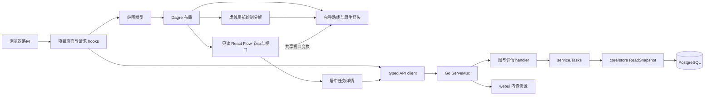

# 项目与任务看板设计

状态：完整图 API、项目任务看板、Go 内嵌交付及 localhost/dev-ci 部署已实现；W-T6 已定位长斜线 SVG 虚线绘制造成的 raster/commit 阻塞，采用局部水平线与短原生转角路径分解；完整生产验收已交付，完成状态与对应源码的 PR/CI 链接由任务清单记录。运行结果随对应 PR 与 CI 保存；本地回执不能代替干净 hosted 验证。原始看板基线为[只读 MVP](../spec/daynight-web.md)，当前项目内任务页签见[任务视图交互预览](mockups/task-views.html)；[原始看板预览](mockups/task-dashboard.html)和[项目详情截图](mockups/task-dashboard-project.png)保留初始视觉基线。[决策记录](../../.agents/notes/implemented/architecture/2026-10-20-task-dashboard-mvp-design.md)保存选型与范围取舍；[任务清单](daynight-web-tasks.md)拥有任务状态、前置与完成条件。

[预定义属性设计](daynight-task-properties.md)的 server 接口、CLI 和任务详情中的
只读 PR 区域已实现。[需求](../spec/daynight-task-properties.md)、
[交互预览](mockups/task-properties.html)及[实施任务](daynight-task-properties-tasks.md)
分别拥有行为、样式和实施状态。

已实现的[附件架构](daynight-task-attachments.md)扩展 task 详情，提供文件树、
单文件上传/覆盖/删除、下载及同源预览。[附件需求](../spec/daynight-task-attachments.md)
拥有文件行为，[Web 决策](../../.agents/notes/implemented/feature/2026-10-21-task-attachment-web.md)
记录状态、渲染和焦点机制；[附件任务拆分](daynight-task-attachments-tasks.md)拥有
实施与组合验收范围，进度由 Daynight 维护。图、统计与 task 字段保留原只读约定。

[鉴权架构](daynight-auth.md)拥有 UniAuth 登录、项目权限、成员与邀请及个人访问
令牌；`AuthenticatedApp` 和 API 客户端已接入生产入口。
[需求](../spec/daynight-auth.md)与[任务拆分](daynight-auth-tasks.md)拥有完整行为和
交付条件。生产 `main.tsx` 在常驻 LocaleProvider 中渲染 `AuthenticatedApp`，复用
messages.auth 的英语/简体中文目录及同一语言偏好。后端使用升级后的公开 UniAuth
SDK 提供 App-aware provider discovery；发现失败与用户会话失效分开呈现。新壳
复用现有任务页签、渐进图和居中 `TaskDetailDialog`，保留可信同源 frame、相对资源及键盘机制。
[Web 鉴权决策](../../.agents/notes/implemented/feature/2026-10-22-web-auth-workspace.md)
记录组件、会话生命周期和验证边界。

[语言设计](daynight-web-i18n.md)拥有已实现的类型化目录、Intl 格式化器、首屏解析、常驻 Provider、共享选择器和全部现有第一方组件的双语呈现；[双语需求](../spec/daynight-web-i18n.md)拥有完整覆盖与验收。源码绑定的组合生产验收由独立任务核对。语言偏好使用独立的 origin-local 键，不改变本文的项目浏览记录、API、图或附件生命周期。

## 目标与现有基础

浏览器完成“项目列表 → 项目统计 → 独立任务列表或根任务链 → 任务详情”的完整读取路径。数据继续归属 `daynight-server`，不接入 客户端的 review 命令，不新增父子任务。读取模型支持 proposed、todo、in_progress 和 done；公开创建仍为
todo，任务字段继续只读。

已有基础与集成位置：

| 事实 | 证据与影响 |
|---|---|
| Go 服务已有项目与任务 JSON API | `packages/daynight-server/api/projects.go` 的 `ProjectPage` 返回项目及 `nextCursor`；`api/tasks.go` 的 `Task` 包含 `dependsOn`、`blockedBy`、`ready`。 |
| 页面与 API 同源 | `internal/server` 在同一 mux 注册精确页面、静态资源及 API 路由；`internal/webui` 内嵌真实构建产物，未知 API 保留 JSON 404。 |
| 已有一致读取机制 | `packages/daynight-server/internal/core/store/snapshot.go` 的 `ReadSnapshot` 使用只读 `REPEATABLE READ`。 |
| 分页之间没有共同快照 | [服务端分页约定](../spec/daynight-server.md)明确这一边界；不能用多次 task list 拼成准确的项目全图。 |
| web 与 CLI 工作区独立 | 私有 React/TypeScript/Vite 包使用显式 `web:*` 命令；根 build/typecheck/test 继续只覆盖 CLI，web 使用按[CI 路由](../../README.md#ci-selection)选择的独立 job。 |

## 看板基线与附件扩展

原看板交付两个页面、一个详情侧栏和一个新增只读 API。该基线使用手动刷新，保持
原有写入接口、依赖规则与本机监听方式。当前项目任务页使用每 5 秒的可见页面自动刷新，
延续完整快照替换与资源隔离；[自动刷新决策](../../.agents/notes/implemented/feature/2026-10-22-project-task-auto-refresh.md)
部分取代原基线的手动触发策略。附件是独立的文件资源扩展，使用自己的
元数据、HTTP 接口和局部状态，不把文件写入混入 task PATCH 或图快照。

项目列表只展示项目元数据，不为每张卡额外请求任务统计。统计集中在项目详情，避免列表产生 N 次图查询。创建编辑、实时推送和大图分片的延后成本及保留条件由[要求文档](../spec/daynight-web.md#明确延后的能力)定义；生产鉴权壳、项目创建、成员与邀请管理由[鉴权架构](daynight-auth.md)拥有。

## 页面与视觉

采用浅色内容区、白色卡片、深色窄导航栏和克制的靛蓝强调色。节点颜色始终表达业务状态；选中态使用描边，不覆盖状态颜色。产品标签使用当前英语或简体中文目录，用户内容、代码标识和仓库地址保留原文；切换遵守[语言设计](daynight-web-i18n.md)的状态、焦点和布局约束。

proposed 按当前语言使用“Proposed”或“待审批”及独立的紫色，应用于项目统计、独立行、整链标签、图节点与详情；颜色同时配有文字。统计使用七项网格，窄屏保留自然换行。现有[任务视图预览](mockups/task-views.html)保留四状态和整链聚合的中文视觉基线，真实组件开发入口使用生产目录提供双语浏览夹具。[四状态读取决策](../../.agents/notes/implemented/feature/2026-10-22-proposed-task-readers.md)拥有存储与读取准备的边界，图模型与组件不提供状态写入控制。

### 项目列表 `/`

- 页首显示“项目”和刷新按钮。
- 卡片显示项目名称、仓库地址、创建日期和“查看任务”。长名称、地址允许换行，仓库地址按普通文本展示。
- 复用 `GET /api/v1/projects?limit=50&cursor=...`，服务端先按成员关系过滤，再以“加载更多”遍历，按 ID 去重。
- 加载下一页失败时保留已加载卡片，错误和重试定位在列表末尾；首次加载失败使用整页错误。
- 刷新重置分页，从新列表开始。列表没有跨页一致性承诺，不显示未经完整读取的项目总数。

### 项目详情 `/projects/{projectId}`

```text
← 项目                         最近刷新时间   [刷新]
项目名称
仓库地址

[任务总数] [已完成] [待审批] [待处理] [进行中] [可开始] [被阻塞]
可开始与被阻塞均为待处理的子集；已完成卡展示完成比例

[独立任务 2] [任务链 7]
[ ] 显示已完成任务链（0）       最新创建在前 · 2 / 2 条任务链
▾ 根任务 A       进行中       3 / 8 已完成
  ┌─────────────────────────────────────────────┐
  │ A → C → E          横向依赖图      [−][+][适应] │
  │ B ⇢ C              B：外部前置，已补齐全部上游       │
  └─────────────────────────────────────────────┘
▸ 根任务 B       进行中       1 / 5 已完成

切到独立任务：
[ ] 显示已完成独立任务（1）     最新创建在前 · 2 / 3 个独立任务
  独立任务 F        待处理       创建时间
  独立任务 G        进行中       创建时间
```

- 两个页签位于项目统计下方，共用 `/projects/{projectId}`、完整快照、居中详情对话框和项目刷新。页签采用原生按钮、`tablist`/`tab`/`tabpanel` 语义及关联 ID，键盘可切换选择。两个 panel 容器始终保留稳定 ID，非当前容器带 `hidden`；只有当前容器挂载列表内容。首次访问默认选择任务链，之后按项目恢复上次选择；两个页签数字均表示完整快照中的未完成任务数，包含待审批、待处理和进行中；独立任务只计无前置且无后续的任务，任务链只计其余任务。遍历完整索引中的唯一 task，按前置/后续关系归类后仅计入状态非 `done` 的任务，共享后续跨根链只计一次。数字不依赖当前页签、展开根或完成筛选，全部完成显示 0；两者之和等于项目 `proposed + todo + inProgress`。列表工具栏继续以独立任务或根链条目显示可见/全部数量。新快照同时更新分类和数字，刷新失败保留上次成功值；机制与取舍见[页签计数决策](../../.agents/notes/implemented/feature/2026-10-22-unfinished-task-tab-counts.md)。
- 独立任务在完整图中既无前置也无后续；状态和 `blockedBy` 不参与分类。任务链页签保留有后续的根任务条目及原根投影，多根共享后续仍显示多条根链。依赖增删后的新快照统一重新分类；完成前置仍属于链。分类只派生展示序列，不新增 task 类型、API 或路由。机制与取舍见[任务视图决策](../../.agents/notes/implemented/feature/2026-10-22-project-task-views.md)。
- 独立任务使用紧凑原生整行按钮，显示标题、自身状态、ID 与创建时间，点击直接打开详情，不挂载单节点画布。任务链条目继续显示整链状态与进度。两类均默认隐藏已完成项，各自的紧凑工具栏左侧为带完成数量的原生复选框，右侧显示最新创建在前及可见/全部数量；任务链按 `rootProgress.status === "done"` 判断完成，独立任务按自身状态判断。完成根仍有未完成后续时继续显示。统计、完整索引、完整投影数据保留、可见集合按渐进规则协调，切换与筛选本身不触发 API 请求；独立的定时刷新按可见性继续运行。
- 两类分别保留页面浏览位置及完成项显示选择，任务链另外保留展开根或明确全部折叠。现有展开 JSON 及完成链 JSON 布尔记录保持原格式；新增选择独立保存。加载、首次读取失败与无可见根不会把自动选择保存为全部折叠。读取、格式或写入失败显示本地偏好提示，并保留本次页面内操作。机制见[浏览偏好决策](../../.agents/notes/implemented/feature/2026-10-21-task-browsing-preferences.md)。浏览位置是页面滚动位置，不是图坐标、缩放或平移；详情选择和全屏也不持久化。非当前页签的内容卸载，返回任务链时保留展开根并重新初始化画布视口。
- 首次进入任务链页签展开当前首个可见非独立根，之后同时最多展开一条。保存根消失或被隐藏时选择最新可见根；没有可见根时仅派生无展开图，保留此前保存的根或明确全部折叠，重新显示后恢复。切换页签保留展开选择。真正空项目、当前类别为空与当前类别全部完成且隐藏有不同空态；全部完成空态的显示入口先聚焦持续存在的复选框，再显示列表。
- 完整图索引保留服务端 `(createdAt,id)` 升序。两类展示序列均从完整顺序生成倒序副本，得到创建时间与相同时间 ID 的倒序展示；更新时间不影响位置。任务链列表和偏好 hook 的首次选择、缺失/隐藏根替代共用相同可见序列，仍有效且可见的已保存根继续保留。前端不通过 JavaScript 毫秒时间重新排序，避免丢失数据库时间精度。职责与取舍见[任务链展示决策](../../.agents/notes/implemented/feature/2026-10-21-task-chain-presentation.md)。
- 紧凑条目保留自然换行、原生整行操作及可见焦点。任务链折叠条目使用 7px 行间距；根按钮桌面内边距为 10px 15px、最小高度为 62px，窄屏内边距为 9px 11px。单行标题条目外框约 64px，长标题允许自然增高。标题保持桌面 13px、窄屏 12px；元信息与状态使用桌面 11px、窄屏 10px，进度区按断点收窄。独立任务保留同一紧凑视觉，不显示链进度。
- 图节点使用固定尺寸和两行标题；省略内容在详情对话框中完整展示。
- 默认从左到右布局，前置在左、后续在右，箭头始终表达执行方向。
- 图内提供缩放、平移、适应画布，触屏和窄屏可滚动。初始缩放范围为 0.8–1；若此缩放无法容纳当前可见图，将当前根放在左侧 32px 并垂直居中，避免长链打开在中段。显式适应画布允许缩小至 0.2，保留平移查看。初始化仅执行一次，详情选择与平移不重新居中或计算布局；显式展开和reset可改变可见布局，reset重新定位概览。
- `TaskCanvas` 的工具栏提供“全屏查看”及“退出全屏”。全屏容器通过固定定位铺满浏览器视口，画布以 flex 占据工具栏、操作提示和图例之外的高度；保持同一 React Flow 实例，切换时不重算布局或重置缩放和平移。容器使用具名 modal dialog 语义，隔离祖先路径上的兄弟元素并保存原 inert 状态，Tab 在实际可见控件间循环；本地 Escape 处理退出并聚焦原按钮。详情继续 portal 到 body 并覆盖全屏图，详情事件不经过图容器，因此 Esc 按详情、图的次序关闭。图和详情共用引用计数的 body 滚动锁，任一卸载顺序都在最后一个持有者释放后恢复原值。全屏状态仅属于当前挂载的图。机制取舍见[全屏查看决策](../../.agents/notes/implemented/feature/2026-10-22-task-graph-fullscreen.md)。
- 保留 React Flow attribution；禁用节点拖动、连线、重连、删除，保留焦点与选择。
- 页面展示最近一次成功快照的本机接收时间，不把 project.updatedAt 当作任务图更新时间。

### 居中任务详情

`TaskDetailDialog` 通过 body portal 相对可用视口居中，最大宽度 960px，桌面四周
至少 24px；600px 及以下边距为 12px。外壳最大高度为
`min(880px, 100dvh − 2 × gutter)`，公共标题、状态、页签和底部说明处于面板滚动区
之外，关闭入口始终可访问。`task-detail.css` 使用统一的 `task-detail-*` 类名。
`TaskDetailPanels` 提供默认概览及附件页签，两面板保持挂载并以 hidden/inert 隔离
隐藏控件；页签使用可访问关联、roving tabindex、方向键与 Home/End 自动激活。
project/task 身份切换重新从概览开始。下载旁的新标签页入口打开独立阅读路由；
`App` 对该路由单独渲染 `AttachmentPage`，不挂载工作空间侧栏或详情外壳。完整清单、
共享内容渲染、locale、非模态键盘与满视口滚动机制由
[独立附件阅读页](daynight-task-attachments.md#独立附件阅读页)拥有。

概览是详情中任务内容的滚动所有者。阅读主栏展示共享 CommonMark/GFM 视图渲染的描述和关联 PR，265px 辅栏
展示时间、完整 ID、直接前置、当前阻塞项和直接后续。850px 及以下辅栏为 225px，
600px 及以下堆叠为单栏；长文本换行，表格和代码在局部横向滚动。附件页签占满正文
宽度，在所有支持宽度保持左列表、右预览；父级正文、面板及右侧外壳隐藏溢出，每侧
分别拥有滚动。Markdown/文本/图片由预览正文纵向滚动，HTML/PDF 由拟合正文的
iframe 内文档纵向滚动。短视口压缩标题与间距以保留内容，不能引入包围右侧的第二个
纵向滚动区。分屏尺寸链、操作及状态由[附件设计](daynight-task-attachments.md#web-文件树与预览)拥有。

依赖引用可以切换同一对话框内容，全部依赖标签使用可访问的按钮。
[居中详情决策](../../.agents/notes/implemented/feature/2026-10-22-centered-task-detail-dialog.md)
保留外壳和生命周期的理由，[分屏决策](../../.agents/notes/implemented/architecture/2026-10-22-task-attachment-split-view.md)
拥有页签及滚动所有权。

描述与附件复用 `MarkdownContent` 及样式。`MarkdownAttachmentBase` 显式区分资源基准：描述使用
任务附件根，附件使用实际文档目录，不为描述构造虚拟文件名。`TaskDetailReading` 持有一个
`useAttachments` 控制器，描述导航与 `TaskAttachmentsPanel` 共享完整分页清单、
选择、预览和错误。
普通主键无 query/hash 的相对文件链接通过该控制器选择路径、激活附件页签并聚焦
预览；完整清单读取前不报告缺失。路径错误、清单错误、缺失和正文错误分别展示，
其重试与资源失效继续属于原附件请求生命周期。真实 href 及其余浏览器导航行为
保留。Markdown 的机制与范围由[描述阅读设计](daynight-task-inspection.md#markdown-与附件链接)
及[决策](../../.agents/notes/implemented/architecture/2026-10-22-task-description-markdown.md)拥有。

PR 区域在描述之后，标题与 URL 分别使用文本节点，空字符串显示专用标记，重复项
保留独立行，长文本按阅读主栏宽度换行。`TaskPullRequests` 用本地 100 行分页
限制挂载规模，保留完整数组和原顺序，并提供可访问的范围/总数与分页控制。HTTP(S)
绝对地址提供 `_blank` 与
`noopener noreferrer` 导航，其他字符串仍展示原文。属性格式、原值保存和导航资格
的分工由[属性设计](daynight-task-properties.md)拥有。

使用既有 `GET /api/v1/projects/{projectId}/tasks/{taskId}`。节点详情单独加载、失败局部重试，不阻塞图。切换节点时取消旧请求，并检查请求所属 project/task，防止晚到响应覆盖新选择。

前置与后续标签来自当前图快照；若详情依赖指向快照中没有的节点，显示其 ID 并允许打开详情，不伪造标题。直接后续来自图快照，明确标为“任务图快照中的后续”。详情与快照中的状态、ready、依赖集合、阻塞集合、更新时间不符时，提示刷新全图。详情读取成功不会单独修改画布或统计。

附件页签组合 `TaskAttachments` 和唯一的 `useAttachments`，列举、
写操作及预览不依赖详情请求或图刷新；切换页签保留附件与表单状态，隐藏面板
不参与焦点循环。上传目标初始为所选文件名，可编辑为多层相对
路径；同路径覆盖，成功后只刷新附件数据。具体分页、错误和内容机制由
[附件设计](daynight-task-attachments.md#web-文件树与预览)拥有。

对话框打开后焦点进入关闭按钮，Tab 在对话框内循环，Esc、关闭按钮和遮罩点击关闭。
`focus.ts` 的 `dialogFocusables` 统一调用 `tabbable` 6.5.0，使用生产默认的完整可见性检查，按实际可 Tab
次序识别表单、链接、iframe 和 contenteditable。可信同源 frame 在 load 后登记
键盘桥接：Esc 调用当前关闭回调，首末 Tab/Shift+Tab 回到对话框相邻可聚焦元素；监听
随 frame 替换或卸载释放。关闭后优先恢复仍连接 DOM 的原节点；节点已随刷新消失时，
若全屏图仍在则恢复其退出按钮，否则使用当前页签内仍可见的任务或页签控件；整个项目为空时恢复项目 H1。

卸载时，`useLayoutEffect` 同步移除键盘监听、恢复背景 inert 与 body 滚动状态；独立的 `useEffect([])` cleanup 在 DOM 删除后，调用 ref 中最新的焦点恢复回调。刷新可能同时卸载对话框和相邻任务链，恢复必须等旧节点真正移除后再检查 `isConnected`，否则焦点会先落到即将删除的节点，随后丢失到 body。关系跳转继续复用对话框，不触发卸载恢复。具体失败机制与验证由[焦点恢复决策](../../.agents/notes/implemented/bug-fix/2026-10-20-drawer-focus-restoration.md)记录。

## 图投影与统计

为每个 task 建立 `id → task`、前置与后续索引。用全部节点的 `dependsOn.length === 0` 判定根；不能用 `blockedBy` 判定根，已完成前置仍是依赖。根且后续索引为空的节点进入独立任务展示序列，其余根进入任务链展示序列。该分类在完整快照上完成，再各自应用完成项过滤，不能从已过滤列表推断依赖是否存在。

完整投影保持 UX1 语义，当前另有渐进可见集合：

```text
M = {r} ∪ descendants(r)
P = M ∪ ancestors(M)
C = P − M
S ⊆ P，包含根，当前实际可见 ID
可见边 = P 中两端均在 S 的全部真实依赖
外部边 = 起点属于 C 的可见边
链进度 = M 内已完成的去重数 / |M|
链状态 = 全部 done 时 done；否则有 done/in_progress 时 in_progress；否则有 todo 时 todo；其余全部 proposed 时 proposed
```

`buildGraphIndex` 按快照拥有完整统计、RootProgress、共享归属与四状态读取；proposed/todo/in_progress/done 继续使用既有聚合规则，S 不改变七项统计或页签未完成数。`projectRoot` 保留所有所需祖先并排除外部无关后续。完整数据基础及原全量展示理由见[UX1决策](../../.agents/notes/implemented/feature/2026-10-22-complete-prerequisite-context.md)，可见规则见[渐进图决策](../../.agents/notes/implemented/feature/2026-10-22-progressive-task-graph.md)。

`visibility.ts` 的 `createGraphOverview(index, P)` 在 P≤50任务且≤100依赖时全显；否则从根按快照稳定顺序无向 BFS，先后续再前置。只有加入后实际诱导图仍满足50/100才接纳，只从接纳者继续。`projectVisibleTasks(P,S)` 提供当前布局输入和全部诱导边，不画捷径或聚合节点。

`getTaskExpansion` 按指定方向选 P 内前20个隐藏直接邻居，不递归，返回本批ID、新增诱导边和剩余数；新增边包含批内关系，无手动边上限。卡片宽220px，两方向都无可展开邻居时高96px（94px主体、2px边框），不渲染footer或分隔线；至少一方向有控件时高136px，包含40px双列footer，另一空方向保留列位置。主体仍是详情触发，方向控件为兄弟原生按钮。每个可见快照只派生一次展开数据，布局、React Flow、视口适配与键盘揭示共用实际卡片尺寸。显式展开在新布局以当前缩放居中锚点并聚焦主体；全局reset重算/定位概览并保留控件焦点。

`reconcileVisibleTasks` 在成功刷新保留旧实际S中仍属于新P的任务，加根后仅留诱导无向图的根连通分量，不自动并入新基线。刷新保持视口，失败保留旧视图；reset/remount计算新概览，项目/根/页签/卸载清除局部状态。详情打开时不抢焦点，丢失入口由既有关闭回退处理。当前概览保留 body-open-details 和原折线/箭头/虚线renderer；依赖主体选择和曲线由进行中的替代 PR #143 交付；旧 #121 已关闭弃用，其运行结果不构成替代源码证据。

布局适配器使用固定 Dagre 3.1.1，统一设置 `rankdir: "LR"` 和
`ranker: "longest-path"`，节点宽度为 220px，高度按可展开邻居为 96px 或 136px，按 ID 稳定输入节点和边，减少同一
输入重复布局时的跳动。返回坐标转换为左上角位置并保留边路径点；空投影在调用
Dagre 前返回零尺寸，非空几何无效时明确失败。只在展开或新快照到达后计算布局；
视口缩放与选择不触发重新布局。

全局 longest-path 提供单一可预测的排名策略，避免让每种图根据探测耗时选择算法。
它可能拉长边；Dagre 对长边插入 dummy 节点，后续成本还取决于各边跨 rank 数之和，
不能仅用原始 V/E 或是否达到 1,000/5,000 推断耗时。默认交叉最小化、排序轮次和
坐标对齐策略保持启用。容量门槛验证固定拓扑矩阵，不能视作任意 DAG 的相同耗时承诺。

锁定的运行时补丁覆盖 Dagre 3.1.1 的公开 ESM/CJS 入口，包含两个保持输出的冗余
消除：平面图没有 `borderType` 节点时跳过必为空的 type-2 冲突扫描；按 truthy 且
相等的 barycenter 建有序候选桶，同时保留原全局外层事件顺序、逆序配对遍历和
引用移除语义。这些条件保证补丁相对同一 longest-path 配置的未补丁实现保留坐标、
边路由及 bounds；ranker 策略本身不承诺与 network-simplex 的几何相同。原始机制见
[pinned type-2 conflict scan](https://github.com/dagrejs/dagre/blob/c3ed0802cd98de74c21cff1f754689ebbb0f8dae/lib/position/bk.ts#L92-L145)
与 [pinned barycenter scan](https://github.com/dagrejs/dagre/blob/c3ed0802cd98de74c21cff1f754689ebbb0f8dae/lib/order/sort-subgraph.ts#L59-L94)。
冻结安装、容器构建必须包含此补丁；升级依赖时必须重做 ESM/CJS 的精确差分、LR
方向/无重叠及默认排序语义回归，不能只凭新的类型检查或平均耗时接受升级。

`web:test` 必需执行 `scripts/dagre.test.mts` 的三项原生检查。它从已安装入口逆向
应用提交补丁并校验发布 bundle 的 SHA-256，在内存重建 pristine 实现；23 个
fixture × 四个方向 × 三种 ranker 比较 ESM/CJS 的全部节点坐标、边路径、bounds
与重复布局，还直接验证同 barycenter、逆向配对移除和 usedBias。许可证引用及
不存在失效 source map 的检查同时执行，不另存第二份第三方源码。

图计算模块不导入 React、fetch 或 React Flow。其输入是已解析的图 DTO，输出是可测试的数据结构：

```ts
type GraphIndex = {
  nodes: ReadonlyMap<string, GraphTask>;
  successors: ReadonlyMap<string, readonly string[]>;
  roots: readonly string[];
  sharedIds: ReadonlySet<string>;
  rootProgress: ReadonlyMap<string, { total: number; done: number; status: TaskStatus }>;
};
type RootProjection = {
  rootId: string;
  mainIds: ReadonlySet<string>;
  externalIds: ReadonlySet<string>;
  edges: readonly { source: string; target: string; external: boolean }[];
  completed: number;
};
declare const buildGraphIndex: (graph: TaskGraph) => GraphIndex;
declare const projectRoot: (index: GraphIndex, rootId: string) => RootProjection;
declare const layoutGraph: (projection: RootProjection) => CanvasLayout;
```

`buildGraphIndex` 用 Kahn 遍历校验无环，同时建立后续索引。必须验证唯一 ID、前置引用闭包、合法状态、blockedBy 与未完成前置相符、ready 与状态相符、summary 与节点折叠一致。四种状态均可读取，summary 必须含 proposed，满足
`total = proposed + todo + inProgress + done` 与 `todo = ready + blocked`。proposed
的 blockedBy 保留未完成直接前置，但永不 ready 且不计入 blocked；仅 in_progress
和 done 需要前置全部完成。无效数据整体拒绝，不能靠默认空数组或删除坏边继续展示。

索引构建与单根投影均为 `O(V+E)`。主节点与祖先闭包分别用迭代栈或队列和 Set 访问，防止菱形路径重复及深链递归溢出；每个快照计算一次各根的进度与共享归属，最坏 `O(K(V+E))`，其中 K 为根数。根统计可缓存到当前快照，布局只为正在展开的一条任务链生成。替换快照时整体释放索引、投影缓存与旧布局，不保存跨快照可变图。

## 技术选型

推荐 **React + TypeScript + Vite + React Flow + Dagre**。没有现有 UI 框架需要兼容；React Flow 提供缩放、平移、节点事件和键盘能力，Dagre 提供横向 DAG 布局。

| 方案 | 成本与适用性 | 选择 |
|---|---|---|
| React + React Flow + Dagre | 复用图交互和可访问性；需要明确禁用编辑功能，固定节点尺寸 | 推荐 |
| React + 完全自建 SVG 画布 + Dagre | 需要自行实现视口变换、键盘定位、焦点和平移缩放测试 | 交互预览使用；产品视口与节点交互继续由 React Flow 提供 |
| Vue + Vue Flow + Dagre | 同样能够实现；仓库没有 Vue 基础，不能减少本次工作 | 保留为可替代方案 |

依据：[React Flow 布局指南](https://reactflow.dev/learn/layouting/layouting)、[Dagre 示例](https://reactflow.dev/examples/layout/dagre)、[可访问性](https://reactflow.dev/learn/advanced-use/accessibility)、[Vue Flow](https://vueflow.dev/guide/)、[Vite 构建](https://vite.dev/guide/build)。Dagre 对外联子图的限制针对嵌套分组；这里每个根条目是独立平面图，不使用嵌套 subflow。

React Flow 固定为 12.12.0，使用单个原生任务按钮处理鼠标/Enter/Space，关闭 wrapper
焦点与所有编辑入口，控件不提供解锁开关。React Flow 拥有 220px 宽、96px 或 136px 高的节点、键盘
焦点、选择、视口、背景与控件；边由公开 `ViewportPortal` 中一个 memoized SVG
拥有。SVG 位于任务节点图层下方，使用同一 `CanvasLayout` 的全部 Dagre points，保留每条边的稳定 ID、
source/target 身份、原生箭头 marker 及可访问语义，不在交互期间省略或裁剪路线。
实线路线保持原生描边；外部前置的完整 canonical 路线关闭自身 body stroke，保留
原生 marker 与 1.5 描边宽度，虚线 body 由独立 paint pieces 绘制。

`task-graph/dashes.ts` 的纯函数 `decomposeDashedRoute(points)` 返回只读 `DashPiece`：
局部水平 `line` 包含 from、length、cosine、sine 和 startDistance，短原生 `path`
包含 points 和 startDistance。每段沿路线累计弧长，用 5/4、周期 9 的原生虚线；
内部切点位于相位 7 的 gap 中点，各 piece 使用正 `startDistance % 9` offset。
转角保留至少 12 单位的原生路径空间，提取后的长直线至少 128 单位，首尾端点
保持原路线端点；重复零长度段不增加弧长。helper 复用已验证布局的有限坐标，
空、单点或全零长度路线没有 body paint，不修改 canonical 路线数据。

长段在局部坐标中为 `(0,0) → (length,0)`，通过单位旋转/平移矩阵还原世界坐标。
Skia 因此可以在局部轴向线上裁剪 dash 生成，短 path 保留原生转角与接合；绘制
并未删除离屏依赖或改变完整路由。paint pieces 在 canonical marker 路径之前绘制，
不接受指针、不增加可访问节点。新增[绘制决策](../../.agents/notes/implemented/bug-fix/2026-10-20-long-dashed-dependency-paint.md)
拥有 SVG 相位、固定 Chromium/Skia 证据及替代方案。虚线分解属于布局后的渲染准备，
其成本计入 renderMs/openMs。

`ViewportPortal` 随 React Flow 视口使用相同的 pan/zoom transform，SVG 在图坐标
中绘制，不自行订阅或重算每条边的视口状态。布局更换才替换静态 SVG 内容；选择、
平移和缩放复用同一批路径。图中仍有全部任务节点与全部依赖路径，交互目标及焦点
保持在任务按钮，边不接收指针事件。

初始视口根据已知 Dagre 几何计算，等待 React Flow viewport 初始化且实际测得的
画布宽高为正后一次应用。完整图可在 0.8–1 倍显示时整体适应；否则使用 0.8 倍锚定最左 rank，根已在该 rank 时保持垂直居中；外部上游位于根左侧时，将该 rank 的最上方节点放在画布 32px 内边距处。不能将根固定在左侧而把新增祖先放到不可见区域；平移、缩放、适应画布和键盘节点聚焦可访问其余内容。该策略只在初始化运行，选择和详情不重新适应。节点保留 React Flow 的原生 ResizeObserver；固定尺寸
与实际 DOM 需通过浏览器边界回归。端点始终是 Dagre 原始矩形交点，分叉边可以
在侧边非中心位置相交。该只读结构不需要编辑端口或逐边端点就绪登记；布局、选择、
静态边、视口和请求分别归所属模块。

同一布局及选择回调创建一组不可变节点引用，每个节点只保留普通和选中两个
canonical variant。选择切换时只替换前后两个节点的引用，关闭只替换原选中节点；
其余节点与边的引用、完整 DOM 和几何保持稳定。React Flow 因此只重绘选择外观
实际变化的节点，避免详情打开成本随 1,000 个节点一起增长。选择不触发投影或布局。

根列表按 `RootRow` memoize；折叠行接收稳定的 null 选择，详情切换不会重绘其他
折叠行。展开状态、索引或回调改变仍触发对应行更新，完整图数据变化后更换索引会更新
所有根行；不能通过缓存保留旧统计或旧 task 数据。

锁定的 `@xyflow/system@0.0.83` 仅声明补丁显式保留 NodeBase 泛型约束，ESM/UMD
运行时字节不变，`exactOptionalPropertyTypes` 与依赖类型检查继续有效。静态测试
保护自定义数据与位置字段约束；容器构建必须复制 root patches 作为安装输入。

## 模块职责与调用方向

```text
packages/daynight-web/
  src/main.tsx                      浏览器入口
  src/app/{App,router}.tsx           两个页面的路由与组合
  src/api/{types,client,parse}.ts    DTO、请求、运行时解析与错误
  src/i18n/                         语言目录、格式化器、生产根 Provider 与共享选择器
  src/features/projects/           ProjectsPage、ProjectPage、ProjectTaskTabs、StandaloneList、偏好 hooks、统计卡
  src/features/task-graph/          model.ts、layout.ts、dashes.ts、RootList、TaskGraph、TaskNode
  src/features/task-detail/         TaskDetailDialog、详情请求 hook、PR 展示及 focus helper
  src/features/task-detail/attachments/  路径树、附件 hook、操作和内容预览
  src/styles/                      设计变量、排版与样式
  scripts/                         构建发布、严格覆盖率、生产验收及布局差分检查
  tests/                           组件、算法与真实浏览器验收
  tests/mockups/                   仅开发使用的实际看板、附件、语言组件及前端 fixture

packages/daynight-server/
  api/task_graph.go                 HTTP 图 DTO
  internal/core/task_graph.go       无传输依赖的读取模型
  internal/core/store/task_graph.go PostgreSQL 快照查询
  internal/service/task_graph.go    图读取编排、上限与统计
  internal/server/task_graph.go     图 HTTP handler 与 DTO 转换
  internal/webui/                   内嵌 FS、HTML 与资源 handler
```

| 模块 | 拥有的内容 | 依赖方向 |
|---|---|---|
| 浏览器 app/router | URL 解析、history/popstate、页面装卸与 404 | 组合页面，不直接 fetch |
| api/client、api/parse | 相对 `/api` 请求、AbortSignal、JSON/附件 DTO 校验、文件传输、HEAD 与 typed error | 不引用组件和图布局 |
| i18n | 两种目录、格式化、当前语言、独立保存与偏好错误、共用选择器 | 生产根及独立入口显式挂载；领域组件订阅展示，不调用业务 API 或图布局 |
| projects hooks | 列表游标、完整图快照、加载/刷新状态、按项目隔离的视图偏好 | 图读取调用 api 并交给 model；偏好只访问浏览器存储 |
| task-graph/model | 根、可达集合、外部前置、统计与共享关系 | 仅依赖 DTO 类型与标准集合 |
| task-graph/visibility | 概览BFS、直接邻居批次、实际S协调和完整诱导投影 | 依赖完整model数据，不调用API |
| task-graph/layout | 将投影映射为确定的节点坐标和边 | 依赖 model 与 Dagre |
| React Flow 组件 | 视口、只读节点、缩放、平移和节点选择 | 接收布局与 onSelectTask，不调用 API |
| 虚线绘制分解 | 保留弧长/相位的局部轴向 line 与短原生转角 path | 只依赖布局坐标类型，不访问 DOM、视口或 API |
| 静态依赖 SVG | 公开 ViewportPortal 内的完整 canonical 路线、原生箭头、派生 body paint 与可访问语义 | 接收不可变布局，复用 React Flow 视口变换，不订阅逐边状态 |
| TaskDetailDialog、TaskDetailPanels | 当前 taskId 的详情、居中外壳、概览/附件页签、关系跳转、body portal、焦点和关闭 | 通过 TaskDetailReading 组合概览与附件，不修改图快照 |
| TaskDetailReading、MarkdownContent | 共享 Markdown 视图、明确的资源基准、描述附件导航与单一控制器组合 | 调用同一个 useAttachments，将其交给描述导航和 TaskAttachmentsPanel；渲染器接收 URL 与点击策略 |
| 附件 hook/model | 当前 project/task 的分页、写状态、选择、预览状态及目录树 | 调用 api；不修改详情或图快照 |
| 附件预览、AttachmentPage | 共享 Markdown、文本、图片和可信同源 frame；独立阅读页的完整清单与文件身份 | 使用原有文件/预览路径；仅实际对话框中的 frame 复用 focus helper 安装键盘桥 |
| Go server | HTTP 解析、响应、路由与方法语义 | 调用 service 或 webui |
| Go service | 具体 store 的读取事务、领域拒绝、图摘要 | 调用 core/store，返回 core 模型 |
| core/store | 同一快照内的具体 SQL 查询与扫描 | 使用 pgx，不依赖 HTTP、React 或 API DTO |
| webui | 内嵌资源及正确的 Content-Type、缓存策略 | 不访问 service/store，不另包日志中间件 |



### 前端数据和状态所有权

不用全局可变 task store，也不引入 Redux 或查询框架。页面维护加载状态与当前资源；纯图模型只计算派生内容。

- `useProjects` 拥有当前已加载页、nextCursor 和下一页错误。首次请求、加载更多和刷新有各自状态；刷新使旧游标及旧请求失效。
- `useTaskGraph(projectId)` 拥有完整 `TaskGraph`、接收时间、成功读取 revision、请求序号、refresh 动作与可见页面定时器。每次成功读取都推进 revision；图内容相同则复用原快照与索引，避免重新投影和布局，内容变化时一次替换完整快照与索引，不能逐节点补丁式混合两次响应。
- `ProjectPage` 管理任务选择、当前页签、独立任务与非独立根的倒序展示序列、各自完成项筛选和浏览位置。任务链列表通过 `rootIds` 使用其可见序列，图投影继续使用完整且未改写的 `GraphIndex`。偏好 hook 负责按项目读取、校验并保存本地选择。图刷新后沿用仍可见的根，根隐藏、消失或变成独立任务后选择最新可见链根；没有可见链根时保留原偏好，明确的全部折叠继续保留。详情选择按完整快照判断存在性，分类和完成项过滤不关闭仍存在的任务。
- `useTaskDetail(projectId, taskId)` 拥有最新详情与局部加载/错误，打开时及每次成功图读取后请求。相同资源保留已有详情；刷新正在读取的同一资源时合并一次后续请求，不中断活动读取。相同有序 PR 值复用数组，使本地分页与焦点保持。对话框换节点不改变页面路由，关闭对话框释放请求；前置引用在对话框内部切换同一个选择。
- `TaskDetailPanels` 的两个面板保持挂载，隐藏面板排除交互；页签状态属于当前 project/task，不进入项目浏览偏好。同任务详情刷新保留正文与面板，附件选择、上传输入、正在执行的写操作和预览 frame 不随读取重新挂载；任务或项目切换仍以资源 key 卸载旧状态。
- `useAttachments(projectId, taskId)` 独立拥有按页加载的文件、选择、写操作与预览；所有结果绑定 project/task，预览还绑定 path。列表校验重复游标和目录冲突，续页失败保留已读取文件并明确标记不完整；刷新取消旧列表请求。所选路径或 `updatedAt` 改变时取消并重新读取内容，同路径覆盖后增加预览 revision。
- 图与详情的已加载数据分别绑定 projectId 与 `(projectId,taskId)`。渲染时只显示 key 相符的数据；key 变化立即显示新资源的加载状态，不能等 effect 清理后再去掉旧内容。同资源刷新才保留旧快照，取消/序号检查不能代替这一显示身份约束。对话框的焦点外壳保持独立，关系跳转不把焦点临时恢复到旧节点。
- API client 的明确入口为 `listProjects(query, signal)`、`getTaskGraph(projectId, signal)`、`getTask(projectId, taskId, signal)`。错误类型区分已取消、网络/解析失败和服务端错误码；错误页面只展示脱敏文案及 requestId。图响应的 project.id、详情响应的 projectId/id 必须与规范化后的请求资源匹配，否则按协议错误拒绝显示。
- 页面导航使用 `pushState`，浏览器返回使用 `popstate`；在组件装卸边界取消请求。未知路径、无法解码的路径或无效 projectId 有明确错误页面，不发起拼接后的非法请求。

项目视图偏好均由 `useProjectViewPreferences.ts` 中的专用 hooks 读取和保存，使用下列
localStorage JSON 记录。选择与滚动记录不扩展原有格式，也不需要任务或数据库迁移。

| 键 | JSON 值与默认行为 |
|---|---|
| `daynight:project-view:${projectId}` | `{ expandedRootId: string \| null }`；缺省自动选择首个可见链根，`null` 表示明确全部折叠。 |
| `daynight:completed-chains:${projectId}` | boolean；缺省 `false`。 |
| `daynight:task-view:${projectId}` | `"chains"` 或 `"standalone"`；缺省 `"chains"`。 |
| `daynight:completed-standalone-tasks:${projectId}` | boolean；缺省 `false`。 |
| `daynight:task-view-scroll:${projectId}` | `{ chains: number, standalone: number }`；两个值均为非负有限的页面纵向滚动坐标，缺省为 0。 |

滚动 hook 监听已加载页面的 `scroll` 和 `pagehide`，切换页签前保存当前坐标，并在目标
内容可用后的 layout effect 恢复其坐标。浏览器按实际文档高度限制可恢复的位置，
依赖变化或完成项过滤可能缩短页面。读取、校验及写入错误分别报告，当前内存状态仍可操作。

### Go 路由和静态资源

Go 服务在同一 origin 提供 JSON API、页面和真实内嵌资源。

保留 `server.New` 的单一 `http.ServeMux`，继续由 `runtime.Start` 中现有 `RequestLogging` 包裹一次。UI 与 API 共用 request context、requestId、panic 处理和访问日志。

| 路径 | 行为 |
|---|---|
| `GET /{$}` | 精确根路径，返回 SPA index；`GET /` 不能替代精确匹配 |
| `GET /projects/{projectId}` | 返回同一个 index，资源存在性由图 API 决定 |
| `GET /projects/{projectId}/tasks/{taskId}/attachments/{path...}` | 返回同一个 index，前端在工作空间外打开独立阅读页；文件存在性由完整附件清单决定 |
| `GET /assets/` 前缀 | 仅返回实际存在的构建资源；目录与缺失文件返回 404 |
| `/api/v1/...` | 项目、任务及 task-graph API 已实现 |
| 其他路径 | 404；未知 `/api/*` 保留 JSON 错误，不返回 HTML |

GET 沿用 Go 的 HEAD 语义；已知 UI、asset 和图路径不支持的方法返回 405 与 Allow。
已知页面形状的 ID 由前端解析，错误 ID 仍交付 index 后显示未找到页面。附件页面
路径先经过既有原始附件路径守卫，非法分隔符、空段、点段和上越在 ServeMux
规范化之前拒绝，不扩大任意页面回退范围。`internal/webui` 暴露具体 HTML/asset handler，server 拥有路由注册，不用外层 URL dispatcher 绕过原 mux。HTML、图和最新详情响应采用 `Cache-Control: no-store`，内容哈希资源采用长期 immutable 缓存；不注册 Service Worker。

### 本地构建与开发

生产构建采用 web typecheck → Vite build → 完整产物发布到 Go 的 `internal/webui/dist/` → Go build。生成目录忽略 Git；不提交占位页面。发布产物前验证 index 及引用资源存在，以临时目录准备完整新产物后替换旧产物；构建失败必须阻止 Go 构建，不能继续使用旧页面。

```text
# 仓库根目录：本地依赖安装
pnpm install --frozen-lockfile

# 私有 web 包的开发与校验
pnpm web:dev
pnpm web:typecheck
pnpm web:test
pnpm web:build
pnpm web:acceptance

# Go 模块：完整校验（显式提供隔离 PG URL）
DAYNIGHT_TEST_DATABASE_URL=... bash scripts/check.sh
```

`web:dev`、`web:typecheck`、`web:test`、`web:build` 和 `web:acceptance` 已实现。共享 `web:build` 调用 Vite 后执行 `scripts/publish-assets.mts`，验证普通文件、index 及其引用，完成整目录暂存与替换，替换失败时尝试恢复先前目录；恢复也失败时保留先前产物并传播两个原因。`web:test` 执行覆盖率检查器、文件系统发布测试、单元/组件测试与严格覆盖率检查。`web:acceptance` 自行创建有所有权标记的 PostgreSQL 容器及卷，并与正常 dev-ci 生产构建并行准备原生 Go 进程；浏览器按原生功能、容器功能、原生容量的顺序完成验证，需要 Docker、Go 工具链与 Playwright Chromium。浏览器本机优先复用，CI 下载及全部临时 profile 放在项目 `.tmp/`。`web:build` 不调用 Go，避免循环依赖。Go `scripts/check.sh` 在执行需要内嵌资源的 Go 命令前，从仓库根调用该命令；Go 测试中重新构建的进程使用同一份真实资源。缺少 pnpm、依赖、index 或资源时明确失败。

开发模式的 Vite 将 `/api` 代理到本机 Go，不引入 CORS 通配配置；生产使用 `http://127.0.0.1:8787/`。运行机器只需要服务二进制与 PostgreSQL；源码构建固定使用 Node 24 与 pnpm 11.28.6。根目录现有 CLI build/test/acceptance 命令的含义保持独立，新增 web 命令显式选择 `@codetreker/daynight-web`。

### localhost 交付部署

生产交付直接集成既有 `deployment/localhost/`。继续执行 `bash deployment/localhost/up.sh`，一次构建并启动带页面的 Go 服务、PostgreSQL 和 gateway；完成后同一地址可打开项目页面与 API。镜像加入前端构建阶段，最终运行阶段仍只有非 root Go 二进制，不增加前端容器。日常重建与停止保持现有数据保留语义。

```text
仓库根构建上下文
  → Node 24 + pnpm 11.28.6：锁文件安装 → web:build
  → Go 构建阶段：Go 源码 + 已验证 dist → 二进制
  → 非 root 运行阶段：仅复制二进制
```

`deployment/localhost/compose.yaml` 使用仓库根 context 并显式指定 `deployment/localhost/Dockerfile`。Dockerfile 专属 `.dockerignore` 使用根相对 allowlist，纳入 workspace/root/web/Go manifests、锁文件、`patches/` 中的 Dagre 运行时与 XYFlow 声明补丁、实际构建脚本与源码，排除宿主 `node_modules`、`.tmp`、生成 dist 和无关工作区内容。安装层只下载 web 所需依赖；镜像内部执行同一 `web:build`，不依赖宿主预构建产物。

保留 nginx stream/TCP 转发、服务与 gateway 共享网络命名空间、服务 loopback 监听、宿主 loopback 端口发布、公开 `/readyz` 数据库就绪检查和命名卷。nginx 不增加 SPA fallback，HTML、资源和 API 都由同一个 Go mux 处理。正常重建栈继续保留数据库数据。操作细节由 `deployment/localhost/README.md` 拥有，拓扑与内嵌交付选择分别由[本机部署决策](../../.agents/notes/implemented/architecture/2026-10-20-localhost-compose.md)和[内嵌交付决策](../../.agents/notes/implemented/architecture/2026-10-20-embedded-dashboard-deployment.md)拥有。

### dev-ci 验收部署

`deployment/dev-ci/` 供本机调试和 CI 验收使用。它运行生产构建的完整应用，不提供另一套前端实现；Vite 开发仍使用既有 `web:dev`。

```text
deployment/
  localhost/
    Dockerfile                  UI/Go 共用生产镜像构建
    Dockerfile.dockerignore
    compose.yaml                日常持久化栈
    nginx.conf                  共用 TCP 转发配置
    up.sh                       日常完整启动入口
  dev-ci/
    compose.yaml                独立的临时验收栈
    run.sh                      启动、发现端口、执行命令与清理
    README.md                   本机/CI 使用与隔离契约
```

两份 Compose 分别拥有环境配置，dev-ci 直接复用 `deployment/localhost/Dockerfile` 和 `nginx.conf`。不把日常 Compose 文件作为 override 基底，避免继承固定项目名、8787 端口及持久卷后再逐一覆盖。生产构建只维护一份；测试比较两份有效 Compose 配置的关键拓扑、固定镜像与服务命令，允许差异限于项目身份、端口、测试数据和资源生命周期。

| 项目 | localhost | dev-ci |
|---|---|---|
| 用途 | 日常运行完整应用 | 本机与 CI 的隔离生产验收 |
| 启动入口 | `up.sh` | `run.sh <command> [args...]` |
| Compose 身份 | 现有 `daynight-localhost` | 每次生成 `daynight-dev-ci-<run-id>`，所有操作显式传 `--project-name` |
| HTTP | 现有 8787 或显式指定端口 | 127.0.0.1 上由 Docker 分配空闲端口，健康后通过 `compose port gateway 80` 发现 |
| PostgreSQL | 现有命名卷，重建保留 | 独立容器、数据库及项目作用域卷，API 创建测试数据，不发布数据库宿主端口 |
| 网络与卷 | 现有日常项目资源 | Compose 项目作用域；不设全局资源 name 或 external |
| 结束 | 保留业务数据 | 只清理当前 run 的容器、卷和网络 |

`run.sh` 在创建任何资源前生成并校验项目名、注册有界清理，固定同一组 file/project-directory/project-name 参数。使用生产 Dockerfile 构建本次唯一镜像标签，记录 image ID，等待数据库及 API 健康后发现 base URL，通过 `DAYNIGHT_BASE_URL` 交给子命令。`pnpm web:acceptance` 调用该入口运行容器浏览器用例，不启动、重建或清理日常 localhost 栈；Go 覆盖率和直接二进制测试继续使用已有独立 PostgreSQL 测试机制。

正常退出、测试失败和信号取消都先终止本次子命令进程组，再收集本项目的必要日志及状态，执行仅针对该项目的 `down --volumes --remove-orphans`。进程组在 leader 退出后仍受管理，避免成功或失败的 callback 留下继续使用资源的后代。清理拒绝空项目名、非 dev-ci 前缀和 `daynight-localhost`，不执行全局 prune；本次镜像标签也只在确认本次容器退出后移除。取消后的清理采用独立有界步骤，清理失败必须使验收失败并保留原测试失败。run ID、base URL、image ID、资源清单和结果记录在任务 `.tmp/`，诊断不输出环境凭据、原始连接串或任务正文。恢复入口 `run.sh --cleanup RUN_ID` 只接受已有本地回执的有效身份，保留原 manifest，另写 recovery-manifest；执行恢复前必须先停止原 runner 与子命令进程组。W-T6 的 CI 外层始终执行定向清理步骤，复用已登记的 run 身份；进程被强制终止而无法确认清理时，保留资源清单并报告未完成，不能宣称已回收。

两套环境定义、隔离 HTTP smoke、运行镜像身份和并发隔离均已本地验证，正常重建保留数据。12 项受控 Docker fixture 验证成功、失败、取消、恢复与遗留子进程清理；它们不代替真实 Docker 故障验收。较早渲染器的本地生产浏览器/性能与实际 Docker 故障矩阵已有通过记录；后者保留独立健康栈，
验证启动中途失败、callback 失败、取消及卷清理失败后的定向恢复。CI 运行既有
受控生命周期 fixture 和完整真实浏览器，不宣称重复这套手工 Docker 故障矩阵。
长虚线分解之前的静态 SVG 本地回执保留；当前绘制源码的完整本地生产、几何/相位与性能已通过，随后验证 clean CI 源码及镜像身份。localhost 的配置与数据不会作为测试前置被修改。

### CI 构建归属

`verify-web` 和 `verify-server` 被选中时，都使用固定 Node/pnpm，在干净 checkout
从锁文件安装依赖并构建真实 UI。Go 检查调用共享构建后继续负责 build/vet/race/go-cov；
web job 在统一验收前执行 dev-ci 生命周期 fixture，随后仅调用 `scripts/ci.mts`。
该入口把固定 Chromium 的 `install --with-deps chromium` 和既有 `pnpm web:test`
作为准备 callback 交给共享 runner；仅覆盖率子进程设置 `VITEST_MAX_WORKERS=2`，
保留 `forks` pool 和文件隔离，两个准备命令各限 180 秒。它们与原生 UI/Go/
PostgreSQL 准备及正常 dev-ci 源码构建/启动并行。dev-ci 继续拥有本次唯一镜像
及运行镜像身份校验和完整 shell 清理。

原生功能阶段只等待原生服务和浏览器就绪；其十三个场景及浏览器回收成功后，runner
原子写入绑定 acceptance run ID、dev-ci run ID 和 source SHA 的容器执行许可。
容器 callback 已登记身份后等待该许可，通过后才记录浏览器 inventory 并执行
十三个功能场景。完整 dev-ci 退出清理、容器浏览器回收和全部准备/覆盖率命令结束
后，才在仍存活的原生 Go/PostgreSQL 上执行五个容量/超限场景。任一失败取消并
等待已启动的所有任务；原生进程意外退出同样取消其他任务。容量阶段保持单浏览器
worker，并与构建、单元测试、功能测试及容器清理隔离。

两个 job 复用以 server `go.sum` 为依赖身份的 Go 模块/编译缓存；Go gate 仍先
失效测试结果缓存。workflow 的恢复和两组产物归档都绑定同一个统一验收步骤。
[流水线决策](../../.agents/notes/implemented/testing/2026-10-21-web-acceptance-pipeline.md)
拥有调度、替代方案和阶段证据取舍。完整 Web run 只准备一次已安装 CLI，在原生与
容器的附件功能场景中复用。生产浏览器与恢复结束后，Ubuntu web job 再执行一次
既有 `deployment/dev-ci/tests/attachments.mts`，将其附件卷和配套备份恢复回执归档到
同一部署证据产物；容量测试继续与构建、功能检查及清理隔离。
PR 按[仓库 CI 路由](../../README.md#ci-selection)选择模块，main push 执行全量检查。
最终 `checks` 汇总路由、Go、web、CLI 原生矩阵和独立 Linux shell completion job 的
结果，只接受 `success` 或 `skipped`，失败、取消及其他结果使汇总失败；未选中的 job
为 `skipped`。

看板交付时，根 `package.json`、锁文件、共享构建脚本和 `.github/workflows/checks.yml` 的唯一编辑归属按阶段交接：W-T2 建立并负责 web 命令和 `verify-web`；W-T2 验收后由 W-T5 接手构建/Go 工具配置；W-T5 验收后由 W-T6 接手最终生产验收步骤。接收任务在开始时核对前一阶段已通过的命令与 required job 清单，再接管编辑；其他任务只提出所需命令和依赖，不直接并发修改这些文件。W-T6 在交付时负责最终汇总，验证当时的 `checks.needs` 包含 `verify-server`、`verify-web`、CLI `verify` 与 `verify-completion`，且任何失败或取消都不能被成功汇总。当前汇总规则见[CI 简化决策](../../.agents/notes/implemented/simplification/2026-10-21-ci-gate-simplification.md)。

## 完整图 API

```http
GET /api/v1/projects/{projectId}/task-graph
```

成功返回：

```ts
type TaskGraph = {
  project: Project;
  summary: {
    total: number;
    proposed: number;
    todo: number;
    inProgress: number;
    done: number;
    ready: number;
    blocked: number;
  };
  tasks: Array<{
    id: string;
    titlePreview: string;
    titleTruncated: boolean;
    status: "proposed" | "todo" | "in_progress" | "done";
    dependsOn: string[];
    blockedBy: string[];
    ready: boolean;
    createdAt: string;
    updatedAt: string;
  }>;
};
```

### Go 读取模型与事务

`internal/core/task_graph.go` 拥有只读投影，不把 HTTP 字段名或 JSON 编解码放入 core：

```go
type GraphTask struct {
    ID             string
    TitlePreview   string
    TitleTruncated bool
    Status         TaskStatus
    DependsOn      []string
    BlockedBy      []string
    Ready          bool
    CreatedAt      time.Time
    UpdatedAt      time.Time
}

type TaskGraphSummary struct {
    Total, Proposed, Todo, InProgress, Done, Ready, Blocked int64
}

type TaskGraph struct {
    Project Project
    Summary TaskGraphSummary
    Tasks   []GraphTask
}
```

具体调用入口为：

```go
// internal/service/task_graph.go
func (s *Tasks) Graph(ctx context.Context, projectID string) (core.TaskGraph, error)

// internal/core/store/task_graph.go
func (s *Snapshot) TaskGraphSize(ctx context.Context, projectID string) (TaskGraphSize, error)
func (s *Snapshot) TaskGraphTasks(ctx context.Context, projectID string, previewCharacters int) ([]core.GraphTask, error)
```

`store.TaskGraphSize` 包含 int64 的 NodeCount 和 EdgeCount；它只描述查询结果。`Tasks.Graph` 使用现有具体 store，拥有 1,000/5,000/160 的策略常量，不新增可配置项、连接池或存储接口。

事务顺序固定为：规范化 projectId → `ReadSnapshot` → 同快照内检查成员关系并读取 `Project` → 精确节点/边计数 → 检查上限 → 查询轻量完整节点及前置 → 从节点折叠 summary → 完成事务 → 返回资源或待返回的领域错误。

store 的 SQL 直接读取 `left(title, previewCharacters)` 与 `char_length(title) > previewCharacters`，不先读取完整 title 或 description。复用现有 project 范围的有序 dependsOn/blockedBy 与 ready SQL 语义，避免另写一套阻塞规则。查询使用现有 project 前缀索引和 `(created_at,id)` 排序；空数组和空节点列表保持 `[]`。计数与长文本扫描仍有数据库成本，上限保证的是返回与渲染规模，不是数据库查询已经有常数耗时。

`api/task_graph.go` 独立定义 JSON DTO，server 将 core 结果转换为 DTO 和 UTC 时间。HTTP handler 拒绝全部 query 参数，不接受分页或筛选；沿用请求 context 与正常的 GET/HEAD、405 方法边界。

### 错误详情与兼容范围

在 `service.Fault` 中增加可选的强类型 `GraphLimit *GraphLimitDetails`，其中包含精确数量和上限。`api.ErrorDetails` 增加对应可选数字字段，图规模错误仅输出这四个字段，原依赖错误继续输出 `taskIds`，不引入任意 map 或将 `taskIds: null` 混进图错误。

同步 `server` 的状态映射、details 转换和 `knownFault` 白名单，保持 `409 graph_limit_exceeded` 可识别且有 requestId。缺失项目或超限 Fault 在 snapshot callback 内暂存并正常完成回调；只有外层事务完成成功后才返回。数据库、取消、提交和清理失败优先，不能因保留了 Fault 就降格为 404/409。

不改变已有列表、详情和写入接口的请求或响应语义，也不进行数据库迁移。

### 图 API 行为

- 无分页、无筛选。`tasks` 是完整项目图；edges 从 `dependsOn` 推导，不再重复传一份边。
- 在一个 `ReadSnapshot` 中检查成员关系并读取项目、节点数、边数、节点与依赖，最终推导统计。回调内领域拒绝仍沿用服务现有事务收尾约定，数据库及清理错误不被领域错误覆盖。
- 快照内先查询数量；超过 1,000 节点或 5,000 边时返回 `409 graph_limit_exceeded`，details 包含 `nodeCount/edgeCount/maxNodes/maxEdges`。不返回部分成功数据，不改变既有写入规则。
- 标题预览限制为 160 Unicode code points，并返回 `titleTruncated`；查询直接投影预览，避免先加载所有完整标题。GraphTask 不含 description；完整文本在点击详情时读取。
- 查询 `dependsOn` 与 `blockedBy` 只覆盖该项目。数组排序、任务排序与既有 API 规则保持稳定。HTTP 400/404/500 沿用现有 typed Fault 和错误脱敏。
- 增加图规模错误时，同步维护 `service.Fault`、HTTP 错误 DTO、状态映射与日志白名单。错误响应沿用 requestId；不返回 SQL、驱动错误或仓库凭据。
- 不改数据库 schema，不加存储接口，不复用 CLI 的 YAML 或 SQLite。

## 请求、刷新与故障

项目列表、图、详情和附件请求分别归属其页面或选择。项目任务页在 document 可见时
每 5 秒读取完整图；隐藏后停止定时触发，重新可见时立即读取并重新开始计时。自动
触发遇到活动图请求时跳过，返回可见时也沿用活动读取；手动刷新取消活动图请求并
立即开始新读取。隐藏不取消已发出的读取。导航和卸载清除定时器并取消所属请求，
请求序号和资源身份检查阻止晚到结果覆盖当前数据；取消不展示失败通知。

每次成功图读取都推进成功 revision，重读仍存在的当前详情，即使图内容没有变化，
详情读取失败后也能在后续周期恢复。相同图复用索引与布局，新的成功接收时间仍更新。
同任务详情在刷新及恢复性失败时保留正文，详情读取期间的多次刷新合并为一次后续
请求；页面隐藏时自动详情读取与后续队列等待，已有读取可以完成。正文、附件和预览不重新挂载。相同有序 PR 值保持引用和分页，内容变化才
按既有规则回到第一页。task/project 切换立即隔离旧内容并卸载旧附件状态。

首次加载显示 skeleton。手动刷新仅由刷新按钮显示忙碌文字并禁用，不插入刷新提示条，
统计和任务内容保持原有位置；自动周期更新最近成功读取时间。
[刷新提示决策](../../.agents/notes/implemented/simplification/2026-10-22-project-refresh-notice.md)
记录该呈现方式。刷新保留上次成功图和详情；恢复性失败保留旧数据、上次成功时间及明确错误，
自动重试期间错误继续可见，首次读取失败后也保留错误而不重复进入加载播报，成功后清除。成功图数据变化时
一次替换统计、索引和两类条目；当前展开根仍可见则保留，否则选择最新可见根；
没有可见根时保留原偏好，明确的全部折叠继续保留。偏好保存不参与图 API 请求；
页签滚动位置分别恢复，不保存详情选择、图坐标或画布视口。当前详情仍存在则
重读详情，不存在则关闭并提示。打开的详情不被后台刷新抢走焦点。

定时范围只包含项目完整图与当前详情。项目列表继续手动分页和刷新；附件的列表、
写操作与预览保持独立状态，预览选择变化会取消旧内容请求，刷新或写入后按其
元数据规则重读。附件写入不自动重试，失败时明确展示错误，保留 K1 的结果可能
已生效语义。

后端图超限是可解释的页面拒绝。HTTP 404 清除对应不可访问图或详情，项目错误
提供返回入口；401 由认证层结束会话并卸载工作空间，详情同样清除旧内容。其他
错误提供重试和 requestId，避免渲染原始响应内容。标题和仓库地址使用文本节点；
描述使用 CommonMark/GFM，原始 HTML 保持文本，URL 沿用已有安全处理。描述与附件
Markdown 复用渲染器，分别使用任务根与文档目录；其他附件内容按
[附件预览规则](daynight-task-attachments.md#web-文件树与预览)处理。可信同源 HTML
仍只属于附件预览的既有执行模型。

## 观测与生命周期

浏览器页面拥有可见性驱动的定时读取，不增加服务端调度、推送连接或浏览器遥测服务。请求经过既有浏览器 fetch、图布局与 HTTP/数据库机制；验收环境另包含 dev-ci 子命令和 Compose 资源的生命周期。

- 浏览器的图请求范围由 projectId 和请求序号关联，详情由 projectId/taskId 和请求序号关联；组件卸载清理图定时器，组件卸载或选择变化负责取消请求。
- dev-ci 验收按 run ID、Compose project 与 image ID 关联启动、健康、测试和清理阶段；资源所有权及取消后的清理由[dev-ci 契约](#dev-ci-验收部署)定义。通过该 run 的清单与 phase/result 字段核对容器、卷和网络的最终状态。
- HTTP 入口沿用现有 requestId；图用例日志附 project_id、component、phase、耗时和 node_count/edge_count，禁止记录标题、描述、repoUrl、SQL 或完整响应。
- 使用既有请求 context 进入 store。布局同步计算只属于当前快照；卸载图后释放节点、边和视口，不保留其他展开图实例。
- API 错误在 HTTP 边界记录一次；浏览器仅展示脱敏 message 与 requestId。静态资源请求也走现有访问日志，不新增第二套错误上报。
- 验证时访问指定项目的 task-graph，从浏览器 Network 记录响应或错误的 requestId；在服务结构化日志中按该 requestId 与 project_id 过滤，确认一次请求的状态、耗时和图规模。禁止用任务正文定位。

模型工具预算不适用：本功能不新增模型调用或工具接口。

## 验证与 CI

自动刷新采用两类时间控制：`refresh-staleness` 使用真实服务变化验证周期更新与
恢复；附件和双语隔离场景控制浏览器定时器，精确断言操作自身的读写次数。容量
场景保留浏览器原生 5 秒定时器与性能时钟，按初始读取或定时回调标记每次图请求，
验证折叠和重新展开本身不触发图读取。请求归因与性能计时分别观测，周期请求
继续计入实际浏览器工作。滚动恢复根据实际 `scrollTop` 连续 100ms 稳定判定，
由测试进程的单调时钟约束在 3,000ms 内；浏览器定时器受控时也能完成观测。

### 生产浏览器验收工具

`scripts/acceptance/runner.mts` 拥有新建运行的源码身份、构建、原生 PostgreSQL/
服务进程、Playwright、dev-ci 调用与恢复；模块导入不注册信号或启动工作。
`packages/daynight-web/scripts/acceptance.mts` 是解析命令及显式传入取消控制器的
CLI，`scripts/ci.mts` 调用同一 runner 并提供浏览器/覆盖率准备 callback。
`pipeline.mts` 只表达本验收的固定阶段依赖，`permission.mts` 拥有绑定运行和源码的
原子许可；没有新增部署环境接口或旧二进制交接路径。`tests/e2e/` 拥有功能流程、
API 数据和固定图集。
[web 验证说明](../../packages/daynight-web/README.md#production-browser-acceptance)
拥有验证命令、要求与场景映射和回执解释。逐次运行结果随对应 PR 与 CI 保存。
较早渲染器的本地双目标与固定性能矩阵通过，但
[PR #52](https://github.com/codetreker/daynight/pull/52) 的真实 CI 发现共享图缩放 452.7ms；静态 SVG
渲染器的原生长虚线绘制也曾触发 hosted 超时；局部绘制分解随 PR #52 交付，
对应运行结果由该 PR 与 CI 保存。

每次运行生成真实 UI 与 Go 可执行文件、启动独立 PostgreSQL 18.6，等待服务
结构化就绪日志并记录二进制摘要；正常 dev-ci 生产构建/启动与这些工作并行。
两目标通过固定到 `0978963813fcefd9d553f6cb9bcc319084c764b3` 的真实 UniAuth
gateway 夹具取得正常浏览器会话和 PAT，数据准备与安装 CLI 使用同一授权通道。
App 与用户凭据只保存在私有 0600 元数据，公开回执和截图不包含秘密。受控外部
provider 响应证明 gateway/SDK 协议，不等同于真实上游账号登录。
原生目标分成二十个功能场景和五个容量/超限场景，容器目标经实际生产镜像 gateway
执行同一个二十场景功能集合。`refresh-staleness` 验证自动读取后图、统计和当前详情
的一致更新，以及保留浏览、焦点和附件状态的故障恢复；定时器、可见性、请求串行与
资源切换另由 hook/组件测试验证。浏览器顺序和清理屏障由[CI 构建归属](#ci-构建归属)定义。日常 localhost 栈
不参与测试。`project-view-tabs` 覆盖两类分类及依赖迁移、独立任务直接详情、独立完成筛选、
页签/滚动/展开的跨刷新与项目隔离。功能数据和容量数据均通过真实写 API 建立；原有八个图场景及新增 `project-view-tabs` 的浏览器
继续只发起 GET/HEAD。`task-attachments` 与 `language-state-preservation` 仅允许精确 fixture task 内的文件
PUT/DELETE；六个鉴权场景仅放行各自登记的精确管理请求，其他写请求仍失败。附件场景在两目标上都让安装 CLI 与生产页面操作同一
组数据，按原始字节交叉验证写入、覆盖、下载与删除；具体机制由
[附件组合验收决策](../../.agents/notes/implemented/testing/2026-10-21-task-attachment-cross-layer-acceptance.md)
拥有。
双语功能的三个稳定场景由[语言设计](daynight-web-i18n.md#验证与证据归属)定义，使用同一受监控页面与场景级 locale；首屏和偏好、图/详情/附件状态、错误及窄屏布局分别提供定向检查。语言不会复制容量矩阵或改变阶段与清理屏障。

单链先 POST 创建 1,000 个无依赖任务，再按索引从 999 到 1 PATCH 当前任务，
将依赖设为前一任务；每次保留实际返回的版本和字段。此顺序使每次环校验遇到的
前置仍为独立任务，避免 fixture 重复遍历不断增长的祖先链。最终仍是相同的
1,000 节点/999 边单链。每个图的完整 API snapshot 逐 ID 比较全部依赖，单链另
校验每个节点精确依赖前一节点；五次计时使用完成后的同一图。
真实数据库失败由有所有权校验的专用数据库故障注入触发；浏览器路由屏障仅用于
控制晚到响应的顺序，不能代替数据库失败证据。

Playwright 固定单 worker、零 retry；报告必须包含全部要求的唯一场景、一次成功
执行、有效 PNG 附件及一致的汇总，跳过、重试、flaky、缺失、多余或重复场景及
全局错误均失败。原生 functional/capacity 两份报告严格合并为十八个唯一场景，
容器目标严格要求十三个；原生与容器及同目标各阶段浏览器身份必须一致。
CI 只接受 Linux、锁定 Playwright 的完整 Chromium channel `chromium`、干净 checkout，且 git SHA 必须
等于 `GITHUB_SHA`；本机可以显式选择现有 Chromium，回执必须记录这一差异。
PDF 预览通过轮询 iframe 的实际 compositor 截图，验证 fixture 专用色块已经绘制，
保留成功 PNG、色块计数/范围及 PDF 摘要；不能只依赖 MIME、load 或固定等待。

性能目标是原生 Go 生产进程。四个完整输入仍为1,000任务，单链999边，merge/shared/external各5,000边，external全数据为2 main/998 external。完整API逐ID/依赖比较；同图五次复用原ID。DOM工作负载改为≤50任务/100诱导边的概览及其全部可见边，并验证显式20直接批次和reset，不要求所有输入同时渲染。

每次从trusted输入到完整可见概览、根可操作和两次animation frame，openMs≤3,000；原detail/zoom/pan≤300。保留详情关闭后立即zoom/pan，不增加fit/reset/等待。当前没有独立inspection/selectMs或曲线容量结论。`visibility[5]`逐次保留repetition、overviewNodes/Edges、addedNodes/Edges、expandedNodes/Edges及resetNodes/Edges，要求顺序、预算、精确增量和reset计数正确。布局/渲染诊断、网络分开计时，1,001节点和5,001边仍完整409拒绝。45场景（25原生、20容器）、锁定浏览器、coverage、timeout、零retry和清理保持；当前运行结果待完成。

每个容量 dataset 的 `feedbackDiagnostics` 增量保存每次 open/detail/zoom/pan 的
`kind`、`repetition`、`start`、`capturedAt`、`conditionAt`、`frame1At`、
`frame2At`、`end`、`status` 和 `error`。`phases` 分别记录输入时间戳到 capture、
capture 到首次 ready、首次 ready 到第一帧及第一帧到第二帧的差值；尚未到达的
时间点与差值保留 null。首次条件/帧里程碑与最终 end 分开保存，不能把阶段差值
当作总耗时或扣除某一阶段后判断成功。原始 end-start、完整可见图就绪条件和所有时间门槛
保持不变，诊断写入/清理失败继续传播并保留测量失败原因。

`tests/e2e/capacity-trace.ts` 为每个重复保存 `*-chromium-trace.json` 附件，使用
CDP timeline、User Timing、frame 与 GC 事件关联浏览器内的输入/条件/帧标记。
它不启用 CPU sampling profiler 或 CDP screenshot category；既有场景 PNG 证据
保持独立。trace 通过有界完成等待和流式文件写入保存，CDP/文件资源必须关闭。
这些测试侧诊断用于定位 hosted 超时，不属于产品遥测，也不改变容量、交互或
成功判定标准。全部生产浏览器场景关闭 Playwright action/network trace，防止
会话 Cookie、PAT 与邀请内容进入产物；这项隐私约束由
[统一启用决策](../../.agents/notes/implemented/architecture/2026-10-22-authentication-activation.md)拥有。
定制 CDP trace、场景 PNG 和全部图/几何检查继续保留。`controllerDurations` 记录 fixture 创建、完整图 snapshot 校验，以及每次
重复的 interaction/total 耗时，用于区分浏览器交互与测试控制器成本；不参与性能
通过判定。此取舍由
[CI 验证效率决策](../../.agents/notes/implemented/testing/2026-10-21-ci-validation-efficiency.md)拥有。

绘制分解后，已有 open/初始 readiness 的 countsDirty 检查还要求 SVG 声明的
`data-paint-piece-count` 为显式非负安全整数，且与实际 `.task-dependency-paint-piece`
数量一致；当前可见卡片/控件和全部诱导canonical路线必须完整，完整API输入另行验证。独立
几何检查通过实际 CTM 将全部 pieces 映射回原路线弧长，验证有序覆盖 0 到总长、
无跳段/重叠、5/4 相位与 gap 中点切缝，以及单位旋转、原生转角和 marker。
大共享图的完整分解几何检查在五次计时之后执行，close → zoom 区间不增加读回或
等待；正常 ready/count 判定与全部预算保持原义。

回执增量写入 `packages/daynight-web/.tmp/acceptance/<run-id>/`，顶层
`evidence.json` 指向最近一次结果，顶层 `schemaVersion: 2` 包含源码、二进制、
数据库/浏览器版本、两目标结果、生产镜像与清理状态。已安装 CLI 回执核对 Git SHA、
dirty 标记、tarball 和 entry 摘要，并重算实际产物摘要；dirty 标记不代表工作区文件
内容指纹，CI 的干净源码与 `GITHUB_SHA` 检查继续承担源码归属。`stages` 逐阶段记录名称、
结果、起止时间、实际取得的受管理命令进程身份 `commands` 和这些命令的
`commandGroups`；短命令仍记录其组，不能伪造已消失进程的身份。目标包含
`phases` 和严格合并的 `scenarios`；每个浏览器阶段记录 functional/capacity、
起止时间、Playwright 进程/组、浏览器身份及 `browserCleanup`。
`native/functional/`、`container/`、`native/capacity/` 分别保留原始 Playwright JSON、
场景截图和浏览器身份；容量的原 schema 1 性能回执位于
`native/capacity/performance.json`。CI 的 `daynight-web-acceptance` 产物同时归档
这些文件与 `.tmp/dev-ci/`、`.tmp/attachment-deployment-*/`，独立 `daynight-web-coverage` 归档原始语句报告及源码
清单。web job 被选中后，任何执行或清理失败必须让该 job 失败。

恢复命令为 `node packages/daynight-web/scripts/acceptance.mts --cleanup [run-id]`，
默认读取最近一次回执，缺失回执不操作资源。恢复只接受顶层 schema 2，schema 1
及未知版本明确失败。恢复先确认原 runner、阶段命令身份和全部登记进程组均停止；
浏览器按 `native/capacity`、`container`、`native/functional` 的逆序检查和回收。
callback 和 Playwright 的进程及其组必须已停止，再依据记录的 Linux PID、
executable、start ticks 与源码身份处理资源。仍存活的原生服务必须额外匹配二进制摘要，Docker 只按本次精确标记
和名称清理。Chromium 单独记录隔离进程组、已验证 executable 和项目内 profile
所有权 marker；只对已确认的组和 profile 恢复。启动窗口出现未登记进程、无有效
leader 的孤立组或未知新增 profile 时明确失败，保留现场，不能猜测归属后删除。
安装产物只有一个 `installedCli` 记录：在调用工厂前保存确定的
`<acceptanceRun>/installed-cli` 根目录与 cleanup 状态，准备完成后才填入可选
`receiptPath/receipt`。工厂排他创建根目录，已有目录保留并报错。清理先确认登记的
命令和组已停止，完整产物仍存在时核对其身份，完成安装时回收所属 CLI；随后删除准确根目录并将
cleanup 成功写回原 evidence，再处理余下原生/Docker 清理。因此准备中断、尚无
完整回执或后续 Docker 清理失败时仍可重复恢复；活跃准备进程阻止删除。
恢复调用已登记 dev-ci run 的既有入口，另写 `recovery.json`，保留原始验收结果和
已经完成的清理状态。
CI 无论验收成功、失败或取消都执行恢复与归档；恢复成功不改变此前的测试失败。

### 验证矩阵

1. Go：真实 PostgreSQL 测试完整图与统计一致性、空项目、不存在、规模边界、长文本预览、并发写期间的一致快照、取消与数据库失败；增加静态资源、深链接、API 优先级、缺失资源与方法测试。
2. web：Vitest + Testing Library，重点测完整图独立分类、页签未完成任务数与默认/恢复、跨根链共享后续去重、筛选计数稳定、全部完成归零及刷新后的状态/分类计数、独立任务直接详情、分类迁移、独立筛选与浏览位置、根识别、闭包、菱形去重、共享节点、外部前置、统计口径、请求取消/晚到、失败重试和居中详情焦点。项目列表必须覆盖续页游标、末页隐藏加载按钮、去重及下一页失败重试，证明所有项目可访问。断言可见行为，不依赖框架内部坐标。
3. 覆盖率：保留 Go go-cov 和原始 profile 的严格 `covered * 10 > total * 9`。web job 使用 Vitest V8 provider 输出的 `coverage-final.json`，按产品文件的语句命中表汇总计数并用整数执行同样严格比较。显式设置 `coverage.include` 为 `src/**/*.{ts,tsx}`；检查脚本另行枚举同一源码清单并逐文件核对报告，含未被测试导入的产品文件，缺失即失败。纯类型文件只有在确认没有运行语句时允许零语句；API、图算法和入口没有排除项。拒绝空、畸形报告，测试恰好 90%、舍入、未导入文件和遗漏文件等失败边界。第三方库与构建产物不属于产品源码。
4. 两个模块分别大于 90%，因此加权总体也大于 90%；不能靠 Go 的高覆盖率掩盖 web 缺口。现有 Go package/function/critical-block 与所有 CLI 原生平台门槛保持。
5. 浏览器验收使用 Playwright、构建后的真实页面、真实服务与隔离 PostgreSQL。通过 API 建立项目和任务，验证完整点击路径、共享/外部前置、空项目、局部失败与重试、深链接刷新、键盘节点操作，以及居中详情的实际几何、概览独立滚动、附件左右分屏与唯一右侧纵向滚动、焦点进入/Tab 循环/Esc、遮罩/关闭按钮和关闭后恢复焦点；收集截图、测试 SHA、通过结果和资源清理证据。
6. PR 按[仓库 CI 路由](../../README.md#ci-selection)选择受影响模块，main push 执行全量应用检查。最终 `checks` 只接受所有前置 job 的 `success` 或 `skipped`，失败、取消及其他结果使汇总失败；未选中的 job 为 `skipped`。Go job 与 web job 被选中时，各自在干净 checkout 中生成真实 UI 产物并完成既有集成验收；跨模块构建前置不改变模块路由。依赖变更遵守现有 workspace 与 PR 的 CLI 版本检查规则。
7. 性能验收使用 Linux CI 的固定 Chromium、生产构建和四个完整输入的渐进可见图，覆盖 1,000 节点的单链，以及恰好同时具有 1,000 节点和 5,000 边的分叉合流、多根共享和外部祖先密集图；外部图的链内 2 项与上下文 998 项分别计数。每次从折叠状态打开，重复五次，最慢一次从点击到可操作概览不超过 3,000ms；布局后打开详情、缩放或平移的可见反馈不超过 300ms。单独保存布局/渲染耗时和完整测试环境，接口耗时与详情网络时间分开记录。失败必须优化或重新评审支持上限，不能把超时结果当成已支持，也不默认引入后台 worker。

## 实施与验收边界

[任务清单](daynight-web-tasks.md)定义六个实现任务：图读取 API、项目浏览基础、纯图模型、项目任务看板、localhost 与 dev-ci 交付、完整验收。任务状态、依赖和文件归属只在该文档维护。图 API 与项目浏览基础可以并行，后续按清单依赖推进。

所有任务交付自身的有效测试与覆盖率；最终验收任务验证组合后的真实进程，不替前面的任务补写缺失测试。设计预览不是实际 API、覆盖率、Docker 或集成完成证据。

任务浏览的前端 mockup 通过 `pnpm web:dev` 下的 `/tests/mockups/browsing.html` 打开，
挂载实际 `ProjectPage`、生产 CSS 和内存图/详情/空附件列表 fixture。场景以 URL hash
保留，覆盖混合图、全部完成、空项目与项目隔离；展示与生产相同的两个页签、
拓扑分类、独立行详情、倒序条目、展开/全部折叠、两类完成显示及浏览位置偏好、
紧凑条目与长标题换行，并区分类别为空、全部完成和没有任务。[自包含任务视图预览](mockups/task-views.html)
保留无需服务或构建的中文视觉基线；实际组件入口与生产共享英语和简体中文目录。该开发入口不进入生产构建，真实服务验收仍由既有
原生、容器和容量场景拥有。

附件的前端 mockup 通过 `pnpm web:dev` 下的 `/tests/mockups/attachments.html` 打开，
复用实际组件、CSS、内存 fixture API 和原生资源文件，不请求 Go API 或 PG。生产构建
只保留应用单一 index，排除该开发入口。组件/状态测试覆盖附件交互；本地真实浏览器
探针验证 CSS 隐藏、contenteditable、frame Tab/Esc、portal/inert 和被动焦点恢复。
JSDOM 使用上游 `tabbable` 测试包装，不能提供可见性证据。本机 Chromium override
的回执只证明该环境的前端行为，不等同锁定 CI 浏览器或真实后端验收。
[A-T6](daynight-task-attachments-tasks.md#a-t6)拥有新增附件后端旅程和组合 CI inventory，
既有看板的原生/容器/容量场景及其门槛继续有效。

## 风险与重审条件

- 大量共享节点会重复出现在不同根图中；通过去重统计和单展开控制成本。需要同时比较多条图时再重审交互。
- 1,000/5,000 是明确的保护上限。长虚线绘制分解已交付；旧回执不能替代当前源码的 CI 证据。布局归一化成本取决于 rank 跨距，不能把固定矩阵的结果宣称为任意 DAG 的相同耗时保证。
- 完整上游可能使一条链接近完整项目规模；外部前置必须保留显式标记与独立计数，避免把上下文误认为链内进度。容量矩阵保留原固定场景，并包含外部祖先密集场景。
- Node 成为 Go 二进制的构建前置；固定构建顺序与干净 checkout 验证，运行时仍只有 Go 与 PostgreSQL。
- 只有本机访问需求。出现远程访问要求时必须先补齐身份与授权设计。
