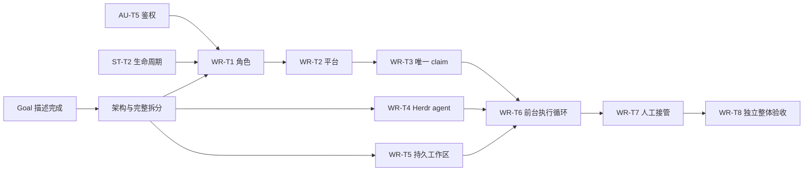

# Worker 交付任务拆分

状态：设计待 review；已登记全部八项交付 task，运行时尚未实现。本文拥有交付范围和真实身份，[架构](daynight-worker.md)拥有机制，[需求](../spec/daynight-worker.md)拥有 W-01～W-11。

## 设计交接与任务身份

Goal 描述 `555a7772-ad35-40f5-b9d6-ff7dd4e08165` 已完成问题定义。架构设计与拆分 task 为 `2b4093dc-7b44-4ec1-a28e-59de68a0d800`，保持 in_progress 供用户 review；设计 PR 实际集成和阶段验收成立后才完成。下列任务均保持 todo，现有角色/平台任务复用其原身份。

| 编号 | 具体结果 | Daynight task ID | 估算（分钟） |
|---|---|---|---:|
| WR-T1 | 为任务增加 Human / Agent 处理角色 | `82bafb30-5c47-4b42-8e78-bb5b524c2ba4` | 180–300 |
| WR-T2 | 为任务增加执行平台要求 | `4dbd624e-5b16-494b-b12d-8ae7db069ca1` | 120–180 |
| WR-T3 | 建立唯一的任务执行认领 | `f41f3052-96ad-4fe0-b969-e03ef789422a` | 240–360 |
| WR-T4 | 通过 Herdr 管理任务 agent | `2a253388-aa58-4c98-912a-7f4eb2e078ac` | 240–360 |
| WR-T5 | 持久化可恢复的任务工作区 | `616df2f2-c64f-4c79-a338-c4bf86bddc0a` | 240–360 |
| WR-T6 | 交付前台 worker 执行循环 | `b4a9efed-4e13-4bc1-8c34-1e5f192bdc0d` | 360–540 |
| WR-T7 | 提供已领取任务的人工接管 | `1fc8c116-d31e-4f0e-b581-73dfb1430ba9` | 180–300 |
| WR-T8 | 验收 worker 跨平台完整执行 | `79a0e979-e792-4225-b2d1-fa52833fc7d6` | 240–360 |

总估算 1800–2760 分钟；实际工作时间受原生 Herdr/agent 验收、CI 和人工 review 等待影响。估算不是降低验收的依据。

## 已登记的依赖

依赖由真实 task 的 `dependsOn` 表达；图是登记结果的投影，执行前读取实际资源。AU-T5 为 `ce2f8cd5-daab-40f2-8637-c1a8ae17e445`，ST-T2 为 `6db17ca5-5090-4ba0-8531-e1715b4e1c97`；当前基线主线尚未交付两者的激活契约。

所有本 Goal 交付根经设计 task 把关；Herdr 适配与本地状态不依赖角色/平台实现，可并行交付；最终 coordinator 同时消费三条已完成能力。每个 task 一个明确结果，内部 CI、review 和修复属于原 task，不另建步骤型 task。

## 每项交付的范围与验收

### WR-T1：为任务增加 Human / Agent 处理角色

覆盖需求：W-02。数据库迁移、明确人工确认、服务端/CLI/Web 一致角色和 claim 锁定。

保留已确认旧任务 Agent、新任务 Human、人工确认和已 claim 锁定；Web 使用该 task 已上传的角色原型，不增加通用任务编辑表单。人工 Human 生命周期仍有效，角色不与凭据类型或具体 agent 混淆。

验收以该 task 主附件 `plan.md` 为准，必须包含迁移、确认、版本/claim 竞争、权限、CLI 与实际 Web 交互及适用 Go/CLI/Web 门禁。

### WR-T2：为任务增加执行平台要求

覆盖需求：W-03。未限制/三平台、设置清除、筛选分页、匹配 claim 与角色/平台锁定。

复用角色任务；原型是该 task 的 `mockui/index.html`。公开枚举为 windows/linux/macos，null 不限制；实际 worker 环境识别，WSL Linux 按 linux。

验收以该 task 主附件 `plan.md` 为准，覆盖全部平台组合、清除/未提供语义、分页/游标、claim 竞争、已 claim 锁定及三端一致。

### WR-T3：建立唯一的任务执行认领

覆盖需求：W-04、W-08，集成 W-02/W-03。服务端受保护的 properties.worker、自动 claim、归属更新、完成与 release/transfer；同步 CLI/Web 读取 DTO，保持普通属性和手工生命周期。

主要动作：

- 扩展预定义 worker 属性，服务端派生用户/时间，普通 create/PATCH 拒绝所有 worker 字段，PR 等属性更新保持 worker。
- 自动 worker-claim 在项目写锁内核验成员、版本、ready/依赖、角色、平台和现有归属，与状态一次提交。保留手工 claim；active worker 的完成须匹配 claim 身份。
- 提供受控会话/阶段更新、release 与原子 transfer，确认停止及成果连续性，原 owner 或项目 admin 才可操作；旧 claim 失效。released 任务保留原工作区绑定，不能由无资料的机器重新开始。
- 补足候选资格/当前 worker 已认领查询、DTO 与错误分类，精确 int64 不丢失，未知写入结果通过读取实际归属核对。

完成条件：

- 两用户/两机器同版本竞争只有一个成功，失败不启动资源；覆盖权限、版本、角色/平台变化、未知响应与旧 claim。
- ordinary properties/status 路径不能改写归属或旁路完成；手工 Human 执行仍有效。
- release/transfer 后原工作区关联保留，目标身份及平台受校验，旧执行方不能更新/完成。
- Go 隔离 PostgreSQL 全 gate 和适用 CLI/Web 类型/读取检查通过，迁移和关联文档、note 同步。

### WR-T4：通过 Herdr 管理任务 agent

覆盖需求：W-01、W-07、W-09、W-11。worker 专用 Herdr API adapter、隔离数据目录、支持版本/能力检查、Copilot/Codex 输入观察与原生会话恢复。

主要动作：

- 实现换行 JSON IPC 与 Unix socket/Windows named pipe，检查所需字段/能力，隔离实例 config/state，启动前验证端点长度。
- 工作目录由调用者给定；实现 workspace/agent 创建、输入、最新状态/native session 获取、停止与快照重连，不承担 task 成功判定或 Git worktree 生命周期。
- 支持 Copilot/Codex 原生参数与历史恢复；冻结技能与执行配置，避免 Herdr 自动恢复与手动启动重复；输入超时先观察不盲目重发。
- 将已完成无原生 agent 冒烟作为有限证据，补齐支持基线、真实原生 agent、无客户端恢复、blocked 与真实进程清理的门禁。

完成条件：

- Linux/macOS/Windows 的本地 API、两个 agent 的 readiness/输入/blocked/native history 与会话恢复均有真实证据，不能用模拟 pane.report_agent 代替。
- worker 重启重连现存 agent，Herdr 重启无人值守恢复不要求人工开 TUI；缺历史/不确定状态明确失败并保留关联。
- pane/server 停止后确认进程退出，长 socket 路径和不兼容版本可诊断，人工 Herdr 不受影响。
- 所有 probe/config/data 位于任务或显式工作区目录，清理服务/进程；适用 CLI/native gate 与原生证据通过。

### WR-T5：持久化可恢复的任务工作区

覆盖需求：W-06、W-09、W-10。worker 独立 SQLite 两表、当前执行检查点、稳定 task worktree/分支与资源所有权；提供 coordinator 使用的窄原语。

主要动作：

- 实现 worker_state 与 executions，WAL/FULL/短事务、身份、轮转、配置/技能快照、claim/session、phase、计数、错误和结束记录。单例 pending_action 只记 Herdr 服务 start/stop，task 动作分别归各 executions，不能跨任务覆盖。
- 一个 task 仅一个未结束本地执行，动作意图先落库；不创建报告 inbox、事件表或通用任务引擎。
- 稳定 task branch/worktree 与 worktreeId，创建前登记预期资源，恢复验证 Git common directory、原分支和标记，保留未完成成果。
- 完成后安全清理、清理失败单独恢复、旧执行结束记录保留；只读导入选定任务的原执行记录时保留成果/冻结配置而不复制 worker 身份。

完成条件：

- 状态/冻结配置/恢复预算/未知动作跨进程重启保持；验证两任务未决动作与服务 start/stop 交错互不覆盖；并发 retry 授权只被消费一次，损坏和高版本 schema 明确拒绝。
- Git 真 worktree 验证创建前/创建后崩溃、原成果恢复、不同 task 隔离、路径/身份不符暂停、删除失败恢复。
- 不会使用 review reset/clean 重置 worker 数据，不以保存 PID 直接杀其他进程。
- 适用 SQLite/native Git/CLI 门禁通过，严格检查新文件和同步 note/文档。

### WR-T6：交付前台 worker 执行循环

覆盖需求：W-01、W-05、W-07、W-09、W-10、W-11。worker run 的配置/命令与持续调度、恢复组合、agent 交付上下文、完成证据门禁和清理；交付正常与中断后端到端主流程。

主要动作：

- 注册懒加载 worker run 和独立 worker 配置域/stateDirectory，复用 API client/仓库绑定/严格路径，原 review/help/补全不加载 worker 业务。
- 启动先核对已有本地及目标归属执行，再轮转仓库领取兼容候选；claim 未确认、等待与暂停占名额，完成后只清理。每次 REST 操作独立有界。
- 加载随包 using-daynight 的 worker-managed 上下文，agent 负责完整交付且维护现有 PR/验收资料；禁止自行下一任务、最终 done 和管理 worktree。无 report 命令、结果文件或事件协议。
- 观察最新 Herdr 状态，idle/done 只触发核验；真实 PR/合并/检查/成果可读性及人工要求核对通过后完成，缺失或冲突在原会话继续/等待。
- 组合崩溃核对、有限恢复、Ctrl+C、暂停/错误、source-bound JSONL 和前台人工入口，保留全部名额与 ownership 约束。

完成条件：

- 安装 CLI 在三平台通过受控服务/agent fixture 验证完整执行与中断链路，原生 Herdr/agent 能力消费 WR-T4 的证据；真实双 agent、三平台完整交付由 WR-T8 独立验收。
- 多仓库轮转公平、同仓库候选顺序、过滤分页完整、全局名额跨 waiting/paused/restart 不丢失；配置重载只影响新领取。
- worker/Herdr/机器重启、各外部动作响应丢失与半途停止均不启动重复 agent，不丢原成果，不重做已交付任务。
- 原 task skill 单任务/Goal、权限、open-PR 等待规则保持；没有通用验收解析器，缺失或人验证据保持 pending。
- 适用 CLI typecheck/test/build/installed/completion、原生入口与受控端到端通过，README/规格/设计/技能说明同步。

### WR-T7：提供已领取任务的人工接管

覆盖需求：W-08、W-09、W-11。有限恢复超限后的明确 retry、人工原会话入口、受控解除/目标机器移交操作与本地执行记录延续。

主要动作：

- worker retry 对暂停任务只授权一次额外恢复，不清空预算、不创建新会话捷径；离线前台期间也能持久保存该授权。
- 实现可操作的 release/transfer CLI，复用服务端权限/版本/claim 校验，显式确认旧执行停止和原成果连续性。
- 接收方先准备原 worktree/native history，并只读导入选定 source SQLite execution 记录；匹配冻结配置、平台、worktreeId 后切换 claim，target coordinator 优先恢复该 in_progress 执行。
- 原执行用户/项目 admin 和现有成员权限均受检查，其他人、缺资料、错误平台、未知停止结果不得接管；前台输出可识别原因及原会话入口。

完成条件：

- 超限任务重启仍暂停，人工 retry 只增加一次尝试；重复授权/并发恢复不双启动。
- 原用户和 admin 在旧执行已停止且资料完整时移交成功，旧 claim 被拒绝；其他成员/失去权限者失败。
- 两套独立 stateDirectory/workerId 的移交保持同一 worktreeId 与成果/native history，缺失资料保持暂停；不复制 worker_state 或自动跨机搬文件。
- release 后资格编辑与新 claim 竞争按 version/锁定处理，原始成果不被新建空目录覆盖，适用服务/CLI/native 验证通过。

### WR-T8：验收 worker 跨平台完整执行

覆盖需求：W-01 至 W-11。独立验收整个 worker Goal，使用已集成的精确源码、安装包、真实服务和原生 Herdr/agent，补足全部需求证据。

主要动作：

- 固定被测 commit、构建/安装产物、OS、Herdr 与原生 agent 版本，以原需求和各任务验收做完整映射。
- 使用隔离 PostgreSQL/认证项目与真实安装 CLI，运行多仓库、多 worker 竞争、角色/平台矩阵、正常交付与清理。
- 运行真实两 agent 的无客户端恢复、进程停止、人工介入/移交、配置冻结、未知结果和崩溃注入，保留 native 与模拟边界。
- 读回所有 task/附件、实际 PR merge/CI 与最终运行结果，核对整体 Goal；发现范围内 Critical/Major 按原交付任务修复并重新验证受影响项。

完成条件：

- W-01..W-11 每项都有 source-bound 证据；三平台、两 agent 以及真实服务与公开命令入口均覆盖。
- 所有必要实现 PR 平台确认集成，全部交付 task 完成，仍存在的暂停/失败/缺证据被准确报告，不用空 ready 队列代替整体验收。
- 未完成或错误结果不被误判成功；恢复预算、唯一归属、原成果、session 与安全清理均成立。
- 资源/浏览器/测试进程清理完成，验收记录作为本 task 主附件可读，最终整体结论区分运行证据和未覆盖范围。

## 资料与登记核验

每个 task 的 `description` 是自足简介，专属 `plan.md` 拥有详细方案和验收；共享需求/架构/拆分留在设计 task 的 `requirements.md`、`design.md`、`tasks.md`，上传副本将仓库相对链接固定到实际设计 commit。执行者按 task ID 和附件路径读取，不假设 task:// URI。

角色和平台 task 的专属原型及资源保留在其来源，不向其他 task 复制整套前端包。独立整体验收消费精确源码、已集成 PR 和原生运行产物，不用设计文档或模拟 smoke 代替真实能力证明。

登记完成需逐项读回全部任务、主附件、共享来源、原型资源和依赖，确认无环且均经过设计完成。PR review 调整机制时，同步本表、所属 task 简介和方案及相应依赖，再重新读回。

## 整体完成条件

全部八项 task 的实际交付与验收成立、必要 PR 真实集成，并由 WR-T8 按原 W-01～W-11 验证后，才能报告整个 Goal 完成。设计 PR 保留供用户 review 时，架构 task 保持 in_progress，所有后继保持依赖阻塞。
