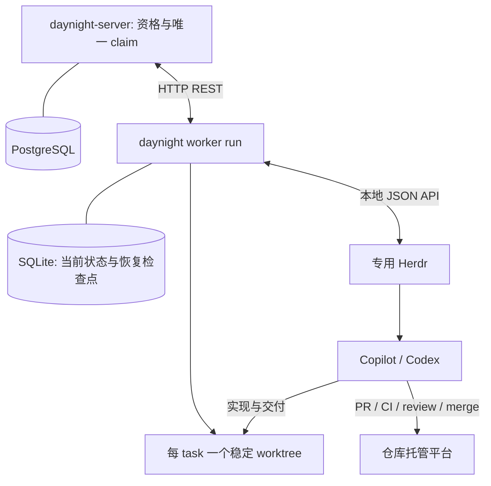

# Worker 架构设计

状态：架构方案已确认，运行时尚未实现。本文拥有机制；[需求](../spec/daynight-worker.md)拥有产品行为，[设计决策](../../.agents/notes/implemented/architecture/2026-10-22-worker-design.md)保留真实备选方案。

## 目标与当前基础

`daynight worker run` 是一个前台常驻 CLI：通过 REST 领取多仓库中允许 Agent 执行的任务，使用系统管理的稳定 worktree 与专用 Herdr 执行，持久化状态并完成恢复和清理。Agent 负责完整交付循环，worker 负责归属、资源和完成核验。

设计初始源码基线为 `e533b8610ec38522fd5387e4715b573734bd16c2`。交付核对基线为 `2d7fdd1e4e178db17e46da5d3b6c0e4050edf730`：主线具有命令组合、严格 YAML、REST client、任务/属性、项目写事务和 review 的 Git/SQLite 基础；鉴权与显式 approve/claim/complete 生命周期已交付，worker 仍待实现。任务的服务端起止时间及图时钟遵循已交付的[执行时间契约](https://github.com/codetreker/daynight/blob/2d7fdd1e4e178db17e46da5d3b6c0e4050edf730/docs/spec/daynight-task-timing.md)，worker DTO 与生命周期扩展须保留该契约。

| 当前基础 | 复用点 |
|---|---|
| [命令组合](../../packages/daynight/src/commands/review/command.ts) | definition → command → runtime，业务按命令懒加载。 |
| [项目写锁](https://github.com/codetreker/daynight/blob/e533b8610ec38522fd5387e4715b573734bd16c2/packages/daynight-server/internal/core/store/project_tx.go#L29-L39)、[版本检查](https://github.com/codetreker/daynight/blob/e533b8610ec38522fd5387e4715b573734bd16c2/packages/daynight-server/internal/service/task.go#L100-L120) | 同一事务中检查资格、权限、版本和归属。 |
| [属性 codec](../../packages/daynight-server/internal/taskproperties/codec.go) | 新增预定义属性，保留已有 PR 属性；读与写权限分开。 |
| [REST client](../../packages/daynight/src/api/client.ts)、[分页范围](../../packages/daynight-server/internal/service/page.go) | 复用认证、int64、游标和不确定写入分类；扩展角色/平台/worker 筛选。 |
| [review store](../../packages/daynight/src/commands/review/store.ts)、[worktrees](../../packages/daynight/src/commands/review/adapters/worktrees.ts) | 复用必要的持久性、Git/路径原语；worker 自己拥有状态和可提交分支。 |

## 总体结构



| 组件 | 唯一职责 |
|---|---|
| 服务端 | 任务角色/平台、ready、认证权限、原子 claim、归属更新、完成与移交。 |
| Worker | 轮转与名额、worktree、Herdr 启停、状态观察、恢复、证据核验及清理。 |
| Agent | 实现、测试、提交、PR、CI/review 修复、合并和任务验收；维护正常 task 资料。 |
| Herdr | PTY、agent 启动/输入/状态及原生会话引用。 |

不增加 agent report 命令、结果文件、callback 服务、报告事件流或通用开发流程引擎。Worker 读取 Herdr 最新状态与现有 task PR/验收资料。Review 保留自己的 PR revision、publication 和 coordinator；只在第二个真实调用方需要时提取窄的共享原语。

## 配置与目录

共享 `config.yml` 增加独立 `worker` mapping；当前 review 根字段保持原义。配置示意：

```yaml
serverUrl: https://daynight.example.com
worker:
  stateDirectory: /workspace/automation/.daynight/worker
  maxConcurrentTasks: 2
  pollIntervalMs: 60000
  maxRecoveries: 3
  retryDelayMs: 30000
  agent:
    type: copilot
    model: auto
    args: []
  repositories:
    - remote: https://github.com/owner/repository.git
      path: /workspace/repository
      agent:
        type: codex
        args: []
```

`stateDirectory`、仓库地址/路径和 agent 类型是明确配置；目录使用工作区或项目内的绝对路径。并发为正整数，轮询/重试间隔为正整数，自动恢复上限为非负整数。表中数值是建议默认值，配置错误明确拒绝。仓库可给出 `projectId` 解决服务端仓库绑定歧义，不能猜测同仓库多个 project。

Agent 类型不变时仓库字段覆盖全局字段；切换类型时按新类型解析，不继承另一类型的模型和参数，未指定模型使用其原生命令默认。Worker 管理的 session/cwd/恢复参数不能由普通 `args` 覆盖。领取时保存最终配置，不保存认证 token；运行启动时加载配置，重启使修改作用于新领取任务，旧执行继续使用其快照。

```text
<stateDirectory>/
  state.sqlite
  instance.lock
  logs/
  tmp/
  h/                   # 专用 Herdr config/state，所有目录由此 worker 拥有
<repositoryPath>/.worktrees/daynight/<taskId>/
```

配置文件沿用既有共享配置所有者。新增任务状态、Herdr 数据和临时文件留在明确的工作区路径，不迁移 review 的数据库或锁，也不静默写入其他用户目录。保护目录不与 disposable worktree、Git 元数据或另一 worker 状态目录重叠。

每个 stateDirectory 一个前台实例；复用实例锁的排他和失效处理原则。Worker ID/机器 ID 生成后存 SQLite，重启保留；复制整库不能作为跨机器移交方式。

## 服务端模型与资格查询

任务顶层字段：

```text
processingRole: Human | Agent
requiredPlatform: null | windows | linux | macos
```

旧任务迁移为 Agent 且平台为 null，保留其他数据/版本/时间；新任务为 Human、平台 null。创建不能直接绕过人工确认设置 Agent。角色确认使用明确操作及认证用户，不从 session/PAT 类型推断物理人工。CLI/skill 禁止自动 worker 自行确认角色；Web 使用角色原型的确认与保存交互。

候选查询扩展现有列表：

```http
GET /api/v1/projects/{project}/tasks?ready=true&processingRole=Agent&compatiblePlatform=linux&limit=10
```

`compatiblePlatform` 包含 null 与相同平台，在排序/limit 前过滤，并加入游标范围。沿用服务端创建时间/UUID 顺序。Worker 按空闲名额读取候选，合法冲突后考虑下一个；空页/无兼容候选不占名额。已有未完成 worktree 的候选还需确认本机持有原执行资料，否则跳过并显示需要人工移交，不能在另一机器新建空 worktree。

### 受保护的执行属性

`properties.worker` 是服务端拥有的预定义属性，普通 create/PATCH 即使原样提供也拒绝；其他属性更新保留它。示意：

```json
{
  "claimId": "uuid",
  "active": true,
  "userId": "authenticated-user-id",
  "workerId": "stable-worker-id",
  "machine": {"id": "stable-machine-id", "name": "build-machine"},
  "platform": "linux",
  "agent": "codex",
  "worktreeId": "stable-task-worktree-id",
  "phase": "executing",
  "herdr": {"session": "w", "workspaceId": "w1", "paneId": "w1:p1"},
  "nativeSessionId": null,
  "claimedAt": "server-timestamp"
}
```

用户与服务器时间由服务端确定；机器/平台和运行资源是 worker 报告的事实，不建立机器认证或远端硬件证明系统。该属性是最新记录的归属/状态，不是在线保证，不以更新时间过期 claim。完成/释放后保留其最后执行信息并标为非 active，详细本地执行记录仍在 SQLite。

### 操作与事务

保留手工 `/claim`；自动领取走 `/worker-claim`，共用 task-service 事务逻辑，不按凭据类型猜测调用模式。

| 操作 | 必要输入与行为 |
|---|---|
| `POST .../processing-role` | version、目标角色；转 Agent 需明确 `confirmAgent=true`。|
| 普通 task PATCH | 可设置/清除 requiredPlatform；已 claim 时角色与平台更改拒绝。|
| `POST .../worker-claim` | version、预先落库的 claimId、worker/机器/平台/agent、worktreeId；成功原子写 in_progress 与唯一 active claim。|
| `PATCH .../worker-claim` | version、claimId 及会话/阶段摘要；仅当前 owner 可更新，不能更换身份、角色、平台或 status。|
| `POST .../complete` | 现有生命周期完成接口；active worker claim 必须另提供匹配 claimId 并满足 owner 校验。普通人工任务保留原行为。|
| `POST .../worker-claim/release` | version、claimId、明确停止确认；仅当前执行用户或项目管理员，可将已停止执行释放回 todo，保留角色/平台和原 worktree 关联。|
| `POST .../worker-claim/transfer` | version、旧 claimId、新 claim/目标用户与 worker/机器/平台、原 worktreeId、停止及连续性确认；原子切换归属，保持 in_progress。|

Claim 在项目写锁内依次检查成员权限、version、todo/依赖、Agent/平台、无其他 active claim；成功只增加一次版本。会话更新、完成、release/transfer 同时检查当前 claim。一般 metadata 更新不能绕过这些入口。

Release 是 worker 专用的受控重入例外，不恢复通用 status PATCH。释放后 ready Agent 可以再次竞争；原工作区绑定仍保留，其他机器没有延续资料时不得重新开始。角色/平台编辑与新 claim 的竞争仍受 version/锁定规则约束。

沿用现有错误 envelope：输入或只读字段为 `400 invalid_input`，认证/所有者权限为既有 401/403，非成员/不存在为 404；旧版本为 `409 version_conflict`，资格或生命周期不符为 `409 invalid_transition`，旧 claim 为 `409 claim_conflict`。错误不转成空候选或成功。

服务端 fencing 只拒绝旧 Daynight 写入，不能撤销 Git 托管凭据或停止另一个进程。人工移交必须先确认旧执行已停，不能仅换 claimId 就允许第二个 agent。

## SQLite：两个业务表

复用现有 SQLite WAL、`synchronous=FULL` 和短事务原则，worker 独立 schema。无需报告收件箱、事件表或独立仓库 registry。

| 表 | 主要字段 |
|---|---|
| `worker_state`（单例） | worker_id、machine_id/name、platform、Herdr session/实例关联、下一个仓库轮转位置；pending_action 仅保存专用 Herdr 服务本身的 start/stop。 |
| `executions`（保留结束记录） | execution_id、server_origin/project_id/task_id、claim_id、worktree_id/路径/分支/所有权、仓库物理身份、冻结配置、Herdr/native session、phase、pause_reason、最新状态/观察时间、恢复次数/上限、retry_at、一次人工恢复授权、pending_action、最后错误、交付引用、创建/结束时间。 |

同一任务最多一个未结束本地执行，claimId 唯一。已释放/移交的记录结束但保留原 worktree 信息；新执行只有在确认同一 worktreeId 和原成果可继续后引用它。任务键包含 server origin，不能配置换服后把旧执行发送到新服务器；认证用户变化同样需要核对。

`worker_state.pending_action` 只属于专用 Herdr 服务的 start/stop，串行推进；未核实该服务动作前不启动新的 pane/agent。它不承载任何 task 级动作。

`executions.pending_action` 分别属于各自执行，覆盖 claim、worktree、pane/agent 启动、prompt、完成及清理。同一执行只推进一个动作，不同任务可各自有未决动作；服务 start/stop 不覆盖或清空它们。恢复先核对服务级动作，再核对各 task 动作。两个执行并发及服务退出交错必须验证互不覆盖。

每条检查点只需保存当前动作：

```json
{"id":"uuid","kind":"start_agent","expected":{"claimId":"...","paneId":"..."},"startedAt":"..."}
```

先提交检查点，再调用外部系统，观察结果确认后清除。未知结果保留并核对，不覆盖成下一动作。只记录 worker 控制的 claim/worktree/Herdr/完成/清理动作；agent 自己的 PR/merge 通过 task 引用和远端读取核对，不声称 SQLite 与所有 agent 工具具有原子事务。

## 前台循环与 worktree

```text
claiming → preparing → executing → verifying → completing → cleaning → finished
                         ↑             |
                         └─────────────┘  交付未完整时继续原会话
```

等待原因、暂停与恢复时间是当前 phase 的字段，不创建第二套 task 生命周期。claiming 结果不确定也暂占名额；preparing 到 completing、等待及暂停占名额；远端完成确认后 cleaning 不占交付名额，清理只需单独重试。降低并发不抢占已有执行。

启动顺序为锁/SQLite → 核对已有执行 → 专用 Herdr → 调度。每次轮询、claim、更新和核验使用新的有界 REST Operation，挂到统一取消信号；不能把整个常驻命令套进现有五分钟总期限。

稳定分支和目录由 task 身份决定，不由 attempt 决定。创建前持久化预期路径/worktreeId，Git 所有权标记关联它；恢复核对实际 Git common directory、分支及持有标记，禁止套用 review 的 reset/clean。删除前必须确认执行已停、归属正确且交付完成。

## Herdr 与 agent

支持基线选择 Herdr 0.9.5，并检查实际 API 所需能力/字段，不只依赖内部 protocol 数字。缺失版本/能力时启动前给出错误；原生 session 恢复所需的官方集成与历史可用性也须预检。不自动下载、升级或修改全局集成。

专用实例的数据在 stateDirectory 内隔离，短 session 名为 `w`，由私有 config/state root 和稳定 workerId 共同识别。清理继承的 Herdr endpoint 环境，使用明确 session/endpoint。人工进入时打印同一私有环境对应的 Herdr attach 命令。

| 需要的 API | 用途 |
|---|---|
| `workspace.create {cwd,label,env}` | 使用已准备 worktree，创建任务终端；label 绑定 execution 身份。 |
| `agent.start {kind,pane_id,args}` | 在已就绪 shell pane 中启动 copilot/codex。 |
| `agent.prompt`、`agent.get` / `agent.wait` | 提交输入并观察最新状态和 native session 引用。 |
| `pane.process_info`、`pane.close`、`server.stop` | 观察并停止本 task 或专用服务，核实运行资源已结束。 |
| `session.snapshot` | 识别重启后的已有 workspace/pane，避免重复创建。 |

API 是本地换行分隔 JSON；Unix 使用 domain socket，Windows 使用 named pipe。启动前校验 API 和 client 两个实际端点的字节长度/平台约束，路径过长要求缩短 stateDirectory，不静默切换目录。

Worker 同一时刻只向一个 task 的同一已就绪 agent 提交一轮输入。超时/断连不证明输入未送达，先观察已有执行和 task 资料；不得盲目重发工作。Herdr idle/done 仅触发核验，blocked 展示人工入口，unknown/不可达先核对并按恢复策略处理。

Prompt 加载随包 `using-daynight` 的阶段和交付规则，传入 task/claim/worktree/session 与冻结配置；worker-managed 上下文明确由 worker 控制领取、最终完成和资源生命周期。Agent 继续维护现有 PR 属性和验收附件，不输出新报告协议。

## 完成核验与人工操作

Worker 核验当前 claim、task/附件可读、引用 PR 的仓库/提交/真实合并及必要检查、工作树成果整合和验收证据引用。验收语义由 task 及 agent 执行负责；文字声明不是任意自然语言条件的独立证明。明确的人验要求、缺失/冲突证据或当前适配器无法核实的事实保持未完成，在原会话请求人工处理；不增加通用验收表达式/Markdown 解析引擎。

原生托管检查复用当前 GitHub/gh 读取能力；不能核实的托管结果不得仅凭 URL 或文字当作已合并。额外托管适配不是领取/归属模型的前提，完成检查接口保持具体结果和错误，遇到缺少适配则等待人工核验。

必要操作入口只有运行、明确恢复及受控任务 claim 管理：

- `worker run`：启动并恢复、观察、调度和显示。
- `worker retry <task-id>`：只为已暂停的本地执行授权一次额外恢复，不清空计数，不换会话、不释放 claim；请求落 SQLite，前台实例消费。
- `task release <task-id> --claim-id <id> --stopped-confirmed`：显式释放已停止的 worker claim，沿用 `--project` 与 `--if-version` 语义。
- `worker transfer <task-id> --source-state <sqlite-snapshot> --stopped-confirmed --continuity-confirmed`：在接收方操作，当前 worker 配置提供目标身份/仓库/实际平台；source-state 是可只读打开的一致 SQLite 快照，跨机器资料准备由人工完成。
- Release/transfer 复用服务端权限和事务。接收方先准备原 worktree/native history，并将选定执行记录从原 SQLite 只读导入本地；保留 worktreeId/冻结配置，不复制 worker_state。操作记录 pending transfer 后调用服务端，再核对新归属完成导入。字段/路径缺失时拒绝而非重做。

Transfer 后，目标 worker 还要查询归属于自己的 in_progress 执行并核对本地已导入记录；这是显式移交后的恢复，不是绕过 ready 的新自动 claim。原用户或项目管理员仍需持有现有项目权限，普通成员不能借此更换他人归属。

## 退出、恢复与清理

| 情况 | 恢复动作 |
|---|---|
| Worker 死亡、Herdr 存活 | 重连专用实例，核对 pane/native session 后继续观察，不重复启动。 |
| Herdr/机器重启 | 按保存关联恢复原会话；需要证明原执行停止且 history 可用。不能取得时暂停。 |
| claim/启动/完成响应丢失 | 按 pending_action 查询服务端、Git 或 Herdr 的实际结果，确认前不重复动作。 |
| 异常/基础设施故障 | 在原 worktree/会话有上限恢复；计数不因重启清零，超限保留名额待人工授权。 |
| Ctrl+C | 停止新领取，停止 agent/专用 Herdr 并等待核实，保存检查点；不明确时保留错误和待恢复状态。 |
| 完成但清理失败 | 保留 completed/cleaning 记录，重启后只重试清理。 |

原生会话恢复优先使用 Herdr 自身保存的引用；若其配置会自动恢复，worker 不能同时手工启动同一 native session。支持版本的无客户端恢复必须通过实测门禁，不能把 client attached 当作无人值守的隐含条件；失败时实现方需在同一 Herdr 公开 API 能力内证明可行方案，再交付该能力。

## 观测、关联和错误

相关性以 server/project/task、executionId、claimId、workerId、Herdr session/pane 和 native session 为主。领取前生成 execution/claim ID 并落库；每个调度并发分支显式携带执行上下文，REST/Herdr/后台等待继承取消信号，错误回到所属执行，不创建无归属的 detached Promise。

前台显示仓库、task、agent/平台、phase、最新 Herdr 状态、等待/暂停原因及原会话入口。使用既有诊断和文件原语写入 worker JSONL 日志，记录 `subsystem`、`phase`、错误类别、原因和可用关联 ID；不记录 token、完整敏感 prompt 或凭据参数。数据库保存最后具体错误，不用空值吞掉错误；日志不参与授权判断。

部署后按一次具体 task 过滤 `taskId` 与 `claimId`，核对 claim→pane→核验→完成/清理日志及 SQLite 当前记录；示意：`jq 'select(.taskId == "<task-id>" and .claimId == "<claim-id>")' <worker-log.jsonl>`。日志结构须保留这些可查询字段。

## 验证与当前证据

Linux 本地 Herdr 0.8.2 的隔离无原生 agent 冒烟已验证：原始 JSON API、headless workspace 创建、人工模拟 working/idle、普通 shell/子进程关闭和 shell 工作区重启恢复。发现 134 字节 client socket 路径启动失败，缩短后 API/client 路径分别 100/107 字节成功。这些是该平台和版本的观察，107 不是三平台通用限制。

它没有运行 Copilot/Codex、没有验证原生检测、native history 恢复、原生 agent 脱离子进程或 macOS/Windows。原始 receipt 保留为本设计 task 附件；运行时交付必须通过下面的独立门禁。

| 门禁 | 必须证明 |
|---|---|
| 服务端与迁移 | 角色默认/确认、平台清除/分页、属性写保护、同版本单赢家、旧 claim、权限、release/transfer 及手工路径。 |
| 本地状态与 Git | WAL/事务、动作结果不确定、稳定 worktree、所有权核对、冻结配置、恢复计数、结束记录和清理。 |
| Herdr 原生 | 支持基线、两 agent、三平台 API/输入/blocked、停止、无客户端 native restore 及真实历史保留。 |
| 端到端 | 安装 CLI、两 worker 竞争、多仓库轮转、PR/CI/review/合并/验收、人工介入/移交、各崩溃窗口与重启。 |

不得以模拟 lifecycle 或文档说明替代原生证据。实现通过适用 CLI/Go/Web 门禁，保留严格覆盖率、原生平台和实际服务证据。

## 模型入口大小

模型入口只使用随包 `using-daynight` 与既有 task CLI。启动上下文传 task/claim/session/worktree 标识及技能路径，不复制完整 Goal 或全部交互资源。对实际登记资料测得：

| 来源 | task 简介 UTF-8 字节 | 主 Markdown 字节 |
|---|---:|---:|
| 555a7772-ad35-40f5-b9d6-ff7dd4e08165 | 3067 | 15259 |
| 82bafb30-5c47-4b42-8e78-bb5b524c2ba4 | 2105 | 8841 |
| 4dbd624e-5b16-494b-b12d-8ae7db069ca1 | 1708 | 7588 |

读取一个普通任务至少需要详情、附件清单、主 Markdown 三次现有 CLI 操作，额外 UI/证据按需读取。保留完整要求，不截断来制造固定 token 上限；具体 token 随 agent/model、仓库指示变化，原生验收记录实际模型使用量。未增加 report tool、模型 RPC 或通用 MCP 服务。

## 选择与范围

| 真正比较过的方案 | 选择理由 |
|---|---|
| Agent 交付循环，worker 管资源/核验 | 保留任务现有流程，明确单一生命周期所有者。 |
| Worker 编排完整 PR/CI/review 引擎 | 需要重复每个仓库开发流程和非代码任务规则，未采用。 |
| report CLI/SQLite inbox 或结果文件 | 需要新消息、去重和恢复协议；现有状态与 task 资料足以承载观察，未采用。 |
| 共用 review coordinator/store | PR revision/发布与长任务的名额和恢复语义不同，采用窄基础原语复用。 |

包含角色/平台、唯一归属、前台执行、原生 agent、恢复、人工管理与完整验收。通用插件引擎、报告系统、自动跨机器文件搬运、基于失联超时抢占及通用自然语言验收引擎不在交付内。相应情况保留明确错误/暂停及人工入口；唯一归属、状态隔离、原成果连续性和错误传播是本次必须成立的保证，不作为后续补丁。
