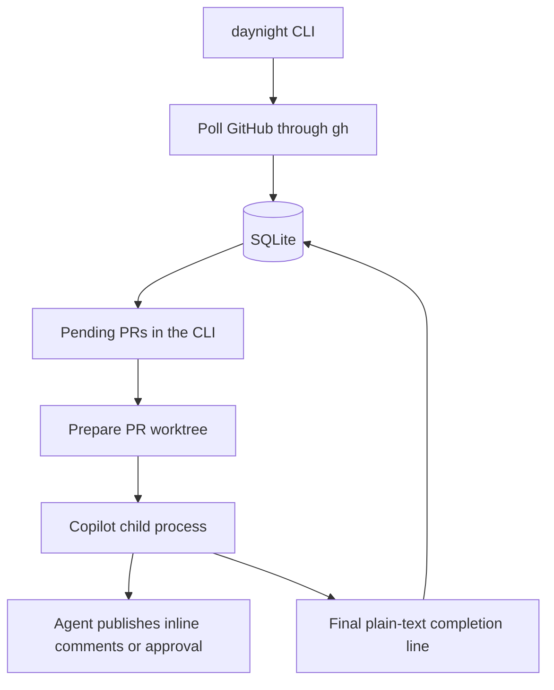

# Daynight Architecture

Status: proposed design; application implementation is pending.

Daynight is one foreground TypeScript CLI that keeps running until stopped. Its
code belongs in `packages/daynight/`. It supports Linux, macOS, and Windows.
[Requirements](../spec/daynight.md) own product behavior; the
[decision note](../../.agents/notes/implemented/architecture/2026-10-16-foreground-review-cli.md)
records the architectural choices.

## Usage and configuration

```text
daynight --config ./daynight.json
```

The CLI loads configuration, opens SQLite, ensures the configured clones exist,
then polls GitHub while invoking Copilot as ordinary child processes. Ctrl+C
stops polling and new reviews, stops active children, records unfinished work,
and exits. It uses the terminal's normal process lifecycle.

Proposed JSON configuration:

```json
{
  "stateDir": "./.daynight",
  "pollIntervalMs": 60000,
  "maxConcurrentReviews": 1,
  "agentTimeoutMs": 1800000,
  "maxAttempts": 3,
  "retryDelayMs": 30000,
  "repositories": [
    {
      "remote": "https://github.com/OWNER/REPO.git",
      "path": "./repositories/REPO"
    }
  ]
}
```

These numbers are proposed operational defaults. Paths resolve relative to the
configuration file. Validate fields, positive integer limits, unique repository
identities, and nonoverlapping clone/state paths. Resolve HTTPS or SSH GitHub
remotes into host/owner/name and a stable repository ID. Changing a spelling or
restarting must not initialize the same repository again. Reject a mismatched
existing clone rather than overwriting it. Preserve its working files/branches.

Use pnpm, TypeScript ESM, Node.js 24 LTS, and `better-sqlite3`. Pin versions when
implementing the package. Git, `gh`, and Copilot CLI are installed beforehand;
`gh` authentication is already prepared. Copilot also needs supported credentials
and access to a model. Configuration contains no credentials.

## One process, ordinary modules



Polling and review scheduling are asynchronous tasks within the same Node.js
process. The poller never waits for an entire review before polling again.
An in-memory map reserves each PR operation before its first asynchronous step.
Preparation, child execution, and cleanup share that reservation, so polling
cannot start another operation on the same worktree. SQLite preserves review
progress after exit. A configurable global limit controls review concurrency
across PRs. Repeated pending updates coalesce.

| Proposed file | Responsibility |
|---|---|
| `src/main.ts` | CLI startup, polling loop, pending work, signal handling |
| `src/config.ts` | Configuration parsing and path resolution |
| `src/github.ts` | Authenticated API reads and pagination through `gh` |
| `src/store.ts` | SQLite schema, observations, review progress, retry state |
| `src/git.ts` | Clone validation, fetch, PR worktree preparation and cleanup |
| `src/review.ts` | Prompts, session selection, child execution, completion check |

Use ordinary functions and concrete types. Inject external commands and time
where verification needs to control them. All process execution uses argument
arrays; configuration and branch names are never interpolated into shell code.
A platform-aware command library handles Windows CLI command shims.

## Local data and SQLite

```text
.daynight/
  state.sqlite
  instance.lock
  copilot/                    # CLI configuration and retained sessions
  cache/
  tmp/
  logs/<review-id>/<attempt>/  # stdout and stderr
  worktrees/<repository-id>/<pr-number>/
```

Keep session data and logs outside disposable worktrees. Set Copilot's state,
cache, log, and temporary directories under this state directory. Store tokens
only in inherited command environments, never in SQLite, arguments, or logs.

The schema needs three tables:

| Table | Key | Stored state |
|---|---|---|
| `repositories` | Stable repository ID | Host/remote/local path, nullable `start_pr_no`, initialization time, last successful poll/error |
| `pull_requests` | Repository ID + PR number | Observed open/draft/head/base branch, desired/completed revision, session UUID and established flag, worktree path, cleanup status |
| `reviews` | Review UUID | PR identity, immutable revision/head/base branch, pinned base SHA, status, attempt count, retry time, child identity, log paths, last error |

A revision is a local increasing number for observed review triggers. It avoids
losing a Draft-to-ready or retargeting trigger even when the head SHA is unchanged.
The desired revision and completed revision are separate. A running review owns
one captured revision; completing it cannot complete a newer desired revision.
Review status is `preparing`, `running`, `retry_wait`, `completed`, `failed`,
`interrupted`, or `superseded`. A unique active-review index covers preparing,
running, retry-wait, and interrupted rows. Together with the per-PR operation
reservation, it enforces one current review per PR. Do not add foreign keys for
these internally owned records.

Use short transactions for related state changes. No transaction spans a Git,
API, or agent call. Enable WAL, `synchronous=FULL`, and a bounded busy timeout;
keep the database on a local filesystem. Use explicit schema migrations and
surface their failures. See [SQLite transactions](https://www.sqlite.org/lang_transaction.html)
and [synchronization](https://www.sqlite.org/pragma.html#pragma_synchronous).

## Polling and selecting work

1. For each uninitialized repository, enumerate all PR states and all pages,
   compute the maximum number, and save `Start PR No` in one successful commit.
   A successful empty scan saves zero; failure leaves initialization incomplete.
   PRs created during initialization can fall inside this boundary.
2. On subsequent polls, enumerate open PRs above that permanent cutoff, including
   Drafts. Read tracked PRs missing from a complete open scan directly before
   recording closure. A failed/partial response is never evidence of closure.
3. Update observations and increment the desired revision on first discovery,
   head SHA change, target branch name change, or observed Draft-to-ready.
   Changes while Draft are saved but never dispatched. The proposed reopen
   policy also increments the revision on observed closed-to-open.
4. Schedule an Open, non-Draft PR whose desired revision exceeds its completed
   revision, whose revision is not terminally failed, and which has no reserved
   operation or unresolved interrupted execution. Reuse a due retry row instead
   of creating another review. Select fairly, respecting concurrency/deadlines.
5. Reserve the PR synchronously before the first await and persist its selected
   review as preparing before Git operations. Read current metadata and prepare
   the worktree against the captured target; changed targets are superseded.
   Immediately before spawn, check the latest observed eligibility and any local
   cancellation request. Persist the pinned target and running state, then spawn
   Copilot. Keep the reservation until child close; cleanup waits for it too.
   After completion, reconcile metadata so later changes remain pending.

Compare `head.sha` and `base.ref`; a change to `base.sha` alone does not schedule
review. Do not use last-seen PR number or `updated_at` as a permanent polling
cursor. Older included PRs can change indefinitely. A repository's failed scan
is logged and retried without resetting its cutoff or stopping other repositories.
Follow GitHub rate-limit delays.

Polling observes snapshots. A ready/Draft round trip or retarget-and-back
entirely between polls can be missed. Complete scans and repeated polling converge
on lasting states; they do not promise a full event history. Sources:
[list PRs](https://docs.github.com/en/rest/pulls/pulls#list-pull-requests),
[pagination](https://docs.github.com/en/rest/using-the-rest-api/using-pagination-in-the-rest-api),
and [API practices](https://docs.github.com/en/rest/using-the-rest-api/best-practices-for-using-the-rest-api).

## Worktree lifecycle

Clone a missing repository and validate an existing clone against its configured
remote. Fetch PR heads through that base repository, including fork PRs:

```text
git fetch --no-tags origin +refs/pull/N/head:refs/daynight/pr/N/head
```

Fetch the selected target branch too. Compare the fetched head with current PR
metadata; refresh/coalesce if it changed. Pin the head and target tip for the
review and compute their merge-base diff. The target tip provides review context,
not an additional trigger. Do not use GitHub's generated merge commit as the PR
head. Keep enough history to compute the diff.

The first review creates a detached worktree. Later reviews reuse the same path,
switching detached to the chosen head after the previous child has ended. Clean
agent-generated files only inside the verified, daemon-owned worktree. Validate
its canonical path and Git common directory before forceful operations; preserve
primary checkout files and shared branches. Confirmation of an unchanged failed
review keeps its existing worktree so the session retains its local context.

On closure or merge, record cleanup pending and cancel preparation or child
execution. Acquire the same per-PR operation reservation after that work ends,
then remove the worktree through Git. Recheck current PR state before
removal; retain it if the PR reopened. Cleanup failures remain pending for retry.
Retain the session and PR history. An included reopened PR recreates the worktree
when ready and resumes the same session. Configuration removal retains stored
state; it does not authorize deleting a clone or its worktrees.

Sources: [PR checkout](https://docs.github.com/en/pull-requests/collaborating-with-pull-requests/reviewing-changes-in-pull-requests/checking-out-pull-requests-locally),
[Git worktrees](https://git-scm.com/docs/git-worktree), and
[Git clean](https://git-scm.com/docs/git-clean).

## Copilot session and publication

Generate and save a UUID before a PR's first review. Invoke Copilot directly:

```text
copilot -C WORKTREE --session-id UUID -p PROMPT \
  -s --output-format text --stream on --no-color \
  --no-ask-user --no-auto-update --allow-all-tools
```

Later review/confirmation calls use `--resume=FULL_UUID`. Never select the globally
most recent session. Keep established session history; if it is missing, report
an error for that PR rather than silently creating another conversation. A crash
during first session creation requires checking whether that exact UUID was
actually established before choosing create versus resume. No session JSONL is
read. Copilot compaction remains its own behavior.

The prompt supplies repository/PR, review ID/revision, exact head, target branch,
pinned diff context, previous incomplete review identity, severity rules, and the
completion marker. The agent reviews code, checks previous findings, and uses
`gh` itself to publish. It rechecks Open/non-Draft status and expected head/base
branch immediately before publication.

Critical/Major findings use inline comments in a `COMMENT` review; clean results
use `APPROVE`. Include explicit `commit_id` through `gh api` so publication is
attributed to the reviewed head, and include a stable review ID in the review
body for agent-side retry reconciliation. Comments are English and identify the
agent. The daemon never submits reviews or parses their findings.

The GitHub API cannot atomically assert that a head stayed unchanged during
publication. An author also cannot approve their own PR. These conditions must
not produce a false completion. The marker is the agent's assertion, not
independent remote proof or a transaction spanning GitHub and SQLite. Sources:
[Copilot flags](https://docs.github.com/en/copilot/reference/copilot-cli-reference/cli-command-reference),
[session storage](https://docs.github.com/en/copilot/reference/copilot-cli-reference/cli-config-dir-reference),
[create review](https://docs.github.com/en/rest/pulls/reviews#create-a-review-for-a-pull-request),
and [review permissions](https://docs.github.com/en/pull-requests/collaborating-with-pull-requests/reviewing-changes-in-pull-requests/reviewing-proposed-changes-in-a-pull-request).

## Completion, retry, and exit

Capture plain-text stdout and stderr separately, streaming to per-attempt logs.
Decode UTF-8 incrementally and normalize CRLF. Keep only a bounded last-line
buffer. Wait for child close and drained output, then require normal exit zero
and a last nonempty stdout line exactly matching:

```text
PR 123 Review Completed
```

The expected number comes from the captured review. Reject substrings, formatting,
stderr markers, trailing nonempty text, failed capture, and nonzero exit. Exit
status is a transport check, not a structured findings protocol.

An unchanged review without the marker becomes `retry_wait`; restore the same
session and ask it to inspect existing GitHub publication, confirm completion,
or finish remaining work. Use fresh logs each attempt. Proposed policy is three
total attempts with exponential delay from `retryDelayMs`, capped at ten minutes.
Exhaustion records `failed` and prints the reason. That revision remains
suppressed by the dispatcher, including after restart; a later observed trigger
creates a newer revision that can run. Ordinary polling must not create a new
review ID to reset the exhausted budget.

A newer revision supersedes waiting obsolete work. Once the old child has ended,
review the latest target in the same session, supplying prior incomplete review
identity and requiring reconciliation of prior effects. Never publish obsolete
code merely to obtain its old marker. Completing a captured revision leaves a
later desired revision pending.

On Draft/close, stop the active review and retain its unresolved result until
safe retry or cleanup. Ctrl+C stops scheduling and polling, requests child
termination, waits for close, records unfinished execution, and closes SQLite.
Use ordinary platform process termination utilities for managed descendants,
with a bounded grace period and clear error if they remain. Windows command
shims and signal differences need tests on each supported platform.

Only one CLI instance may own a state directory. Use an atomic lock-file creation
with owner identity; a second instance fails visibly. Remove the lock only on
ordered exit. After abnormal termination, the lock and saved running reviews
make the interruption visible: require the previous CLI and agents to have
stopped before clearing the stale lock and restarting those reviews. Do not
infer that an old child ended merely because its parent exited or a PID vanished.
There is no live-agent reattachment or transparent process-tree crash recovery.
Preserve uncertain work/session/worktree and report it when ownership cannot be
established. Once that precondition is met, startup moves saved `preparing` or
`running` rows through `interrupted` to retry/confirmation of their captured
target; it never marks them completed. A newer target can supersede them under the same session.
This operational limit keeps abnormal restart honest without adding background
supervisor processes. Node documents the relevant
[child-process limitations](https://nodejs.org/api/child_process.html#subprocesskillsignal).

## Errors and observability

Log readable events with repository, PR number, revision, review ID, attempt,
and phase. Pass that context explicitly across poll timers, command callbacks,
retry timers, and cleanup. Report command exits/timeouts, cause, next retry,
and affected resource. Repository-wide operations carry repository identity.
Keep logs and console output free of credentials. Bound output capture and retain
active attempt evidence until its outcome is recorded.

For example, console events for `OWNER/REPO PR 123 review=UUID` should show
selection, child start, final-line acceptance or retry, and cleanup. Operators can
filter that same identifier to investigate a review. Startup prints cutoff and
unfinished-state information. Errors are visible and affect the relevant PR or
repository; invalid configuration/database startup stops the CLI. Detached
unobserved promises must not hide task failures.

## Verification and delivery

This repository has no application tooling yet. Implementation must document real
pnpm typecheck/test/build commands and test on Linux, macOS, and Windows. Use
real temporary SQLite databases and local Git repositories; use a fake executable
for controllable child output, delays, and exit behavior.

| Area | Required observations |
|---|---|
| Polling | All pages and PR states at initialization; permanent cutoff; failed scans do not close PRs or become empty repositories |
| Triggers | Head/base-name/ready changes trigger; base-SHA-only does not; Draft never starts; old completion preserves pending revision |
| Worktrees | Fork PR refs, exact detached head, dirty artifacts, correct repository/path checks, close/reopen cleanup |
| Agent output | Chunked Unicode/CRLF, exact final line, wrong PR/stderr/fenced/trailing markers, failed capture, nonzero exit |
| Sessions/retries | Fixed UUID then explicit resume, first-launch interruption, missing history error, prior publication confirmation, persisted retry budget |
| CLI lifecycle | Polling continues during review, preparation/execution/cleanup reservation, failed-revision suppression, concurrency bound, Ctrl+C, second-instance refusal, abnormal-exit stale lock and interrupted-state reporting |
| Platforms | Paths with spaces/Unicode, Windows CLI shims, subprocess termination and final output on each supported OS |

A live Copilot/GitHub run in an authorized test repository is needed to prove
actual session continuation and inline/approval behavior. Mock tests cannot
establish those effects. This task delivers design documents, not an application
or runtime acceptance evidence.

No deployed data needs migration. The design includes all confirmed product
behavior. Webhooks, distributed execution, UI, and additional agent providers are
separate features. A process-supervision service would change the execution model
and is outside this CLI design. The single-process model deliberately requires
operator attention after an ambiguous abnormal exit; it does not pretend to
recover a still-running child transparently.
