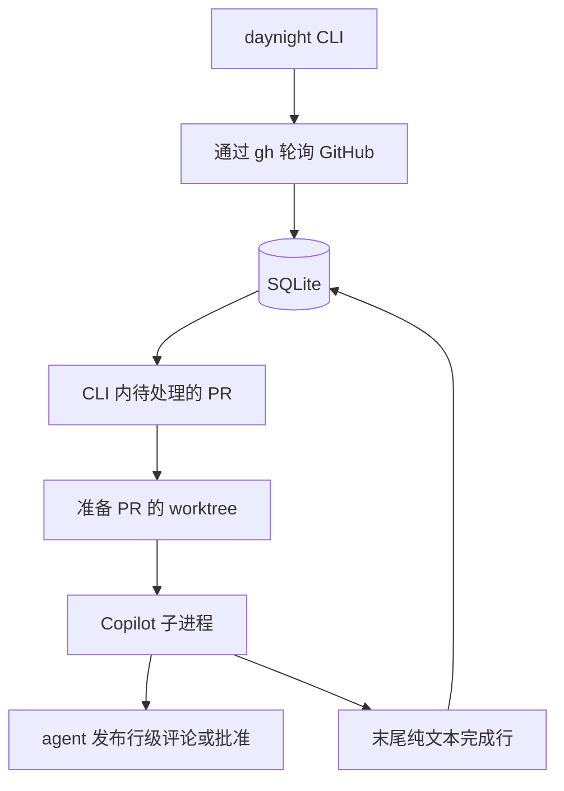

# Daynight 架构设计

状态：CLI 已接入配置、SQLite、GitHub 观测、Git 管理、Copilot 会话和前台协调模块。
受控执行链已实现，真实 GitHub/Copilot 验收仍待完成。当前范围见
[仓库 README](../../README.md)。

Daynight 是一个在前台持续运行、直到被停止的 TypeScript CLI，通过 npm 包
`@codetreker/daynight` 提供 `daynight` 命令，代码位于 `packages/daynight/`，
支持 Linux、macOS 和 Windows。
[需求文档](../spec/daynight.md)定义产品行为；
[决策记录](../../.agents/notes/implemented/architecture/2026-10-16-foreground-review-cli.md)
记录架构选择。

## 使用方式与配置

```text
daynight add-repo https://github.com/OWNER/REPO.git
daynight add-repo git@github.com:OWNER/OTHER.git --path ./review-other
daynight --daemon-review
daynight review list
daynight review ls
```

CLI 固定使用当前用户主目录下的 `~/.daynight/config.yml`。`~` 由程序解析为操作系统
当前用户的主目录，再使用平台路径操作构造文件位置，不依赖调用者的工作目录或 shell
的路径展开。Windows 同样使用当前用户主目录下的 `.daynight` 目录。

`add-repo` 只处理配置：读取现有文件或创建初始文档，解析远程身份和目标路径，校验完整
结果，再保存 YAML。它不接入运行时，不获取 review 实例锁，也不进行 clone、认证检查、
GitHub 查询、SQLite 初始化、PR 边界选择或运行中配置重载。成功输出说明配置已保存，
下次启动生效。review 模式加载配置、打开 SQLite、确保配置中的仓库已克隆到本地，
然后持续轮询 GitHub，并以普通子进程调用 Copilot。配置缺失、YAML 语法错误或字段
无效时，review 模式显示配置路径及具体原因并退出。按下 Ctrl+C 后，停止轮询和启动
新审查，停止活跃子进程，记录未完成工作并退出。

`~/.daynight/config.yml` 的配置示例如下：

```yaml
repositoryRoot: ~/daynights
pollIntervalMs: 60000
maxConcurrentWorker: 1
agentTimeoutMs: 1800000
maxAttempts: 3
retryDelayMs: 30000
repositories:
  - remote: https://github.com/OWNER/REPO.git
    path: /home/alice/daynights/github.com/owner/repo
```

数值字段省略时使用上述默认值；显式传入的不合理值报错。使用 YAML 1.2 解析器读取
数据，拒绝语法问题、重复键和不支持的字段，再校验数据类型。所有数值必须是正的
安全整数；毫秒计时字段还必须不超过 `2147483647`。`repositories` 必须是非空列表，
每项只接受 `remote` 和 `path`，两者均必填。

`repositoryRoot` 默认是 `~/daynights`，仅属于添加命令的路径选择。根目录接受本机
绝对路径、配置目录相对路径，以及 `~` 或 `~/...` 形式的当前用户主目录展开；不支持
其他用户的波浪号形式。省略 `--path` 时，命令在根目录下按规范化的 host/owner/name
生成仓库目录，组件使用确定性的文件系统安全编码，以容纳端口及 Windows 保留名称。
生成结果立即作为绝对 `path` 保存；修改根目录只影响后续添加。显式 `--path` 按调用者
的当前工作目录解析并保存绝对路径。运行时不根据 `repositoryRoot` 推导仓库位置。

手写的仓库 `path` 接受本机绝对路径或相对于配置目录的路径，不展开波浪号；Windows
盘符相对路径也会报错。既有路径组成部分必须是目录；尚未创建的克隆目录允许缺失。
数据库和会话等状态目录固定为 `~/.daynight/`。配置解析校验正整数限制、仓库身份的
唯一性，以及克隆路径与状态路径互不重叠。

配置解析先检查路径的字面结构；review 启动加载及添加时，通过既有目录的设备号和
inode 识别实际位置及祖先关系，处理符号链接和挂载边界。如果两个缺失路径的既有祖先和后续组成部分
数量相同，则在该祖先中临时创建一个唯一的探测目录，在其中逐级建立一个候选路径，再
查询另一个候选写法是否指向同一目录。判断依据是实际目录身份，不依赖操作系统、小写
转换或 Unicode 归一化推断，因此可以处理大小写规则和 Unicode 编码别名。仅配置一个
仓库或既有祖先不同的路径无需探测；需要探测时，目录权限、建立、查询或清理失败均使
配置校验明确报错。探测不创建真实克隆目录或审查状态；只按倒序非递归删除此次建立的
目录，清理失败会保留现场并报告所有相关错误。

同一规范化仓库的重复添加若省略 `--path`，直接复用保存的路径，不重新应用根目录；
显式指定同一实际路径时同样不重写配置，指定不同路径则报错。
添加命令修改 YAML 文档节点以保留已有设置和注释。`config.yml.lock` 是独立于
`instance.lock` 的配置写锁，覆盖读取、校验和替换全过程；占用时立即明确报错。
异常退出后必须确认没有配置写入者，再人工移除该锁。现有配置必须是普通文件；
修改时拒绝符号链接及其他文件类型。保存先在同目录写入唯一临时文件，再以 rename
替换配置，保留既有文件的权限模式。校验或替换前的失败保留原文件，并清理本次拥有的
临时资源。该写锁协调配置命令，不取代人工编辑器的文件管理。

将 HTTPS 或 SSH GitHub 远程地址解析为 host/owner/name。地址写法变化或程序重启都
不得让同一仓库再次初始化。已有克隆与配置不匹配时拒绝使用，不得覆盖；保留其工作
文件和分支。HTTPS 地址保留非默认端口；SSH 端口只属于 Git 传输，不作为 API 端口。
配置解析得到的 `coordinate` 是规范化的 host/owner/name，稳定仓库 ID 由后续 review
启动的 GitHub API 查询确定。[仓库添加决策](../../.agents/notes/implemented/feature/2026-10-18-add-repo-configuration.md)
记录配置职责和路径固定的选择。

使用 pnpm、TypeScript ESM、Node.js 24 LTS 和 `better-sqlite3`。实现包时锁定版本。
review 模式需要预先安装 Git、`gh` 和 Copilot CLI，`gh` 认证提前准备好。Copilot 还需要
受支持的凭据和可访问的模型。配置文件不包含凭据。

## 本地审查状态列表

`review list` 与 `review ls` 分派到同一列表操作。列表读取当前 `config.yml`，使用
`parseConfiguration` 完成 YAML、字段、仓库身份及路径字面关系校验；它不调用会建立
文件系统探测目录的运行时配置加载流程，也不要求本地克隆已存在。配置读取或解析
失败保留具体原因并以非零状态退出。

`readReviewListingSnapshot` 以 `readonly` 和 `fileMustExist` 打开已有数据库，在一个
短的 deferred 事务内检查表结构版本并读取仓库、Open PR 和相关审查记录。读取路径
只接受已支持的版本 1，不调用运行时开库、迁移、恢复或日志写入。数据库缺失时返回
空快照且不创建文件。缺失判断逐级检查父路径，直到最近既有祖先，并要求该祖先
解析为目录；中间父目录同样缺失可以表示未初始化。非目录祖先、悬空的祖先符号链接、
权限错误或文件系统根查询失败均报错，不能归为未初始化。已有空文件、损坏或版本
不匹配也均报错。读事务保留仓库、PR 和审查状态之间的一致性，允许 daemon 继续提交。
连接使用有上限的 busy timeout，读取和关闭错误均可见。SQLite 读取已有 WAL 数据库时可能创建或更新 WAL/SHM 协调伴随
文件；只读连接的保证是没有应用状态写入，不是状态目录的逐字节不变。

列表将配置与已存仓库远程地址都规范化为 host/owner/name，再用持久化的 host 和
GitHub ID 关联 PR 与审查记录。同一配置身份若对应多个已存 GitHub ID，命令明确
报错，避免猜测初始化边界。只显示当前配置的仓库，保持配置顺序；Open PR 按编号
排序。已完成或失败的审查仍可属于 Open PR。关闭 PR 和已移除配置的历史不显示。

输出首先声明本地持久化快照及 `Running` 的记录含义，每个仓库显示 `Last observed`
的最近成功完整轮询时间，无时间时为 `never`；`Last poll error` 单独显示已保存的
轮询错误。时间戳不证明最近一次轮询成功或进程仍存活。未登记或未初始化的仓库显示
`Not initialized.`。初始化完成的仓库显示 `Tracking PRs above #N; earlier PRs
excluded/not tracked.`；边界以内的 PR 从未逐条保存，无法列为单独排除行。没有已保存
的范围内 Open PR 时显示 `No tracked ongoing PRs.`。

表格列为 `PR`、`PR STATE`、`REVIEW`、`ATTEMPTS`。Draft 的行状态为 `Paused`，
已有当前审查时另行显示其保存状态。非 Draft 当前审查映射为 `Preparing`、`Running`、
`Retry waiting`、`Completed`、`Failed` 或 `Interrupted`；没有当前审查或记录已被
取代时为 `Pending`。审查按 desired revision、head SHA 和 base ref 同时匹配当前
目标，base SHA 不参与匹配，以保持仅 base tip 变化不触发审查的规则。

最新目标没有匹配审查而旧版本仍活跃时，当前行显示 `Pending (previous revision
<state>)`，尝试次数为 `-`；旧版本的修订序号、保存状态和 `attempts: count/max`
独立显示。当前审查的尝试次数、重试时间和错误只属于当前目标；旧版本的重试时间和
错误带 `Previous revision` 前缀。错误文本中的终端控制字符被转义，防止破坏表格或
产生终端控制效果。整个命令不启动 daemon、Git、gh 或 Copilot，不获取实例锁、
不做认证或网络请求，也不恢复中断状态。
[列表决策](../../.agents/notes/implemented/feature/2026-10-18-review-status-listing.md)
记录状态归属和本地快照范围的选择。

`cleanup_pending` 独立于审查状态，重新打开的 PR 也可能保留此屏障。行详情显示
`Worktree cleanup: Pending` 及已保存的清理错误；没有当前审查的非 Draft PR 显示
`Pending (cleanup blocked)`，Draft 仍显示 `Paused`。旧活跃审查的独立详情继续显示，
已经匹配当前目标的审查状态与待清理资源分别呈现。列表只报告屏障，不执行资源清理、
进程排除或恢复。

## 单进程与普通模块



轮询与审查调度是在同一个 Node.js 进程内运行的异步任务。轮询器不等待整轮审查结束
才再次轮询。内存中的映射在每项 worktree 操作的第一个异步步骤之前预留该 PR；准备、
子进程执行和清理共用这个预留，避免轮询为同一个 worktree 启动另一项操作。
SQLite 在程序退出后保留审查进度。`maxConcurrentWorker` 控制不同 PR 之间并行执行
的审查准备与执行数量；这里的 Worker 是 CLI 进程内的一项审查工作。清理使用同一
PR 预留，但不占审查 Worker 容量。待处理期间的多次更新合并处理，FIFO 待审队列
保留已等待 PR 的位置；已执行 PR 的新修订排到其他等待工作之后。每轮调度显式让出
一次事件循环，避免持续到期的快速轮询只在微任务间循环，阻塞定时器和子进程 I/O。

| 文件 | 职责 |
|---|---|
| `src/main.ts` | 可执行入口和退出状态 |
| `src/cli.ts` | 参数、帮助、版本、仓库添加、审查列表和 review 模式命令分派 |
| `src/paths.ts` | 用户主目录、保留状态路径和仓库路径关系 |
| `src/config.ts` | YAML 解析、字段及仓库路径校验、配置加载 |
| `src/repositories.ts` | 添加时的路径生成、幂等判断、配置写锁与原子替换 |
| `src/review-list.ts` | 当前配置加载、持久化快照归属和状态列表格式化 |
| `src/github.ts` | 通过 `gh` 读取 PR、分页与当前 CI 完整状态 |
| `src/store.ts` | SQLite 表结构、观测结果、审查进度、重试状态和只读列表快照 |
| `src/git.ts` | 克隆校验、fetch、PR worktree 准备与清理 |
| `src/copilot.ts` | 提示词、会话选择、子进程执行和完成检查 |
| `src/coordinator.ts` | 仓库轮询、PR 操作预留、并发容量、重试和清理调度 |
| `src/instance-lock.ts` | 实例锁持有者校验、存活探测与并发接管 |
| `src/runtime.ts` | 模块组装、实例持有关系、信号与有序关闭 |
| `src/processes.ts` | 本次执行的进程组或 Windows 进程树停止与执行证据 |

使用普通函数和具体类型。需要在验证中控制外部命令和时间时，将其作为依赖传入。
所有进程调用均使用参数数组，配置内容和分支名不得插入 shell 代码。使用能识别平台
差异的命令库处理 Windows CLI 命令包装脚本。

## 本地数据与 SQLite

配置、数据库、会话文件、实例锁、日志、缓存和临时文件放在当前用户的
`~/.daynight/` 下：

```text
~/.daynight/
  config.yml
  config.yml.lock             # 仅配置写入期间持有
  state.sqlite
  instance.lock
  instance.lock.sqlite        # 实例锁操作的持久化串行化数据库
  copilot/                    # CLI 配置和保留的会话
  cache/
  tmp/
  logs/<review-id>/<attempt>-<unique>/  # stdout、stderr 和 CLI 诊断
```

PR worktree 位于各受监控仓库根目录的 `.worktrees/` 下，布局见下文的生命周期说明。
会话数据和日志放在可清理的 worktree 之外。将 Copilot 的状态、缓存、日志和临时目录
都设在这个状态目录下。SQLite 的 WAL、SHM 等伴随文件也保留在该目录。启动目录变化
不会改变数据库、会话或实例锁的位置。凭据使用已准备好的 `gh` 认证环境。带端口的
API 请求为兼容 `gh` 的主机名校验，会在受控内存中读取已有主机凭据，再仅通过当前
子进程的环境变量传递。令牌不得写入 SQLite、配置、命令参数、公开异常或日志。
配置与状态位置的选择记录在
[用户主目录配置决策](../../.agents/notes/implemented/architecture/2026-10-16-user-home-review-configuration.md)。

表结构需要三张表：

| 表 | 键 | 保存的状态 |
|---|---|---|
| `repositories` | 主机 + 稳定的 GitHub 仓库 ID | 远程地址、本地路径、可为空的 `start_pr_no`、初始化时间、最近成功轮询及错误 |
| `pull_requests` | 仓库 ID + PR 编号 | 观测到的 open/draft/head/base branch、待审及已完成修订序号、会话 UUID 及已建立标记、worktree 路径、清理状态 |
| `reviews` | 审查 UUID | PR 身份、不可变的修订序号/head/base branch、固定的 base SHA、状态、尝试次数、重试时间、子进程身份、日志路径、最近错误 |

修订序号是本地递增的数字，用于表示观测到的审查触发事件。即使 head SHA 未变化，
它也能避免丢失 Draft 转 ready 或修改目标分支的触发事件。待审修订序号与已完成修订
序号分开保存。一轮正在执行的审查只持有启动时捕获的修订序号；完成它不得同时将更新
的待审修订标记为完成。审查状态为 `preparing`、`running`、`retry_wait`、`completed`、
`failed`、`interrupted` 或 `superseded`。活跃审查的唯一索引覆盖 `preparing`、
`running`、`retry_wait` 和 `interrupted` 状态的记录，配合每个 PR 的操作预留，
保证一个 PR 同时只有一轮当前审查。不要为这些由程序内部管理的记录添加外键。

相关状态变更使用短事务。事务不得跨越 Git、API 或 agent 调用。启用 WAL、
`synchronous=FULL`，并设置有上限的 busy timeout；数据库保存在本地文件系统。
使用显式的表结构迁移，并暴露迁移失败。参见
[SQLite 事务](https://www.sqlite.org/lang_transaction.html)和
[同步设置](https://www.sqlite.org/pragma.html#pragma_synchronous)。

状态模块以同步函数维护这些记录，时间、UUID 和已经验证的外部结果由调用者传入。
`start_pr_no` 从 NULL 写入整数的操作只允许成功一次；零表示成功完成的空扫描，不表示
需要重新初始化。已完成审查只推进它捕获的修订；最终失败的修订不能通过新建审查 ID
重新获得尝试预算。会话 UUID 在启动前保存，已建立标记只向前推进。worktree 登记、
待清理标记和清理错误也保留在数据库中，但不能替代 Git 身份或会话文件检查。
`cleanup_pending` 是独立于 PR 开关状态的资源屏障，观测到重新打开不会清除标记或错误。
`listCleanupCandidates` 包含已重新打开的待清理 PR；只在调用者确认清理操作已停止并
排除相关 agent、工具后，才能通过 `cancelCleanup` 撤销其清理意图。该操作仅清除
待清理标记和错误，保留 worktree 路径及会话。

运行时开库只执行迁移和连接设置，不自动恢复审查；列表使用独立的只读快照入口。
`preparing` 状态可能仍有 Git 操作，
`running` 或 `interrupted` 可能仍有子进程；不能只根据状态或 PID 推断它们已经停止。
取代准备工作或解除中断前，由协调模块明确确认相应操作已结束。数据库保存这项确认
带来的状态变化，本身不证明外部进程已经停止。状态实现决策见
[持久化审查状态](../../.agents/notes/implemented/architecture/2026-10-17-durable-review-state.md)。

## 轮询与工作选择

1. 对每个尚未初始化的仓库，枚举所有状态、所有分页中的 PR，计算最大编号，并在一次
   成功的数据库提交中保存 `Start PR No`。成功扫描且结果为空时保存零；失败时保持
   未完成初始化。初始化期间创建的 PR 可能落在这个边界之内。
2. 后续轮询枚举编号超过永久边界的 Open PR，包括 Draft。完整扫描 Open PR 后，
   对未出现在扫描结果中的已跟踪 PR 单独读取，确认后才记录关闭。失败或不完整的响应
   不得作为关闭证据。
3. 更新观测结果，并在首次发现、head SHA 变化、目标分支名变化或观测到 Draft 转 ready
   时递增待审修订序号。Draft 期间的变化会被保存，但不调度执行。建议的重新打开策略
   也会在观测到 closed 转 open 时递增修订序号。
4. 调度 Open、非 Draft，且待审修订序号大于已完成修订序号的 PR；该修订尚未被标记
   为最终失败，PR 也不得有已预留的操作或尚未解决的中断执行。已有到期重试记录时复用该
   记录，不另建一轮审查。公平选择工作，并遵守并发限制和截止时间。独立异步查询当前
   PR 的 CI，只有通过才进入工作预留；等待不创建审查、会话或 worktree，也不占 Worker。
   未通过的队首不阻挡其他已通过 PR。结果仅在修订序号、head SHA 和目标分支都匹配时
   有效，按现有轮询间隔更新，错误遵守限流期限；重启后重新查询，不修改 SQLite 表结构。
5. 在第一个 await 之前同步预留该 PR，并在执行 Git 操作前，将选中的审查持久化为
   `preparing`。读取当前元数据，针对捕获的目标准备 worktree；目标已变化时将旧审查
   标记为 `superseded`。启动子进程前重新读取 PR 并查询 CI，await 返回后再次核对数据库
   目标和取消状态。CI 退回未通过或查询失败时延后准备、释放容量，保留原审查、会话和
   尝试预算。只有通过后才持久化固定的目标和 `running` 状态，然后启动 Copilot。预留一直保留到子进程 close；
   清理也必须等待该预留释放。完成后重新核对最新观测状态，使后续变化继续保持待处理。

比较 `head.sha` 和 `base.ref`；只有 `base.sha` 变化不调度审查。不得将最近看到的 PR
编号或 `updated_at` 用作永久轮询游标，范围内的旧 PR 仍可能不断发生变化。一个仓库
扫描失败时，记录日志并重试，不重置其边界，也不停止其他仓库。遵守 GitHub 限流要求
的等待时间。

CI 资格通过只读 GraphQL 查询取得。检查 head 和可用的 `potentialMergeCommit` 的
`statusCheckRollup`，覆盖 check runs 与旧式 statuses；同时分页读取 check suites，防止
需要批准或尚无 jobs 的 workflow 被成功汇总遗漏。按 workflow 身份、事件和运行序号
选择最新运行及尝试，已替代的历史失败不阻塞。无法证明替代关系的 suite 保守保留其
阻塞作用。所有已报告 CI 完成且为 `success`、`skipped` 或 `neutral` 才放行；确实没有
检查时直接放行。分页固定目标、suite 总数及唯一身份并校验完整覆盖；可见的集合变化、错误、未知状态或
不完整数据都不能授权启动。

CI 只是启动条件，不递增待审修订。已完成审查不会因 CI 重跑而再次启动；已开始的
agent 也不因后续新登记的 CI 自动取消。没有检查时直接放行意味着后续才登记的 workflow
可能在审查启动后出现。CI 请求与其他受管操作一起响应关闭，并等待已发出的请求结束。

GitHub 模块提供一次仓库观测，不启动定时器。通过参数数组调用 `gh api --include`
逐页执行显式 GET，先读取完整 HTTP 状态和响应头。成功响应必须是有效 JSON；失败
响应先按状态和响应头处理限流，正文可以是 HTML 或空内容，JSON 错误信息仅为可选
元数据。非零 HTTP 退出保留响应信息；超时、取消、输出溢出或格式错误则使本次扫描
失败。`Link` 先校验 HTTPS API 来源、
所属仓库路径、查询条件和页码，再转换为受控请求。支持仓库名路径和 GitHub 返回的
数字 ID 路径；关系参数按允许的空白和引号语法读取，格式错误不能当作分页结束。
初始化只需要各 PR 编号，已永久排除的 PR 不要求解析无关的 head 或 Draft 元数据。

同一轮分页中重复出现的 PR 以最后读到的状态合并，每个 PR 只应用一次观测。收齐所有
页面和缺失 PR 的直接确认后，`applyRepositoryPoll` 在一个短事务中提交初始化边界或
整批观测，以及最近成功轮询时间。任一请求、确认或数据库写入失败均保留上次完整状态，
另行记录错误；不得将部分结果提交成成功扫描。

限流错误携带 HTTP 状态和可重试的绝对时间。等待时间同时考虑 `Retry-After` 的秒数或
HTTP 日期，以及主限额重置时间，取最晚约束。客户端在内存中按主机保留截止时间，
到期前不再执行该主机的 API 请求，因此同一批次中的其他仓库也不能绕过限流；其他
主机可继续。模块不自行休眠或重试，由协调模块复用客户端并安排下一次观测。
机制与凭据处理的依据见
[完整 GitHub 观测决策](../../.agents/notes/implemented/architecture/2026-10-17-github-observation.md)。

轮询只能观测快照。两次轮询之间完整发生的 ready/Draft 往返，或修改目标分支后又改回，
可能被遗漏。完整扫描和重复轮询能最终观测到持续存在的状态，不保证完整的事件历史。
资料来源：
[列出 PR](https://docs.github.com/en/rest/pulls/pulls#list-pull-requests)、
[分页](https://docs.github.com/en/rest/using-the-rest-api/using-pagination-in-the-rest-api)和
[API 最佳实践](https://docs.github.com/en/rest/using-the-rest-api/best-practices-for-using-the-rest-api)。

## Worktree 生命周期

Git 模块先校验配置中的本地位置。缺失时通过 HTTPS 正常克隆，并显式选择 `origin`；
SSH 配置地址仍用于仓库身份识别，实际传输复用准备好的 `gh` 认证。已有仓库通过
local origin 的唯一原始 URL 和稳定 GitHub ID 校验，保留其 origin 配置、文件和分支。
模块不改全局 Git 或认证配置。带端口 HTTPS 传输复用受控凭据环境；SSH 端口不作为
API 或 HTTPS 端口。

克隆和首次 Git 检查均使用已验证的物理路径，保留配置别名的身份核对。目录名按所在
平台 Git 的规则处理，合法的前导和内部空格得到保留。POSIX 支持的尾空格名称可以正常
准备；Windows Git 保护规则拒绝的名称明确报错，并保留既有父目录和其他数据，不放宽
这些原生保护来使克隆通过。

PR worktree 放在实际仓库根目录下：

```text
<repository>/
  .worktrees/
    pr-<number>/
```

本地克隆及其 PR worktree 是系统独占的审查环境。daemon 只操作自己登记的固定 PR
路径，各 PR 的工作目录相互独立。Git 的 `locked daynight:<sessionId>` 标记将持久化
会话与实际登记关联；同一 PR 清理后重新打开时，仍用原会话 UUID。此机制记录在
[worktree 所有权决策](../../.agents/notes/implemented/architecture/2026-10-17-owned-review-worktrees.md)，
环境边界见[专用审查环境决策](../../.agents/notes/implemented/architecture/2026-10-17-exclusive-review-environment.md)。

操作前必须确认配置路径是精确 Git 根目录，并比较物理目录身份。对 PR leaf 同时校验
精确 top-level、common directory、固定路径、会话锁标记和数据库登记；不能只比较
common directory，因为缺失的 `.git` 会让 Git 向上发现主仓库。leaf 的普通 `.git` 文件还
必须指向所属 linked Git admin，且该 admin 位于预期 common 的 worktree 登记目录下。
实际 admin、会话锁标记和 `gitdir` 回指必须对应同一 leaf；相对元数据路径按 Git 规定
的目录解析。强制 checkout/clean 显式绑定已校验的 git-dir 与 work-tree，避免可变的
`.git` 指针切换到主仓库或 sibling 的 HEAD/index。容器和 leaf 的符号链接、
未登记的既有目录，以及不匹配的锁均明确拒绝。

在基础仓库中通过显式 HTTPS URL 取得 PR head，包括 fork PR，而非读取 fork 分支：

```text
git fetch --atomic --refmap= --no-tags --no-write-fetch-head \
  --no-auto-maintenance --no-recurse-submodules HTTPS_URL \
  +refs/pull/N/head:refs/daynight/incoming/REVIEW_ID/head \
  +refs/heads/BASE:refs/daynight/incoming/REVIEW_ID/base
```

空 refmap 和显式 URL 避免命名 origin fetch 顺带更新共享的 remote-tracking refs；
FETCH_HEAD、共享分支和 tags 保持不变。需要时补全浅克隆历史。将获取到的 head 与
捕获目标及当前 PR 元数据核对，目标已变化则交回协调模块处理；仅 base tip 变化不产生
新的审查触发。为审查 UUID 固定 head、base 和 merge-base 私有 refs，再保存 base SHA，
使后续 fetch、force push 或相同目标重试不能替换该轮上下文。

受控 Git 命令显式禁止 replacement objects，并使用所属临时目录中的独立空 graft 文件。
这样，本地 `refs/replace` 或默认 `info/grafts` 不会在 SHA 不变时替换文件树或父关系，
这些本地元数据本身保持不变。准备结果中的非敏感 `gitEnvironment` 将相同原始对象视图
提供给后续 agent runner；空 hooks/template 目录与 graft 文件分开，且在 runner 生命周期
内保持有效。

所有 Git 调用按命令禁用 hooks、fsmonitor 和不需要的子模块递归，克隆模板为空目录；
fetch 还显式禁止递归子模块，以覆盖更具体的用户 fetch 配置。继承的仓库选择器和调试
环境只对子进程清除，避免 `git -C` 被重定向或认证信息进入输出；保留 HTTPS CA 等
传输信任设置及全局配置位置，避免破坏已准备好的企业环境。

首次创建前先排除路径冲突，再保存数据库意图并建立带锁的 detached worktree。中断
后，完全缺失的 leaf 和登记可重试；匹配的带锁登记可校验复用；不明资源不得接管。
新的修订先 detach，再清理 daemon 拥有的内容，避免附着分支时改写共享分支。
清理会检查当前和目标 gitlinks，避免新引入的子模块目录残留旧文件；仅清空所属工作
目录，保留共享管理数据、refs、配置及基础工作区中的子模块文件。PR leaf 及其所属
admin 内的嵌套 clone、生成文件和管理数据都属于可丢弃的审查内容。相同捕获目标的
确认或重试保留原工作树和本地上下文。

primary 的 sparse checkout 和 sparse index 不限制 PR 的完整代码视图。首次 add 使用
命令级完整检出设置；未启动审查的已有 leaf 在所有权和当前目标校验后，仅重建
自己的 index，再物化完整目标、detach 和清理。普通 checkout 或 read-tree reset
不足以清除旧 skip-worktree 位，因此需要先清空所属 index。primary 的共享及每工作区
配置、patterns、index、refs 和文件不改变；已启动后的同目标确认重试保留原 context。
非敏感 `gitEnvironment` 携带完整视图设置，runner 先清除继承的 Git 仓库/配置选择器，
再应用这些受控配置和原始对象设置。

更新或删除已校验的 PR 工作区时，使用标准 Git checkout、clean 和 worktree remove
命令清除所属内容。系统不维护嵌套 Git 仓库的依赖图，也不保护其他用途对这些可丢弃
管理数据的引用。固定路径、登记和进程排除校验仍是操作前提。

关闭或合并后先记录待清理状态，停止准备和执行，并获取同一个 PR 操作预留。删除前
再次确认远程关闭状态及数据库中无活跃审查。重新打开会取消删除资格，但不能清除
仍在执行或结果不确定的清理操作。清理流程必须等待自己已启动的命令确切结束，并取得
agent 排除证明后，才能对已重新打开的 PR 调用 `cancelCleanup`，保留其路径及会话，
再允许调度；已删除的 worktree 可在后续准备中重建。
只移除匹配所有权标记的具体 Git 登记，不做全局 prune。Git 删除成功后才完成数据库
清理；会话、审查历史和私有快照 refs 保留。清理失败继续待处理，即使此时 PR 已重新
打开，也保留待清理标记及错误。命令失败可能已经产生副作用，取消或进程结果不确定时
保留资源并报错，不能据此声明已经安全停止。

从配置移除仓库不构成删除已有克隆或 worktree 的授权。资料来源：
[本地检出 PR](https://docs.github.com/en/pull-requests/collaborating-with-pull-requests/reviewing-changes-in-pull-requests/checking-out-pull-requests-locally)、
[Git worktree](https://git-scm.com/docs/git-worktree)和
[Git fetch](https://git-scm.com/docs/git-fetch)。

## Copilot 会话与结果发布

在每个 PR 首次审查前生成并保存一个 UUID。直接调用 Copilot：

```text
copilot -C WORKTREE --session-id UUID \
  -s --output-format text --stream on --no-color \
  --no-ask-user --no-auto-update --allow-all-tools --log-dir ATTEMPT_LOG_DIR
```

提示词通过 stdin 传入并关闭输入。Copilot 将管道输入作为非交互模式处理；不同时提供
`-p`，避免提示词进入 Windows 命令行并受长度和转义限制。使用 `cross-spawn` 解析
PATH、PATHEXT 和 Windows 命令包装脚本，调用方传递独立参数并保持 `shell: false`。
`COPILOT_HOME`、`COPILOT_CACHE_HOME` 及临时目录环境变量指向保留状态目录中的
对应位置。保留 HOME、GH_CONFIG_DIR、PATH 和已有认证环境；Copilot 可按其认证
优先级自动使用已登录的 `gh`，daemon 不复制 token 到提示词或日志。

agent 子进程继承准备结果中的原始 Git 对象环境，同时清除继承的 Git 仓库选择器，
避免其自行执行的 diff/log 命令采用另一仓库或本地的 replacement/graft 视图。

后续审查或确认调用使用 `--resume=FULL_UUID`。不得选择全局最近的会话。保留已经建立
的会话历史；历史缺失时报告该 PR 的错误，不得静默创建另一段对话。首次创建会话期间
发生崩溃时，必须先检查这个确切的 UUID 是否实际建立，再选择创建或恢复。不读取会话
JSONL。Copilot 的上下文压缩由其自身处理。

提示词提供仓库与 PR、审查 ID 与修订序号、确切的 head、目标分支、固定的差异上下文、
上一轮未完成审查的身份、严重程度规则和完成标记。agent 审查代码、检查既有问题，
并自行使用 `gh` 发布。发布前立即重新检查 PR 是否 Open 且非 Draft，以及 head 和
目标分支是否符合预期。

Critical/Major 问题以 `COMMENT` review 中的行级评论发布；没有这些问题时使用
`APPROVE`。通过 `gh api` 显式提供 `commit_id`，使发布结果归属于被审查的 head，
并在 review 正文中包含稳定的审查 ID，供 agent 在重试时核对既有发布结果。评论使用
英文，并表明 agent 身份。daemon 不提交 review，也不解析问题内容。

GitHub API 无法原子地断言发布期间 head 一直未变。作者也无法批准自己的 PR。
这些情况不得导致虚假的完成状态。完成标记是 agent 的声明，不是独立的远程证据，
也不是跨越 GitHub 和 SQLite 的事务。资料来源：
[Copilot 非交互调用](https://docs.github.com/en/copilot/how-tos/copilot-cli/automate-copilot-cli/run-cli-programmatically)、
[GitHub CLI 认证回退](https://docs.github.com/en/copilot/how-tos/copilot-cli/set-up-copilot-cli/authenticate-copilot-cli#authenticating-with-github-cli)、
[Copilot 命令行参数](https://docs.github.com/en/copilot/reference/copilot-cli-reference/cli-command-reference)、
[会话存储](https://docs.github.com/en/copilot/reference/copilot-cli-reference/cli-config-dir-reference)、
[创建 review](https://docs.github.com/en/rest/pulls/reviews#create-a-review-for-a-pull-request)和
[审查权限](https://docs.github.com/en/pull-requests/collaborating-with-pull-requests/reviewing-changes-in-pull-requests/reviewing-proposed-changes-in-a-pull-request)。

## 完成、重试与退出

每次尝试创建带唯一后缀的日志目录，启动意图保存后才拉起进程；启动前取消也不会占用
下一次尝试的日志路径。分别捕获纯文本 stdout 和 stderr，以流式方式写入各自的日志。
增量解码 UTF-8，
统一 CRLF。stdout 末行缓冲区默认最多保存 8192 个 UTF-16 码元，超长末行不能匹配
完成标记；完整日志通过流写入磁盘，不累计在内存中。等待子进程 close 且输出全部读取完毕，
要求进程正常退出且退出码为零，并且 stdout 最后一条非空行精确匹配：

```text
PR 123 Review Completed
```

预期 PR 编号来自本轮捕获的审查。拒绝子串匹配、额外格式、stderr 中的标记、标记后的
非空内容、捕获失败和非零退出。退出状态用于检查进程通信是否正常，不是结构化的问题
输出协议。完成检查只比较原始 stdout 的末行，不解释此前输出的 Markdown 结构。
命令找不到时单独记录启动失败：Windows 包装进程可能有 PID，却没有启动 agent。
只有匹配所请求命令的结构化 spawn ENOENT 加上包装进程关闭，才能使用此明确失败结论；
不能把普通输出捕获错误当作未启动。启动意图已提交时，失败仍消耗本次尝试预算。

目标未变化且缺少完成标记的审查转入 `retry_wait`；恢复同一会话，要求它检查 GitHub
上已有的发布结果、确认完成或完成剩余工作。每次尝试使用新的日志。建议策略为最多
尝试三次，从 `retryDelayMs` 开始指数退避，延迟上限为十分钟。次数耗尽时记录 `failed`
并输出原因。调度器继续抑制该修订，重启后也一样；后续观测到新的触发事件时，创建
可执行的更新修订。普通轮询不得通过新建审查 ID 重置已耗尽的尝试预算。

尝试次数在提交启动 agent 的意图时原子递增，并在实际启动子进程前保存。提交后即使
启动失败或进程中断，该次预算也已消耗。仅进行 Git 准备不消耗 agent 尝试次数；准备
失败的重试调度由协调模块负责。重试保留审查 ID、捕获目标、预算与最近一次启动的
进程和日志引用，历史日志继续保留在该审查各次尝试的目录中。

更新的修订取代等待中的过时工作。旧子进程结束后，在同一会话中审查最新目标，提供
上一轮未完成审查的身份，并要求核对其已有影响。不得仅为获得旧完成标记而发布对过时
代码的审查。完成已捕获的修订后，更新的待审修订仍保持待处理。

PR 转为 Draft 或关闭时，停止活跃审查，并保留尚未确定的结果，直到可以安全重试或
清理。Ctrl+C 停止调度和轮询，终止当前执行并等待操作结束，记录未完成执行，再关闭
SQLite。review agent 遵守前台执行契约：返回前结束自己启动的工具和服务，正常退出及
完整关闭的 stdio 作为该契约的执行证据。此证据不等同于操作系统对任意后台后代的隔离证明。

Linux/macOS 为直接子进程建立独立进程组，同时保留引用、pipes 和 await，不调用 unref。
停止时向本次执行的进程组发送 TERM，超过宽限期再发 KILL。探测返回 EPERM 时仍检查
目标 PGID 的已有状态；仅无匹配执行成员或全部为 zombie 时确认不再执行。有执行成员时
保留原权限错误，状态读取或解析失败也保留不确定状态。Windows 在根进程仍存活时使用 `taskkill /PID ... /T /F` 停止普通进程树，避免
先杀包装脚本而丢失树根。正常、未被强制的退出及排空的 stdio 按前台契约处理。

取消时根已消失、进程终止失败、输出被强制放弃或其他执行证据不确定时，阻止该 PR
复用和清理，并保留实例锁及状态供人工确认。系统只操作本次运行实时持有的进程，
不根据持久化 PID 杀旧进程，也不重建已消失的任意进程树。Windows 包装脚本、后代进程
和信号差异在各平台使用受控执行文件验证。

每个状态目录只能由一个 daemon 实例持有。`instance.lock` 保存 `owner`、`pid` 和
`startedAt`。读取既有锁时严格校验元数据，其中 PID 必须是正整数且不超过
`2147483647`，再用 `process.kill(pid, 0)` 检查该 CLI 是否存在。探测成功表示仍存活；
只有 `ESRCH` 允许接管失效锁。`EPERM`、其他错误或无效元数据均保留锁并明确拒绝
启动。PID 已被其他进程复用时也保守拒绝，交由人工检查。`startedAt` 和文件时间只供
诊断，不能证明进程死亡；不使用保存的 PID 终止进程。

独立的 `instance.lock.sqlite` 通过短时间、同步的 SQLite `BEGIN IMMEDIATE` 事务，
串行化锁读取、存活检查、创建或替换和释放。失效锁的替换先完整写入临时文件，再在
事务内原子 rename 覆盖既有锁；并发启动不能删除另一个实例刚取得的锁。释放同样在
事务内重新核对持有者，仅删除自己的锁。进程崩溃由操作系统释放 SQLite 事务锁；
串行化数据库保留在原位置，运行期间不得 unlink，否则不同实例可能锁住不同文件。

自动接管只证明旧 CLI 不存在，不能证明旧 agent 或工具已结束。因此以失效锁接管
启动时，锁结果为 `previousProcessesExcluded: false`，进程监督模块不获得旧执行已
排除的证明。协调器将保存的
`preparing`、`running` 和 `interrupted` 审查标为中断并阻塞对应 PR。启动时发现
`cleanup_pending` 且无法确认旧执行已排除，则在第一次轮询前阻塞该 PR 的复用和
清理。无论 PR 当前是否重新打开，都保留清理标记及错误；轮询可以记录新的观测，
但不能清除该屏障。它只在操作已结束并排除旧 agent、工具后解除，使重新打开期间
再次崩溃的启动仍能发现未确定性。诊断要求人工确认旧执行已停止；受影响的会话和
worktree 保留。同一仓库中的其他 PR 和其他仓库继续轮询和执行。只要旧执行仍未
确认排除，有序关闭也保留实例锁。

异常退出时没有未确定审查或待清理资源，自动接管即可继续运行，无需人工删除锁。
存在这些资源时，运维人员先停止当前 daemon，确认上一 CLI 及其所有 agent、工具均
已停止，再只删除 `instance.lock` 并重新启动，保留 `instance.lock.sqlite`、状态、会话
及日志。不存在实例锁的启动沿用明确确认旧执行已排除的恢复契约，将保存的
`preparing` 或 `running` 记录经 `interrupted` 转入针对原捕获目标的重试或确认，
绝不直接标记完成。更新目标可在同一会话中取代它们。不接管仍在运行的 agent，也不
重建任意进程树。锁恢复选择见
[失效实例锁决策](../../.agents/notes/implemented/bug-fix/2026-10-18-stale-instance-lock-recovery.md)。
Node 文档说明了相关的
[子进程限制](https://nodejs.org/api/child_process.html#subprocesskillsignal)。
进程证据的依据还包括 [Node 进程组](https://nodejs.org/api/child_process.html#optionsdetached)、
[POSIX 信号与 zombie 语义](https://pubs.opengroup.org/onlinepubs/9799919799/functions/kill.html)
和 [Windows taskkill](https://learn.microsoft.com/en-us/windows-server/administration/windows-commands/taskkill)。

## 错误与可观测性

记录可读事件，包含仓库、PR 编号、修订序号、审查 ID、尝试次数和阶段。在轮询定时器、
命令回调、重试定时器和清理操作之间显式传递这些上下文。报告命令退出或超时、原因、
下次重试时间及受影响的资源。仓库级操作携带仓库身份。日志和控制台输出不得包含凭据。
限制输出捕获容量，并在记录本次结果之前保留活跃尝试的证据。

例如，`OWNER/REPO PR 123 review=UUID` 的控制台事件应显示工作选择、子进程启动、
末行接受或重试以及清理。运维人员可通过同一个标识筛选事件来调查一轮审查。启动时
输出初始化边界和未完成状态信息。错误必须可见，并影响相应的 PR 或仓库；配置无效
或数据库启动失败时停止 CLI。不得让无人观测的游离 Promise 隐藏任务失败。

## 验证与交付

应用工具链提供 `pnpm typecheck`、`pnpm test`、`pnpm build` 和独立的 `pnpm acceptance`。
CI 要求源码、包元数据、构建或依赖输入发生变化时升级包版本；具体范围和本地检查命令见
[README](../../README.md#package-versions)。版本检查在 Linux 任务中运行，其失败会使最终
必需检查失败。

当前测试覆盖参数、帮助与版本、编译后的入口、仓库添加、审查列表、严格配置解析
和路径校验；GitHub Actions 在 Linux、macOS 和 Windows 上运行这些检查。SQLite 测试使用真实磁盘数据库，验证迁移、事务回滚、
连接锁冲突、重开后的边界与预算、修订转换、会话和 worktree 登记。列表验证缺失或无效
数据库、当前配置过滤、已记录状态与进程存活的区别、最新目标与旧活跃审查的独立归属，
以及真实 WAL 上并行读事务的一致性。GitHub 测试使用
受控 API 和子进程验证完整分页、失败保留、限流、关闭确认和观测事务回滚。真实 Git
fixtures 验证克隆、私有 refs、detached head、dirty 内容、所有权、浅克隆、子模块及
其他 PR 工作区保留。Copilot 测试使用受控可执行文件和真实 SQLite，验证会话选择、
启动意图、stdin 提示词、分流日志、完成标记及异常输出，不调用真实模型或发布 review。
执行边界见[Copilot 会话执行决策](../../.agents/notes/implemented/architecture/2026-10-17-copilot-session-execution.md)。
协调器测试使用真实 SQLite、受控观测和失败注入，验证公平调度、并发容量、永久边界、
预算抑制、取消、清理及恢复。公平调度案例通过注入时钟及显式控制 CI 响应、执行结束
来建立先后关系：先确认新修订已持久化，再让两个等待 PR 的 CI 就绪，逐次释放 Worker，
验证两个等待 PR 均先于持续更新 PR 的后续修订，且就绪候选保持 FIFO。时钟在准入比较
期间固定，机器负载不会使其中一个候选的 CI 证据先过期；详见
[公平调度验证决策](../../.agents/notes/implemented/testing/2026-10-19-deterministic-coordinator-fairness.md)。
集成案例组合真实本地 Git、Copilot 受控进程和生产进程监督模块。编译后 CLI 测试验证
实例锁、状态创建、信号退出和资源释放，无需真实远程认证。调度器内部失败也会取消
仍在等待的轮询，再等待所有已启动操作结束。
[协调决策](../../.agents/notes/implemented/architecture/2026-10-17-foreground-review-coordination.md)
记录这些责任和异常恢复前提。
macOS 检查挂载临时的大小写敏感和不敏感 APFS 镜像，验证缺失路径的大小写冲突、
Unicode 编码别名、状态目录别名及探测目录清理。挂载 fixture 在现有 30 秒绝对清理
预算内最多尝试三次普通 detach，仅明确的 `Resource busy` 允许继续尝试，并立即保留
精确挂载文件系统的有界诊断。调用 attach 前就记录 `attachmentAttempted`，因为命令
失败或超时仍可能已挂载。只要尝试过挂载，就必须成功执行普通 detach 后才删除 fixture
目录；尚未尝试挂载的 setup 可直接移除目录。持续占用、其他错误或预算耗尽仍使测试
失败并保留现场。八项原生断言及 hook、CI 的时间限制保持不变。
[APFS fixture 清理决策](../../.agents/notes/implemented/testing/2026-10-18-apfs-fixture-finalization.md)
记录资源归属和失败诊断的依据。

独立的 `pnpm acceptance` 先打包，再在临时 consumer 中正常安装，驱动实际生成的
`daynight` bin。真实 SQLite 和本地 Git 配合受控的原生 gh 执行文件及 Copilot 命令
包装脚本，验证配置登记、根目录变更后保留既有路径、本地审查列表，以及完整的审查、
重试、重启和关闭清理流程；测试不替换产品内部依赖。
该安装步骤需要包注册表访问，不做全局安装，也不需要真实 review 凭据。CI 只上传
精选的工具版本清单和场景 receipt。异常退出验收在直接工具句柄全部关闭后同步结束
CLI，检查锁保留、存活实例拒绝和自动接管失效锁；进程树终止保留独立的原生验证。[验收报告](../research/daynight-acceptance.md)
记录实际已测试的平台和真实服务验收范围。

下表定义模块、原生子进程和安装后验收需要观测的行为；实际通过记录及其对应修订见
验收报告。历史平台 receipt 不构成自动接管失效锁行为的验证：

| 范围 | 必须观测的行为 |
|---|---|
| 轮询 | 初始化覆盖所有分页和 PR 状态；永久边界；扫描失败不得关闭 PR 或将仓库视为空仓库 |
| 触发条件 | head、目标分支名、ready 状态变化触发；仅 base SHA 变化不触发；Draft 不得启动；旧审查完成后保留待审修订 |
| Worktree | 所属仓库根目录的 `.worktrees/`、固定 PR 路径、其他 worktree 保留、fork PR 引用、确切的 detached head、脏文件残留、正确的仓库与路径校验、关闭和重新打开时的清理 |
| agent 输出 | 分块 Unicode 与 CRLF、精确末行、错误 PR 编号、stderr 中的标记、带前后缀或闭合代码围栏的标记、标记后的内容、捕获失败、非零退出 |
| 会话与重试 | 固定 UUID 后显式恢复、首次启动中断、历史缺失报错、确认既有发布结果、持久化尝试预算 |
| 审查列表 | `review list` 与 `review ls` 等价、配置仓库顺序和 PR 编号排序、Draft 与仍 Open 的完成或失败记录、明确排除边界、最新修订和旧活跃审查分别归属、重试及错误、待清理屏障与清理错误、最后完整观测时间、缺失状态不创建数据库、无效数据库报错、运行中只读一致快照 |
| CLI 生命周期 | 审查期间继续轮询；准备、执行和清理的操作预留；抑制失败修订；`maxConcurrentWorker` 并发上限；Ctrl+C；拒绝第二个实例；异常退出后的失效锁自动接管；锁状态含糊时拒绝；中断审查及待清理资源阻塞与诊断 |
| 配置与目录 | 固定的 `~/.daynight/config.yml`、严格 YAML、review 启动缺失配置报错、添加时创建配置和保留注释、全局根目录仅在添加时生成固定绝对路径、显式路径按当前目录解析、重复添加幂等及冲突、配置写锁和失败保留、不同启动目录复用状态、手写相对路径按配置目录解析、按实际文件系统规则检查重复与重叠路径、探测目录清理和失败报告；用注入的主目录解析结果隔离测试文件 |
| 平台 | `daynight --daemon-review`、各平台用户主目录和路径分隔符、含空格或 Unicode 的路径、Windows CLI 命令包装脚本、每个受支持系统上的子进程终止和最终输出 |

需要在获得授权的测试仓库中实际运行 Copilot 与 GitHub，才能证明真实的会话续接、
行级评论和批准行为。受控的完整执行链验证编排、打包及文本/会话协议；真实模型判断、
认证权限和远程发布效果仍需独立的实际运行证据。

没有已部署的数据需要迁移。本设计涵盖所有已确认的产品行为。Webhook、分布式执行、
UI 和其他 agent 提供方属于独立功能。进程监督服务会改变执行模型，超出本 CLI 设计的
范围。单进程模型明确要求运维人员介入处理状态含糊的异常退出，不承诺透明恢复仍在
运行的子进程。
