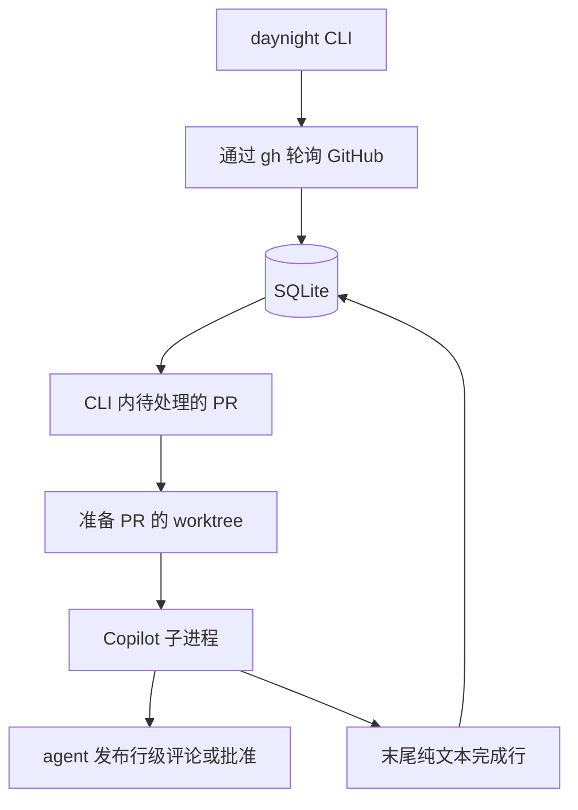

# Daynight 架构设计

状态：架构已确认。CLI 与配置处理已实现；其余执行模块待接入，实现范围见
[仓库 README](../../README.md)。

Daynight 是一个在前台持续运行、直到被停止的 TypeScript CLI，代码位于
`packages/daynight/`，支持 Linux、macOS 和 Windows。
[需求文档](../spec/daynight.md)定义产品行为；
[决策记录](../../.agents/notes/implemented/architecture/2026-10-16-foreground-review-cli.md)
记录架构选择。

## 使用方式与配置

```text
daynight --deamon-review
```

CLI 通过这个参数进入持续审查模式，固定读取当前用户主目录下的
`~/.daynight/config.yml`。`~` 由程序解析为操作系统当前用户的主目录，再使用平台路径
操作构造文件位置，不依赖调用者的工作目录或 shell 的路径展开。Windows 同样使用当前
用户主目录下的 `.daynight` 目录。

CLI 加载 YAML 配置、打开 SQLite、确保配置中的仓库已克隆到本地，然后持续轮询
GitHub，并以普通子进程调用 Copilot。配置缺失、YAML 语法错误或字段无效时，显示
配置路径及具体原因并退出。按下 Ctrl+C 后，停止轮询和启动新审查，停止活跃子进程，
记录未完成工作并退出。整个程序遵循终端中的普通进程生命周期。

`~/.daynight/config.yml` 的建议配置如下：

```yaml
pollIntervalMs: 60000
maxConcurrentWorker: 1
agentTimeoutMs: 1800000
maxAttempts: 3
retryDelayMs: 30000
repositories:
  - remote: https://github.com/OWNER/REPO.git
    path: ../code/REPO
```

这些数值是运行默认值，省略相应数值字段时使用默认值；显式传入的不合理值报错。
使用 YAML 1.2 解析器读取数据，拒绝语法问题、重复键和不支持的字段，再校验数据类型。
所有数值必须是正的安全整数；毫秒计时字段还必须不超过 `2147483647`。
`repositories` 必须是非空列表，每项只接受 `remote` 和 `path`。
仓库路径接受本机绝对路径或相对于配置目录的路径；不进行 shell 的波浪号展开，
Windows 盘符相对路径也会报错。既有路径组成部分必须是目录；尚未创建的克隆目录
允许缺失。示例的 `../code/REPO` 指向用户主目录下的
`code/REPO`。数据库和会话等状态的目录固定为 `~/.daynight/`。校验正整数限制、仓库身份的唯一性，
以及克隆路径与状态路径互不重叠。将 HTTPS 或 SSH GitHub 远程地址解析为
host/owner/name 和稳定的仓库 ID。地址写法变化或程序重启都不得让同一仓库再次初始化。
已有克隆与配置不匹配时拒绝使用，不得覆盖；保留其工作文件和分支。HTTPS 地址保留
非默认端口；SSH 端口只属于 Git 传输，不作为 API 端口。配置解析得到的
`coordinate` 是规范化的 host/owner/name，稳定仓库 ID 由后续 GitHub API 查询确定。

使用 pnpm、TypeScript ESM、Node.js 24 LTS 和 `better-sqlite3`。实现包时锁定版本。
Git、`gh` 和 Copilot CLI 预先安装，`gh` 认证提前准备好。Copilot 还需要受支持的凭据
和可访问的模型。配置文件不包含凭据。

## 单进程与普通模块



轮询与审查调度是在同一个 Node.js 进程内运行的异步任务。轮询器不等待整轮审查结束
才再次轮询。内存中的映射在每项 PR 操作的第一个异步步骤之前预留该 PR；准备、
子进程执行和清理共用这个预留，避免轮询为同一个 worktree 启动另一项操作。
SQLite 在程序退出后保留审查进度。`maxConcurrentWorker` 控制不同 PR 之间并行执行
的审查任务数量；这里的 Worker 是 CLI 进程内的一项审查工作。待处理期间发生的多次
更新合并处理。

| 建议文件 | 职责 |
|---|---|
| `src/main.ts` | 可执行入口和退出状态；完整审查运行由后续协调模块接入 |
| `src/cli.ts` | 参数、帮助、版本和配置加载后的命令分派 |
| `src/paths.ts` | 用户主目录、保留状态路径和仓库路径关系 |
| `src/config.ts` | 配置解析与路径解析 |
| `src/github.ts` | 通过 `gh` 执行经过认证的 API 读取和分页 |
| `src/store.ts` | SQLite 表结构、观测结果、审查进度和重试状态 |
| `src/git.ts` | 克隆校验、fetch、PR worktree 准备与清理 |
| `src/review.ts` | 提示词、会话选择、子进程执行和完成检查 |

使用普通函数和具体类型。需要在验证中控制外部命令和时间时，将其作为依赖传入。
所有进程调用均使用参数数组，配置内容和分支名不得插入 shell 代码。使用能识别平台
差异的命令库处理 Windows CLI 命令包装脚本。

## 本地数据与 SQLite

配置、数据库、会话文件、实例锁、日志、缓存和临时文件放在当前用户的
`~/.daynight/` 下：

```text
~/.daynight/
  config.yml
  state.sqlite
  instance.lock
  copilot/                    # CLI 配置和保留的会话
  cache/
  tmp/
  logs/<review-id>/<attempt>/  # stdout 和 stderr
```

PR worktree 位于各受监控仓库根目录的 `.worktrees/` 下，布局见下文的生命周期说明。
会话数据和日志放在可清理的 worktree 之外。将 Copilot 的状态、缓存、日志和临时目录
都设在这个状态目录下。SQLite 的 WAL、SHM 等伴随文件也保留在该目录。启动目录变化
不会改变数据库、会话或实例锁的位置。令牌只通过命令继承的环境变量传递，不得写入
SQLite、命令参数或日志。配置与状态位置的选择记录在
[用户主目录配置决策](../../.agents/notes/implemented/architecture/2026-10-16-user-home-review-configuration.md)。

表结构需要三张表：

| 表 | 键 | 保存的状态 |
|---|---|---|
| `repositories` | 稳定的仓库 ID | 主机、远程地址、本地路径、可为空的 `start_pr_no`、初始化时间、最近成功轮询及错误 |
| `pull_requests` | 仓库 ID + PR 编号 | 观测到的 open/draft/head/base branch、待审及已完成修订序号、会话 UUID 及已建立标记、worktree 路径、清理状态 |
| `reviews` | 审查 UUID | PR 身份、不可变的修订序号/head/base branch、固定的 base SHA、状态、尝试次数、重试时间、子进程身份、日志路径、最近错误 |

修订序号是本地递增的数字，用于表示观测到的审查触发事件。即使 head SHA 未变化，
它也能避免丢失 Draft 转 ready 或修改目标分支的触发事件。待审修订序号与已完成修订
序号分开保存。一轮正在执行的审查只持有启动时捕获的修订序号；完成它不得同时将更新
的待审修订标记为完成。审查状态为 `preparing`、`running`、`retry_wait`、`completed`、
`failed`、`interrupted` 或 `superseded`。活跃审查的唯一索引覆盖 `preparing`、
`running`、`retry_wait` 和 `interrupted` 状态的记录，配合每个 PR 的操作预留，
保证一个 PR 同时只有一轮当前审查。不要为这些由程序内部管理的记录添加外键。

相关状态变更使用短事务。事务不得跨越 Git、API 或 agent 调用。启用 WAL、
`synchronous=FULL`，并设置有上限的 busy timeout；数据库保存在本地文件系统。
使用显式的表结构迁移，并暴露迁移失败。参见
[SQLite 事务](https://www.sqlite.org/lang_transaction.html)和
[同步设置](https://www.sqlite.org/pragma.html#pragma_synchronous)。

## 轮询与工作选择

1. 对每个尚未初始化的仓库，枚举所有状态、所有分页中的 PR，计算最大编号，并在一次
   成功的数据库提交中保存 `Start PR No`。成功扫描且结果为空时保存零；失败时保持
   未完成初始化。初始化期间创建的 PR 可能落在这个边界之内。
2. 后续轮询枚举编号超过永久边界的 Open PR，包括 Draft。完整扫描 Open PR 后，
   对未出现在扫描结果中的已跟踪 PR 单独读取，确认后才记录关闭。失败或不完整的响应
   不得作为关闭证据。
3. 更新观测结果，并在首次发现、head SHA 变化、目标分支名变化或观测到 Draft 转 ready
   时递增待审修订序号。Draft 期间的变化会被保存，但不调度执行。建议的重新打开策略
   也会在观测到 closed 转 open 时递增修订序号。
4. 调度 Open、非 Draft，且待审修订序号大于已完成修订序号的 PR；该修订尚未被标记
   为最终失败，PR 也不得有已预留的操作或尚未解决的中断执行。已有到期重试记录时复用该
   记录，不另建一轮审查。公平选择工作，并遵守并发限制和截止时间。
5. 在第一个 await 之前同步预留该 PR，并在执行 Git 操作前，将选中的审查持久化为
   `preparing`。读取当前元数据，针对捕获的目标准备 worktree；目标已变化时将旧审查
   标记为 `superseded`。启动子进程前立即检查最新观测到的执行条件和本地取消请求。
   持久化固定的目标和 `running` 状态，然后启动 Copilot。预留一直保留到子进程 close；
   清理也必须等待该预留释放。完成后重新核对元数据，使后续变化继续保持待处理状态。

比较 `head.sha` 和 `base.ref`；只有 `base.sha` 变化不调度审查。不得将最近看到的 PR
编号或 `updated_at` 用作永久轮询游标，范围内的旧 PR 仍可能不断发生变化。一个仓库
扫描失败时，记录日志并重试，不重置其边界，也不停止其他仓库。遵守 GitHub 限流要求
的等待时间。

轮询只能观测快照。两次轮询之间完整发生的 ready/Draft 往返，或修改目标分支后又改回，
可能被遗漏。完整扫描和重复轮询能最终观测到持续存在的状态，不保证完整的事件历史。
资料来源：
[列出 PR](https://docs.github.com/en/rest/pulls/pulls#list-pull-requests)、
[分页](https://docs.github.com/en/rest/using-the-rest-api/using-pagination-in-the-rest-api)和
[API 最佳实践](https://docs.github.com/en/rest/using-the-rest-api/best-practices-for-using-the-rest-api)。

## Worktree 生命周期

PR worktree 归属于配置中的本地仓库，放在该仓库根目录的 `.worktrees/` 下：

```text
<repository>/
  .worktrees/
    pr-<number>/
```

daemon 为每个 PR 使用固定路径 `<repository>/.worktrees/pr-<number>/`，并在 SQLite
中记录其归属。该目录可能同时容纳其他工具或人工创建的 worktree，daemon 只操作自己
登记的 PR worktree。位置选择记录在
[仓库内 worktree 决策](../../.agents/notes/implemented/architecture/2026-10-16-repository-local-review-worktrees.md)。

克隆尚不存在的仓库，并校验已有克隆是否与配置中的远程地址匹配。通过该基础仓库
获取 PR 的 head，包括来自 fork 的 PR：

```text
git fetch --no-tags origin +refs/pull/N/head:refs/daynight/pr/N/head
```

同时获取选定的目标分支。将获取到的 head 与 PR 当前元数据比较；发生变化时刷新并
合并待处理更新。固定本轮审查的 head 和目标分支顶端提交，并以它们的 merge-base
计算差异。目标分支顶端提交用于提供审查上下文，不构成额外触发条件。不得将 GitHub
生成的合并提交用作 PR head。保留足够的历史以计算差异。

首次审查在上述路径创建 detached worktree。后续审查复用同一路径，在上一子进程结束后以
detached 状态切换到选定的 head。仅在经过校验且由 daemon 管理的 worktree 内清理
agent 生成的文件。执行强制操作前校验其规范路径和 Git common directory；保留主工作
区文件及共享分支。确认目标未变化的失败审查时，保留原 worktree，让会话保有本地
上下文。

PR 关闭或合并时，记录待清理状态，并取消准备操作或子进程执行。等待这些工作结束后，
获取同一个 PR 操作预留，再通过 Git 删除 worktree。删除前重新检查 PR 当前状态；
如果 PR 已重新打开则保留 worktree。清理失败继续保持待处理，等待重试。保留会话和
PR 历史。范围内的 PR 重新打开且 ready 时重建 worktree，并恢复同一个会话。
从配置移除仓库时保留已存状态；这不构成删除克隆或其 worktree 的授权。

资料来源：
[本地检出 PR](https://docs.github.com/en/pull-requests/collaborating-with-pull-requests/reviewing-changes-in-pull-requests/checking-out-pull-requests-locally)、
[Git worktree](https://git-scm.com/docs/git-worktree)和
[Git clean](https://git-scm.com/docs/git-clean)。

## Copilot 会话与结果发布

在每个 PR 首次审查前生成并保存一个 UUID。直接调用 Copilot：

```text
copilot -C WORKTREE --session-id UUID -p PROMPT \
  -s --output-format text --stream on --no-color \
  --no-ask-user --no-auto-update --allow-all-tools
```

后续审查或确认调用使用 `--resume=FULL_UUID`。不得选择全局最近的会话。保留已经建立
的会话历史；历史缺失时报告该 PR 的错误，不得静默创建另一段对话。首次创建会话期间
发生崩溃时，必须先检查这个确切的 UUID 是否实际建立，再选择创建或恢复。不读取会话
JSONL。Copilot 的上下文压缩由其自身处理。

提示词提供仓库与 PR、审查 ID 与修订序号、确切的 head、目标分支、固定的差异上下文、
上一轮未完成审查的身份、严重程度规则和完成标记。agent 审查代码、检查既有问题，
并自行使用 `gh` 发布。发布前立即重新检查 PR 是否 Open 且非 Draft，以及 head 和
目标分支是否符合预期。

Critical/Major 问题以 `COMMENT` review 中的行级评论发布；没有这些问题时使用
`APPROVE`。通过 `gh api` 显式提供 `commit_id`，使发布结果归属于被审查的 head，
并在 review 正文中包含稳定的审查 ID，供 agent 在重试时核对既有发布结果。评论使用
英文，并表明 agent 身份。daemon 不提交 review，也不解析问题内容。

GitHub API 无法原子地断言发布期间 head 一直未变。作者也无法批准自己的 PR。
这些情况不得导致虚假的完成状态。完成标记是 agent 的声明，不是独立的远程证据，
也不是跨越 GitHub 和 SQLite 的事务。资料来源：
[Copilot 命令行参数](https://docs.github.com/en/copilot/reference/copilot-cli-reference/cli-command-reference)、
[会话存储](https://docs.github.com/en/copilot/reference/copilot-cli-reference/cli-config-dir-reference)、
[创建 review](https://docs.github.com/en/rest/pulls/reviews#create-a-review-for-a-pull-request)和
[审查权限](https://docs.github.com/en/pull-requests/collaborating-with-pull-requests/reviewing-changes-in-pull-requests/reviewing-proposed-changes-in-a-pull-request)。

## 完成、重试与退出

分别捕获纯文本 stdout 和 stderr，以流式方式写入每次尝试各自的日志。增量解码 UTF-8，
统一 CRLF。仅保留容量有上限的末行缓冲区。等待子进程 close 且输出全部读取完毕，
要求进程正常退出且退出码为零，并且 stdout 最后一条非空行精确匹配：

```text
PR 123 Review Completed
```

预期 PR 编号来自本轮捕获的审查。拒绝子串匹配、额外格式、stderr 中的标记、标记后的
非空内容、捕获失败和非零退出。退出状态用于检查进程通信是否正常，不是结构化的问题
输出协议。

目标未变化且缺少完成标记的审查转入 `retry_wait`；恢复同一会话，要求它检查 GitHub
上已有的发布结果、确认完成或完成剩余工作。每次尝试使用新的日志。建议策略为最多
尝试三次，从 `retryDelayMs` 开始指数退避，延迟上限为十分钟。次数耗尽时记录 `failed`
并输出原因。调度器继续抑制该修订，重启后也一样；后续观测到新的触发事件时，创建
可执行的更新修订。普通轮询不得通过新建审查 ID 重置已耗尽的尝试预算。

更新的修订取代等待中的过时工作。旧子进程结束后，在同一会话中审查最新目标，提供
上一轮未完成审查的身份，并要求核对其已有影响。不得仅为获得旧完成标记而发布对过时
代码的审查。完成已捕获的修订后，更新的待审修订仍保持待处理。

PR 转为 Draft 或关闭时，停止活跃审查，并保留尚未确定的结果，直到可以安全重试或
清理。Ctrl+C 停止调度和轮询，请求终止子进程，等待 close，记录未完成执行，再关闭
SQLite。使用平台常规的进程终止工具处理受管理的后代进程，给予有上限的宽限期；
若仍有进程残留则明确报错。Windows 命令包装脚本和信号差异需要在每个受支持平台上测试。

每个状态目录只能由一个 CLI 实例持有。以原子方式创建包含持有者身份的锁文件；
第二个实例明确失败。只有有序退出时才删除锁。异常终止后，锁与保存的运行中审查
使中断状态可见：必须先确保上一 CLI 及其 agent 已停止，才能清除失效锁并重新启动
这些审查。不得仅凭父进程退出或某个 PID 消失，就推断旧子进程已经结束。不支持重新
接管仍在运行的 agent，也不提供透明的进程树崩溃恢复。无法确认持有关系时，保留
状态不确定的工作、会话和 worktree，并报告情况。满足上述前提后，启动流程将保存的
`preparing` 或 `running` 记录经 `interrupted` 转入针对原捕获目标的重试或确认，
绝不直接标记完成。更新目标可在同一会话中取代它们。这项运行限制使异常重启的实际
状态得到准确反映，同时无需增加后台监督进程。Node 文档说明了相关的
[子进程限制](https://nodejs.org/api/child_process.html#subprocesskillsignal)。

## 错误与可观测性

记录可读事件，包含仓库、PR 编号、修订序号、审查 ID、尝试次数和阶段。在轮询定时器、
命令回调、重试定时器和清理操作之间显式传递这些上下文。报告命令退出或超时、原因、
下次重试时间及受影响的资源。仓库级操作携带仓库身份。日志和控制台输出不得包含凭据。
限制输出捕获容量，并在记录本次结果之前保留活跃尝试的证据。

例如，`OWNER/REPO PR 123 review=UUID` 的控制台事件应显示工作选择、子进程启动、
末行接受或重试以及清理。运维人员可通过同一个标识筛选事件来调查一轮审查。启动时
输出初始化边界和未完成状态信息。错误必须可见，并影响相应的 PR 或仓库；配置无效
或数据库启动失败时停止 CLI。不得让无人观测的游离 Promise 隐藏任务失败。

## 验证与交付

应用工具链提供 `pnpm typecheck`、`pnpm test` 和 `pnpm build`。当前测试覆盖参数、
帮助与版本、编译后的入口、严格配置解析和路径校验；GitHub Actions 在 Linux、macOS
和 Windows 上运行这些检查。审查模式现阶段在配置校验后明确返回协调模块尚未接入的
错误，不创建状态、仓库或审查结果。完整执行链仍需以下验收：使用真实的临时 SQLite
数据库和本地 Git 仓库，使用模拟可执行程序控制子进程输出、延迟和退出行为。

| 范围 | 必须观测的行为 |
|---|---|
| 轮询 | 初始化覆盖所有分页和 PR 状态；永久边界；扫描失败不得关闭 PR 或将仓库视为空仓库 |
| 触发条件 | head、目标分支名、ready 状态变化触发；仅 base SHA 变化不触发；Draft 不得启动；旧审查完成后保留待审修订 |
| Worktree | 所属仓库根目录的 `.worktrees/`、固定 PR 路径、其他 worktree 保留、fork PR 引用、确切的 detached head、脏文件残留、正确的仓库与路径校验、关闭和重新打开时的清理 |
| agent 输出 | 分块 Unicode 与 CRLF、精确末行、错误 PR 编号、stderr 中的标记、代码围栏内的标记、标记后的内容、捕获失败、非零退出 |
| 会话与重试 | 固定 UUID 后显式恢复、首次启动中断、历史缺失报错、确认既有发布结果、持久化尝试预算 |
| CLI 生命周期 | 审查期间继续轮询；准备、执行和清理的操作预留；抑制失败修订；`maxConcurrentWorker` 并发上限；Ctrl+C；拒绝第二个实例；异常退出后的失效锁和中断状态报告 |
| 配置与目录 | 固定的 `~/.daynight/config.yml`、有效及无效 YAML、缺失配置报错、不同启动目录复用状态、相对仓库路径按配置目录解析；用注入的主目录解析结果隔离测试文件 |
| 平台 | `daynight --deamon-review`、各平台用户主目录和路径分隔符、含空格或 Unicode 的路径、Windows CLI 命令包装脚本、每个受支持系统上的子进程终止和最终输出 |

需要在获得授权的测试仓库中实际运行 Copilot 与 GitHub，才能证明真实的会话续接、
行级评论和批准行为。模拟测试无法证明这些效果。本项工作交付设计文档，尚不交付应用
或运行时验收证据。

没有已部署的数据需要迁移。本设计涵盖所有已确认的产品行为。Webhook、分布式执行、
UI 和其他 agent 提供方属于独立功能。进程监督服务会改变执行模型，超出本 CLI 设计的
范围。单进程模型明确要求运维人员介入处理状态含糊的异常退出，不承诺透明恢复仍在
运行的子进程。
