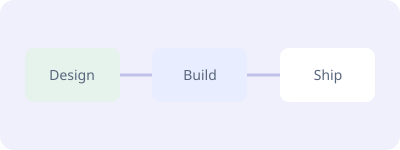

# 附件使用说明

此预览展示 **CommonMark** 正文、GFM 表格、任务列表和同目录关系的资源。

| 文件 | 用途 |
| --- | --- |
| `site/index.html` | 可交互的 HTML 页面 |
| `data/example.json` | JSON 配置 |

- [x] 查看文件树
- [ ] 上传一个新文件



[打开 HTML mockup](../site/index.html) · [外部文档](https://commonmark.org/)

```ts
const task = { status: 'in_progress' };
```

<script>document.body.innerHTML = 'Raw HTML is text';</script>
